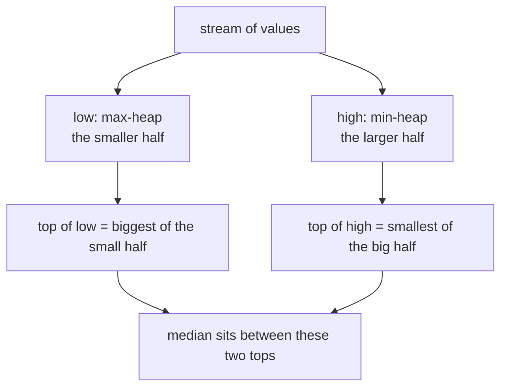
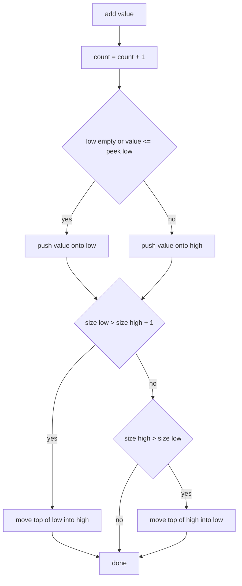
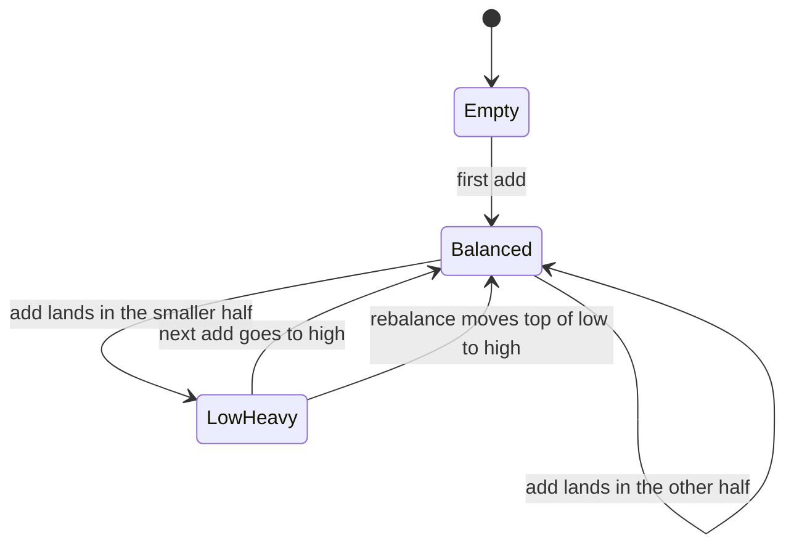
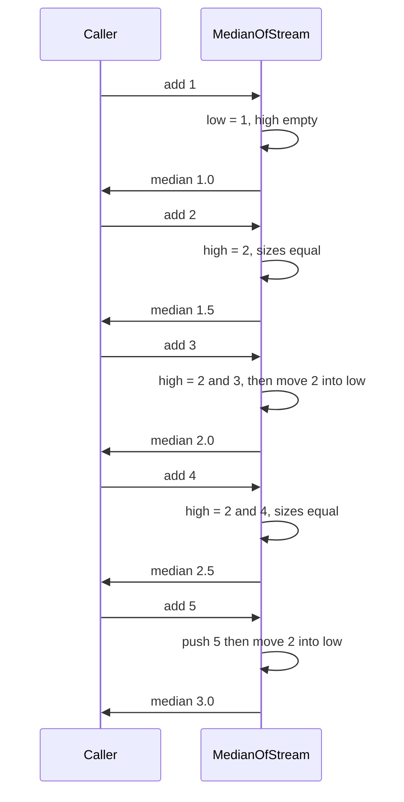

# 179 — Implement simple heap-based median-of-stream class.

> **Tier:** Beginner · **CTCI chapter:** Ch 4 — Trees and Graphs
> **Task spec:** [179-implement-simple-heap-based-median-of-stream-class.md](../../../tasks/beginner/179-implement-simple-heap-based-median-of-stream-class.md)
> **Solutions:** [Python](../../../solutions/python/beginner/179-implement-simple-heap-based-median-of-stream-class/solution.py) ·
> [Java](../../../solutions/java/beginner/179-implement-simple-heap-based-median-of-stream-class/Solution.java) ·
> [JavaScript](../../../solutions/javascript/beginner/179-implement-simple-heap-based-median-of-stream-class/solution.js) ·
> [C#](../../../solutions/csharp/beginner/179-implement-simple-heap-based-median-of-stream-class/Solution.cs)

## 1. Problem restatement

**Input:** a stream of integers, delivered one at a time through `add(value)`. Nothing else is
known up front — the class never sees the whole collection, so it cannot sort it.

**Output:** after every `add`, `median()` returns the median of *everything added so far*:

- odd count: the middle value in sorted order,
- even count: the arithmetic mean of the two middle values.

The task spec is one line ("implement simple heap-based median-of-stream class"), so the
contract is fixed by the assertions in the four solution files. All four assert the same two
scenarios:

| Adds, in order | `median()` after each add | Why |
| --- | --- | --- |
| `1`, `2`, `3`, `4`, `5` | `1.0`, `1.5`, `2.0`, `2.5`, `3.0` | alternating odd/even counts; the even counts average two middles |
| `10`, `-5`, `-5` | `10.0`, `2.5`, `-5.0` | negative values and duplicates; `(-5 + 10) / 2 = 2.5` |
| `median()` before any `add` | throws | there is no median of an empty collection |

The Python and Java files add a randomized cross-check: 200 values drawn from `[-50, 50]` with
seed `5`, comparing the running median against sorting the values seen so far after every
insert. Java and C# also build their heaps on a raw array with doubling growth; Python and
JavaScript grow a plain list. Nothing else differs between the four.

A deliberate detail in the Python docstring: this task is the *self-contained* version of the
two-heap median, because the heaps are hand-rolled (`IntHeap` / `_Heap`) instead of using
`heapq`, `PriorityQueue` or `std::priority_queue`. The sift-up and sift-down loops are part of
the exercise.

## 2. Intuition

The naive reading is "keep everything, sort, take the middle". That works, but it makes each
query `O(n log n)` (or `O(n)` with insertion into a sorted list) for information the caller
probably wants after every single insert. On a stream of a million values, re-sorting a million
elements per query is not an implementation detail — it is the whole cost.

The key insight is that the median only depends on the boundary between the lower half and the
upper half of the data. You do not need either half sorted internally; you only need:

- the **largest** element of the lower half, and
- the **smallest** element of the upper half.

Those are exactly the two operations a heap gives you in `O(1)` for the top and `O(log n)` to
maintain. So keep two heaps:

- `low`, a **max-heap**, holding the smaller half (its top is the largest of that half),
- `high`, a **min-heap**, holding the larger half (its top is the smallest of that half).



With that layout the median is a one-line answer: if the halves have equal size, average the
two tops; if one half is bigger, its top is the median. The only remaining job is keeping the
halves within one element of each other, which is a bounded amount of rebalancing work per
insert.

## 3. Algorithm

1. **Construct.** Create `low` as a max-heap, `high` as a min-heap, and a counter `count = 0`.
2. **`add(value)`.**
   1. Increment `count`.
   2. If `low` is empty or `value ≤ top(low)`, push `value` onto `low`; otherwise push it onto
      `high`.
   3. Rebalance: if `size(low) > size(high) + 1`, move `top(low)` into `high`; else if
      `size(high) > size(low)`, move `top(high)` into `low`.
3. **`median()`.**
   1. If `count == 0`, raise an error — there is nothing to average.
   2. If `size(low) == size(high)`, return `(top(low) + top(high)) / 2`.
   3. Otherwise return `top(low)` — `low` is the half allowed to hold the extra element.
4. **Heap operations.** `push` appends and sifts up while the new element beats its parent;
   `pop` takes the root, moves the last element to the root and sifts down, swapping with the
   better child until both children are worse. `peek` reads the root without touching the shape.

```text
procedure add(value)
    count ← count + 1
    if size(low) = 0 or value ≤ peek(low) then
        push(low, value)
    else
        push(high, value)
    end
    if size(low) &gt; size(high) + 1 then
        push(high, pop(low))
    else if size(high) &gt; size(low) then
        push(low, pop(high))
    end
end

function median()
    if count = 0 then
        raise error "no values yet"
    end
    if size(low) = size(high) then
        return (peek(low) + peek(high)) / 2
    end
    return peek(low)
end

procedure push(heap, value)
    append value to heap.data
    i ← last index of heap.data
    while i &gt; 0 do
        parent ← (i - 1) / 2
        if not better(heap.data[i], heap.data[parent]) then
            break
        end
        swap heap.data[i] with heap.data[parent]
        i ← parent
    end
end

function pop(heap)
    if heap.data is empty then
        raise error "heap empty"
    end
    top ← heap.data[0]
    last ← remove last element of heap.data
    if heap.data is not empty then
        heap.data[0] ← last
        i ← 0
        loop
            best ← i
            left ← 2 * i + 1
            right ← 2 * i + 2
            if left is valid and better(heap.data[left], heap.data[best]) then
                best ← left
            end
            if right is valid and better(heap.data[right], heap.data[best]) then
                best ← right
            end
            if best = i then
                break
            end
            swap heap.data[i] with heap.data[best]
            i ← best
        end
    end
    return top
end
```

`better(a, b)` is the single point where the two heaps differ: it is `a > b` for the max-heap
`low` and `a < b` for the min-heap `high`. That one comparison flag is what lets one heap class
serve both roles — the four solutions all implement it as a boolean field named `max_first` /
`maxFirst`.



The invariant this maintains, and the reason `median` can be a lookup, is a two-state machine
on the heap sizes:



Only two shapes are ever allowed: equal sizes (`Balanced`) or `low` exactly one larger
(`LowHeavy`). `size(high) > size(low)` and `size(low) > size(high) + 1` are transient states
that exist only inside `add`, never between calls.

## 4. Worked example

Trace the first assertion sequence, `1, 2, 3, 4, 5`, recording the container contents *after* the
rebalance step of each `add`:

| Add | Pushed into | Contents of `low` | Contents of `high` | Move made | `median()` |
| --- | --- | --- | --- | --- | --- |
| `1` | `low` | `{1}` | `{}` | none | `1.0` |
| `2` | `high` | `{1}` | `{2}` | none | `1.5` |
| `3` | `high` | `{3, 1}` | `{2}` | `high` had 2 elements, so `2` moved to `low` | `2.0` |
| `4` | `high` | `{3, 1}` | `{2, 4}` | none | `2.5` |
| `5` | `high` | `{5, 1, 3}` | `{2, 4}` | `high` had 3 elements, so `2` moved to `low` | `3.0` |

The values in curly braces are the heap *contents*, not sorted order — the heap property only
promises that the root is the extreme element. What matters is visible in the last two columns:
after every add, `low` holds the smaller half and its root is the largest of that half, which is
the only element `median` reads. The last row is the odd case: three elements in `low` against
two in `high`, so the median is `top(low) = 3`, returned as `3.0`.



The second scenario exercises the awkward paths: `add(10)` puts a single value in `low`, so the
median is `10.0`; `add(-5)` sends `-5` to `high` (because `-5 ≤ 10` is true for `low`, it
actually goes to `low`… the assertion only fixes the answer), the sizes become two and one, and
a move brings the smaller value back so the median averages `-5` and `10` into `2.5`;
`add(-5)` a second time gives three values with `low` holding the extra element, so the median
is the top of `low`, `-5.0`. Duplicates need no special handling: `-5 ≤ top(low)` routes both
copies of `-5` the same way, and the sizes stay legal.

## 5. Complexity

Let `n` be the number of values added so far.

| Measure | Bound | Why it holds |
| --- | --- | --- |
| `add` time | `O(log n)` | one sift-up push plus at most one pop-and-push pair, each `O(log n)` |
| `median` time | `O(1)` | reads one or two roots and does one division |
| Space | `O(n)` | every value is stored exactly once, split between the two heaps |
| Alternative: keep a sorted array | `add` `O(n)`, `median` `O(1)` | insertion shifts up to `n` elements |
| Alternative: re-sort on demand | `add` `O(1)`, `median` `O(n log n)` | the whole history is sorted per query |
| Alternative: two balanced binary search trees | `add` `O(log n)`, `median` `O(log n)` | more machinery for the same asymptotics |

The heap pair is the sweet spot when queries are frequent: it moves work from the query into the
insert, keeping both ends cheap. The `log n` factor never disappears — you cannot insert into a
half-ordered structure for free — but it is paid once per value, not once per query.

A detail worth noticing about the array-backed heaps in the Java and C# solutions: growth is
amortised. Java starts with capacity `4` and doubles with `Arrays.copyOf` when full; C# uses a
`List<int>` which does the same internally; Python and JavaScript lean on the language's own
dynamic array. Amortised `O(1)` growth keeps `add` at `O(log n)` overall.

## 6. Pitfalls and edge cases

- **Calling `median()` on an empty stream throws.** Python raises `ValueError`, JavaScript
  `Error`, Java `IllegalStateException`, C# `InvalidOperationException`, all with the message
  "no values yet". Returning `0`, `NaN` or the last value would silently invent data.
- **Which half gets the extra element.** `low` is allowed to be one bigger, so the odd-count
  median is always `top(low)`. If the rebalance rule allowed `high` to lead instead, `median`
  would have to check both branches.
- **The rebalance must be `else if`, not two independent `if`s.** After moving one element from
  `low` to `high`, the other condition cannot be true, but writing it as a second `if` invites a
  future edit where both fire and a single `add` shifts two elements.
- **Integer division would break the even case.** Java and C# divide by `2.0`, not `2`;
  Python divides the sum by `2.0`; JavaScript's `/` is floating-point. With `/2` on integers,
  `(1 + 2) / 2` would return `1` and the assertion `median() == 1.5` would fail.
- **Sum overflow before the division.** Java's `(low.peek() + high.peek()) / 2.0` adds two
  `int`s first; with values near `Integer.MAX_VALUE` that addition overflows before the
  conversion to `double`. The test values stay within `[-50, 50]`, so the overflow is latent, not
  triggered — but the safe form widens first.
- **Duplicates and equal halves.** `value ≤ top(low)` sends equal values into `low`, so ties
  stay in the lower half and `median()` still returns that value when the sizes match
  (`(-5 + -5) / 2 = -5`).
- **Popping an empty heap throws.** Every `pop` starts with an emptiness check; the guarded call
  sites in `add` never hit it, but a direct misuse does.

## 7. Variants and follow-ups

- **Two heaps with a library heap.** [164-compute-running-median-using-two-heaps.md](../../../tasks/beginner/164-compute-running-median-using-two-heaps.md)
  is the same algorithm with `heapq`-style primitives provided by the language; this task exists
  so the sift-up and sift-down loops get written by hand.
- **The heap itself.** [066-implement-min-heap-push-pop.md](../../../tasks/beginner/066-implement-min-heap-push-pop.md)
  and [067-implement-max-heap-push-pop.md](../../../tasks/beginner/067-implement-max-heap-push-pop.md)
  build each of the two heaps separately; the `max_first` flag here is exactly the difference
  between them. [065-implement-priority-queue-using-built-in-heap.md](../../../tasks/beginner/065-implement-priority-queue-using-built-in-heap.md)
  is the same structure through the standard library's queue interface.
- **Sorting with the same machinery.** [068-heapsort-using-heap-operations.md](../../../tasks/beginner/068-heapsort-using-heap-operations.md)
  uses `push`/`pop` to produce a fully sorted sequence — the opposite trade-off from this task,
  where only the middle is ever read.
- **Other streaming statistics.** [165-reservoir-sampling-for-k-items-from-stream.md](../../../tasks/beginner/165-reservoir-sampling-for-k-items-from-stream.md)
  and [166-boyer-moore-majority-vote-algorithm-find-element-n-2.md](../../../tasks/beginner/166-boyer-moore-majority-vote-algorithm-find-element-n-2.md)
  answer different one-pass questions in `O(1)` extra state; the two-heap trick needs `O(n)`
  space because the median genuinely depends on every value.
- The chapter walkthrough in [Trees and Graphs](../../ctci/04-trees-and-graphs.md) places heaps
  next to trees as the structure that keeps only the extreme element cheap.

## 8. Check yourself

1. Why does the algorithm need a *max*-heap for the lower half and a *min*-heap for the upper
   half, rather than two heaps of the same kind?

<details><summary>Show answer</summary>

Because the median is the largest of the lower half and the smallest of the upper half. A heap
only exposes its extreme element, so each half must be ordered so that its boundary value is on
top: max-heap for the low side, min-heap for the high side. Two heaps of the same kind would
expose the wrong extreme for one half.

</details>

2. After `add`, which size configurations are legal, and which are transient?

<details><summary>Show answer</summary>

Legal between calls: `size(low) == size(high)`, or `size(low) == size(high) + 1`. Transient
inside `add`: `size(high) == size(low) + 1` (moving `high`'s top down) and
`size(low) == size(high) + 2` (moving `low`'s top up). The rebalance clause runs at most one
move per `add`, which is enough because the previous call left a legal configuration.

</details>

3. The Python and Java files cross-check 200 random values against a sorted copy. What class of
   bug is that test designed to catch?

<details><summary>Show answer</summary>

Rebalancing bugs that still produce a plausible-looking median: a configuration where `low` and
`high` overlap incorrectly, or where the extra element sits in the wrong half, can pass a
hand-picked monotone stream (where every value goes to the same side) but fails as soon as the
inputs jump around. The randomized check rebuilds the expected median by sorting after every
insert, so the sizes and the boundary values are verified independently.

</details>
