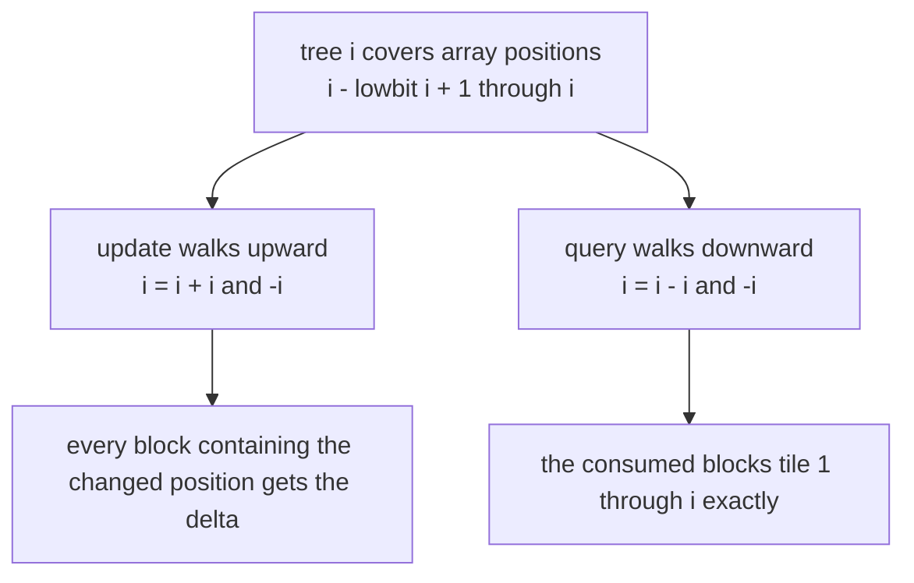
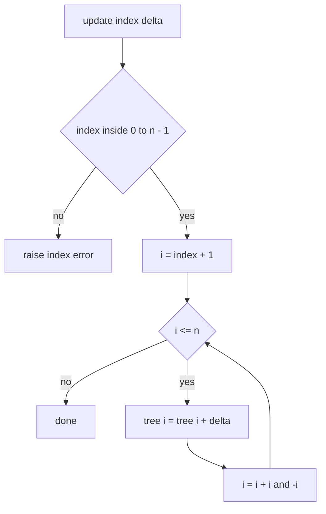
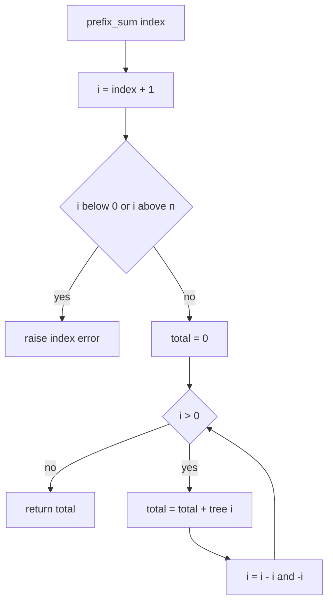
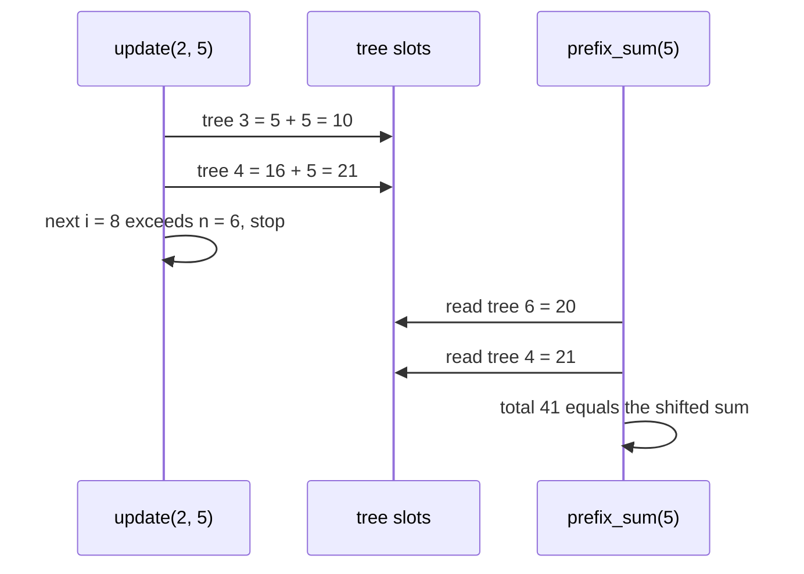

# 180 — Implement binary indexed tree (Fenwick) basic: point update, prefix sum.

> **Tier:** Beginner · **CTCI chapter:** Ch 4 — Trees and Graphs
> **Task spec:** [180-implement-binary-indexed-tree-fenwick-basic-point-update-prefix.md](../../../tasks/beginner/180-implement-binary-indexed-tree-fenwick-basic-point-update-prefix.md)
> **Solutions:** [Python](../../../solutions/python/beginner/180-implement-binary-indexed-tree-fenwick-basic-point-update-prefix/solution.py) ·
> [Java](../../../solutions/java/beginner/180-implement-binary-indexed-tree-fenwick-basic-point-update-prefix/Solution.java) ·
> [JavaScript](../../../solutions/javascript/beginner/180-implement-binary-indexed-tree-fenwick-basic-point-update-prefix/solution.js) ·
> [C#](../../../solutions/csharp/beginner/180-implement-binary-indexed-tree-fenwick-basic-point-update-prefix/Solution.cs)

## 1. Problem restatement

**Input:** an array `values` of `n` integers used to build the structure, followed by two kinds of
call:

- `update(index, delta)` — add `delta` to the element at 0-based `index`,
- `prefix_sum(index)` — the sum of `values[0..index]` inclusive, where `index = -1` means the
  empty sum.

**Output:** the current prefix sums. The structure is *incremental*: `update` changes the
underlying array by a delta, and every later `prefix_sum` must reflect it. A `range_sum(lo, hi)`
helper is included as `prefix_sum(hi) - prefix_sum(lo - 1)`.

The task spec is one line, so the four solution files define the contract. They all assert the
same sequence:

| Call on `values = [1, 3, 5, 7, 9, 11]` | Result | Why |
| --- | --- | --- |
| `prefix_sum(0)` | `1` | just `values[0]` |
| `prefix_sum(5)` | `36` | the whole array sums to `36` |
| `range_sum(1, 3)` | `15` | `3 + 5 + 7` |
| `range_sum(0, 0)` | `1` | a single-element range |
| `range_sum(3, 2)` | `0` | an inverted range is empty, not an error |
| `update(2, 5)` then `prefix_sum(5)` | `41` | `5` becomes `10`, so the total grows by `5` |
| `update(0, -1)` then `prefix_sum(0)` | `0` | `1` becomes `0` |

Python and Java add a randomized cross-check: 50 rounds with seed `9`, each picking a random
index and a delta in `[-5, 5]`, then comparing every prefix and one random range against a plain
array that is updated in parallel. Python additionally builds `Fenwick([])` and asserts
`prefix_sum(-1) == 0` — the empty structure's empty prefix.

Note the build strategy shared by all four files: the constructor allocates `n + 1` zeroed slots
and then calls the *point-update* primitive once per element. That is a valid `O(n log n)` build;
the linear-time build is discussed in section 7.

## 2. Intuition

The two problems that bracket this one are both easy in isolation and awkward together:

- keeping a plain array makes `update` `O(1)` but `prefix_sum` `O(n)`,
- keeping a prefix-sum array makes `prefix_sum` `O(1)` but `update` `O(n)`, because every suffix
  entry has to be repaired.

A binary indexed tree (Fenwick tree) walks a middle line by storing **responsibility ranges**
instead of single values: `tree[i]` holds the sum of the block of array positions ending at
`i` whose length is `lowbit(i) = i & -i`. For `i = 4` the block is `1..4`; for `i = 6` it is
`5..6`; for `i = 1` it is just `1`.

Now both operations are walks over those blocks:

- to **update** position `i` (1-based), touch every block that contains it: `i, i + lowbit(i), ...`,
- to **prefix-sum** up to `i`, consume consecutive blocks backwards: `i, i - lowbit(i), ...`.



The key insight is the arithmetic identity that makes the two walks meet: subtracting the lowest
set bit can only remove block lengths, and adding it can only jump to the next block that
contains the current one. Because both walks stop at `0` or at `n + 1`, each performs
`O(log n)` steps — the number of set-bit boundaries in the index.

That layout is deliberately smaller than a segment tree over the same data: `n` slots instead of
`2n`, with no recursion and no explicit tree nodes.

## 3. Algorithm

1. **Construct.** Allocate `tree` with `n + 1` zeros, all indices 1-based. For each array
   position `i` (0-based), call the internal update with `i + 1` and its value.
2. **`update(index, delta)`.** Reject `index` outside `[0, n)`. Then walk the 1-based index:
   while `i ≤ n`, add `delta` to `tree[i]` and set `i ← i + (i & -i)`.
3. **`prefix_sum(index)`.** Convert to `i = index + 1` and reject `i < 0` or `i > n`. Then while
   `i > 0`, add `tree[i]` to the total and set `i ← i - (i & -i)`. Return the total.
4. **`range_sum(lo, hi)`.** If `lo > hi` return `0`; otherwise return
   `prefix_sum(hi) - prefix_sum(lo - 1)`.

```text
procedure update_index(i, delta)
    while i ≤ n do
        tree[i] ← tree[i] + delta
        i ← i + (i and -i)
    end
end

procedure update(index, delta)
    if index &lt; 0 or index ≥ n then
        raise index error
    end
    update_index(index + 1, delta)
end

function prefix_sum(index)
    i ← index + 1
    if i &lt; 0 or i &gt; n then
        raise index error
    end
    total ← 0
    while i &gt; 0 do
        total ← total + tree[i]
        i ← i - (i and -i)
    end
    return total
end

function range_sum(lo, hi)
    if lo &gt; hi then
        return 0
    end
    return prefix_sum(hi) - prefix_sum(lo - 1)
end
```

Both walks are the same statement read in opposite directions: one adds the low bit, the other
subtracts it. The guard `i ≤ n` stops the update walk as soon as it would leave the tree, which
is why no bounds arithmetic is needed beyond that.



The mirrored flow for queries — note that `index = -1` is a legal input, because it produces
`i = 0` and the loop body never runs, which is exactly the empty prefix:



## 4. Worked example

Build the tree for `values = [1, 3, 5, 7, 9, 11]`, so `n = 6` and the 1-based values are
`v1 = 1, …, v6 = 11`. Because each constructor call is a point update of a single position, the
final contents are exactly the responsibility blocks:

| 1-based `i` | `lowbit(i)` | Block covered | `tree[i]` |
| --- | --- | --- | --- |
| 1 | 1 | `1..1` | `1` |
| 2 | 2 | `1..2` | `1 + 3 = 4` |
| 3 | 1 | `3..3` | `5` |
| 4 | 4 | `1..4` | `1 + 3 + 5 + 7 = 16` |
| 5 | 1 | `5..5` | `9` |
| 6 | 2 | `5..6` | `9 + 11 = 20` |

`prefix_sum(5)` converts to `i = 6` and walks `6 → 4 → 0`, adding `tree[6] = 20` and
`tree[4] = 16` for a total of `36` — the two blocks `5..6` and `1..4` tile `1..6` exactly.

| Step | `i` | `tree[i]` | `total` after |
| --- | --- | --- | --- |
| start | 6 | — | 0 |
| 1 | 6 | 20 | 20 |
| 2 | 4 | 16 | 36 |
| stop | 0 | — | 36 |

`range_sum(1, 3)` is `prefix_sum(3) - prefix_sum(0) = 16 - 1 = 15`. Note that `prefix_sum(3)`
touches only `tree[4]`: the block `1..4` is the smallest block *ending* at the boundary `4`, so
the walk skips straight past positions 1–3 in one read.

Now `update(2, 5)`, which changes `v3` from `5` to `10`. The update starts at 1-based `3` and
climbs while the index stays `≤ 6`:

| Step | `i` | `lowbit(i)` | `tree[i]` before | `tree[i]` after | Why this block cares |
| --- | --- | --- | --- | --- | --- |
| 1 | 3 | 1 | 5 | 10 | block `3..3` contains position 3 |
| 2 | 4 | 4 | 16 | 21 | block `1..4` contains position 3 |
| stop | 8 | — | — | — | `8 > n = 6`, the walk ends |

`prefix_sum(5)` afterwards is `tree[6] + tree[4] = 20 + 21 = 41`, matching the assertion. Two
slot writes for one update and two slot reads for a full prefix — that is the trade the
structure makes.



The randomized cross-check in Python and Java extends this to 50 rounds, recomputing every
prefix from a plain array after each random `update`, so a single wrong block assignment shows up
immediately as a mismatch at some position.

## 5. Complexity

Let `n` be the size of the underlying array.

| Operation | Time | Space | Why it holds |
| --- | --- | --- | --- |
| Build | `O(n log n)` | `O(n)` | one point update per element, each `O(log n)` |
| `update` | `O(log n)` | `O(1)` extra | the walk adds the low bit, so the index at least doubles in value per step |
| `prefix_sum` | `O(log n)` | `O(1)` extra | the walk removes the lowest set bit, so at most `log n` bits are cleared |
| `range_sum` | `O(log n)` | `O(1)` extra | two prefix queries and one subtraction |
| Structure storage | — | `O(n)` | one slot per position, plus the unused `tree[0]` |
| Plain array alternative | `update` `O(1)`, `prefix_sum` `O(n)` | `O(n)` | every query rescans the prefix |
| Prefix-sum array alternative | `update` `O(n)`, `prefix_sum` `O(1)` | `O(n)` | every update repairs the whole suffix |

The step counts come straight from binary: the number of iterations of the update walk is bounded
by the number of times you can carry into a higher bit, and the query walk is bounded by the
number of set bits, which is at most `log2(n) + 1`. A segment tree achieves the same bounds with
about twice the memory and a recursive or loop-heavy query; the Fenwick tree's advantage is
constant factors and code size, its disadvantage is that it can only answer invertible
aggregations — sums, XORs — because `range_sum` recovers a range by *subtracting* two prefixes.

## 6. Pitfalls and edge cases

- **Two index systems at once.** Everything internal is 1-based, everything external is 0-based,
  and the conversion is `+1` on the way in. Forgetting it in one place produces answers that are
  off by exactly one position of data — usually detected only by the randomized cross-check.
- **`prefix_sum(-1)` is legal, `prefix_sum(-2)` is not.** The Python check is on `i = index + 1`,
  so `index = -1` gives `i = 0` (empty sum) while `index = -2` gives `i = -1` and raises. The
  empty structure `Fenwick([])` accepts only `prefix_sum(-1)`.
- **`tree[i]` is a block sum, not `values[i - 1]`.** Reading it as the value at a position is the
  most common misinterpretation of the structure.
- **`update` takes a delta.** There is no "assign" operation: setting a position to a new value
  means calling `update(index, new - old)`, which requires the caller to know the old value.
- **`range_sum(lo, hi)` with `lo > hi` returns `0`** instead of raising, while `prefix_sum` and
  `update` raise on out-of-range indices. That asymmetry is deliberate in all four solutions
  (the inverted range is a legitimate empty query), but it means the two helpers have different
  error contracts.
- **Overflow.** Java and C# store the tree as `long[]` so that `n` values near `Integer.MAX_VALUE`
  do not overflow the partial sums; Python has arbitrary precision; JavaScript numbers lose
  integer exactness past `2^53`. The tests keep values small, but the widening is the reason the
  Java and C# trees are not `int[]`.
- **`update(index, 0)` is a no-op that still walks.** A zero delta touches `O(log n)` slots to
  add nothing; a caller with bulk zero changes should filter them out.
- **`n = 0`.** The tree is a single unused slot. Every `update` and every `prefix_sum(index)`
  except `prefix_sum(-1)` throws because no valid 0-based index exists.
- **The low-bit trick needs two's complement.** `i & -i` works in all four languages because they
  all represent signed integers in two's complement; it would break under an arbitrary-precision
  representation that lacks a bitwise negation.
- **No persistence, no undo.** The tree mutates in place; there is no way to ask it for the value
  it had before the last update.

## 7. Variants and follow-ups

- **The dual problem.** [181-range-update-point-query-with-fenwick-tree.md](../../../tasks/beginner/181-range-update-point-query-with-fenwick-tree.md)
  swaps the roles: it stores a *difference* array in the same tree so that range updates cost two
  point updates and point queries become prefix sums. Comparing the two files is the fastest way
  to see what the Fenwick walk really does.
- **Segment trees.** [182-implement-segment-tree-for-range-sum-build-query-update.md](../../../tasks/beginner/182-implement-segment-tree-for-range-sum-build-query-update.md)
  answers the same range-sum queries with an explicit tree, which costs twice the memory but
  generalises to non-invertible aggregations such as minimum and maximum;
  [183-implement-iterative-segment-tree.md](../../../tasks/beginner/183-implement-iterative-segment-tree.md)
  shows the same structure flattened into an array with the classic `n + i` indexing.
- **Linear-time build.** Allocating the tree and then doing a second pass —
  `tree[i] += tree[i - lowbit(i)]` for `i = 1..n` — builds in `O(n)`. The solutions here use the
  simpler `O(n log n)` build because it reuses the update primitive and the tests are small.
- **Beyond sums.** The prefix-sum machinery with a Fenwick tree also computes frequency tables and
  order statistics when the values are counts; the requirement is only that the operation has an
  inverse.
- The chapter walkthrough in [Trees and Graphs](../../ctci/04-trees-and-graphs.md) puts the
  Fenwick tree next to the heap as a structure stored in a flat array.

## 8. Check yourself

1. Why does `update` walk upward with `i += i & -i` while `prefix_sum` walks downward with
   `i -= i & -i`?

<details><summary>Show answer</summary>

A position change must be reported to every block that contains it, and the containing blocks are
exactly those reachable by adding the low bit. A prefix query must consume disjoint blocks that
tile `1..i`, which is exactly what subtracting the low bit produces (for `i = 6` it consumes
`5..6` and then `1..4`). The two walks are inverses of each other.

</details>

2. What does `prefix_sum(-1)` return, and why is that not a bug?

<details><summary>Show answer</summary>

`0`. The conversion gives `i = 0`, the loop never runs, and the total stays at the initial zero.
It is the empty prefix, and it is exactly what `range_sum(0, hi)` needs when it calls
`prefix_sum(lo - 1)`.

</details>

3. For `n = 6`, which slots does `update(5, delta)` touch, and which does `update(0, delta)`
   touch?

<details><summary>Show answer</summary>

`update(5, delta)` operates on 1-based `6`, then `6 + 2 = 8 > 6`, so only `tree[6]` changes.
`update(0, delta)` starts at `1` and visits `1, 2, 4, 8 — stop`, so `tree[1]`, `tree[2]` and
`tree[4]` change. The first position in the array sits in three blocks, the last one in a single
block: that asymmetry is the structure working as intended.

</details>

4. Can this structure report the *minimum* of a range?

<details><summary>Show answer</summary>

Not with this code. `range_sum` combines two prefix results by subtraction, which only works for
invertible operations. A minimum has no inverse, so you would need a segment tree (or a Fenwick
tree with a different, more delicate formulation) to answer range-minimum queries.

</details>

5. Why do the Java and C# solutions declare the tree as `long[]` when the tests only use small
   numbers?

<details><summary>Show answer</summary>

Because `tree[i]` is the sum of up to `i` array values, so its magnitude can exceed the element
range: adding `n` values near `Integer.MAX_VALUE` overflows a 32-bit partial sum. `long` is wide
enough for realistic `n`, and the cost is memory, not time.

</details>
