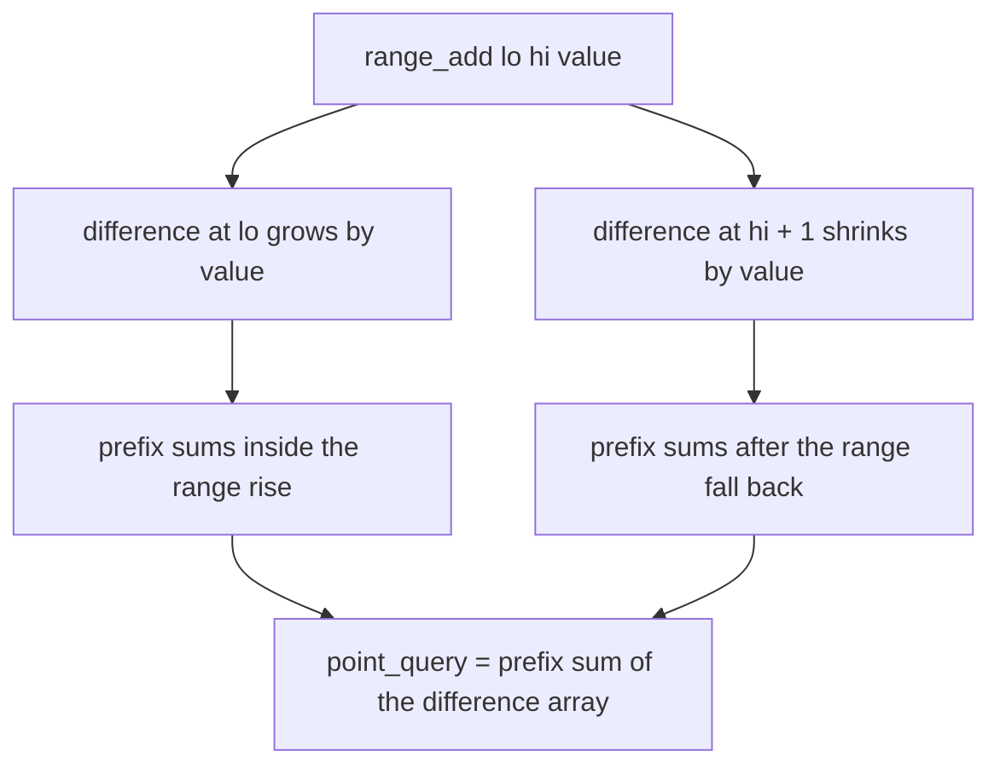
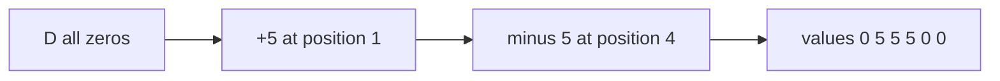
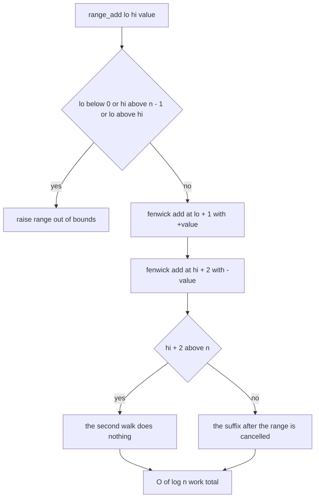
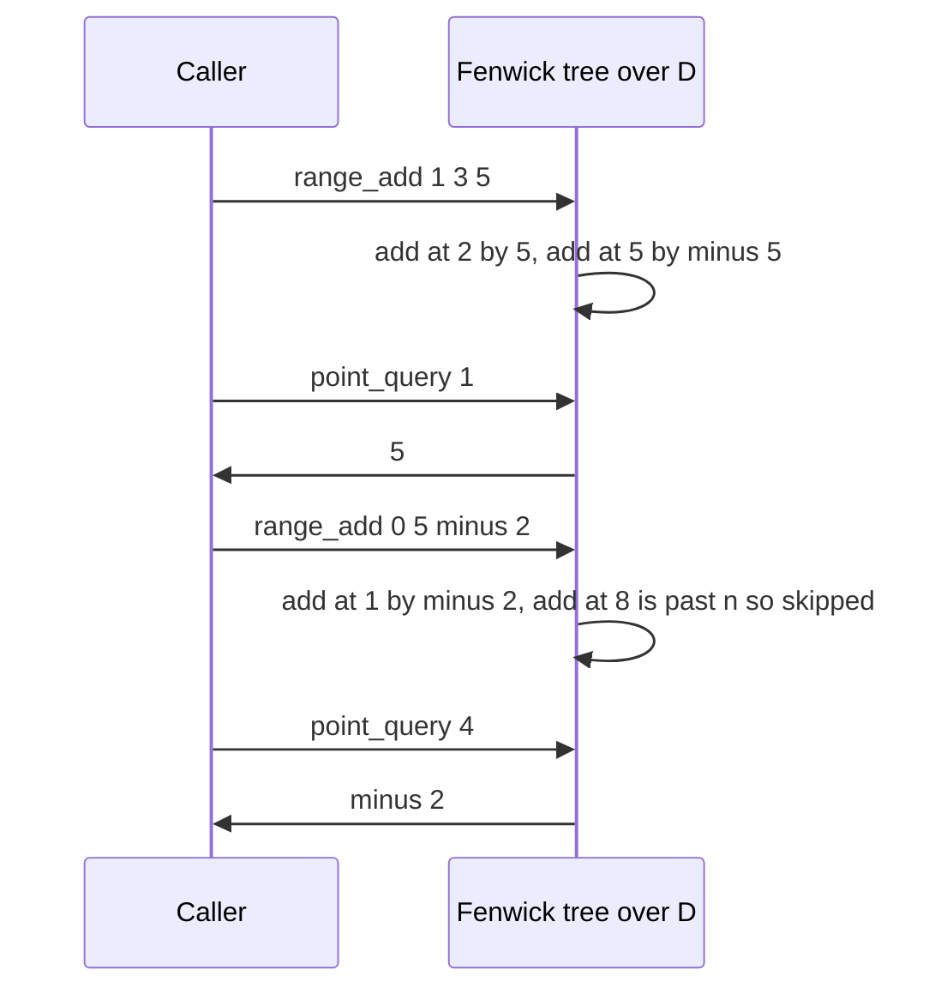

# 181 — Range update, point query with Fenwick tree.

> **Tier:** Beginner · **CTCI chapter:** Ch 4 — Trees and Graphs
> **Task spec:** [181-range-update-point-query-with-fenwick-tree.md](../../../tasks/beginner/181-range-update-point-query-with-fenwick-tree.md)
> **Solutions:** [Python](../../../solutions/python/beginner/181-range-update-point-query-with-fenwick-tree/solution.py) ·
> [Java](../../../solutions/java/beginner/181-range-update-point-query-with-fenwick-tree/Solution.java) ·
> [JavaScript](../../../solutions/javascript/beginner/181-range-update-point-query-with-fenwick-tree/solution.js) ·
> [C#](../../../solutions/csharp/beginner/181-range-update-point-query-with-fenwick-tree/Solution.cs)

## 1. Problem restatement

**Input:** a size `n` known at construction (all positions start at `0`), followed by two kinds of
call:

- `range_add(lo, hi, value)` — add `value` to every position in the inclusive 0-based range
  `[lo, hi]`,
- `point_query(index)` — the current value at one position.

**Output:** the value at a position, after any number of range additions. The structure never
stores the array itself — only a Fenwick tree over its difference array.

The task spec is one line ("range update, point query with Fenwick tree"), so the four solutions
define the contract. They all run the same scenario on `n = 6`:

| Call | Position values afterwards | Why |
| --- | --- | --- |
| `range_add(1, 3, 5)` | `[0, 5, 5, 5, 0, 0]` | four positions shifted, the ends untouched |
| `range_add(0, 5, -2)` | `[-2, 3, 3, 3, -2, -2]` | a whole-array shift, including negatives |
| `range_add(2, 2, 10)` | `[-2, 3, 13, 3, -2, -2]` | a single-position range |
| `range_add(5, 5, 7)` then `point_query(5)` | `5` | the range ends exactly at `n - 1` |
| `range_add(0, 0, -3)` then `point_query(0)` | `-5` | the range starts at position `0` |

Rejected inputs, asserted in every file: `range_add(-1, 2, 1)`, `range_add(0, 6, 1)` and
`range_add(3, 2, 1)` all throw, as do `point_query(-1)`, `point_query(6)`, and `point_query(0)`
on `RangeUpdateFenwick(0)`.

Python and Java then run a randomized cross-check: 80 rounds with seed `11` on `n = 12`, each
picking a random range and a value in `[-9, 9]`, applying the same change to a plain array by
brute force, and comparing *every* position. The JavaScript version does the same with a small
hand-written LCG (`state * 48271 mod 2147483647`) because the language has no seeded RNG.

## 2. Intuition

The direct approach is to loop over the range and add the value to each cell. On a range of
length `k` that is `O(k)` per update, which is fine until the ranges get long — a whole-array
shift costs `n` writes every time. Point queries would be `O(1)`, so the naive structure is the
mirror image of task 180's naive approach.

The key insight is to stop storing the values and store **differences** instead. Define

```text
D[0] = values[0]
D[i] = values[i] - values[i - 1]   for i &gt; 0
```

Then the value at any position is the prefix sum of `D` up to that position, and — this is the
useful part — adding `value` to the whole range `[lo, hi]` changes only **two** entries of `D`:

- `D[lo] += value` (position `lo` starts being `value` bigger than its predecessor),
- `D[hi + 1] -= value` (position `hi + 1` goes back to its old difference).

Every position strictly inside the range keeps the same difference, so nothing else needs
touching. Range update becomes "two point writes" and point query becomes "one prefix sum" —
both exactly the operations a Fenwick tree already provides from task 180.



Two boundary writes buy a change over the whole range because the prefix-sum operation
*accumulates* them: every position from `lo` onward sees the `+value`, until the `-value` at
`hi + 1` cancels it for everything after the range.



Note what happens when `hi = n - 1`: the second write lands at index `hi + 2` in 1-based terms,
which is past the end of the tree. The walk condition `i ≤ n` fails immediately, so the write is
a **silent no-op** — there is no suffix to cancel, and no error to report.

## 3. Algorithm

1. **Construct.** Remember `n`, allocate a Fenwick tree of `n + 1` zero slots (1-based).
2. **`range_add(lo, hi, value)`.** Reject `lo < 0`, `hi ≥ n` or `lo > hi`. Then apply two point
   updates to the underlying Fenwick tree: `+value` at 1-based `lo + 1`, and `-value` at 1-based
   `hi + 2`.
3. **`point_query(index)`.** Reject `index` outside `[0, n)`. Walk the prefix sum from 1-based
   `index + 1` down to `0`, accumulating `tree[i]` while stepping `i ← i - (i & -i)`.
4. **Snapshot (test helper).** Query every position in turn, which is how the files compare the
   structure against a plain array.

```text
procedure range_add(lo, hi, value)
    if lo &lt; 0 or hi ≥ n or lo &gt; hi then
        raise range out of bounds
    end
    fenwick_add(lo + 1, value)
    fenwick_add(hi + 2, -value)
end

function point_query(index)
    if index &lt; 0 or index ≥ n then
        raise index out of range
    end
    total ← 0
    i ← index + 1
    while i &gt; 0 do
        total ← total + tree[i]
        i ← i - (i and -i)
    end
    return total
end

procedure fenwick_add(i, delta)
    while i ≤ n do
        tree[i] ← tree[i] + delta
        i ← i + (i and -i)
    end
end
```

`fenwick_add` is exactly the point-update primitive from
[180-implement-binary-indexed-tree-fenwick-basic-point-update-prefix.md](../../../tasks/beginner/180-implement-binary-indexed-tree-fenwick-basic-point-update-prefix.md),
and `point_query` is exactly its prefix-sum primitive. The trick of this task is entirely in how
`range_add` *uses* them: two calls instead of a loop over the range.



The pair of boundary writes is the whole update: the first opens the range at `lo`, the second
closes it one position past `hi`, and every position in between inherits the change through the
prefix sum.

## 4. Worked example

Trace the assertion scenario on `n = 6`. The tree holds the difference array; below, `D` is shown
in 0-based position terms for readability, while the code addresses it 1-based internally.

Initial state: `values = [0,0,0,0,0,0]`, `D = [0,0,0,0,0,0]`.

**Step 1 — `range_add(1, 3, 5)`.** Writes `+5` at `D[1]` and `-5` at `D[4]`.

| Position | 0 | 1 | 2 | 3 | 4 | 5 |
| --- | --- | --- | --- | --- | --- | --- |
| `D` | 0 | 5 | 0 | 0 | -5 | 0 |
| prefix sum = value | 0 | 5 | 5 | 5 | 0 | 0 |

This matches the first assertion `[0, 5, 5, 5, 0, 0]`. Position `4` is *outside* the range and
the cancellation is already in place — that is the second write doing its job.

**Step 2 — `range_add(0, 5, -2)`.** Writes `-2` at `D[0]` and `-2` at 1-based `8`, which is
beyond `n = 6`, so the second write is a no-op.

| Position | 0 | 1 | 2 | 3 | 4 | 5 |
| --- | --- | --- | --- | --- | --- | --- |
| `D` | -2 | 5 | 0 | 0 | -5 | 0 |
| value | -2 | 3 | 3 | 3 | -2 | -2 |

Now every position carries the extra `-2`, because the opening write at `D[0]` is never cancelled
— exactly what "the whole array shifted" means.

**Step 3 — `range_add(2, 2, 10)`.** Writes `+10` at `D[2]` and `-10` at `D[3]`.

| Position | 0 | 1 | 2 | 3 | 4 | 5 |
| --- | --- | --- | --- | --- | --- | --- |
| `D` | -2 | 5 | 10 | -10 | -5 | 0 |
| value | -2 | 3 | 13 | 3 | -2 | -2 |

A single-position range is still two writes: the pair lands adjacent, so only one position sees
the bump.

**Step 4 — `range_add(5, 5, 7)`.** Writes `+7` at `D[5]` and `-7` at 1-based `7 > n`, another
no-op. `value[5]` becomes `-2 + 7 = 5`, which is what the JS and Java files assert.

**Step 5 — `range_add(0, 0, -3)`.** Writes `-3` at `D[0]` and `+3` at `D[1]`, so
`value[0] = -2 - 3 = -5` and `value[1]` is untouched at `3`.



Every `point_query` in the trace walks the tree in `O(log n)` steps rather than reading a stored
array, which is the price for making the updates cheap.

## 5. Complexity

Let `n` be the number of positions and `k = hi - lo + 1` the length of a range.

| Operation | Time | Space | Why it holds |
| --- | --- | --- | --- |
| `range_add` | `O(log n)` | `O(1)` extra | two Fenwick point updates, each `O(log n)`, independent of `k` |
| `point_query` | `O(log n)` | `O(1)` extra | one prefix-sum walk, at most `log n` set bits cleared |
| Construct | `O(n)` | — | allocate `n + 1` zero slots |
| Naive range update + `O(1)` query | `O(k)` update, `O(1)` query | `O(n)` | the loop over the range |
| Plain difference array | `O(1)` update, `O(n)` query | `O(n)` | query recomputes the whole prefix |

The last two rows show why the Fenwick tree is the right container for the difference array: a
plain `D` array already gives `O(1)` range updates (two writes), but the prefix sum needed for a
point query costs `O(n)`. Task 180's tree makes that prefix sum `O(log n)` while keeping the
point update `O(log n)`, so both operations land in the middle at `O(log n)` — which beats both
extremes for mixed workloads.

Note the asymmetry with task 180: there, the tree stored the values and the *update* was the point
operation; here, the tree stores differences and the *query* is the point operation. It is the
same class with the roles of the operations exchanged, which is why the Python docstring calls
this the dual of task 180.

## 6. Pitfalls and edge cases

- **The tree does not hold the values.** `tree[i]` is a partial sum of the difference array;
  reading it as a position's value is wrong. `point_query` is the only way to get a value.
- **`hi + 2` may be past the end.** For `hi = n - 1` the cancelling write is a no-op because the
  walk starts at `n + 1 > n`. That is correct, not an oversight — but a reader who expects an
  error on "index out of range" needs to see the comment in the source.
- **`lo > hi` is rejected**, unlike the `lo > hi → 0` convention used by `range_sum` helpers in
  tasks 180 and 182. Here an inverted range is treated as a caller bug rather than an empty
  query.
- **`point_query(-1)` is rejected.** Task 180's `prefix_sum(-1)` is legal (it is the empty
  prefix); this class has no such concept, because positions are 0-based data, not boundaries.
- **`n = 0`.** The tree has one unused slot; `point_query(0)` and any `range_add` throw, because
  no position exists. All four files assert the query case.
- **No way to read a range sum.** The dual structure answers only point queries. Getting range
  sums as well requires a second tree (see section 7), because the Fenwick prefix sum returns a
  single position's value here.
- **Values accumulate silently.** After many overlapping `range_add` calls a position can hold a
  value far outside the range of a single update; the tree entries are sums of many deltas, so
  Java and C# use `long[]` and Python relies on arbitrary precision. JavaScript numbers stay exact
  only below `2^53`.
- **The seed story in the JS test.** The cross-check uses a hand-rolled LCG because the standard
  library has no seeded generator; the sequence is deterministic but the implementation is part
  of the test, not of the data structure.
- **Both writes must happen, even for a single position.** Skipping the cancelling write for
  `lo == hi` would leave the bump propagating to every later position.

## 7. Variants and follow-ups

- **The dual structure.** [180-implement-binary-indexed-tree-fenwick-basic-point-update-prefix.md](../../../tasks/beginner/180-implement-binary-indexed-tree-fenwick-basic-point-update-prefix.md)
  is the same tree with point updates and prefix queries. Reading the two files side by side is
  the clearest way to see that a Fenwick tree is a tool, not a data structure with a fixed job.
- **Range update and range query together.** Two trees (one over `D`, one over `i · D[i]`) give
  both operations in `O(log n)`; the second tree corrects for the accumulated slope.
- **Segment trees.** [182-implement-segment-tree-for-range-sum-build-query-update.md](../../../tasks/beginner/182-implement-segment-tree-for-range-sum-build-query-update.md)
  supports range queries with an explicit tree and lazy propagation;
  [183-implement-iterative-segment-tree.md](../../../tasks/beginner/183-implement-iterative-segment-tree.md)
  builds the same structure bottom-up without recursion.
- **Offline difference arrays.** When every range update is known before the queries, the
  difference array alone suffices: apply all updates to `D`, then sweep once computing prefix
  sums. That is this task's invariant with the tree replaced by a single pass.
- The chapter walkthrough in [Trees and Graphs](../../ctci/04-trees-and-graphs.md) covers the
  array-encoded tree family that both Fenwick tasks belong to.

## 8. Check yourself

1. Why does a range update need only two difference-array writes?

<details><summary>Show answer</summary>

Because the value at a position is the prefix sum of `D`, and adding a constant to a contiguous
range changes only how the sum *starts* and how it *ends*. `D[lo] += value` makes every prefix
from `lo` onward larger; `D[hi + 1] -= value` restores the level for everything after `hi`. The
interior differences are unchanged, so no interior write is needed.

</details>

2. What happens to the second write when `hi = n - 1`?

<details><summary>Show answer</summary>

It addresses 1-based `n + 1`, which fails the `i ≤ n` loop condition immediately, so it does
nothing. The range reaches the end of the array, so there is no suffix to cancel — the no-op is
the correct behaviour, and the step-2 trace in section 4 depends on it.

</details>

3. Both this task and task 180 use a Fenwick tree with `O(log n)` operations. What actually
   differs?

<details><summary>Show answer</summary>

What the tree stores. Task 180 stores the values and offers `update`/`prefix_sum`; this task
stores the differences of the values, so `range_add` becomes two point updates and
`point_query` becomes one prefix sum. The tree code is the same; the interpretation of the
stored data is what changed.

</details>

4. Is `point_query(2)` after `range_add(2, 2, 10)` affected by the cancelling write?

<details><summary>Show answer</summary>

Yes, and that is why it works. `D[2]` grows by `10` and `D[3]` shrinks by `10`; the prefix sum at
position `2` includes only the first, so the value rises by `10`, while the prefix sum at
position `3` includes both and returns to its previous value. The cancellation is exactly what
keeps the update local.

</details>

5. Why is `range_add(3, 2, 1)` an error here but `range_sum(3, 2)` returns `0` in task 182?

<details><summary>Show answer</summary>

It is a design choice, not a mathematical one. An empty range sum has an obvious value (`0`), so
task 182 returns it; an empty range *update* has no defined effect on any position, and silently
accepting it would hide a caller bug such as `hi` and `lo` swapped. The files therefore reject it
with an out-of-bounds error.

</details>
