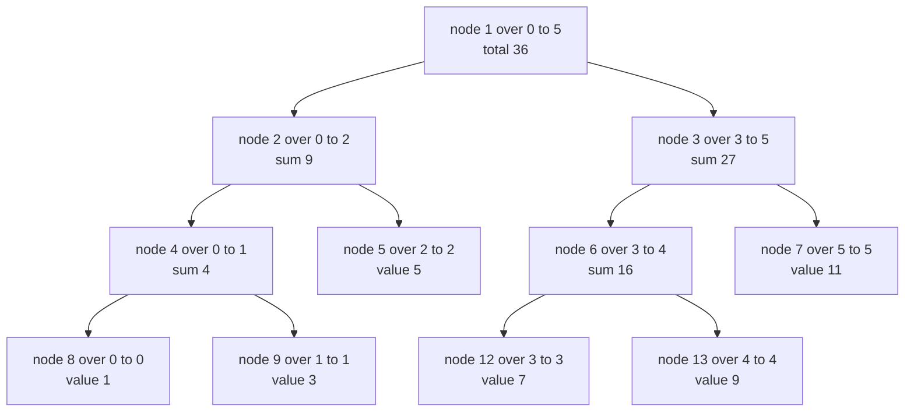
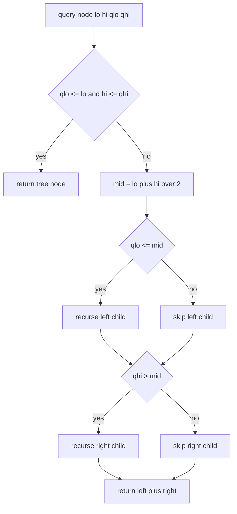
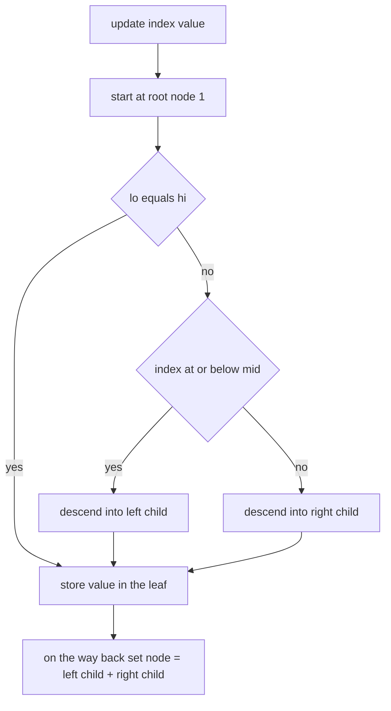
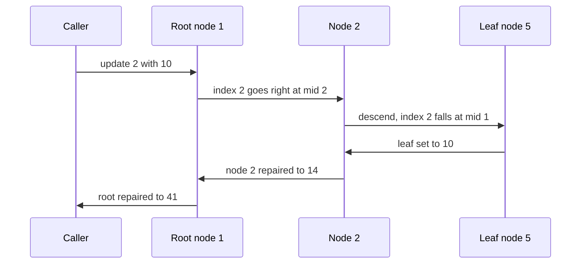

# 182 — Implement segment tree for range sum (build/query/update).

> **Tier:** Beginner · **CTCI chapter:** Ch 4 — Trees and Graphs
> **Task spec:** [182-implement-segment-tree-for-range-sum-build-query-update.md](../../../tasks/beginner/182-implement-segment-tree-for-range-sum-build-query-update.md)
> **Solutions:** [Python](../../../solutions/python/beginner/182-implement-segment-tree-for-range-sum-build-query-update/solution.py) ·
> [Java](../../../solutions/java/beginner/182-implement-segment-tree-for-range-sum-build-query-update/Solution.java) ·
> [JavaScript](../../../solutions/javascript/beginner/182-implement-segment-tree-for-range-sum-build-query-update/solution.js) ·
> [C#](../../../solutions/csharp/beginner/182-implement-segment-tree-for-range-sum-build-query-update/Solution.cs)

## 1. Problem restatement

**Input:** an array `values` of `n` integers, then a mix of calls:

- `update(index, value)` — **assign** `value` to `values[index]` (this task replaces a value, it
  does not add a delta),
- `range_sum(lo, hi)` — the sum of `values[lo..hi]`, inclusive.

**Output:** the range sums, always reflecting the updates applied so far. An inverted range
(`lo > hi`) is an empty query and returns `0`.

The task spec is one line, so the contract comes from the four solution files, which all run:

| Call on `values = [1, 3, 5, 7, 9, 11]` | Result | Why |
| --- | --- | --- |
| `range_sum(0, 5)` | `36` | the whole array |
| `range_sum(0, 0)` / `range_sum(5, 5)` | `1` / `11` | single-element ranges are leaves |
| `range_sum(2, 3)` | `12` | `5 + 7`, two nodes combined |
| `range_sum(3, 2)` | `0` | empty range |
| `update(2, 10)` then `range_sum(1, 3)` | `20` | `3 + 10 + 7` |
| `update(0, -4)` then `range_sum(0, 5)` | `36` | `-4` replaces `1`, so the total drops by `5` |
| `update(0, -4)` then `range_sum(0, 0)` | `-4` | assignments can lower a value |

Rejected inputs: `range_sum(-1, 2)`, `range_sum(0, 6)` and `update(6, 0)` all throw. Degenerate
shapes are asserted too: `SegmentTree([7])` works, and `SegmentTree([])` answers
`range_sum(0, -1)` with `0`.

Python, Java and C# follow with a randomized cross-check — seed `21`, 40 rounds of random
assignments, then *every* `O(n²)` range compared against a plain array. The JavaScript version
does the same with its own LCG. The storage is a flat array of `4 * n` slots holding the tree:
node `1` is the root covering `[0, n - 1]`, and the children of node `i` are `2i` and `2i + 1`.

## 2. Intuition

Again the two obvious structures sit at opposite extremes: a plain array gives `O(1)` assignment
and `O(n)` range sums; a prefix-sum array gives `O(1)` range sums and `O(n)` assignments. A
segment tree aims at `O(log n)` for both by storing the *sum of every dyadic block* of the array,
so that any range decomposes into `O(log n)` of those blocks.

The block structure is a binary partition of the index range:

- the root holds the sum of the entire array,
- each node splits its range at the midpoint into a left and a right child,
- leaves hold single values.

For `n = 6` the ranges look like this, with node numbers in brackets:



Two operations follow directly from that picture:

- **Query**: if a node's range lies entirely inside the query range, take its stored sum and
  stop; otherwise descend into whichever children overlap the query. The recursion returns after
  at most two branches per level, so it touches `O(log n)` nodes.
- **Update**: walk down the *unique* path to the leaf holding the target index, store the new
  value there, and on the way back recompute each ancestor as the sum of its two children. That
  is `O(log n)` nodes, all of them ancestors of one leaf.

The key insight is that the tree is not a search tree over values — it is a **search tree over
index ranges**. Nothing is compared; the midpoints decide where to go, and both the query and the
update use the same `lo`, `hi`, `mid` arithmetic that the build already laid out.

The `4n` slots deserve a note: the recursion indexes children as `2i` and `2i + 1` starting from
the root at `1`, exactly like a binary heap. For an array that is not a power of two the tree is
not perfectly balanced, and the standard safe bound for that indexing scheme is `4n` — the
solutions allocate `4 * max(n, 1)` so that the empty tree still has a usable slot 1.

## 3. Algorithm

1. **Construct.** Store `n`, allocate `4 * max(n, 1)` zeroed slots. If `n > 0`, build the tree.
2. **`_build(node, lo, hi, values)`.** If `lo == hi`, store the value at that position in the
   node and return. Otherwise recurse into `[lo, mid]` (node `2 * node`) and `[mid + 1, hi]`
   (node `2 * node + 1`), then set the node's sum to the sum of its children.
3. **`update(index, value)`.** Reject an out-of-range index, then descend from the root: at each
   node compare `index` with `mid`, recurse into the matching child, and on the way back
   recompute the node as the sum of both children.
4. **`range_sum(lo, hi)`.** If `lo > hi`, return `0`. Reject indices outside `[0, n)`. Then query
   from the root.
5. **`_query(node, lo, hi, qlo, qhi)`.** If the node's range is fully inside `[qlo, qhi]`, return
   the node's stored sum. Otherwise split at `mid` and add the result of the left child when
   `qlo ≤ mid`, plus the result of the right child when `qhi > mid`.

```text
procedure build(node, lo, hi, values)
    if lo = hi then
        tree[node] ← values[lo]
        return
    end
    mid ← (lo + hi) / 2
    build(2 * node, lo, mid, values)
    build(2 * node + 1, mid + 1, hi, values)
    tree[node] ← tree[2 * node] + tree[2 * node + 1]
end

procedure update(node, lo, hi, index, value)
    if lo = hi then
        tree[node] ← value
        return
    end
    mid ← (lo + hi) / 2
    if index ≤ mid then
        update(2 * node, lo, mid, index, value)
    else
        update(2 * node + 1, mid + 1, hi, index, value)
    end
    tree[node] ← tree[2 * node] + tree[2 * node + 1]
end

function query(node, lo, hi, qlo, qhi)
    if qlo ≤ lo and hi ≤ qhi then
        return tree[node]
    end
    mid ← (lo + hi) / 2
    total ← 0
    if qlo ≤ mid then
        total ← total + query(2 * node, lo, mid, qlo, qhi)
    end
    if qhi &gt; mid then
        total ← total + query(2 * node + 1, mid + 1, hi, qlo, qhi)
    end
    return total
end
```

The build and the update share their shape exactly — both recurse to a leaf and then recompute
the path on the way back. The only difference is which leaves they touch: the build visits all of
them, the update visits one.



Note there is no explicit "disjoint" case: a node is only reached from a parent that already
established an overlap, and the two guards at the bottom are what keep the recursion on the part
of the tree that matters.

The update path is a single descent with a repair pass on the way back:



## 4. Worked example

Build from `values = [1, 3, 5, 7, 9, 11]`. The recursion splits `[0, 5]` at `mid = 2`, then each
half further, and fills the leaves first:

| Node | Range | Stored sum | Source |
| --- | --- | --- | --- |
| 8 | `0..0` | `1` | leaf |
| 9 | `1..1` | `3` | leaf |
| 4 | `0..1` | `4` | `tree[8] + tree[9]` |
| 5 | `2..2` | `5` | leaf |
| 2 | `0..2` | `9` | `tree[4] + tree[5]` |
| 12 | `3..3` | `7` | leaf |
| 13 | `4..4` | `9` | leaf |
| 6 | `3..4` | `16` | `tree[12] + tree[13]` |
| 7 | `5..5` | `11` | leaf |
| 3 | `3..5` | `27` | `tree[6] + tree[7]` |
| 1 | `0..5` | `36` | `tree[2] + tree[3]` |

Now trace `range_sum(2, 3)`, which must return `12`:

| Visiting | Node range | Fully covered? | Decision |
| --- | --- | --- | --- |
| node 1 | `0..5` | no (`0 < 2`) | `mid = 2`; left because `2 ≤ 2`; right because `3 > 2` |
| node 2 | `0..2` | no (`0 < 2`) | `mid = 1`; skip left (`2 > 1`); right because `3 > 1` |
| node 5 | `2..2` | yes | return `tree[5] = 5` |
| node 3 | `3..5` | no (`5 > 3`) | `mid = 4`; left because `2 ≤ 4`; skip right (`3 ≤ 4`) |
| node 6 | `3..4` | no (`4 > 3`) | `mid = 3`; left because `2 ≤ 3`; skip right (`3 ≤ 3`) |
| node 12 | `3..3` | yes | return `tree[12] = 7` |

The total is `5 + 7 = 12`. Six nodes were visited to sum two array elements, and one of them was
skipped entirely (`node 7`) because its range starts after the query ends.

Then `update(2, 10)`, which assigns `10` to the leaf for index `2`:

| Step | Node | Action |
| --- | --- | --- |
| 1 | node 1 `0..5` | `mid = 2`, `2 ≤ 2` → go left |
| 2 | node 2 `0..2` | `mid = 1`, `2 > 1` → go right |
| 3 | node 5 `2..2` | leaf — `tree[5] = 10` |
| 4 | node 2 | repair: `tree[2] = tree[4] + tree[5] = 4 + 10 = 14` |
| 5 | node 1 | repair: `tree[1] = tree[2] + tree[3] = 14 + 27 = 41` |

`range_sum(1, 3)` afterwards is `3 + 10 + 7 = 20`, matching the assertion, and
`range_sum(0, 5)` is `41`. The second update, `update(0, -4)`, walks `1 → 2 → 4 → 8`, stores
`-4`, and repairs `tree[4] = -1`, `tree[2] = 9`, `tree[1] = 36` — which is why the file asserts
that the total is back at `36` after replacing `1` with `-4` (the sum drops by `5`, not by `1`).



## 5. Complexity

Let `n` be the array size and `q = hi - lo + 1` the query length.

| Measure | Bound | Why it holds |
| --- | --- | --- |
| Build time | `O(n)` | each of the `2n - 1` nodes is created once, with constant work |
| Update time | `O(log n)` | one root-to-leaf descent plus the repair on the way back |
| Query time | `O(log n)` worst case | at most two frontier nodes per level, and the depth is `log n` |
| Space | `O(n)` nodes, `O(4n)` slots allocated | the flat array holds the tree; the factor 4 is the safe bound for heap-style indexing |
| Naive array alternative | update `O(1)`, query `O(q)` | the direct loop over the range |
| Prefix-sum alternative | update `O(n)`, query `O(1)` | every update repairs the suffix |
| Fenwick tree (task 180/181) | `O(log n)` each | half the memory, but only for invertible operations |

The depth bound follows from splitting the range at the midpoint each time: the range sizes halve
with every level, so a root-to-leaf path has about `log2(n)` steps. The query's "two frontier
nodes per level" claim is the standard argument: the left and right boundaries of the query range
can each be partially covered at most once per level, and everything strictly between them is
fully covered and returned immediately.

The `4n` allocation is a compromise: a recursive tree can be laid out more compactly (some
implementations allocate `2 * 2^ceil(log2 n)`), but `4n` is the figure that always fits the
`2i` / `2i + 1` indexing without further reasoning. Section 7 shows the `2n` layout that gets
rid of the waste.

## 6. Pitfalls and edge cases

- **Assignment versus delta.** `update(index, value)` *replaces* the value. A caller who wants
  the behaviour of [181-range-update-point-query-with-fenwick-tree.md](../../../tasks/beginner/181-range-update-point-query-with-fenwick-tree.md)
  must compute `value = old + delta`, and the tree does not expose the old value — the parallel
  plain array in the tests is how the files keep track.
- **Empty range first, bounds second.** `range_sum(3, 2)` returns `0` without touching the tree,
  while `range_sum(-1, 2)` throws. The order of those two checks matters for a query like
  `range_sum(-1, -2)`, and the solutions check `lo > hi` first.
- **`n = 0` needs a slot.** `4 * max(n, 1)` guarantees the root index `1` exists even when the
  array is empty; allocating `4 * n = 0` slots and then indexing `tree[1]` would be out of range
  in Java and C#.
- **`mid` must be consistent.** Build, update and query all compute `mid = (lo + hi) / 2` from
  the same `lo` and `hi`; changing the rounding in one place silently corrupts the others.
- **Integer division.** Python and JavaScript use `//` and `>> 1`; Java and C# use `/ 2` on
  non-negative integers, which truncates the same way. Negative bounds never reach this code
  because they are rejected at the public methods.
- **Widening for sums.** Java and C# store the tree in `long[]`; the sum of `n` large `int`s does
  not fit in `int`. The tests use small values, so the widening is defensive.
- **Do not mutate the caller's array during build.** Python copies with `list(values)`; the other
  three only read from `values`, and the tests update their own copy in parallel.
- **Recursion depth.** The recovery is `O(log n)` deep, so stack overflow is not a concern for
  any realistic `n` — but the iterative tree in task 183 removes the concern entirely.
- **The tree array is sparse.** For `n = 6` the allocated `4n = 24` slots hold nodes numbered
  1–13; slots 0, 10, 14–23 stay zero. Reading them as data is a bug.

## 7. Variants and follow-ups

- **Bottom-up, `2n` slots.** [183-implement-iterative-segment-tree.md](../../../tasks/beginner/183-implement-iterative-segment-tree.md)
  stores the leaves at `[n, 2n)` and builds the parents with a single downward loop, halving the
  memory and removing the recursion.
- **Fenwick trees.** [180-implement-binary-indexed-tree-fenwick-basic-point-update-prefix.md](../../../tasks/beginner/180-implement-binary-indexed-tree-fenwick-basic-point-update-prefix.md)
  and [181-range-update-point-query-with-fenwick-tree.md](../../../tasks/beginner/181-range-update-point-query-with-fenwick-tree.md)
  attack the same two problems with `n` slots instead of `4n`; the price is that only invertible
  aggregations work.
- **Non-invertible aggregations.** Replace the additions with `min` or `max` and the segment tree
  still works, because the query combines child answers rather than subtracting prefixes. This is
  the main reason to pay the extra memory over a Fenwick tree.
- **Lazy propagation.** Range *updates* over a segment tree need a pending-update tag on each
  node, so that a fully covered node can be updated without descending to its leaves.
- The chapter walkthrough in [Trees and Graphs](../../ctci/04-trees-and-graphs.md) frames the
  segment tree as the array-encoded tree family's most general member.

## 8. Check yourself

1. Why does `_query` need no explicit "this node does not overlap" case?

<details><summary>Show answer</summary>

Because a child is only recursed into when the query range overlaps the child's side of the split:
the left child is visited only when `qlo ≤ mid`, and the right child only when `qhi > mid`. The
root is called with a validated, overlapping query range, so every visited node overlaps by
construction.

</details>

2. Whose sums does `update` recompute, and how many are there?

<details><summary>Show answer</summary>

Exactly the ancestors of the changed leaf, one per level — about `log2(n)` nodes. Sibling subtrees
are untouched because a point assignment cannot change the sum of a block that does not contain
the changed index.

</details>

3. `range_sum(0, 5)` on the six-element example reads `tree[1]` and nothing else. Which query is
   the worst case, and how many nodes does it touch?

<details><summary>Show answer</summary>

A range whose two ends are misaligned with the block boundaries, such as `range_sum(1, 4)`. The
recursion then partially covers nodes on both boundaries at each level, touching `O(log n)`
nodes overall. The example file asserts `range_sum(1, 4) == 24`, the sum of `3 + 5 + 7 + 9`.

</details>
