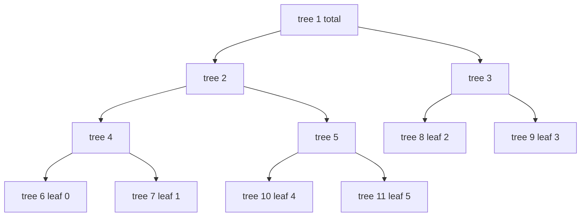
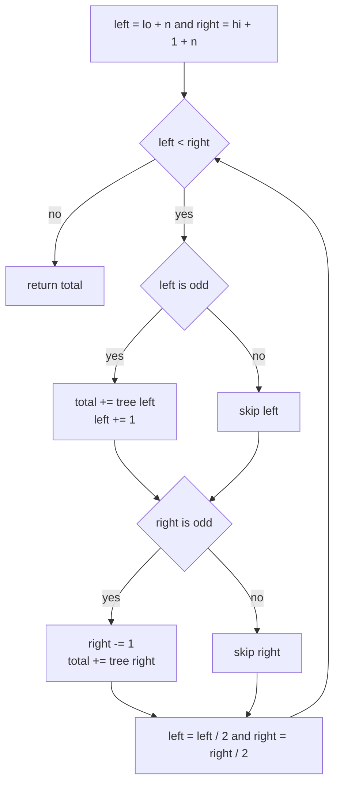
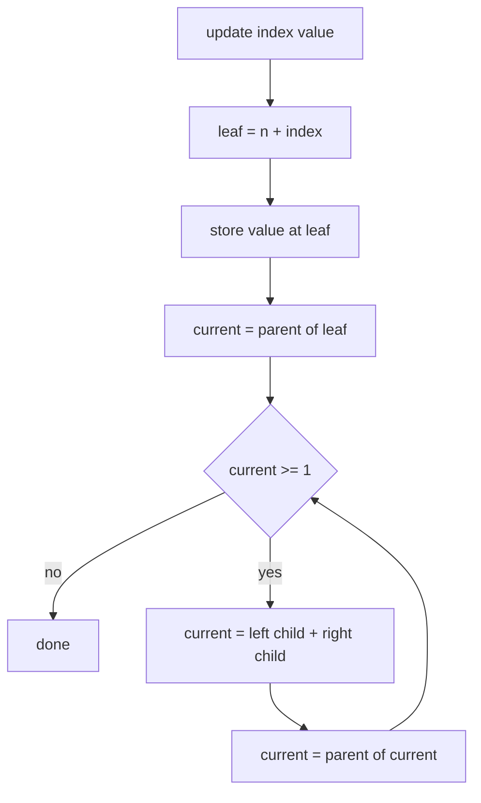
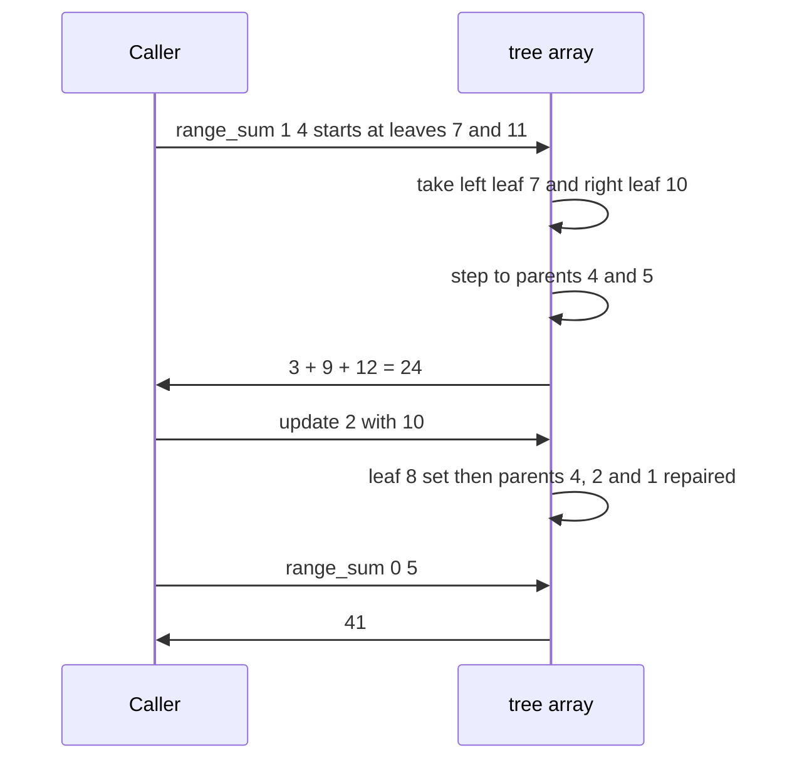

# 183 — Implement iterative segment tree.

> **Tier:** Beginner · **CTCI chapter:** Ch 4 — Trees and Graphs
> **Task spec:** [183-implement-iterative-segment-tree.md](../../../tasks/beginner/183-implement-iterative-segment-tree.md)
> **Solutions:** [Python](../../../solutions/python/beginner/183-implement-iterative-segment-tree/solution.py) ·
> [Java](../../../solutions/java/beginner/183-implement-iterative-segment-tree/Solution.java) ·
> [JavaScript](../../../solutions/javascript/beginner/183-implement-iterative-segment-tree/solution.js) ·
> [C#](../../../solutions/csharp/beginner/183-implement-iterative-segment-tree/Solution.cs)

## 1. Problem restatement

**Input:** an array `values` of `n` integers, then a mix of calls:

- `update(index, value)` — assign `value` to `values[index]`,
- `range_sum(lo, hi)` — the sum of `values[lo..hi]`, inclusive.

**Output:** the same answers the recursive tree of
[182-implement-segment-tree-for-range-sum-build-query-update.md](../../../tasks/beginner/182-implement-segment-tree-for-range-sum-build-query-update.md)
produces, but from a bottom-up structure: a flat array of **`2n` slots** in which the leaves sit
at `[n, 2n)` and every parent at index `i < n` is `tree[2i] + tree[2i + 1]`. No recursion
anywhere.

The task spec is one line, so the four solution files define the contract. They run the same
sequence as task 182 plus one extra inner range:

| Call on `values = [1, 3, 5, 7, 9, 11]` | Result | Why |
| --- | --- | --- |
| `range_sum(0, 5)` | `36` | the whole array |
| `range_sum(0, 0)` / `range_sum(5, 5)` | `1` / `11` | single leaves |
| `range_sum(2, 3)` | `12` | one parent node covers both |
| `range_sum(1, 4)` | `24` | `3 + 5 + 7 + 9`, a range that needs two boundary pieces |
| `range_sum(3, 2)` | `0` | empty range |
| `update(2, 10)` then `range_sum(0, 5)` | `41` | one leaf change, three repairs |
| `update(2, 10)` then `range_sum(2, 2)` | `10` | the leaf itself |
| `update(0, -4)` then `range_sum(0, 5)` | `36` | replacing `1` with `-4` |

Degenerate shapes: `IterativeSegmentTree([7])` answers `7`, then `2` after `update(0, 2)`;
`IterativeSegmentTree([])` answers `range_sum(0, -1)` with `0`. Errors: `range_sum(-1, 2)`,
`range_sum(0, 6)` and `update(6, 0)` all throw. Python, Java and C# cross-check with seed `33`
on 24 random values over 40 rounds; JavaScript uses its own LCG.

## 2. Intuition

The recursive tree stores the same information twice over: the recursion decides the children of
each node, and the flat array of `4n` slots has room for a shape that is never that deep. Both
costs disappear if the tree is laid out so that the structure is *implied by the indices*:

- put the `n` leaves at positions `n, n + 1, ..., 2n - 1`,
- put parents below them at `1, 2, ..., n - 1`,
- then `tree[i] = tree[2i] + tree[2i + 1]` for every `i ≥ 1`.

Array position `lo` is exactly leaf `n + lo`, so no descent is needed to find a leaf, and the
ancestors of leaf `i` are `i / 2, i / 4, ...` — a loop instead of a recursion.



The picture shows the layout for `n = 6`: the leaves are contiguous at the end of the array, the
parents fill the front, and the array slot `0` is never used. Two consequences follow:

- **Build** is a single backward loop `i = n - 1 … 1` — children always have larger indices than
  their parent, so by the time slot `i` is written both children are final.
- **Update** is a single forward loop: write the leaf, then `i ← i / 2` until `i < 1`, repairing
  each parent.

The only operation that needs real thought is the range query. It uses the *half-open* interval
`[lo + n, hi + 1 + n)` and walks two pointers up the tree: whenever the left pointer is a right
child, its whole subtree is inside the range, so its value is consumed and the pointer advances;
symmetrically for the right pointer when it is a left child. Then both pointers move to their
parents.



The insight behind the walk is that an odd index is a right child, so it is not fully inside the
range its parent covers; consuming it and stepping past it moves the boundary inwards without
losing any position. The pointers converge until they meet, at which point every leaf in the
range has been accounted for exactly once.

## 3. Algorithm

1. **Construct.** Store `n`, allocate `2n` zeroed slots. Copy the input into the leaves:
   `tree[n + i] = values[i]`. Then for `i = n - 1` down to `1`, set
   `tree[i] = tree[2i] + tree[2i + 1]`.
2. **`update(index, value)`.** Reject an out-of-range index. Set `i = n + index` and write
   `value` into the leaf. Then while `i ≥ 1` after halving — repair each ancestor with
   `tree[i] = tree[2i] + tree[2i + 1]`.
3. **`range_sum(lo, hi)`.** If `lo > hi`, return `0`. Reject bounds outside `[0, n)`. Set
   `left = n + lo`, `right = n + hi + 1`, `total = 0`. While `left < right`:
   if `left` is odd, add `tree[left]` and increment `left`; if `right` is odd, decrement `right`
   and add `tree[right]`; then halve both.
4. Return `total`.

```text
procedure build(values)
    n ← length(values)
    tree ← new array of 2 * n zeros
    for i ← 0 to n - 1 do
        tree[n + i] ← values[i]
    end
    for i ← n - 1 down to 1 do
        tree[i] ← tree[2 * i] + tree[2 * i + 1]
    end
end

procedure update(index, value)
    if index &lt; 0 or index ≥ n then
        raise index out of range
    end
    i ← n + index
    tree[i] ← value
    i ← i / 2
    while i ≥ 1 do
        tree[i] ← tree[2 * i] + tree[2 * i + 1]
        i ← i / 2
    end
end

function range_sum(lo, hi)
    if lo &gt; hi then
        return 0
    end
    if lo &lt; 0 or hi ≥ n then
        raise range out of bounds
    end
    total ← 0
    left ← lo + n
    right ← hi + 1 + n
    while left &lt; right do
        if left is odd then
            total ← total + tree[left]
            left ← left + 1
        end
        if right is odd then
            right ← right - 1
            total ← total + tree[right]
        end
        left ← left / 2
        right ← right / 2
    end
    return total
end
```

Two details carry the whole structure. First, the repair loop halves *before* the first repair,
so the leaf is never overwritten by a recomputation of itself. Second, the halving inside the
query happens after both boundary checks: halving first would skip nodes that sit exactly on the
range boundary.



The build is the same repair loop run once for the whole array, in the only order that works —
from the highest index downwards.

## 4. Worked example

Build from `values = [1, 3, 5, 7, 9, 11]`, so `n = 6` and the array has 12 slots:

| Slot | 0 | 1 | 2 | 3 | 4 | 5 | 6 | 7 | 8 | 9 | 10 | 11 |
| --- | --- | --- | --- | --- | --- | --- | --- | --- | --- | --- | --- | --- |
| Content | — | 36 | 32 | 4 | 12 | 20 | 1 | 3 | 5 | 7 | 9 | 11 |
| Role | unused | root | `1..4`? no: covers leaves 4–5 | covers leaves 6–7 | covers leaves 8–9 | covers leaves 10–11 | leaf 0 | leaf 1 | leaf 2 | leaf 3 | leaf 4 | leaf 5 |

The parent contents come from the backward loop, in this order: `tree[5] = 9 + 11 = 20`,
`tree[4] = 5 + 7 = 12`, `tree[3] = 1 + 3 = 4`, `tree[2] = 12 + 20 = 32`,
`tree[1] = 32 + 4 = 36`.

The non-obvious part of this layout is that node `2` covers leaves `4` and `5` of the logical
array — the array is *not* split as `[0..2] / [3..5]` the way the recursive tree does it. The
indices still partition the leaves in order, which is all the query needs.

**Trace `range_sum(1, 4)`**, which must return `24`:

| Step | `left` | `right` | Action | `total` |
| --- | --- | --- | --- | --- |
| start | 7 | 11 | `left` odd: take `tree[7] = 3`, `left → 8`; `right` odd: `right → 10`, take `tree[10] = 9` | 12 |
| after halving | 4 | 5 | `left` even: skip; `right` odd: `right → 4`, take `tree[4] = 12` | 24 |
| after halving | 2 | 2 | `left < right` false, stop | 24 |

The walk consumed leaf `1` on the left boundary, leaf `4` on the right boundary, and then the
single node `4` that covers leaves `2` and `3` — three reads for a four-element range, and no
recursion.

**Trace `range_sum(2, 3)`**, the case that needs only one node: `left = 8`, `right = 10`. Both
are even at the start, so the loop halves immediately to `left = 4`, `right = 5`; then `right` is
odd, so `right → 4` and `tree[4] = 12` is consumed; the pointers meet and the answer is `12`. The
whole query is one array read.

**Trace `update(2, 10)`.** The leaf index is `n + 2 = 8`, so:

| Step | Index | Action | New content |
| --- | --- | --- | --- |
| 1 | 8 | write the leaf | `tree[8] = 10` |
| 2 | 4 | `tree[8] + tree[9]` | `10 + 7 = 17` |
| 3 | 2 | `tree[4] + tree[5]` | `17 + 20 = 37` |
| 4 | 1 | `tree[2] + tree[3]` | `37 + 4 = 41` |

`range_sum(0, 5)` afterwards walks `left = 6, right = 12`: both even, halve to `3` and `6`;
`left` odd, take `tree[3] = 4`; halve to `2` and `3`; `right` odd, take `tree[2] = 37`; the
pointers meet and the total is `41`. Four reads instead of six leaves.

The second update, `update(0, -4)`, writes `tree[6] = -4` and repairs `tree[3] = -4 + 3 = -1`
and `tree[1] = 37 - 1 = 36`, which is why the assertion after it expects the original total
`36` again.



## 5. Complexity

Let `n` be the array size.

| Measure | Bound | Why it holds |
| --- | --- | --- |
| Build time | `O(n)` | `n` leaf copies plus `n - 1` parent sums |
| Update time | `O(log n)` | the path from a leaf to the root has `log2(n)` nodes |
| Query time | `O(log n)` | the two pointers move to their parents each iteration and stop when they meet |
| Space | `2n` slots | leaves plus parents, with slot `0` unused; the recursive tree in task 182 allocates `4n` |
| Naive array alternative | update `O(1)`, query `O(hi - lo + 1)` | scan the range |
| Recursive segment tree (task 182) | same times, `4n` space | same algorithm with a worse layout and call overhead |

The two iterators in the query start `hi - lo + 2` apart in leaf terms and halve that distance
every iteration, so the loop runs about `log2(n)` times regardless of the range length. That is
why `range_sum(0, 5)` costs the same as `range_sum(2, 3)`: both coalesce into a handful of whole
subtree reads.

The `2n` bound is tight — every node of the logical tree has a slot — which is the structural win
over the recursive version's `4n`. It is also why the build can be a single backward loop: the
layout puts all children at indices larger than their parent, so one pass in decreasing index
order suffices. Nothing about the algorithm is probabilistic, and no input shape changes the
bounds.

## 6. Pitfalls and edge cases

- **Half-open on the right.** The query uses `right = hi + 1 + n` and then treats `right` as
  exclusive. Mixing the two conventions — for instance adding `tree[right]` without decrementing
  first — silently includes one extra leaf.
- **Halve last.** The parent step must happen after both boundary checks. Halving first skips the
  nodes that sit exactly on the range boundary and produces a sum that is too small.
- **Slot `0` is dead.** `tree[0]` is never written and never read; `left` and `right` stop when
  they meet, which is always at an index `≥ 1` for a non-empty query.
- **`n = 1` collapses leaf and root.** The leaf is `tree[1]`, the build loop `n - 1 … 1` is empty,
  and the repair loop exits immediately after `i ← i / 2 = 0`. The file asserts
  `IterativeSegmentTree([7]).range_sum(0, 0) == 7` and then `2` after an update.
- **`n = 0` allocates nothing.** `2 * 0 = 0` slots, so `tree` is empty — unlike the recursive
  version, which needs one spare slot. `range_sum(0, -1)` returns `0` before touching the array;
  every other query or update throws on the bounds check.
- **Assignment, not delta.** `update(index, value)` replaces the value; a caller with a delta must
  know the old value, which the tree does not store at leaf level for you to read back.
- **Widening for sums.** Java and C# declare the array `long[]`; parent nodes sum many `int`
  values, so an `int` tree can overflow on realistic inputs.

## 7. Variants and follow-ups

- **The recursive version.** [182-implement-segment-tree-for-range-sum-build-query-update.md](../../../tasks/beginner/182-implement-segment-tree-for-range-sum-build-query-update.md)
  spells out the same tree top-down with `mid` splits; it is the easier one to derive, this one is
  the easier one to run.
- **Fenwick trees.** [180-implement-binary-indexed-tree-fenwick-basic-point-update-prefix.md](../../../tasks/beginner/180-implement-binary-indexed-tree-fenwick-basic-point-update-prefix.md)
  and [181-range-update-point-query-with-fenwick-tree.md](../../../tasks/beginner/181-range-update-point-query-with-fenwick-tree.md)
  use only `n` slots and no tree nodes at all, but they can only combine invertible operations.
- **Non-invertible aggregations.** Swap the sums for `min` or `max` and both this iterative walk
  and the recursive tree keep working; the boundary-pointer trick is agnostic to what a node
  stores.
- **Lazy propagation.** Range updates need a pending tag per node; the iterative bottom-up variant
  must push those tags down before descending, which is where the simplicity of this version
  starts to cost.
- The chapter walkthrough in [Trees and Graphs](../../ctci/04-trees-and-graphs.md) shows the flat
  array tree layouts shared by heaps, Fenwick trees and segment trees.

## 8. Check yourself

1. Why can the build be a single backward loop over `i = n - 1 … 1`?

<details><summary>Show answer</summary>

Because the layout guarantees that both children of node `i` have indices greater than `i`
(`2i` and `2i + 1`). Walking downwards means every child is already final when its parent is
computed, so one pass fills all parents without recursion.

</details>

2. In the query walk, why is an odd `left` pointer consumed and incremented?

<details><summary>Show answer</summary>

An odd index is a right child, so its parent's range extends to the left of it — the parent is not
fully inside the query interval, but the node itself is. Taking `tree[left]` and stepping to
`left + 1` (its parent's sibling boundary) preserves exactly the part of the range that pointer is
responsible for. The symmetric argument applies to an odd `right` pointer.

</details>

3. `range_sum(0, 5)` and `range_sum(2, 3)` have very different lengths. Why do they cost
   comparably?

<details><summary>Show answer</summary>

Because the walk tracks boundaries, not elements. It starts with the two leaf pointers at most
`log n` levels below the root and halves their distance each iteration, so the number of reads is
`O(log n)` — two reads for the whole-array range that align with nodes `2` and `3`, one read for
`range_sum(2, 3)` that lands exactly on node `4`.

</details>
