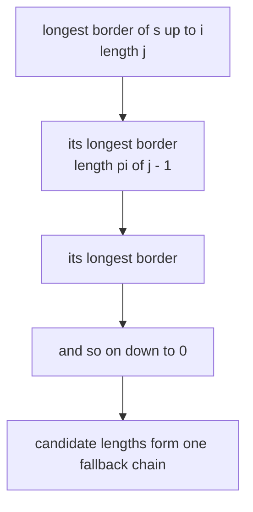
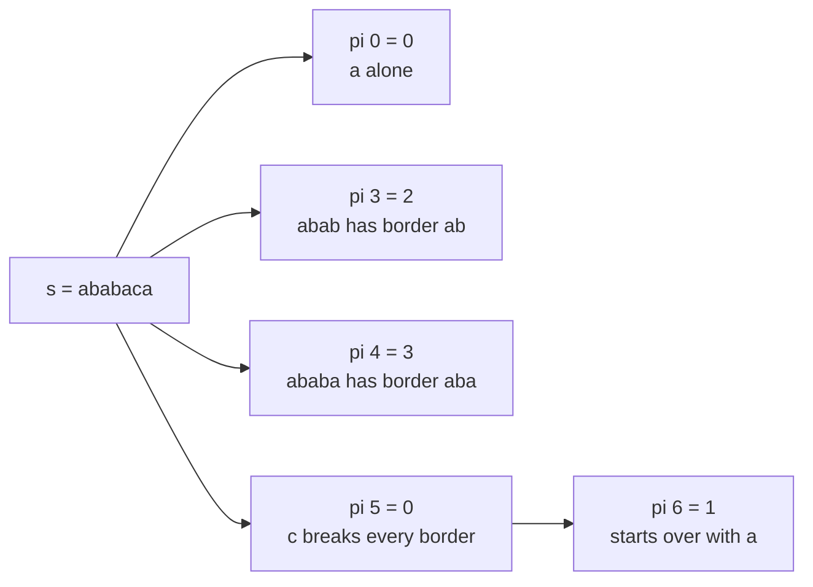
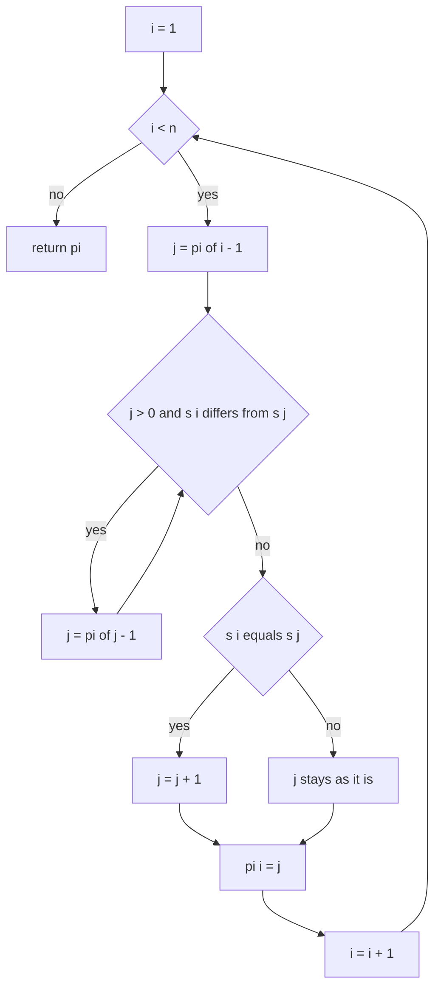
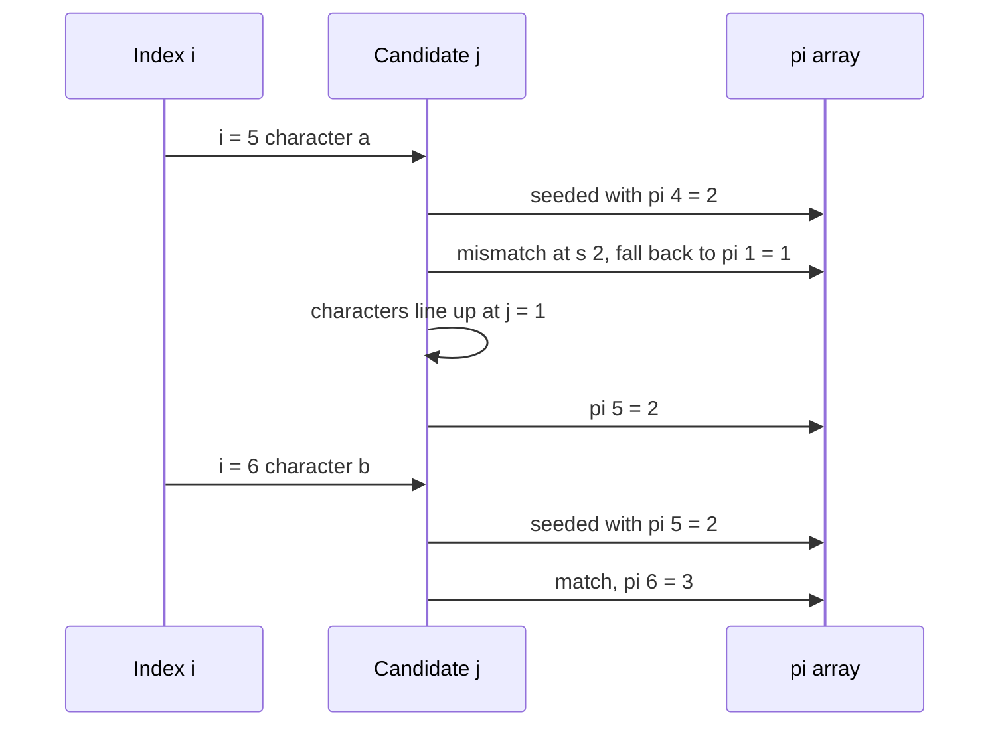

# 184 — Implement prefix function (KMP) for pattern matching.

> **Tier:** Beginner · **CTCI chapter:** Beyond — Advanced Data Structures & Algorithms
> **Task spec:** [184-implement-prefix-function-kmp-for-pattern-matching.md](../../../tasks/beginner/184-implement-prefix-function-kmp-for-pattern-matching.md)
> **Solutions:** [Python](../../../solutions/python/beginner/184-implement-prefix-function-kmp-for-pattern-matching/solution.py) ·
> [Java](../../../solutions/java/beginner/184-implement-prefix-function-kmp-for-pattern-matching/Solution.java) ·
> [JavaScript](../../../solutions/javascript/beginner/184-implement-prefix-function-kmp-for-pattern-matching/solution.js) ·
> [C#](../../../solutions/csharp/beginner/184-implement-prefix-function-kmp-for-pattern-matching/Solution.cs)

## 1. Problem restatement

**Input:** a string `s` of `n` characters. The string may be empty.

**Output:** the **prefix function** `pi`, an array of `n` integers where `pi[i]` is the length of
the longest *proper* prefix of `s[0..i]` that is also a suffix of `s[0..i]`. "Proper" means the
prefix may not be the whole of `s[0..i]`, so `pi[i] ≤ i` and in particular `pi[0] = 0`.

The task spec is one line, so the contract is fixed by the assertions the four solution files
ship with. All four assert the same nine cases:

| `s` | `pi` | Note |
| --- | --- | --- |
| `""` | `[]` | nothing to compute |
| `"a"` | `[0]` | a single character has no proper border |
| `"ab"` | `[0, 0]` | no repetition at all |
| `"ababaca"` | `[0, 0, 1, 2, 3, 0, 1]` | borders shrink sharply at the `c` |
| `"aabaaab"` | `[0, 1, 0, 1, 2, 2, 3]` | a mismatch that falls back twice |
| `"aaaa"` | `[0, 1, 2, 3]` | every prefix is a border of the next |
| `"abcabcd"` | `[0, 0, 0, 1, 2, 3, 0]` | a border that grows for four steps then vanishes |
| `"abababab"` | `[0, 0, 1, 2, 3, 4, 5, 6]` | two-character period |
| `"aabaaabaaab"` | `[0, 1, 0, 1, 2, 2, 3, 4, 5, 6, 7]` | long suffix that keeps matching |

Each file also ships a `prefix_function_naive` / `prefixFunctionNaive` reference that brute-forces
the definition — for every prefix, try every length from `1` to `end` and keep the largest one
that reproduces itself — and cross-checks the fast version against it on pseudo-random strings.
Python, Java and C# use seed `5` and 200 strings of length `0..40` over the alphabet `{a, b}`;
JavaScript drives the same loop with its own LCG.

## 2. Intuition

A "border" of a string is a piece that is both a prefix and a suffix. For `s = "ababaca"` the
prefixes and their longest borders are:

```text
a        -> ""          0
ab       -> ""          0
aba      -> "a"         1
abab     -> "ab"        2
ababa    -> "aba"       3
ababac   -> ""          0
ababaca  -> "a"         1
```

The naive way to get each value is to test every candidate length independently, which is the
reference implementation. The observation that makes the fast version possible is that **the
borders of consecutive prefixes are related**:

> Every border of `s[0..i]` shorter than the longest one is itself a border of the longest one.

So when the character comparison fails, you do not restart from zero — you fall back to the
longest border of the border you already had, which is exactly `pi[j - 1]` where `j` is the
length you were trying.



That chain is the whole algorithm in one picture: instead of `i` candidate lengths, each starting
from scratch, the search walks down a chain that is at most as long as the current match length.
Because the length only ever goes up by one per character, the total amount of falling back over
the whole string is bounded by `n` — which is why the loop that looks nested is still linear.



## 3. Algorithm

1. Create `pi` with `n` zeros.
2. For `i` from `1` to `n - 1`:
   1. Start `j` at `pi[i - 1]` — the best border of the previous prefix is the best *candidate*
      for the current one.
   2. While `j > 0` and `s[i]` differs from `s[j]`, set `j ← pi[j - 1]`: shrink to the longest
      border of the candidate.
   3. If `s[i]` equals `s[j]`, increment `j` — the border grows by the matching character.
   4. Store `j` as `pi[i]`.
3. Return `pi`.

```text
function prefix_function(s)
    n ← length(s)
    pi ← new array of n zeros
    for i ← 1 to n - 1 do
        j ← pi[i - 1]
        while j &gt; 0 and s[i] ≠ s[j] do
            j ← pi[j - 1]
        end
        if s[i] = s[j] then
            j ← j + 1
        end
        pi[i] ← j
    end
    return pi
end
```

Two lines do all the work: `j ← pi[i - 1]` is the seed, and `j ← pi[j - 1]` is the escape hatch
when the seed cannot be extended. The loop terminates because `j` strictly decreases along the
fallback chain and stops at `0`.



The same walk can also be read as a machine over the match length: the chain of borders is walked
downward until either a character lines up or there is nothing left to shrink.

## 4. Worked example

Trace `s = "aabaaab"`, whose expected `pi` is `[0, 1, 0, 1, 2, 2, 3]`:

| `i` | `s[i]` | `j` seeded from `pi[i - 1]` | Fallbacks (`j ← pi[j - 1]`) | Final check | `pi[i]` |
| --- | --- | --- | --- | --- | --- |
| 1 | `a` | `pi[0] = 0` | none | `s[1] = a` equals `s[0] = a` → `j = 1` | 1 |
| 2 | `b` | `pi[1] = 1` | `s[2] = b` ≠ `s[1] = a` → `j = pi[0] = 0` | `s[2] = b` ≠ `s[0] = a` → stays `0` | 0 |
| 3 | `a` | `pi[2] = 0` | none | `s[3] = a` equals `s[0] = a` → `j = 1` | 1 |
| 4 | `a` | `pi[3] = 1` | none | `s[4] = a` equals `s[1] = a` → `j = 2` | 2 |
| 5 | `a` | `pi[4] = 2` | `s[5] = a` ≠ `s[2] = b` → `j = pi[1] = 1` | `s[5] = a` equals `s[1] = a` → `j = 2` | 2 |
| 6 | `b` | `pi[5] = 2` | none | `s[6] = b` equals `s[2] = b` → `j = 3` | 3 |

Row `i = 5` is the instructive one: the candidate border of length `2` cannot be extended,
so the algorithm drops to the border *of that candidate* (length `1`) and extends it instead.
The result `2` means `s[0..5] = "aabaaa"` has the border `"aa"` — the last two characters match the
first two, even though the length-3 candidate `"aab"` does not.

For contrast, `s = "ababaca"` narrows all the way down at `i = 5`, where the character is `c`:

| `i` | Character | Candidate `j` | Fallback chain | Result `pi[i]` |
| --- | --- | --- | --- | --- |
| 1 | `b` | 0 | — | 0 |
| 2 | `a` | 0 | — | 1 |
| 3 | `b` | 1 | — | 2 |
| 4 | `a` | 2 | — | 3 |
| 5 | `c` | 3 | `3 → pi[2] = 1` then `1 → pi[0] = 0` | 0 |
| 6 | `a` | 0 | — | 1 |

At `i = 5` the fallback chain visits lengths `3` and `1` before giving up; at `i = 6` the
algorithm starts again from `pi[5] = 0` and immediately matches.



The reference implementation in the same files computes the same numbers by brute force: for
every `end` it tries every `length` from `1` to `end` and keeps the largest that satisfies
`s[0..length-1] == s[end-length+1..end]`. It is the definition, not an algorithm — which is
exactly why it is useful as a test oracle.

## 5. Complexity

Let `n` be the length of `s`.

| Measure | Bound | Why it holds |
| --- | --- | --- |
| Time, worst | `O(n)` | `j` grows by at most one per iteration, so the total amount of shrink over all iterations is at most `n` |
| Time, best | `O(n)` | the outer loop always runs `n - 1` times with constant work per step when no fallback is needed |
| Space | `O(n)` | the `pi` array is the only auxiliary storage |
| Naive reference | `O(n²)` candidate comparisons | for each of `n` prefixes, up to `end` lengths are tested; the docstring names it the `O(n²)` reference |
| Naive reference, character work | up to `O(n³)` | each candidate comparison inspects up to `length` characters, so the candidate count understates the character work |

The linear bound is the classic amortised argument and it is worth stating exactly: `j` can only
increase by one per iteration of the outer loop, so across the whole run it increases at most
`n` times. Every step of the inner loop decreases `j` by at least one (it moves to a strictly
smaller border length), so the inner loop can run at most as many times as `j` ever increased.
Total inner work is therefore `O(n)`, and the nested loop is not quadratic at all.

That is what makes this structure worth computing. Once `pi` exists, an `O(n + m)` substring
search is a few extra lines, minimal periods and border counts are one-liners, and the same
fallback machinery solves a family of string problems — all from an array of `n` integers.

## 6. Pitfalls and edge cases

- **"Proper" is doing real work.** `pi[0]` is `0` for every string, and `pi[i] ≤ i`. If the
  implementation allowed the full prefix, every entry would be its own length and the array would
  carry no information.
- **Seed from `pi[i - 1]`, not from `0`.** Starting the candidate at zero turns the algorithm into
  the naive one, losing the amortised bound.
- **Fall back with `pi[j - 1]`, not `pi[j]`.** The border of a candidate of length `j` is found at
  index `j - 1`; using `pi[j]` reads one position too far and produces borders that never shrink
  to the right value.
- **The match check after the loop must tolerate `j = 0`.** Comparing `s[i]` with `s[j]` when
  `j = 0` is safe — index `0` always exists for a non-empty string — and the comparison failing
  simply leaves `pi[i] = 0`.
- **Empty string.** `pi` is `[]`; there is no index `0`, and all four files assert it.
- **Single character.** `pi` is `[0]`; the outer loop never runs.
- **Highly repetitive input.** `"aaaa"` gives `[0, 1, 2, 3]`, where each border is one longer than
  the previous. This is the case that makes the fallback chain deepest, and it is why the
  amortised argument matters.
- **Text units.** Python iterates code points and JavaScript compares UTF-16 code units;
  Java's `charAt` and C#'s indexer also work on UTF-16 code units. A character outside the BMP is
  two units, so the border structure computed over code units may split a surrogate pair
  mid-border. Neither the array nor the algorithm notices, because strings are never validated.
- **The naive reference is not a substitute.** It agrees on every tested input — including
  `"aabaaabaaab"`, which exercises long chains — but it is orders of magnitude slower, and the
  200-string randomized check exists precisely because hand-picked strings can hide a wrong
  fallback.

## 7. Variants and follow-ups

- **Search with the prefix function.** [185-kmp-search-using-prefix-function.md](../../../tasks/beginner/185-kmp-search-using-prefix-function.md)
  builds the array over the pattern only and then scans the text with the same fallback rule, for
  `O(n + m)` matching. That task is the reason this one exists.
- **Hashing instead of borders.** [186-rabin-karp-rolling-hash-string-search.md](../../../tasks/beginner/186-rabin-karp-rolling-hash-string-search.md)
  solves the same search problem with a rolling hash and expected `O(n + m)` time, requiring a
  verification step that KMP does not need.
- **Integer arrays.** [187-implement-basic-rolling-hash-for-integer-arrays.md](../../../tasks/beginner/187-implement-basic-rolling-hash-for-integer-arrays.md)
  moves the hashing idea off strings entirely; the prefix function transfers to integer arrays
  unchanged, since it only ever compares two elements for equality.
- **Minimal period.** The smallest period of `s` is `n - pi[n - 1]` when that value divides `n`,
  which falls straight out of the last entry of this array.
- **Longest palindromic prefix.** Concatenate `s`, a separator that cannot occur, and the reverse
  of `s`; the last `pi` entry is the answer.

## 8. Check yourself

1. Why is `pi[0]` always `0`?

<details><summary>Show answer</summary>

Because the only candidate for a one-character string is the character itself, and a border must
be a *proper* prefix, so the whole string does not qualify. There is no shorter non-empty prefix.

</details>

2. The inner `while` loop is nested inside the `for` loop. Why is the total still `O(n)`?

<details><summary>Show answer</summary>

Because `j` increases by at most one per outer iteration — at most `n` increases overall — and
every fallback step strictly decreases `j`. The number of inner-loop iterations is therefore
bounded by the number of increases, which is `O(n)`. The loops look nested but the second one
spends a budget the first one pays for.

</details>

3. What is `pi` for `"abababab"` and why does it have such a regular shape?

<details><summary>Show answer</summary>

`[0, 0, 1, 2, 3, 4, 5, 6]`. The string has period two, so from the third character onward each
prefix ends with the longest border one shorter than the whole prefix, and the candidate always
extends by one: `j = pi[i - 1]` and then `s[i] == s[j]`, so `j` grows by exactly one per step.

</details>

4. In the trace of `"aabaaab"` at `i = 5`, why does the answer become `2` rather than `3`?

<details><summary>Show answer</summary>

The candidate of length `2` cannot be extended because `s[5] = a` differs from `s[2] = b`. The
algorithm falls back to the longest border of that candidate, which has length `pi[1] = 1`
(`"a"`), and `s[5] = a` matches `s[1] = a`, so it grows to `2`. The value `3` would require
`s[0..2] = "aab"` to be a suffix of `"aabaaa"`, which it is not.

</details>

5. How would you use the same array to find every position where the pattern `"abab"` can start
   in a longer text?

<details><summary>Show answer</summary>

Run the same loop with the pattern indexed by `j` and the text by `i`: on a mismatch fall back
with `pi[j - 1]`, on a match increment `j`, and when `j` reaches the pattern length record
`i - m + 1` and set `j = pi[j - 1]` to keep searching for overlapping matches. That is exactly
what task 185 implements.

</details>
