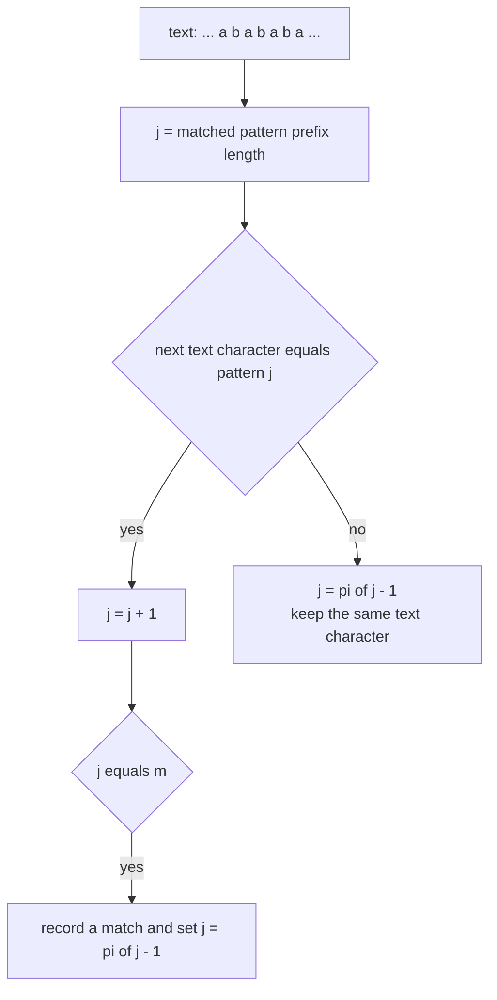
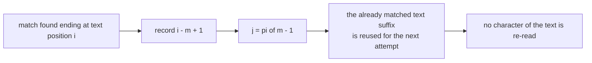
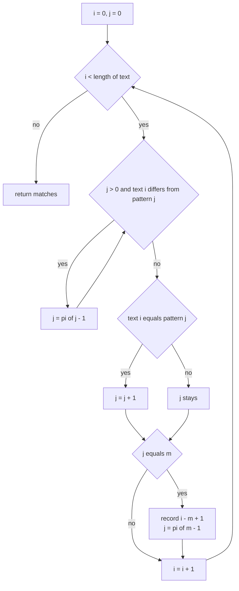
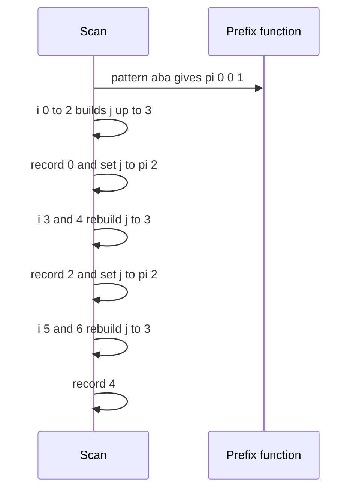

# 185 — KMP search using prefix function.

> **Tier:** Beginner · **CTCI chapter:** Beyond — Advanced Data Structures & Algorithms
> **Task spec:** [185-kmp-search-using-prefix-function.md](../../../tasks/beginner/185-kmp-search-using-prefix-function.md)
> **Solutions:** [Python](../../../solutions/python/beginner/185-kmp-search-using-prefix-function/solution.py) ·
> [Java](../../../solutions/java/beginner/185-kmp-search-using-prefix-function/Solution.java) ·
> [JavaScript](../../../solutions/javascript/beginner/185-kmp-search-using-prefix-function/solution.js) ·
> [C#](../../../solutions/csharp/beginner/185-kmp-search-using-prefix-function/Solution.cs)

## 1. Problem restatement

**Input:** a `text` of `n` characters and a `pattern` of `m` characters. Either may be empty.

**Output:** every start index where `pattern` occurs in `text`, in increasing order. Matches may
overlap, and all of them are reported. By the convention shared by all four solutions, an empty
pattern returns **no matches** rather than an unbounded list of positions.

The task spec is one line, so the contract is fixed by the assertions the four files ship with:

| Call | Result | Why |
| --- | --- | --- |
| `kmp_search("aaaaa", "aaaa")` | `[0, 1]` | overlapping matches are all reported |
| `kmp_search("abababa", "aba")` | `[0, 2, 4]` | three overlapping occurrences two apart |
| `kmp_search("abcabcabc", "abc")` | `[0, 3, 6]` | a repeated block, no overlap |
| `kmp_search("abracadabra", "cad")` | `[4]` | exactly one occurrence |
| `kmp_search("mississippi", "issi")` | `[1, 4]` | two occurrences, one overlapping the other |
| `kmp_search("aaaa", "b")` | `[]` | no match |
| `kmp_search("ab", "abc")` | `[]` | the pattern is longer than the text |
| `kmp_search("", "a")` | `[]` | empty text |
| `kmp_search("", "")` / `kmp_search("anything", "")` | `[]` | the empty-pattern convention |
| `kmp_search("a", "a")` | `[0]` | a one-character match |
| `kmp_search("aaa", "aa")` | `[0, 1]` | overlapping again |
| `kmp_search("aaa", "aaa")` | `[0]` | the whole text, once |

The prefix function reused here is exactly the one built in
[184-implement-prefix-function-kmp-for-pattern-matching.md](../../../tasks/beginner/184-implement-prefix-function-kmp-for-pattern-matching.md);
every file carries a private copy of it. Each file also has a naive reference scan and cross-checks
the two on pseudo-random inputs — Python, Java and C# with seed `13` using 300 pairs of a text of
length `0..30` and a pattern of length `1..5` over the alphabet `{a, b}`, JavaScript with its own
LCG.

## 2. Intuition

The naive scan tries every alignment and compares character by character, so a text of `n` `a`s
and a pattern of `m` `a`s costs `n · m` comparisons. What it wastes is the information already
gathered: after failing at position `i` it re-reads characters it has just seen.

The prefix function from task 184 removes that waste. While scanning, keep a counter `j` = "how
many characters of the pattern matched the text ending here". On a mismatch at pattern character
`j`, the text suffix you have already matched is a *prefix* of the pattern, and the longest border
of that prefix tells you the largest `j` that still matches — namely `pi[j - 1]`. So instead of
restarting at the next text position with `j = 0`, you shrink `j` and stay on the same text
character.



Two rules make the whole thing work:

- **Mismatch** → fall back to `pi[j - 1]` and re-test the *same* text character.
- **Full match** → record the start index `i - m + 1`, then also fall back to `pi[m - 1]` so that
  an overlapping occurrence starting inside the match is not missed.

The second rule is what makes `"aaaaa"` find `"aaaa"` twice and `"abababa"` find `"aba"` three
times. It costs one array read.



## 3. Algorithm

1. If the pattern is empty, return the empty list — the solution's documented convention.
2. Build `pi` over the **pattern** only, using the fallback loop of task 184.
3. Set `j = 0`.
4. For each text index `i` from `0` to `n - 1` with character `ch`:
   1. While `j > 0` and `ch` differs from `pattern[j]`, set `j ← pi[j - 1]`.
   2. If `ch` equals `pattern[j]`, increment `j`.
   3. If `j` equals `m`, record `i - m + 1` and set `j ← pi[j - 1]` to continue searching for
      overlapping matches.
5. Return the recorded indices.

```text
function kmp_search(text, pattern)
    if pattern is empty then
        return empty list
    end
    pi ← prefix_function(pattern)
    m ← length(pattern)
    matches ← empty list
    j ← 0
    for i ← 0 to length(text) - 1 do
        ch ← text[i]
        while j &gt; 0 and ch ≠ pattern[j] do
            j ← pi[j - 1]
        end
        if ch = pattern[j] then
            j ← j + 1
        end
        if j = m then
            append i - m + 1 to matches
            j ← pi[j - 1]
        end
    end
    return matches
end
```

The scan body is the same three-line shape as the prefix-function builder, with `text[i]` in place
of `s[i]` and `pattern` in place of `s`. That is not a coincidence: computing the prefix function
*is* a KMP search of a string inside itself.



## 4. Worked example

Trace `kmp_search("abababa", "aba")`. The pattern's prefix function is `pi = [0, 0, 1]`, so
`m = 3` and `pi[2] = 1`. `text` is indexed `0..6`.

| `i` | `text[i]` | `j` at entry | Fallbacks | After the match check | Recorded | `j` after |
| --- | --- | --- | --- | --- | --- | --- |
| 0 | `a` | 0 | none | `a = pattern[0]` → `j = 1` | — | 1 |
| 1 | `b` | 1 | none | `b = pattern[1]` → `j = 2` | — | 2 |
| 2 | `a` | 2 | none | `a = pattern[2]` → `j = 3 = m` | `0` | `pi[2] = 1` |
| 3 | `b` | 1 | none | `b = pattern[1]` → `j = 2` | — | 2 |
| 4 | `a` | 2 | none | `a = pattern[2]` → `j = 3 = m` | `2` | `pi[2] = 1` |
| 5 | `b` | 1 | none | `b = pattern[1]` → `j = 2` | — | 2 |
| 6 | `a` | 2 | none | `a = pattern[2]` → `j = 3 = m` | `4` | `pi[2] = 1` |

The result is `[0, 2, 4]`. Every text character was visited exactly once, and after each match the
fallback to `pi[2] = 1` reused the `"a"` that ended the previous occurrence as the start of the
next one — which is precisely why the overlapping match at index `2` is found.

Now trace the mismatch path with `kmp_search("abracadabra", "cad")`. The pattern's prefix function
is `pi = [0, 0, 0]`, so any mismatch resets `j` to `0`:

| `i` | `text[i]` | `j` at entry | Fallbacks | Result |
| --- | --- | --- | --- | --- |
| 0 | `a` | 0 | — | `a ≠ c`, `j` stays 0 |
| 1 | `b` | 0 | — | no match, `j` stays 0 |
| 2 | `r` | 0 | — | no match, `j` stays 0 |
| 3 | `a` | 0 | — | no match, `j` stays 0 |
| 4 | `c` | 0 | — | `c = pattern[0]` → `j = 1` |
| 5 | `a` | 1 | — | `a = pattern[1]` → `j = 2` |
| 6 | `d` | 2 | — | `d = pattern[2]` → `j = 3 = m`, record `4` |

`mississippi` / `issi` shows the same machinery with a partial fallback: the pattern's prefix
function is `pi = [0, 0, 0, 1]`, and the occurrence at `1` is followed by a mismatch that falls back
to `pi[3] = 1`, letting the scan find the second occurrence at index `4` without re-reading text.



## 5. Complexity

Let `n` be the text length and `m` the pattern length.

| Measure | Bound | Why it holds |
| --- | --- | --- |
| Prefix-function build | `O(m)` | task 184's amortised argument |
| Scan time | `O(n)` amortised | `j` grows by at most one per text character, and every fallback step decreases it |
| Total time | `O(n + m)` | the two linear passes |
| Space | `O(m)` | the `pi` array plus `O(1)` counters; the output list is `O(n)` in the worst case |
| Naive scan | `O(n · m)` worst case | every alignment re-compares up to `m` characters |
| Rabin-Karp alternative | expected `O(n + m)` | hashing plus verification, see task 186 |

The amortised argument is identical to the one for the prefix function: `j` can only increase on a
match, and it increases by exactly one per text character, so the total increase over the scan is
at most `n`. Each iteration of the inner loop strictly decreases `j` via `pi[j - 1] < j`, so the
total number of fallbacks is at most `n` as well. The nested loop is linear.

Note that all four files build `pi` over the *pattern*, not the text: the text is only scanned, so
the extra memory is `O(m)` even for a text of gigabytes — which is what makes the algorithm
attractive for streaming or memory-mapped search.

## 6. Pitfalls and edge cases

- **After a match, fall back — do not reset to zero.** `j = pi[j - 1]` reuses the overlap; setting
  `j = 0` would miss every overlapping occurrence and turn `"aaaaa" / "aaaa"` into `[0]`.
- **Empty pattern returns no matches.** The convention is documented in the files ("no match
  avoids an unbounded list of positions") and asserted in all four: both `kmp_search("", "")` and
  `kmp_search("anything", "")` are `[]`. Note that a "matches everywhere" convention would return
  `n + 1` positions, which is why it was rejected.
- **Pattern longer than the text.** `m > n` needs no special case: `j` can never reach `m`, so the
  scan simply reports nothing. `kmp_search("ab", "abc")` asserts this.
- **Empty text.** The loop body never runs and the result is `[]`.
- **Index `pattern[j]` is always valid.** After recording a match `j` is reset to `pi[m - 1] < m`,
  and `j ≤ i` throughout, so the character access never runs off either end.
- **Mismatch handling must be a `while`, not an `if`.** A single fallback can still mismatch, and
  `"aabaaab"`-style inputs need the chain walked all the way down. The prefix-function builder has
  the same requirement.
- **Overlapping versus non-overlapping matches are different products.** This task reports all
  occurrences; a caller wanting non-overlapping matches must skip `m` characters after each hit.
- **Text units.** Python iterates code points, JavaScript compares UTF-16 code units, Java's
  `charAt` and C#'s indexer produce `char` (also UTF-16 code units), so a pattern containing an
  astral character can fail to match a text that contains the same character — the code units are
  compared, not the code points. None of the four normalises Unicode.
- **Do not reuse `j` across calls.** The state belongs to a single scan; the four solutions keep it
  as a local variable for exactly that reason.

## 7. Variants and follow-ups

- **Where the array comes from.** [184-implement-prefix-function-kmp-for-pattern-matching.md](../../../tasks/beginner/184-implement-prefix-function-kmp-for-pattern-matching.md)
  derives `pi` and proves it is linear; this task is the payoff.
- **Hashing instead of borders.** [186-rabin-karp-rolling-hash-string-search.md](../../../tasks/beginner/186-rabin-karp-rolling-hash-string-search.md)
  matches windows by hash with a verification step and the same expected complexity, but with a
  different failure mode (collisions) and a smaller state.
- **Windows in numeric arrays.** [187-implement-basic-rolling-hash-for-integer-arrays.md](../../../tasks/beginner/187-implement-basic-rolling-hash-for-integer-arrays.md)
  applies rolling hashes to arrays of integers, where exact verification by comparison is also
  cheap.
- **Searching many patterns at once.** Building a prefix-function automaton over a set of patterns
  (a trie with fallback links) turns the single scan into multi-pattern search in one pass.
- **Streaming search.** Because the state is just `i`, `j` and `pi`, the scan can be fed chunk by
  chunk with no need to hold the text — the incremental line reader of
  [196-implement-file-line-reader-that-yields-lines-lazily.md](../../../tasks/beginner/196-implement-file-line-reader-that-yields-lines-lazily.md)
  is one place where that matters.

## 8. Check yourself

1. Why does the scan never re-read a text character?

<details><summary>Show answer</summary>

Because on a mismatch the algorithm falls back on the *pattern* side (`j ← pi[j - 1]`) while keeping
the same text index `i`, and on a match it consumes the character and advances `i`. The knowledge
about the already-matched text suffix lives in `j` and `pi`, so it never has to be re-derived by
re-reading.

</details>

2. `kmp_search("aaaaa", "aaaa")` returns `[0, 1]`. Which line makes the second occurrence visible?

<details><summary>Show answer</summary>

The `j ← pi[j - 1]` executed right after recording a match. `pi` for `"aaaa"` is `[0, 1, 2, 3]`, so
after the match at index 0 the counter drops to `3`, meaning the last three characters of that
match are already assumed to prefix the next one. The final `a` extends it to a full match at
index 1.

</details>

3. What is the total time for a text of 1000 `a`s and a pattern of 20 `a`s, and how many matches
   are reported?

<details><summary>Show answer</summary>

`O(n + m)` — the text is scanned once and the fallbacks are amortised, so roughly a constant amount
of work per character. Every start position from `0` to `980` yields a match, so the answer has
`981` entries; that is exactly what
[186-rabin-karp-rolling-hash-string-search.md](../../../tasks/beginner/186-rabin-karp-rolling-hash-string-search.md)
asserts,
`list(range(981))`. The *output* is large, but producing it costs no extra comparisons because each
match is completed by extending the previous one by a single character.

</details>

4. If the pattern's prefix function were all zeros, what does the scan degenerate to?

<details><summary>Show answer</summary>

A plain naive scan. With `pi[j - 1] = 0` for every `j`, each mismatch resets the counter to `0`, so
no partial match is ever reused and every candidate alignment starts from scratch — `O(n · m)`
work in the worst case. The prefix function is what upgrades the scan to linear, and a pattern with
no borders (like `"cad"` or `"abc"`) can never do better than restart.

</details>

5. How would you find the *first* non-overlapping occurrence instead?

<details><summary>Show answer</summary>

Scan until `j` reaches `m`, report `i - m + 1` and stop. If you need repeated non-overlapping hits,
after reporting a match set `j = 0` and advance `i` past the match end — for `"aaaaa"` with pattern
`"aaaa"` that yields only `[0]`, versus the overlapping `[0, 1]` reported here.

</details>
