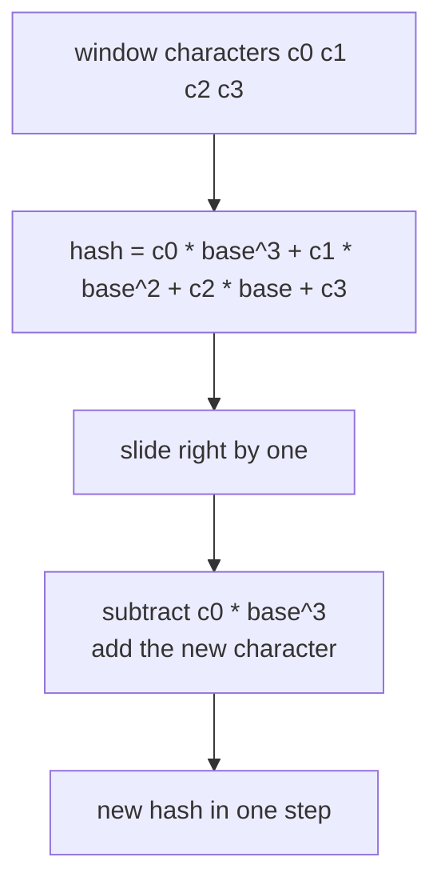
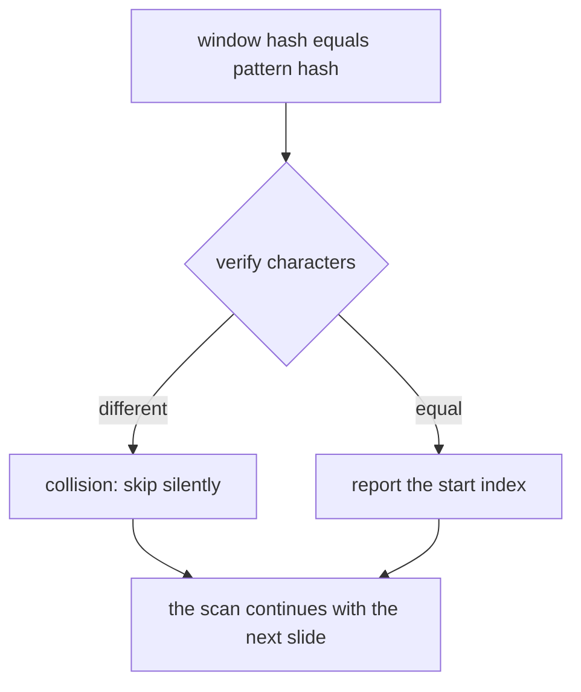
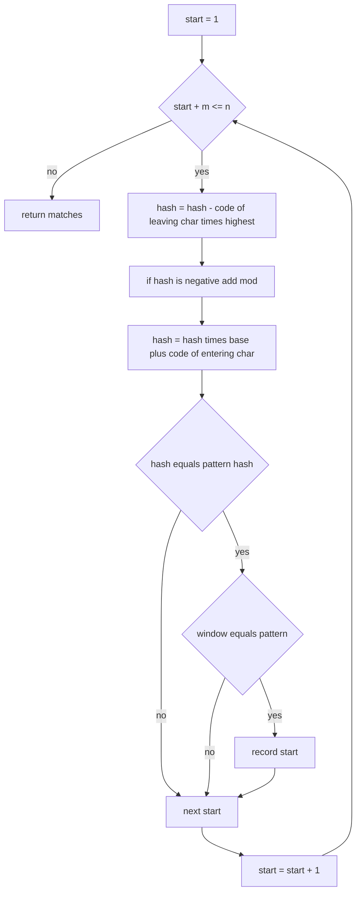
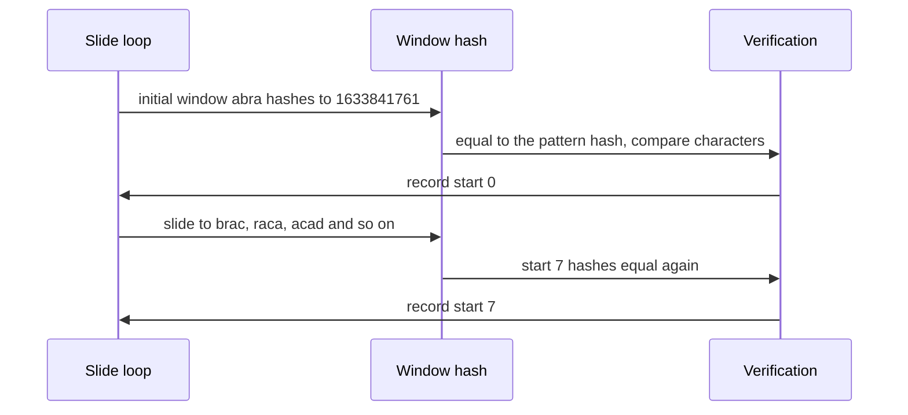

# 186 — Rabin-Karp rolling hash string search.

> **Tier:** Beginner · **CTCI chapter:** Beyond — Advanced Data Structures & Algorithms
> **Task spec:** [186-rabin-karp-rolling-hash-string-search.md](../../../tasks/beginner/186-rabin-karp-rolling-hash-string-search.md)
> **Solutions:** [Python](../../../solutions/python/beginner/186-rabin-karp-rolling-hash-string-search/solution.py) ·
> [Java](../../../solutions/java/beginner/186-rabin-karp-rolling-hash-string-search/Solution.java) ·
> [JavaScript](../../../solutions/javascript/beginner/186-rabin-karp-rolling-hash-string-search/solution.js) ·
> [C#](../../../solutions/csharp/beginner/186-rabin-karp-rolling-hash-string-search/Solution.cs)

## 1. Problem restatement

**Input:** a `text` of `n` characters, a `pattern` of `m` characters, and optional `base` and `mod`
parameters for the hash (defaults `256` and `1_000_000_007`). Either string may be empty.

**Output:** every start index where `pattern` occurs in `text`, in increasing order, overlapping
occurrences included. An empty pattern returns `[]` — the same convention as
[185-kmp-search-using-prefix-function.md](../../../tasks/beginner/185-kmp-search-using-prefix-function.md).

The task spec is one line, so the contract comes from the four solution files, which all assert:

| Call | Result | Why |
| --- | --- | --- |
| `rabin_karp("abracadabra", "abra")` | `[0, 7]` | two occurrences, far apart |
| `rabin_karp("aaaaa", "aa")` | `[0, 1, 2, 3]` | overlapping windows |
| `rabin_karp("abcabcabc", "abc")` | `[0, 3, 6]` | repeated block |
| `rabin_karp("abcd", "bcd")` | `[1]` | matches at the tail |
| `rabin_karp("aaaa", "b")` / `("ab", "abc")` | `[]` | no match / pattern too long |
| `rabin_karp("", "a")` / `("", "")` / `("anything", "")` | `[]` | empty inputs and the empty-pattern convention |
| `rabin_karp("a", "a")` | `[0]` | single character |

They also assert on repetition-heavy inputs: `"a" * 1000 + "b"` with `"a" * 20` yields every start
from `0` to `980` (`list(range(981))`), the same text with `"ab"` yields `[999]`, and
`"ab" * 300` with `"abab"` yields the even indices `0, 2, …, 596`.

Then come two randomized cross-checks against a naive `startsWith` scan: 200 random pairs with
the default modulus (seed `17`; JavaScript uses its own LCG), and 200 more with `base = 256,
mod = 101` — a deliberately tiny modulus that makes hash collisions common, to prove the
verification step filters them out. Finally the files assert that a *real* collision exists in
their generated text: among all length-3 windows hashed with `mod = 101`, two different windows
share a hash value.

## 2. Intuition

The naive scan compares `m` characters per alignment. Rabin-Karp instead gives every window of
length `m` a **fingerprint**, computed with a polynomial rolling hash:

```text
h = c0 * base^(m - 1) + c1 * base^(m - 2) + ... + c(m - 1)   (mod mod)
```

The pattern's fingerprint is computed once. Then the trick: when the window slides one position
right, the new fingerprint is derivable from the old one in constant time —

```text
h_new = base * (h_old - c_leaving * base^(m - 1)) + c_entering   (mod mod)
```

because every remaining character's weight multiplies by exactly `base`. So all `n - m + 1` window
hashes cost `O(n)` total instead of `O(n · m)`.



A hash equality is only *evidence* of a match, because two different windows can collide modulo
`mod`. So every hash hit is confirmed with a direct substring comparison. That step is what makes
the result exact: a false positive can never be reported, and the tiny-modulus tests exist to prove
the confirmation is really there.



## 3. Algorithm

1. If the pattern is empty, return `[]`. If `m > n`, return `[]`.
2. Compute `highest = base^(m - 1) mod mod` with a simple loop — the weight of the leaving
   character.
3. Build the hash of the pattern and of the first window with the same Horner recurrence
   `h = (h * base + code(c)) mod mod`.
4. If the first window's hash matches the pattern's hash **and** the substring equals the pattern,
   record index `0`.
5. For each start `s` from `1` to `n - m`:
   1. Drop the leaving character: `h = (h - code(text[s - 1]) * highest) mod mod`, adding `mod`
      when the result is negative in languages with a sign-preserving remainder.
   2. Append the entering character: `h = (h * base + code(text[s + m - 1])) mod mod`.
   3. If `h` equals the pattern hash and the window equals the pattern, record `s`.
6. Return the recorded indices.

```text
function rabin_karp(text, pattern, base, mod)
    if pattern is empty or length(pattern) &gt; length(text) then
        return empty list
    end
    m ← length(pattern)
    n ← length(text)
    highest ← base^(m - 1) mod mod
    pattern_hash ← 0
    window_hash ← 0
    for i ← 0 to m - 1 do
        pattern_hash ← (pattern_hash * base + code(pattern[i])) mod mod
        window_hash ← (window_hash * base + code(text[i])) mod mod
    end
    matches ← empty list
    if window_hash = pattern_hash and text[0 .. m - 1] = pattern then
        append 0 to matches
    end
    for start ← 1 to n - m do
        window_hash ← (window_hash - code(text[start - 1]) * highest) mod mod
        window_hash ← (window_hash * base + code(text[start + m - 1])) mod mod
        if window_hash = pattern_hash and text[start .. start + m - 1] = pattern then
            append start to matches
        end
    end
    return matches
end
```

The slide is the heart of the algorithm: one subtraction of a weighted term and one multiplication
to shift everything else up by a power of `base`.



## 4. Worked example

Trace `rabin_karp("abracadabra", "abra")` with the default `base = 256` and `mod = 1_000_000_007`.
The pattern hash is built by Horner's rule and equals `1633841761`, and the weight of a leaving
character is `highest = 256^3 = 16777216`.

| Start | Window | Slide arithmetic | Window hash | Match? |
| --- | --- | --- | --- | --- |
| 0 | `abra` | initial build | `1633841761` | hash equal and substring equal → record `0` |
| 1 | `brac` | `1633841761 - 97·16777216 = 6451809`, then `·256 + 99` | `1651663203` | no |
| 2 | `raca` | `1651663203 - 98·16777216 = 7496035`, then `·256 + 97` | `1918985057` | no |
| 3 | `acad` | `1918985057 - 114·16777216 = 6382433`, then `·256 + 100` | `1633902948` | no |
| 4 | `cada` | `1633902948 - 97·16777216 = 6512996`, then `·256 + 97` | `1667327073` | no |
| 5 | `adab` | `1667327073 - 99·16777216 = 6382689`, then `·256 + 98` | `1633968482` | no |
| 6 | `dabr` | `1633968482 - 97·16777216 = 6578530`, then `·256 + 114` | `1684103794` | no |
| 7 | `abra` | `1684103794 - 100·16777216 = 6382194`, then `·256 + 97` | `1633841761` | hash equal and substring equal → record `7` |

The result is `[0, 7]`. Note that the value arriving at start `7` is exactly the pattern hash
reached from a completely different direction — that is what makes the rolling update a real
recurrence rather than a coincidence. Every intermediate value stays below `mod`, so the arithmetic
fits comfortably in the 64-bit integers the Java and C# versions use.

The same slide explains the repetition-heavy assertions. For text `"a" * 1000 + "b"` and pattern
`"a" * 20`, consecutive `a`-windows slide into each other with no change at all, so all `981`
windows hash to the pattern hash and each is confirmed by comparison; the single occurrence of
`"ab"` sits at index `999`.

Collisions are the part that a hand trace cannot show, so the files force them. With `mod = 101`
and `base = 256`, the length-3 windows of the generated text collide, and the tiny-modulus loops
assert that the answer still matches the naive scan exactly. The Python and JavaScript files go
further and assert that a collision *exists* in their sample text:

```text
two distinct windows with one hash, found by scanning all length-3 windows of the sample
→ proves the verification branch is actually exercised, not just present
```



## 5. Complexity

Let `n` be the text length, `m` the pattern length, and suppose the pattern occurs `k` times.

| Measure | Bound | Why it holds |
| --- | --- | --- |
| Hash build | `O(m)` | `highest` via a `m - 1` step loop plus `m` Horner steps |
| Sliding | `O(n)` | `n - m` slides, each two arithmetic operations |
| Verification | `O(m)` per hash hit | a direct comparison of the window with the pattern |
| Expected total | `O(n + m)` | hash hits are rare for a large `mod`, so the `k` verifications are cheap |
| Worst-case total | `O(n · m)` | a text of `n` identical characters with a pattern of `m` identical characters hashes equal at every position, so every window is compared |
| Space | `O(1)` extra | two hashes and a few counters; the output list is separate |
| Naive scan | `O(n · m)` always | no hashing, `m` comparisons per alignment |

The important asymmetry: KMP from
[185-kmp-search-using-prefix-function.md](../../../tasks/beginner/185-kmp-search-using-prefix-function.md)
is `O(n + m)` in the *worst* case because it never guesses. Rabin-Karp is linear only in
expectation, and the degradation is exactly the verification cost when many windows hash equal. The
compensating advantage is `O(1)` auxiliary state — no prefix array of size `m` — which is why the
rolling hash family shows up when `m` itself is large or when hashing is needed for other reasons
(duplicate detection, content-defined chunking, the rsync-style comparison in
[197-implement-checksum-based-file-difference-simplified-rsync-idea.md](../../../tasks/beginner/197-implement-checksum-based-file-difference-simplified-rsync-idea.md)).

Note also that `pow_mod` in these files is a plain loop rather than fast exponentiation: it costs
`O(m)` time, which is dominated by the `O(m)` hash build anyway, and the files comment on nothing
faster because the pattern is hashed once.

## 6. Pitfalls and edge cases

- **Never trust the hash alone.** Every recorded match is confirmed by comparing the substring.
  Without the comparison, `mod = 101` produces false matches, and the tiny-modulus tests would
  fail.
- **Negative remainders.** Python's `%` already returns a non-negative value for positive moduli,
  but Java, JavaScript and C# keep the sign, so those files add `mod` when the subtraction goes
  below zero. Omitting that gives a hash that never matches again after one slide.
- **Empty pattern returns no matches.** The convention is explicit in all four files; returning
  `n + 1` positions is the tempting alternative and it is wrong here.
- **`m > n` short-circuits.** Otherwise the slide loop bound `n - m` would be negative; the files
  return early instead of relying on the loop condition.
- **Default modulus is not the only configuration.** `base` and `mod` are parameters, and the tests
  deliberately pass `(256, 101)`. A caller choosing a modulus smaller than the character codes gets
  no error but many collisions — correctness survives, speed does not.
- **Weighted drop versus plain drop.** The leaving character must be multiplied by
  `base^(m - 1)`, the weight it carried inside the hash. Subtracting the bare character code is a
  classic bug: it produces hashes that drift and a search that silently misses matches.
- **`highest` is computed by `m - 1` multiplications.** For `m = 0` that loop would run `-1` times;
  the empty-pattern guard runs first, so the case never occurs.
- **Integer width.** Java and C# use `long` for the hash and cast the character codes; JavaScript's
  numbers stay exact for these magnitudes because `mod ≈ 1e9` and `base = 256`, giving products
  below `2^53`.
- **Text units.** All four hash `char` values or code points as they come: Python and JavaScript
  hash code points through `ord`/`charCodeAt` (respectively returned per iteration), while Java and
  C# index UTF-16 code units. A pattern with astral characters hashes stable values only against a
  text iterated the same way.
- **Output order.** Indices are appended while sliding left to right, so the result is already
  sorted — no post-processing is needed.

## 7. Variants and follow-ups

- **Exact, worst-case-linear matching.** [185-kmp-search-using-prefix-function.md](../../../tasks/beginner/185-kmp-search-using-prefix-function.md)
  trades `O(m)` memory for a guarantee, where this task trades a probabilistic step for `O(1)`
  memory.
- **Rolling hashes off strings.** [187-implement-basic-rolling-hash-for-integer-arrays.md](../../../tasks/beginner/187-implement-basic-rolling-hash-for-integer-arrays.md)
  applies the same slide to integer windows and groups duplicates by hash with exact confirmation,
  which is the natural generalisation of the verification idea here.
- **Double hashing.** Combining two different moduli (or a 64-bit modulus) makes collisions
  astronomically unlikely and removes the verification step from the hot path, at the cost of two
  hash updates per slide.
- **Checksums and content-defined chunking.** [197-implement-checksum-based-file-difference-simplified-rsync-idea.md](../../../tasks/beginner/197-implement-checksum-based-file-difference-simplified-rsync-idea.md)
  uses block hashes to find shared content between two files, the same fingerprinting trick applied
  to bytes rather than characters.
- The chapter walkthrough in [Arrays and Strings](../../ctci/01-arrays-and-strings.md) covers the
  string-scanning basics that this hash-based scan builds on.

## 8. Check yourself

1. Why is the slide update `O(1)` instead of `O(m)`?

<details><summary>Show answer</summary>

Because the hash is a polynomial: sliding one place multiplies every remaining character's weight
by `base`, which is exactly `h * base`, and the only character whose contribution is lost is the
leaving one. That character's contribution is a single constant, `code · base^(m - 1)`, so the whole
update is one subtraction and one multiplication followed by one addition.

</details>

2. What exactly does the verification step protect against, and why is it not optional?

<details><summary>Show answer</summary>

It protects against hash collisions: two different windows can map to the same value modulo `mod`.
Without the comparison, a colliding window would be reported as a match. The `mod = 101` tests make
collisions common precisely to prove that the confirmation filters them out and the reported list
still equals the naive scan's.

</details>

3. What input makes the running time degrade to `O(n · m)`, and what does that look like here?

<details><summary>Show answer</summary>

A text and pattern built from a single repeated character — for example `"a" * 1000 + "b"` with
`"a" * 20`. Every window hashes equal to the pattern hash, so each of the `981` hash hits triggers a
comparison of up to 20 characters. The result is still correct; only the work grows.

</details>

4. Python's `%` never returns a negative value for a positive modulus, but Java's does. Where does
   that matter in the slide?

<details><summary>Show answer</summary>

In `h - code * highest`. When the leaving contribution exceeds the current hash, the difference is
negative; Python wraps it into `[0, mod)` automatically, while Java, JavaScript and C# must add
`mod` explicitly. Skipping that step leaves a negative hash that can never equal the pattern hash
again, so matches after the first slide are missed.

</details>

5. Both this task and KMP solve substring search in expected `O(n + m)`. When would you prefer the
   hash-based version?

<details><summary>Show answer</summary>

When memory matters: KMP keeps a prefix array of size `m`, while the rolling hash keeps a constant
number of integers. It is also the better starting point when you need hashes for other reasons —
detecting duplicate blocks, comparing files, shingling near-duplicate documents — since the same
fingerprints can serve several purposes at once.

</details>
