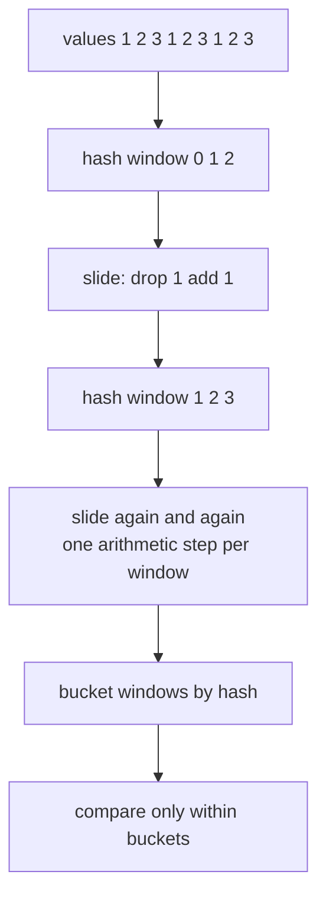
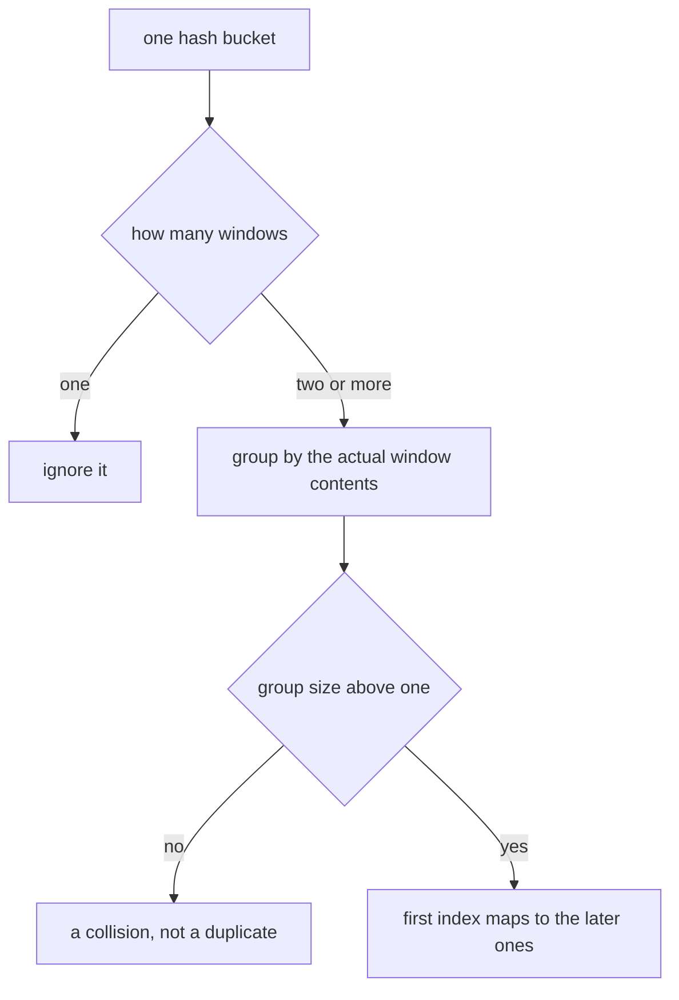
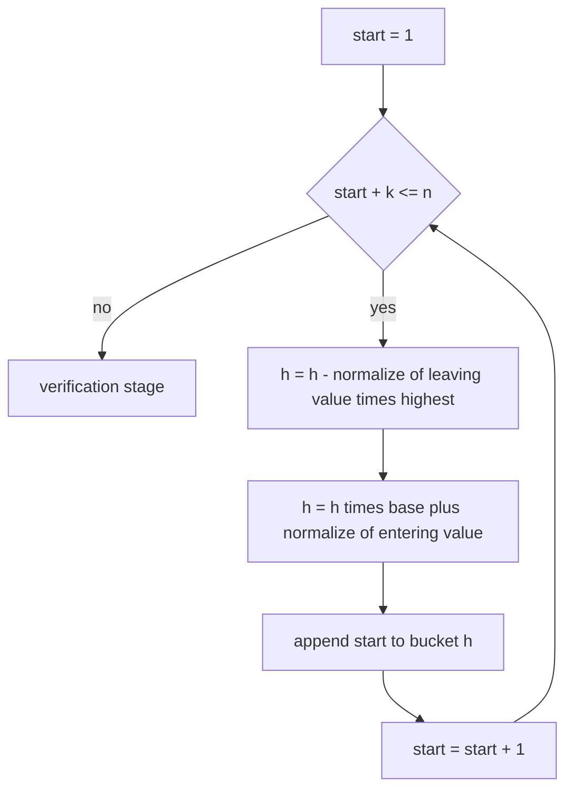
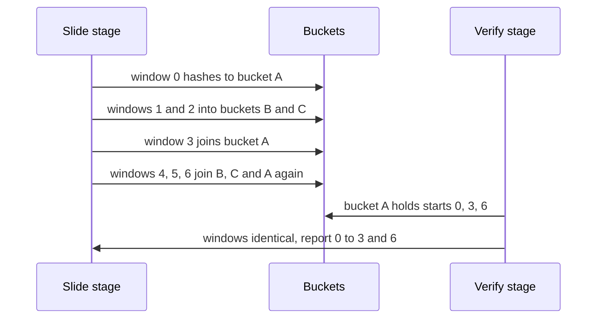

# 187 — Implement basic rolling hash for integer arrays.

> **Tier:** Beginner · **CTCI chapter:** Beyond — Advanced Data Structures & Algorithms
> **Task spec:** [187-implement-basic-rolling-hash-for-integer-arrays.md](../../../tasks/beginner/187-implement-basic-rolling-hash-for-integer-arrays.md)
> **Solutions:** [Python](../../../solutions/python/beginner/187-implement-basic-rolling-hash-for-integer-arrays/solution.py) ·
> [Java](../../../solutions/java/beginner/187-implement-basic-rolling-hash-for-integer-arrays/Solution.java) ·
> [JavaScript](../../../solutions/javascript/beginner/187-implement-basic-rolling-hash-for-integer-arrays/solution.js) ·
> [C#](../../../solutions/csharp/beginner/187-implement-basic-rolling-hash-for-integer-arrays/Solution.cs)

## 1. Problem restatement

**Input:** an integer array `values`, a window length `k`, and optional `base`/`mod` parameters for
the hash (defaults `257` and `1_000_000_007`).

**Output:** a map from the **first** start index of every repeated length-`k` window to the list of
its later start indices. Windows that occur once are omitted entirely, so an array with no repeats
maps to an empty result.

The task spec is one line, so the contract comes from the four solution files, which all assert:

| Input | Result | Why |
| --- | --- | --- |
| `[1,2,3,1,2,3,1,2,3]`, `k=3` | `{0: [3, 6], 1: [4], 2: [5]}` | three interleaved windows, each repeated |
| `[2,3,1,2,3,1,2,3,1,2,3]`, `k=3` | `{0: [3, 6], 1: [4, 7], 2: [5, 8]}` | the same idea shifted by one |
| `[5,5,5,5]`, `k=2` | `{0: [1, 2]}` | every window is identical, overlaps included |
| `[4,7,4,7,4]`, `k=2` | `{0: [2], 1: [3]}` | overlapping occurrences count as duplicates |
| `[7,7,8,7,7]`, `k=1` | `{0: [1, 3, 4]}` | single-element windows find equal values |
| `[1,2,3,1,2,4]`, `k=3` | `{}` | a near-duplicate is not a duplicate |
| `[1,2,3,4]`, `k=4` | `{}` | only one window exists |
| `[1,2,3,4]`, `k=5` | `{}` | `k > n` |
| `[]`, `k=2` | `{}` | no windows at all |
| `[-5,-5,3,-5,-5]`, `k=2` | `{0: [3]}` | negative values hash correctly |
| `[1,2]`, `k=0` | throws | a window length must be positive |

Results are ordered by first index (Python sorts the mapping, Java uses a `TreeMap`, C# a
`SortedDictionary`, and the JavaScript file renders the object keys numerically). Python, Java and
C# then cross-check against a naive grouping on 200 random arrays (seed `23`, values in `0..3`,
`k` in `1..4`), repeat the check with the tiny modulus pair `(257, 97)` to force collisions (200
more arrays, values in `0..199`, `k` in `1..3`), and finally assert a concrete collision:

```text
(5 * 257 + 63) mod 97  ==  (6 * 257 + 0) mod 97
```

so the windows `(5, 63)` and `(6, 0)` collide; the file asserts that an array containing both as
*different* windows still reports nothing, and that appending a genuine copy of `(5, 63)` reports
exactly `{0: [5]}`.

## 2. Intuition

Finding repeated windows naively means building a key for every window and grouping equal keys —
`O(n · k)` character work, and a key allocation per window. The rolling hash from
[186-rabin-karp-rolling-hash-string-search.md](../../../tasks/beginner/186-rabin-karp-rolling-hash-string-search.md)
removes most of that: compute the first window's polynomial hash, then update it in `O(1)` per
slide, and only windows whose hashes agree ever need a real comparison.



The bucket is a promise, not a verdict. Two different windows can hash to the same value, so each
bucket is subdivided by comparing the windows themselves. That second stage is what the concrete
collision in the tests is for: `(5, 63)` and `(6, 0)` share a hash under `mod = 97`, and the
algorithm must not report them as duplicates.



## 3. Algorithm

1. Reject `k ≤ 0` with an error. If `k > n`, return an empty result — there are no windows.
2. Compute `highest = base^(k - 1) mod mod`, the weight of the leaving element.
3. Build the hash of the first window (`values[0..k-1]`) with Horner's recurrence, normalising each
   value into `[0, mod)` so negative entries cannot break the arithmetic.
4. Put start index `0` into the bucket for that hash. For each `start` from `1` to `n - k`:
   1. `h ← (h - normalize(values[start - 1]) * highest) mod mod`, adding `mod` if the language's
      remainder can go negative.
   2. `h ← (h * base + normalize(values[start + k - 1])) mod mod`.
   3. Append `start` to the bucket for `h`.
5. For every bucket with at least two starts, group the starts by the actual window contents (the
   exact tuple of `k` values). For each group of two or more, record
   `first_index → [later indices]`.
6. Return the mapping sorted by first index.

```text
function find_duplicate_windows(values, k, base, mod)
    if k ≤ 0 then
        raise "window length must be positive"
    end
    if k &gt; length(values) then
        return empty mapping
    end
    n ← length(values)
    highest ← base^(k - 1) mod mod
    h ← 0
    for i ← 0 to k - 1 do
        h ← (h * base + normalize(values[i])) mod mod
    end
    buckets ← empty mapping from hash to list of starts
    append 0 to buckets[h]
    for start ← 1 to n - k do
        h ← (h - normalize(values[start - 1]) * highest) mod mod
        h ← (h * base + normalize(values[start + k - 1])) mod mod
        append start to buckets[h]
    end
    duplicates ← empty mapping
    for each (hash, starts) in buckets do
        if length(starts) ≥ 2 then
            groups ← empty mapping from window contents to list of starts
            for start in starts do
                append start to groups[window at start of length k]
            end
            for each (window, positions) in groups do
                if length(positions) ≥ 2 then
                    duplicates[positions[0]] ← positions[1 .. end]
                end
            end
        end
    end
    return duplicates sorted by first index
end

function normalize(value)
    return ((value mod mod) + mod) mod mod
end
```

Step 5 is the whole reason the structure is not simply "bucket by hash": a bucket may hold one
genuine group and several colliding strangers, and the grouping separates them.



## 4. Worked example

Trace `find_duplicate_windows([1, 2, 3, 1, 2, 3, 1, 2, 3], 3)`. There are seven windows
(`start = 0` to `6`), and the answer is `{0: [3, 6], 1: [4], 2: [5]}`.

| Start | Window | Relation to the previous window | Bucket |
| --- | --- | --- | --- |
| 0 | `(1, 2, 3)` | initial hash build | bucket A |
| 1 | `(2, 3, 1)` | drop `1`, append `1` | bucket B |
| 2 | `(3, 1, 2)` | drop `2`, append `2` | bucket C |
| 3 | `(1, 2, 3)` | drop `3`, append `3` | bucket A (same hash as start 0) |
| 4 | `(2, 3, 1)` | drop `1`, append `1` | bucket B (same hash as start 1) |
| 5 | `(3, 1, 2)` | drop `2`, append `2` | bucket C (same hash as start 2) |
| 6 | `(1, 2, 3)` | drop `3`, append `3` | bucket A (same hash as starts 0 and 3) |

After the slide stage the buckets are A = `[0, 3, 6]`, B = `[1, 4]`, C = `[2, 5]`, and every other
bucket is absent because every window of this array is one of the three. The verification stage
then confirms each bucket within itself:

| Bucket | Starts | Windows compared | Grouping | Reported |
| --- | --- | --- | --- | --- |
| A | `0, 3, 6` | all three are `(1, 2, 3)` | one group of three | `0 → [3, 6]` |
| B | `1, 4` | both are `(2, 3, 1)` | one group of two | `1 → [4]` |
| C | `2, 5` | both are `(3, 1, 2)` | one group of two | `2 → [5]` |

The result is exactly `{0: [3, 6], 1: [4], 2: [5]}`. Note that the mapping is keyed by the *first*
index of each group: `3` and `6` are values of the entry whose key is `0`, not keys of their own.

The overlapping case `[4, 7, 4, 7, 4]` with `k = 2` shows the same machinery with sliding
windows: the windows are `(4,7)`, `(7,4)`, `(4,7)`, `(7,4)`. Two buckets each hold two starting
points, and the result is `{0: [2], 1: [3]}` — position `2` is both the second occurrence of
`(4,7)` and an element of the window starting at `1`, which is fine because windows overlap.



The tiny-modulus assertions play a different role: with `mod = 97` two unrelated windows land in
the same bucket, so the verification stage must split that bucket into two single-element groups
and report nothing. That is the test that distinguishes "bucket by hash" from "bucket by hash and
then confirm".

## 5. Complexity

Let `n` be the array length, `k` the window length, and `c` the number of windows whose hash
collides with another window (including genuine duplicates).

| Measure | Bound | Why it holds |
| --- | --- | --- |
| Hash build | `O(k)` | `k - 1` steps for `highest` plus `k` Horner steps |
| Sliding | `O(n)` | `n - k` slides with constant arithmetic each |
| Bucketing | expected `O(n)` | one hash-map insert per window |
| Verification | `O(c · k)` | only colliding buckets build window keys of length `k` |
| Expected total | `O(n + k + c · k)` | with a large `mod`, `c` is close to the number of true duplicates |
| Worst case | `O(n · k)` | a tiny modulus (or a repetitive array) makes `c ≈ n` |
| Space | `O(n)` | buckets hold one start index per window; the output holds the reported groups |
| Naive grouping | `O(n · k)` time, `O(n · k)` space | a key is materialised for every window |

The practical difference from the naive grouping is the constant and the memory traffic: the hash
version allocates a key only for windows that share a bucket, and compares nothing at all for
windows that are unique by hash. With the default modulus of `1_000_000_007` and `base = 257`, the
expected number of colliding pairs is tiny even for large arrays, so the verification cost behaves
like "the number of real duplicates × k" rather than "n × k".

The design choice worth naming: verification is not optional. Report risk is symmetric — skipping
it silently invents duplicates, while hashing with a modulus so large that collisions "cannot
happen" only changes the probability, not the guarantee. The task keeps a moderate modulus and pays
`O(k)` on hits.

## 6. Pitfalls and edge cases

- **Hash equality is a candidate, not a duplicate.** The concrete `(5, 63)` / `(6, 0)` collision
  under `mod = 97` is asserted in the files precisely so this stage cannot be dropped.
- **Negative values need normalisation.** Python's `%` already returns a non-negative result for a
  positive modulus, but Java, JavaScript and C# keep the sign — those files route every value
  through a `normalize` helper. Without it, `[-5, -5, 3, -5, -5]` would produce garbage hashes.
- **`k ≤ 0` is an error, `k > n` is not.** An impossible window length is a caller bug and throws
  (`ValueError`, `RangeError`, `IllegalArgumentException`, `ArgumentException`); a window longer
  than the array simply has no occurrences, and the files return an empty mapping.
- **Overlaps count.** `[4, 7, 4, 7, 4]` with `k = 2` reports overlapping windows. A caller wanting
  disjoint repeats must post-process the index lists.
- **`k = n` yields nothing.** There is exactly one window, so no group can have two members; the
  same holds for the empty array.
- **Keyed by the first occurrence.** The result maps the earliest start of each group to the later
  ones. Collapsing the groups into a flat list of starts would lose that structure.
- **Ordering is part of the contract.** Python sorts explicitly, Java and C# use sorted maps, and
  the JavaScript result is a plain object whose keys are strings — the test helper converts keys to
  numbers before sorting, because `"10" < "2"` lexicographically. Relying on object key order
  without that step produces an unstable-looking answer.
- **Small `base` or `mod` changes speed, not correctness.** The files pass `(257, 97)` purely to
  make collisions frequent and prove the confirmation works; correctness is unaffected either way.
- **Memory for the keys.** Verification materialises a window key (a tuple, a comma-joined string
  or a sliced array) per colliding window. On a heavily colliding input that is the dominant cost.
- **Integer width.** The hash values stay below `mod ≈ 1e9`, and each slide multiplies by `base`
  before reducing, so products stay inside 64-bit range in Java and C# and below `2^53` in
  JavaScript.

## 7. Variants and follow-ups

- **The string version.** [186-rabin-karp-rolling-hash-string-search.md](../../../tasks/beginner/186-rabin-karp-rolling-hash-string-search.md)
  slides a hash over characters and confirms single matches; this task slides over integers and
  groups windows, so the two together cover both the search and the grouping use of the same hash.
- **Exact matching without hashing.** [185-kmp-search-using-prefix-function.md](../../../tasks/beginner/185-kmp-search-using-prefix-function.md)
  and [184-implement-prefix-function-kmp-for-pattern-matching.md](../../../tasks/beginner/184-implement-prefix-function-kmp-for-pattern-matching.md)
  find repeats with borders instead of fingerprints, in worst-case linear time and `O(m)` state.
- **Block checksums over bytes.** [197-implement-checksum-based-file-difference-simplified-rsync-idea.md](../../../tasks/beginner/197-implement-checksum-based-file-difference-simplified-rsync-idea.md)
  looks for shared blocks between two files, which is this duplicate-window search applied to a
  file's bytes.
- **Two moduli.** Hashing with two independent moduli (or one 64-bit modulus) makes collisions
  negligible and lets the verification stage become a rare fallback rather than a routine step.
- **Longest repeated substring.** Binary-searching the window length `k` with this duplicate search
  as the predicate finds the longest repeated substring in `O(n log n)` hashes.

## 8. Check yourself

1. Why does the algorithm need a verification stage if the window hash already matched?

<details><summary>Show answer</summary>

Because hashing is many-to-one: different windows can produce the same value modulo `mod`. The
concrete example in the files is `(5, 63)` and `(6, 0)` under `base = 257, mod = 97`. Only a direct
comparison of the window contents can turn a hash match into a reported duplicate, and the
tiny-modulus test run exists to keep that step honest.

</details>

2. What does `find_duplicate_windows([1, 2, 3, 4], 4)` return, and why?

<details><summary>Show answer</summary>

`{}`. Only one window of length four exists in a four-element array, and a group with one member is
not a duplicate. The same reasoning applies when `k > n`: the code returns early because no window
exists at all.

</details>

3. In `[1,2,3,1,2,3,1,2,3]` with `k = 3`, why is the answer keyed by `0`, `1` and `2` rather than by
   all seven starts?

<details><summary>Show answer</summary>

Because each distinct window content appears as one group, and the map is keyed by the group's
first start index. `(1,2,3)` occurs at `0`, `3` and `6`, so it contributes the single entry
`0 → [3, 6]`; likewise `(2,3,1)` gives `1 → [4]` and `(3,1,2)` gives `2 → [5]`.

</details>

4. Where does the negative-value handling live, and why is it needed?

<details><summary>Show answer</summary>

In the polynomial arithmetic: a negative value must be shifted into `[0, mod)` before it is folded
into the hash, which the Java, JavaScript and C# files do with a `normalize` helper
(`((value % mod) + mod) % mod`). Python gets that behaviour from `%` directly. Without it, the
leaving-value subtraction can produce a negative hash that never matches again, and the array
`[-5, -5, 3, -5, -5]` would report nothing.

</details>

5. When does the expected runtime stop looking linear?

<details><summary>Show answer</summary>

When many windows share a hash bucket, because every one of them builds a comparison key of length
`k`. A tiny modulus (as in the `(257, 97)` test run) or a highly repetitive array makes that happen
for almost every window, giving `O(n · k)` — the same as the naive grouping. Verification cost is
proportional to collisions, not to `n`.

</details>
