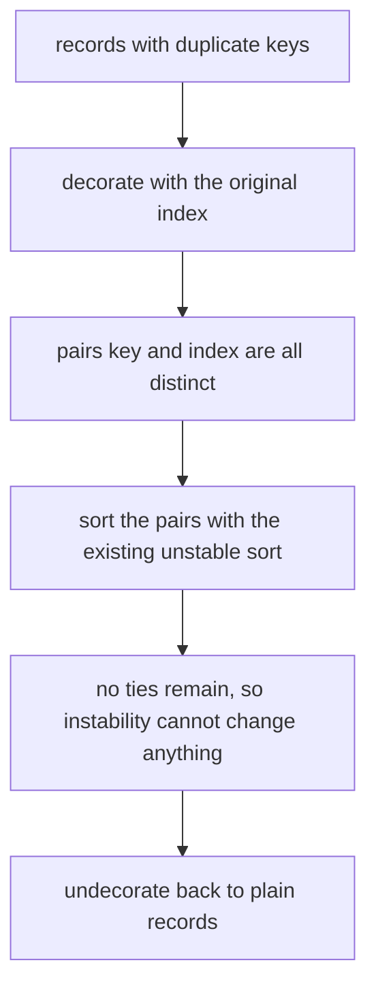
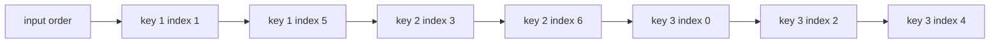
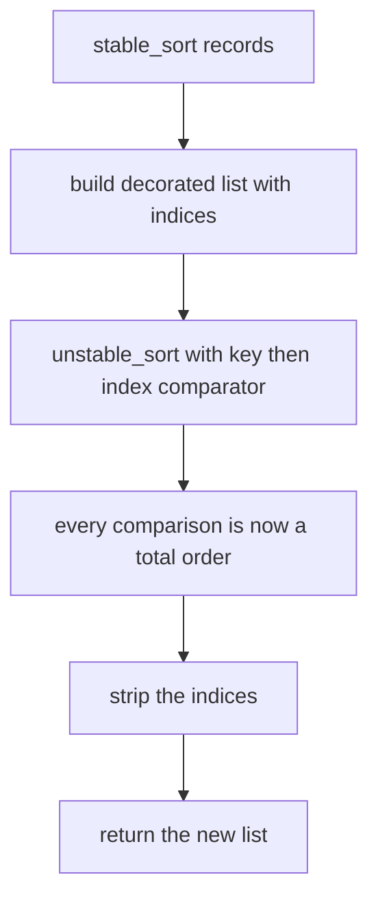
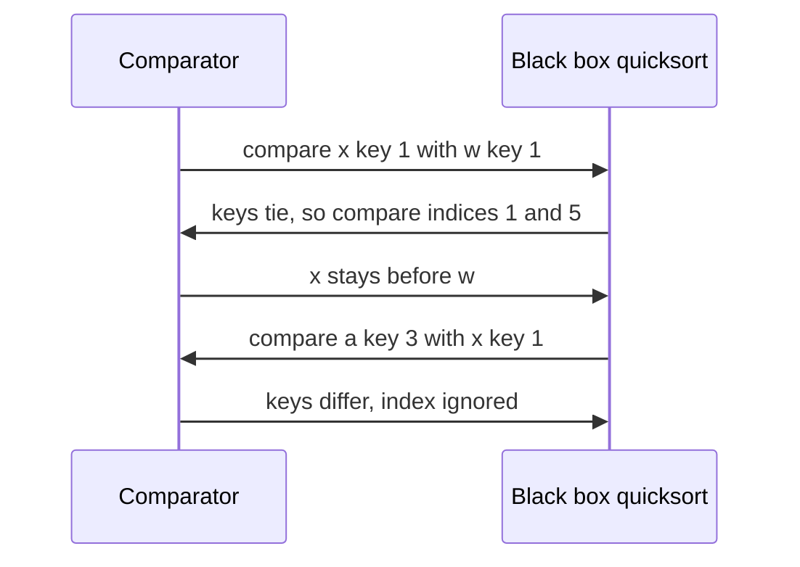

# 188 — Implement stable sort wrapper around existing unstable sort.

> **Tier:** Beginner · **CTCI chapter:** Beyond — Software Engineering & Tooling
> **Task spec:** [188-implement-stable-sort-wrapper-around-existing-unstable-sort.md](../../../tasks/beginner/188-implement-stable-sort-wrapper-around-existing-unstable-sort.md)
> **Solutions:** [Python](../../../solutions/python/beginner/188-implement-stable-sort-wrapper-around-existing-unstable-sort/solution.py) ·
> [Java](../../../solutions/java/beginner/188-implement-stable-sort-wrapper-around-existing-unstable-sort/Solution.java) ·
> [JavaScript](../../../solutions/javascript/beginner/188-implement-stable-sort-wrapper-around-existing-unstable-sort/solution.js) ·
> [C#](../../../solutions/csharp/beginner/188-implement-stable-sort-wrapper-around-existing-unstable-sort/Solution.cs)

## 1. Problem restatement

**Input:** a list of records, each with an integer `key` and a string `tag`, plus a sort by `key`.
The black box available for sorting is **unstable**: it orders records by key, but records that
share a key may come out in any relative order.

**Output:** a sort that is **stable** — records with equal keys must appear in the same relative
order as in the input — while reusing the unstable black box rather than writing a new sorting
algorithm from scratch. The input list must not be modified.

The task spec is one line, so the contract comes from the four solution files. They all assert the
same scenario:

| Input (keys and tags in order) | Stable result | Why |
| --- | --- | --- |
| `(3,a) (1,x) (3,b) (2,y) (3,c) (1,w) (2,z)` | `(1,x) (1,w) (2,y) (2,z) (3,a) (3,b) (3,c)` | within each key group, the original order survives |
| the same input after the call | `(3,a) (1,x) (3,b) (2,y) (3,c) (1,w) (2,z)` | the caller's list is untouched |
| `(1,p) (1,q) (1,r) (1,s)` | unchanged | one key group: stability means "return it as it was" |
| `(0,p) (-1,q) (0,r) (-1,s)` | `(-1,q) (-1,s) (0,p) (0,r)` | negative keys behave the same |
| `[]` | `[]` | nothing to sort |
| `(9,only)` | `(9,only)` | a single record |

The files also assert the properties of the black box itself: the raw unstable sort must produce
keys in non-decreasing order and must be a *permutation* of the input (nothing lost, nothing
duplicated). Finally, a 120-record batch with keys drawn from `0..4` (seed `41`, tags `tag-000` …
`tag-119`) is sorted and checked three ways: keys sorted, result is a permutation, and every key
group has exactly the tags of the original group in the original relative order.

Which black box each language uses differs, and the files document it: Python and Java hand-roll a
**Lomuto quicksort** with a strict `<` comparison (Python because the built-in sort is already
stable, Java because object sorting is TimSort and primitive sorting cannot carry a payload);
JavaScript does the same because `Array.prototype.sort` is stable since ES2019; C# uses
`Array.Sort`, an introsort that "gives no stability guarantee", which is exactly the property being
wrapped.

## 2. Intuition

Stability is about *ties*. An unstable sort breaks ties however its partitioning happens to fall
out; a stable sort must preserve the input order among equal keys. The naive fixes are unattractive:

- sort by `key` and then repair the ties — repairing requires knowing the original positions, which
  means storing them anyway;
- write a merge sort — correct, but that is a new sorting algorithm, not a wrapper.

The insight is that **you can remove ties instead of handling them**. If each record carries a
unique number, and that number is part of the sort key, then no two records ever compare equal.
An unstable sort with no ties has exactly one valid output — the sorted order of the decorated
keys — so its instability becomes irrelevant.



The original index is the natural unique tag: it is already distinct, it is already known, and
comparing it preserves exactly the property we want — among equal keys, smaller index first, which
is the definition of stability.



The decorated comparison is lexicographic: compare `key` first, and only when the keys are equal
compare the index. That is one extra integer comparison per tie and nothing at all otherwise.

## 3. Algorithm

1. **Decorate.** Walk the input and build a new list of entries, each carrying the original record
   together with its original index (a tuple, a field, or an object property, depending on the
   language).
2. **Sort.** Call the unstable black box on the decorated list with a comparator that compares
   `key` first and `index` second. Every comparison is now a total order on distinct entries.
3. **Undecorate.** Walk the sorted decorated list and emit the records in place order, discarding
   the indices.
4. Return the new list — the input list is never mutated (all four files copy before decorating).

```text
function stable_sort(records)
    decorated ← empty list
    for index ← 0 to length(records) - 1 do
        append (key(records[index]), index, records[index]) to decorated
    end
    ordered ← unstable_sort(decorated, compare by (key, index))
    result ← empty list
    for each entry in ordered do
        append the record part of entry to result
    end
    return result
end

function compare(left, right)
    if key(left) ≠ key(right) then
        return key(left) - key(right)
    end
    return index(left) - index(right)
end
```

The black box itself is a Lomuto quicksort in three of the four files: pick the last element as
pivot, move every smaller element to the front, place the pivot after them, then recurse on the two
sides. The loop form recurses on the left part and continues iterating on the right, so the
right-hand side needs no extra stack frame.

```text
procedure unstable_sort(items, compare)
    if items is empty then
        return items
    end
    quick(0, length(items) - 1)

    procedure quick(lo, hi)
        while lo &lt; hi do
            pivot ← items[hi]
            store ← lo
            for j ← lo to hi - 1 do
                if compare(items[j], pivot) &lt; 0 then
                    swap items[store] with items[j]
                    store ← store + 1
                end
            end
            swap items[store] with items[hi]
            quick(lo, store - 1)
            lo ← store + 1
        end
    end
end
```

Because the partition test is a strict `<`, an element equal to the pivot is left where it is and
the pivot lands after it — the tie order is whatever the partitioning produced, which is precisely
why the raw sort is documented as unstable.



## 4. Worked example

Trace the main assertion: `(3,a) (1,x) (3,b) (2,y) (3,c) (1,w) (2,z)`.

**Decoration** pairs each record with its position:

| Index | Record | Decorated entry |
| --- | --- | --- |
| 0 | `(3, a)` | `(key 3, index 0, a)` |
| 1 | `(1, x)` | `(key 1, index 1, x)` |
| 2 | `(3, b)` | `(key 3, index 2, b)` |
| 3 | `(2, y)` | `(key 2, index 3, y)` |
| 4 | `(3, c)` | `(key 3, index 4, c)` |
| 5 | `(1, w)` | `(key 1, index 5, w)` |
| 6 | `(2, z)` | `(key 2, index 6, z)` |

**Sort** by `(key, index)`. The pairs are all distinct, so the sorted sequence is unique:

| Sorted position | Entry | Key | Index |
| --- | --- | --- | --- |
| 0 | `x` | 1 | 1 |
| 1 | `w` | 1 | 5 |
| 2 | `y` | 2 | 3 |
| 3 | `z` | 2 | 6 |
| 4 | `a` | 3 | 0 |
| 5 | `b` | 3 | 2 |
| 6 | `c` | 3 | 4 |

**Undecorate** drops the indices and yields `x, w, y, z, a, b, c`, exactly the asserted output.
Notice that the index column is strictly increasing inside each key group — that *is* stability,
expressed as an inequality.

A comparison trace for the tie group makes the mechanism concrete. Comparing entry `(1, 1, x)` with
entry `(1, 5, w)`: the keys are equal, so the comparator falls through to `1 < 5` and keeps `x`
first. Comparing `(3, 0, a)` with `(1, 1, x)`: the keys differ, so the index never matters and `1`
sorts first.



The randomized batch closes the loop: with 120 records over five keys, each key group has roughly
24 members, so a wrong comparator would almost certainly shuffle them. The files assert group by
group that the ordered tags equal the original tags with that key — a check that the "keys are
sorted" assertion alone cannot make.

## 5. Complexity

Let `n` be the number of records.

| Measure | Bound | Why it holds |
| --- | --- | --- |
| Decorate | `O(n)` time, `O(n)` space | one new entry per record |
| Sort | the black box's own cost | the wrapper adds one integer comparison per tie and no extra passes |
| Undecorate | `O(n)` | one copy per record |
| Total | same order as the black box | Lua's quicksort: expected `O(n log n)`, worst case `O(n²)` on adversarial pivots |
| Extra space | `O(n)` | the decorated list, plus `O(n)` worst-case recursion depth in the quicksort |
| Extra comparisons | one per tie | `key` is compared first, the index only when the keys are equal |
| Correctness cost | zero | the decorated order is a total order, so the black box's instability is unobservable |

The asymptotic cost of the wrapper is the same as the cost of the black box — the constant factor
grows by the decoration pass and by the occasional second comparison. Where stability is worth that
price is in multi-key sorting: sort by the secondary key first, then by the primary key with a
stable sort, and the result is sorted by the pair, with no comparator juggling.

The worst case of the hand-rolled Lomuto quicksort is worth naming: choosing the last element as
pivot degenerates on already-sorted input, where every partition peels off one element. The `while`
form re-uses the frame for the right-hand side but still recurses on the left-hand side, so a
fully degenerate input produces recursion depth proportional to `n`. That is a property of the
documented black box, not of the wrapper.

## 6. Pitfalls and edge cases

- **The index must be part of the comparison, not merely carried along.** Decorating with an index
  and then sorting by `key` alone leaves ties again, and the black box is free to shuffle them.
- **Never mutate the caller's list.** All four solutions copy into a new list or array before
  decorating; the files assert the input order after the call (`a,x,b,y,c,w,z`).
- **Undecorate back to the original record type.** Java, JavaScript and C# build fresh record
  objects when undecorating, so the caller's objects are not shared with the decorated copies — if
  the caller later mutates a returned record, the input is unaffected.
- **Empty input must not reach the partition step.** Python and JavaScript guard with
  `if result:` / `if (out.length)`, because `quick(0, -1)` would be a nonsense range; Java's
  `while (lo < hi)` handles it, and C#'s `Array.Sort` accepts an empty array.
- **One distinct key means "return the input order".** `(1,p) (1,q) (1,r) (1,s)` must come back
  unchanged; this is the assertion that catches a comparator that ignores the index.
- **Negative keys.** Nothing in the wrapper assumes non-negative keys — the comparator subtracts or
  compares integers — so `(-1,q) (-1,s) (0,p) (0,r)` is the same story with a different range.
- **Single record and single window of keys.** `(9, only)` sorts trivially; the interesting cases
  are always the groups of size two or more.
- **The black box is still unstable; the wrapper is what is stable.** The raw-call assertions in
  the files deliberately check only "keys sorted" and "is a permutation", because tie order from
  the raw call is allowed to differ.
- **Sorting by a composite key inside the black box would work too**, but it changes the black box;
  the whole point of this task is to leave it alone and put the fix outside.
- **Stability is not the same as "sorted by key and tag".** Records with equal keys keep *input*
  order, which has nothing to do with their tags or values.

## 7. Variants and follow-ups

- **Merge sort: stable by construction.** A merge that prefers the left run on ties is inherently
  stable and needs no decoration; the wrapper exists for the case where the available primitive is
  not. The sorting drills in [070-insertion-sort.md](../../../tasks/beginner/070-insertion-sort.md)
  show another stable-in-practice algorithm, while
  [068-heapsort-using-heap-operations.md](../../../tasks/beginner/068-heapsort-using-heap-operations.md)
  and [069-selection-sort.md](../../../tasks/beginner/069-selection-sort.md) are the classic
  unstable examples whose tie behaviour depends on their comparison discipline.
- **Sort by a composite comparator.** Sorting with `compare(key, then index)` directly is what the
  decorated version actually does; the decoration exists only because the black box's comparator
  interface may not accept it.
- **Multi-pass sorting.** Sort by the least significant key first and by the most significant last,
  using a stable sort each time, to sort by a tuple of keys — the classic reason stability matters.
- **External sorts.** When records do not fit in memory, a stable merge of sorted runs is the
  standard approach, and the decoration trick still applies to the in-memory chunk sorts.
- The chapter walkthrough in [Sorting and Searching](../../ctci/10-sorting-and-searching.md) frames
  stability among the properties that decide which sort to reach for.

## 8. Check yourself

1. Why does adding the original index to the key make the sort stable?

<details><summary>Show answer</summary>

Because the decorated entries are all distinct. Any pair with equal keys is separated by the index,
so equal keys can no longer be reordered: the smaller index must come first, and the smaller index
is the record that appeared first in the input. Removing all ties removes the only situation where
an unstable sort can differ from a stable one.

</details>

2. What exactly does the wrapper cost compared with calling the black box directly on the records?

<details><summary>Show answer</summary>

One `O(n)` decoration pass, one `O(n)` undecoration pass, `O(n)` extra space for the decorated
list, and at most one extra integer comparison per comparison of equal keys. The asymptotic sorting
cost is unchanged, so the wrapper is essentially free unless the black box is dominated by
comparison cost on many ties.

</details>

3. Why do the files assert the input order *after* calling the stable sort?

<details><summary>Show answer</summary>

Because stability is a property of the returned order, and a naive implementation could achieve it
by sorting the caller's list in place. The assertion `a,x,b,y,c,w,z` after the call pins down that
the wrapper works on a copy, which is the contract a general-purpose sorting helper should have.

</details>

4. If the records had a unique secondary field, could you use it instead of the index?

<details><summary>Show answer</summary>

Only if it happens to sort in the same order as the input positions. The requirement is not
uniqueness for its own sake — it is that the tie-breaker must reproduce the *original order*, and
the original index is the only field guaranteed to do that. A unique but arbitrary field like a tag
would give a deterministic order, but not the input order, so the result would not be stable.

</details>

5. The quicksort used as the black box picks the last element as pivot. What input makes it slow,
   and does that affect the correctness of `stable_sort`?

<details><summary>Show answer</summary>

Already-sorted or reverse-sorted input makes Lomuto's partition peel one element at a time, giving
`O(n²)` time and deep recursion. Correctness is unaffected — the decorated order is a total order,
so a slow run still produces the unique sorted result — and the wrapper does not add or remove that
weakness, which is why the files document the black box as "unstable" rather than "good".

</details>
