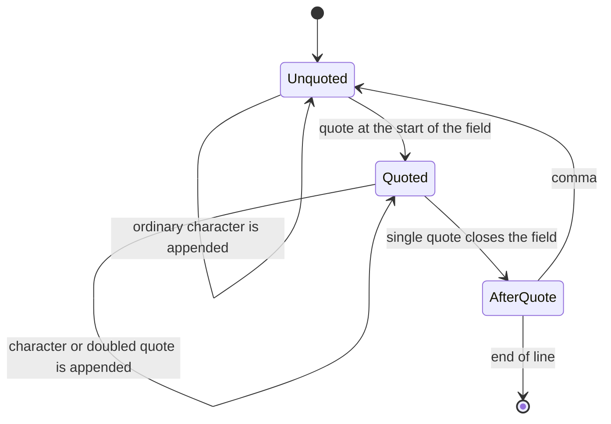
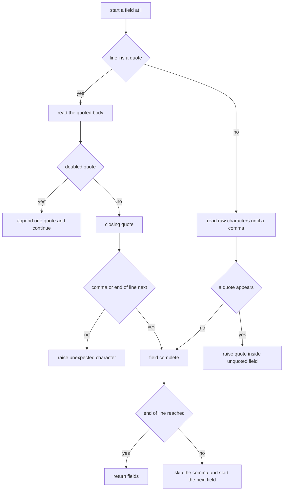
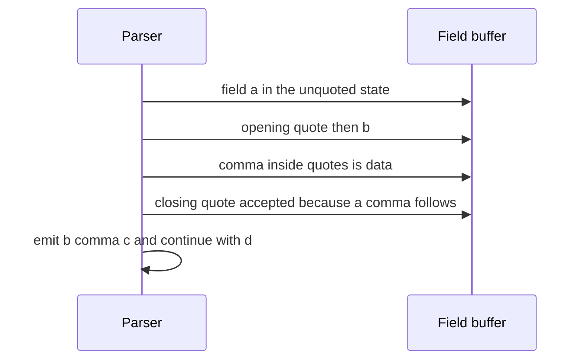

# 189 — Implement simple CSV parser (line -> fields).

> **Tier:** Beginner · **CTCI chapter:** Ch 7 — Object-Oriented Design
> **Task spec:** [189-implement-simple-csv-parser-line-fields.md](../../../tasks/beginner/189-implement-simple-csv-parser-line-fields.md)
> **Solutions:** [Python](../../../solutions/python/beginner/189-implement-simple-csv-parser-line-fields/solution.py) ·
> [Java](../../../solutions/java/beginner/189-implement-simple-csv-parser-line-fields/Solution.java) ·
> [JavaScript](../../../solutions/javascript/beginner/189-implement-simple-csv-parser-line-fields/solution.js) ·
> [C#](../../../solutions/csharp/beginner/189-implement-simple-csv-parser-line-fields/Solution.cs)

## 1. Problem restatement

**Input:** a single CSV line as a string. The supported rules, quoted verbatim from the files:

- `,` separates fields outside quotes;
- a field starting with `"` is quoted, and `""` inside a quoted field is one literal quote;
- only `,` or the end of the line may follow a closing quote — anything else is an error;
- an empty line yields one empty field, and a trailing comma yields a final empty field.

**Output:** the list of field values, with quotes removed and doubled quotes collapsed. Malformed
input raises: `ValueError` (Python), `Error` (JavaScript), `IllegalArgumentException` (Java),
`FormatException` (C#).

The task spec is one line, so the contract comes from the assertions the four files share:

| Line | Fields | Why |
| --- | --- | --- |
| `a,b,c` | `["a", "b", "c"]` | the ordinary case |
| `a,"b,c",d` | `["a", "b,c", "d"]` | quotes protect a comma inside a field |
| `"a""b",c` | `['a"b', "c"]` | doubled quote becomes one literal quote |
| `` (empty) | `[""]` | one empty field, not zero fields |
| `a,,c` | `["a", "", "c"]` | an empty middle field is legal |
| `a,b,` | `["a", "b", ""]` | the trailing comma opens a final empty field |
| `,,` | `["", "", ""]` | three empty fields |
| `"",x` | `["", "x"]` | a quoted empty field, quoted and empty |
| `"line""break"` | `['line"break']` | quoting does not create a field break |
| `"a,b","c,d"` | `["a,b", "c,d"]` | two quoted fields in a row |
| ` , ` | `[" ", " "]` | spaces are data, not padding |
| `"  spaced  ",tail` | `["  spaced  ", "tail"]` | quotes preserve internal spacing |
| `single` | `["single"]` | no commas, no quotes |

And the rejected inputs, asserted in every file: `a,"b,c` (unterminated quote), `"` (a lone
quote), `a,"b"c,d` (junk after the closing quote), `a"b` (a quote inside an unquoted field) and
`"unterminated`.

## 2. Intuition

The naive parser splits on commas — `line.split(",")` — and fails on the first field that contains
a comma, which is exactly the case CSV quoting exists for. Fixing that with a regular expression is
tempting and works until the doubles and the error cases arrive, because "a quoted field accepts
anything except an unescaped quote, after which only a comma or the end is allowed" is not a
regular language you want to write by hand.

The key insight is that the line is a **three-state machine**, and each character is interpreted
according to the state the parser is in:

- **unquoted** — commas separate fields; a quote here is an error, because it should have been at
  the start of the field;
- **quoted** — commas and quotes-with-partners are data; a lone quote ends the field;
- **after a closing quote** — only a comma or the end of the line is acceptable.



Every error in the task falls out of that machine: a quote in the `Unquoted` state is "quote inside
unquoted field"; ending the line in the `Quoted` state is "unterminated quoted field"; a character
other than a comma in the `AfterQuote` state is "unexpected character after closing quote".

```mermaid
flowchart LR
    A["a,&#34;b,c&#34;,d"] --> B["field a"]
    A --> C["quoted field b,c"]
    C --> C1["comma inside quotes is data"]
    A --> D["field d"]
```



## 3. Algorithm

1. Start at index `i = 0` with an empty field buffer.
2. If the current character is a quote, enter the **quoted** branch:
   1. Advance past the opening quote.
   2. Read characters into the buffer. If the line ends here, raise "unterminated quoted field".
   3. On a quote, look at the next character: if it is another quote, append one literal quote,
      advance by two and continue; otherwise this is the closing quote — advance one and leave the
      loop.
   4. After the loop, only a comma or the end of the line may remain; otherwise raise "unexpected
      character after closing quote".
3. Otherwise read the **unquoted** branch: append characters until a comma or the end of the line;
   a quote here raises "quote inside unquoted field".
4. Append the buffer to the field list.
5. If the end of the line has been reached, return the field list; otherwise skip the separating
   comma and repeat from step 2.

```text
function parse_csv_line(line)
    fields ← empty list
    i ← 0
    loop
        chunk ← empty buffer
        if i &lt; length(line) and line[i] = quote then
            i ← i + 1
            loop
                if i ≥ length(line) then
                    raise "unterminated quoted field"
                end
                if line[i] = quote then
                    if i + 1 &lt; length(line) and line[i + 1] = quote then
                        append quote to chunk
                        i ← i + 2
                        continue
                    end
                    i ← i + 1
                    exit inner loop
                end
                append line[i] to chunk
                i ← i + 1
            end
            if i &lt; length(line) and line[i] ≠ comma then
                raise "unexpected character after closing quote"
            end
        else
            while i &lt; length(line) and line[i] ≠ comma do
                if line[i] = quote then
                    raise "quote inside unquoted field"
                end
                append line[i] to chunk
                i ← i + 1
            end
        end
        append chunk to fields
        if i ≥ length(line) then
            return fields
        end
        i ← i + 1
    end
end
```

The outer `loop` has no counter: it repeats once per field and each iteration consumes at least the
separating comma. Two details carry the whole contract:

- the doubled-quote test happens **before** the closure test, because `""` is an escaped quote and
  not an empty quoted field followed by a close;
- after the closing quote the parser demands a comma or the end — that single check turns
  `a,"b"c,d` into an error instead of silently producing `a`, `bc`, `d`.



## 4. Worked example

Trace `parse_csv_line('a,"b,c",d')`, whose characters are indexed
`0:'a' 1:',' 2:'"' 3:'b' 4:',' 5:'c' 6:'"' 7:',' 8:'d'`.

| Field | `i` at entry | Branch | Steps | Buffer | Emitted |
| --- | --- | --- | --- | --- | --- |
| 1 | 0 | unquoted | read `a`, stop on the comma at `1` | `a` | `a`, then `i = 2` |
| 2 | 2 | quoted | skip the opening quote; read `b`; the comma at `4` is data; read `c`; the quote at `6` closes because the next character is `,` | `b,c` | `b,c`, then `i = 8` |
| 3 | 8 | unquoted | read `d`, reach the end of the line | `d` | `d`, end → return |

The result is `["a", "b,c", "d"]`. Field 2 is the one the naive split gets wrong: the comma at
index `4` is inside quotes, so it is data and not a separator.

Now trace `parse_csv_line('"a""b",c')`, characters
`0:'"' 1:'a' 2:'"' 3:'"' 4:'b' 5:'"' 6:',' 7:'c'`:

| Step | `i` | Character | Decision | Buffer |
| --- | --- | --- | --- | --- |
| 1 | 0 | `"` | opening quote, `i → 1` | `""` |
| 2 | 1 | `a` | ordinary quoted character, `i → 2` | `a` |
| 3 | 2 | `"` | next character is also `"` → escaped quote, `i → 4` | `a"` |
| 4 | 4 | `b` | ordinary quoted character, `i → 5` | `a"b` |
| 5 | 5 | `"` | next character is `,`, so this closes the field, `i → 6` | `a"b` |
| 6 | 6 | `,` | legal follower; emit `a"b`; skip the comma, `i → 7` | — |
| 7 | 7 | `c` | unquoted field, reach the end | `c` |

The result is `['a"b', "c"]`, exactly as asserted. Step 3 is the subtle one: the two consecutive
quotes at indices `2` and `3` are one escaped quote, not a closing quote followed by an opening
one.

The error paths are the same machine stopping in a bad state:

| Input | Where it fails | Message |
| --- | --- | --- |
| `a,"b,c` | quoted branch reaches the end of the line | unterminated quoted field |
| `"` | quoted branch, index `1` is past the end | unterminated quoted field |
| `a,"b"c,d` | after the closing quote, the next character is `c` | unexpected character after closing quote |
| `a"b` | unquoted branch meets a quote | quote inside unquoted field |
| `"unterminated` | quoted branch runs out of characters | unterminated quoted field |



The empty-line case is worth noting because it looks like a special case and is not: with
`i = 0` and no characters, the unquoted branch reads nothing, appends `""` as the field, and
returns `[""]`. A trailing comma behaves the same way — after skipping the comma, `i` is at the end
of the line and one more empty field is emitted.

## 5. Complexity

Let `L` be the length of the line and `F` the number of fields.

| Measure | Bound | Why it holds |
| --- | --- | --- |
| Time | `O(L)` | every character is inspected a constant number of times, and `i` only moves forward |
| Time, doubled quotes | `O(L)` | each escaped quote consumes two characters in one step |
| Space | `O(L + F)` | the output holds `L` characters (minus the removed quotes) plus `F` list slots |
| Buffer cost | `O(L)` total across fields | every character lands in exactly one field buffer |
| Regex alternative | — | a pattern can match simple fields but not the "junk after the closing quote" error cleanly |
| `split(",")` only | `O(L)` but wrong | it ignores quoting entirely and mis-parses `a,"b,c",d` |

The single-pass property is the design: there is no backtracking, no lookahead beyond one
character (the doubled-quote test), and no rewriting of the line. Each character is appended at
most once and copied at most once, so the parser is linear in the line length. The Java and C#
files build each field with a `StringBuilder`, JavaScript appends to a string built up per field,
and Python collects characters in a list that is joined at the end — all linear, differing only in
constant factors.

## 6. Pitfalls and edge cases

- **Spaces are data.** `" , "` parses to `[" ", " "]`, and `"  spaced  ",tail` keeps the internal
  spacing. No trimming happens anywhere; a field that starts with a space is unquoted, so a quote
  later in it is an error.
- **An empty line yields one empty field.** `[""]` — not `[]`, and not an error. The same logic
  gives a trailing empty field for `a,b,` and three fields for `,,`.
- **Only a field *starting* with a quote is quoted.** `a"b` is an error rather than `ab`, because
  the parser must not guess that the author meant a quoted field.
- **Doubled quotes are handled before the closing test.** Checking for a closing quote first turns
  `"a""b"` into two fields instead of `a"b`.
- **Junk after a closing quote is an error.** `a,"b"c,d` must not parse as `a`, `bc`, `d`. This is
  the rule that distinguishes a strict parser from a forgiving one, and the files assert it.
- **Unterminated quotes.** Both `"` and `"unterminated` raise; a lone quote is the degenerate case
  of a quoted field that never closes.
- **Line endings are the caller's job.** The function parses one line and treats `\r` as data; a
  file reader that hands over lines with Windows line endings must strip the `\r` first, as
  [196-implement-file-line-reader-that-yields-lines-lazily.md](../../../tasks/beginner/196-implement-file-line-reader-that-yields-lines-lazily.md)
  does for its lines.
- **No multi-line quoted fields.** Real RFC 4180 allows a quoted field to contain a newline. This
  API takes a single line, so that case cannot be represented — the parser never sees it, and a
  caller feeding it half a record gets a "unterminated quoted field" error rather than a silent
  corruption.
- **No type conversion.** Every field is a string. `"007"` stays `"007"`, and turning fields into
  numbers or dates is the caller's decision, since CSV itself carries no types.
- **Error messages differ per language but the conditions do not.** `ValueError`, `Error`,
  `IllegalArgumentException` and `FormatException`, with the same three failure conditions.

## 7. Variants and follow-ups

- **Tokenising expressions.** [193-implement-simple-expression-tokenizer.md](../../../tasks/beginner/193-implement-simple-expression-tokenizer.md)
  is the same "walk the line, classify the character" pattern for arithmetic input, with numbers
  and operators in place of fields and commas.
- **Evaluating what comes out.** [190-parse-and-evaluate-postfix-rpn-expression.md](../../../tasks/beginner/190-parse-and-evaluate-postfix-rpn-expression.md)
  consumes a token list — exactly the shape this parser produces — and reduces it with a stack.
- **Feeding lines in.** [196-implement-file-line-reader-that-yields-lines-lazily.md](../../../tasks/beginner/196-implement-file-line-reader-that-yields-lines-lazily.md)
  yields one line at a time, which is how this parser is meant to be used on a large file: parse
  each line as it arrives instead of loading the whole file.
- **Serialising the other way.** [198-serialize-object-to-json-string-manual.md](../../../tasks/beginner/198-serialize-object-to-json-string-manual.md)
  and [199-deserialize-json-with-arrays-objects-basic.md](../../../tasks/beginner/199-deserialize-json-with-arrays-objects-basic.md)
  handle a richer format, where the escaping rules are `\"` and `\\` instead of doubled quotes, and
  where nested structures replace the flat field list.
- The chapter walkthrough in [Object-Oriented Design](../../ctci/07-object-oriented-design.md)
  frames this kind of task as designing a small object with a sharp contract.

## 8. Check yourself

1. Why is `a"b` an error instead of the field `ab`?

<details><summary>Show answer</summary>

Because the quote did not start the field, so it cannot open a quoted section; it is a stray
character in an unquoted field. Accepting it would mean guessing the author's intent, and the files
document the strict rule: "a field starting with `"` is quoted" — a quote anywhere else in an
unquoted field raises.

</details>

2. What does `parse_csv_line('"a""b"')` return, and which test makes that work?

<details><summary>Show answer</summary>

`['a"b']`. The doubled-quote test runs before the closing-quote test, so the pair at the middle
collapses into a single literal quote and the final quote closes the field. The assertion
`parse_csv_line('"line""break"') == ['line"break']` pins this down.

</details>

3. How many fields does `parse_csv_line("")` produce, and why is that not an error?

<details><summary>Show answer</summary>

One: `[""]`. The outer loop always emits the field it is currently building, and the unquoted
branch simply reads zero characters. Zero fields would mean the line has no columns at all, which
contradicts the "a line is a row of fields" model the caller relies on.

</details>

4. A line reads `a,"b,c",` — what is the result?

<details><summary>Show answer</summary>

`["a", "b,c", ""]`. The quoted field is emitted at its closing quote, the comma is skipped, and the
end of the line then produces one more empty field — the same rule that makes `a,b,` end with an
empty field.

</details>

5. Why can this parser not be replaced by a single regular expression?

<details><summary>Show answer</summary>

Because the grammar is defined by *states* rather than by a character pattern: a comma is a
separator outside quotes and data inside them, a quote is an escape when doubled but a terminator
when single, and a closing quote imposes a requirement on the next character. A pattern can
approximate the field syntax, but reproducing the error contract (unterminated quote, junk after
the closing quote, quote inside an unquoted field) is exactly what the three-state machine makes
explicit.

</details>
