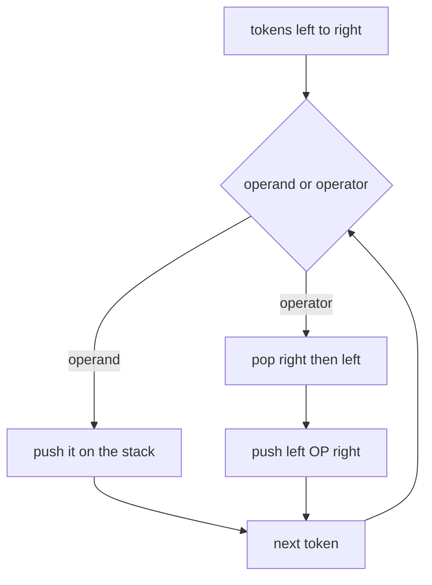
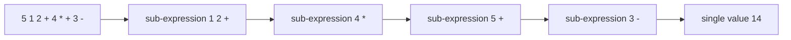
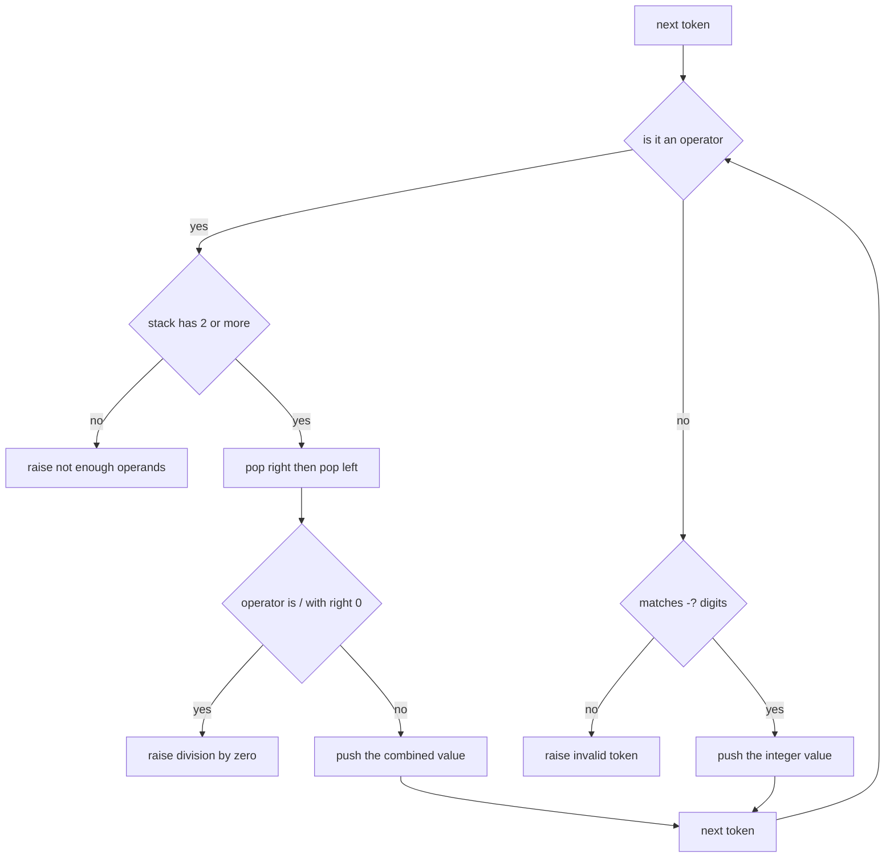
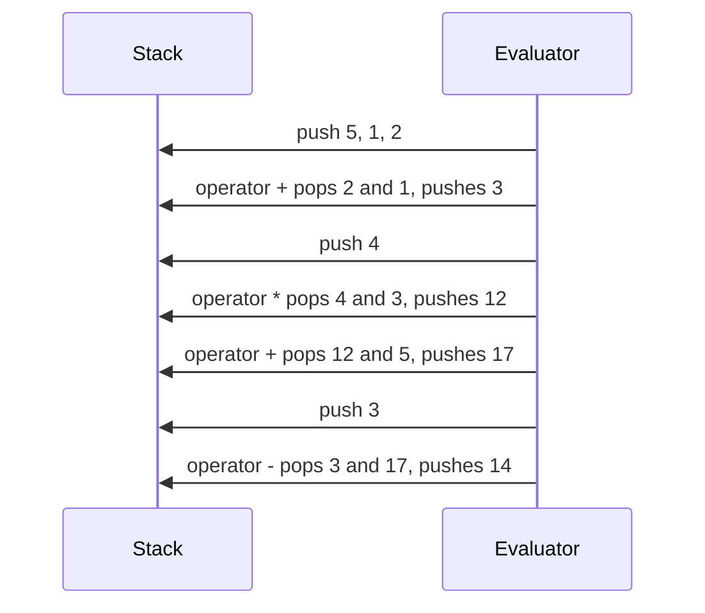

# 190 — Parse and evaluate postfix (RPN) expression.

> **Tier:** Beginner · **CTCI chapter:** Ch 3 — Stacks and Queues
> **Task spec:** [190-parse-and-evaluate-postfix-rpn-expression.md](../../../tasks/beginner/190-parse-and-evaluate-postfix-rpn-expression.md)
> **Solutions:** [Python](../../../solutions/python/beginner/190-parse-and-evaluate-postfix-rpn-expression/solution.py) ·
> [Java](../../../solutions/java/beginner/190-parse-and-evaluate-postfix-rpn-expression/Solution.java) ·
> [JavaScript](../../../solutions/javascript/beginner/190-parse-and-evaluate-postfix-rpn-expression/solution.js) ·
> [C#](../../../solutions/csharp/beginner/190-parse-and-evaluate-postfix-rpn-expression/Solution.cs)

## 1. Problem restatement

**Input:** an RPN (postfix) expression as a string of whitespace-separated tokens: integer operands
and the operators `+`, `-`, `*`, `/`. There are no parentheses and no unary operators.

**Output:** the integer value of the expression. `/` is integer division **truncating toward
zero**, as in C and Java. Every malformed input raises: division by zero, an unknown token, too few
operands for an operator, or a final stack that does not hold exactly one value. The exception type
is `ValueError` (Python), `Error` (JavaScript), `IllegalArgumentException` (Java),
`FormatException` or `DivideByZeroException` (C#).

The task spec is one line, so the contract comes from the assertions in the four solution files:

| Expression | Result | Why |
| --- | --- | --- |
| `3 4 +` | `7` | the smallest complete expression |
| `5 1 2 + 4 * + 3 -` | `14` | nested sub-expressions, evaluated left to right |
| `7 2 /` | `3` | truncating division |
| `42` and `  42  ` | `42` | a lone operand, with padding |
| `2 3 4 * +` | `14` | right-nested products |
| `1 2 + 3 *` | `9` | the sum feeds the product |
| `10 3 - 4 2 / *` | `14` | `(10 - 3) * (4 / 2)`, mixing both rules |
| `5 1 - 1 -` | `3` | chained subtraction |
| `0 5 /` | `0` | a zero numerator is fine |
| `-7 2 /`, `7 -2 /` | `-3` | truncation toward zero, not floor |
| `-7 -2 /` | `3` | two negatives give a positive |
| `-1 3 /` | `0` | the truncated result is zero, not `-1` |

Rejected: `1 0 /` and `0 0 /` (division by zero), `3 4` and `1 2 + 3` (leftover values), `+` and
`3 -` (missing operands), `""` and `"   "` (empty input), `abc`, `1 2 &`, `1.5 2 +` and `+5 1 +`
(unknown tokens). Note that `+5` and `1.5` are rejected on purpose: the integer token pattern is
`-?\d+`, so an explicit plus sign and a decimal point are both invalid.

## 2. Intuition

Postfix notation removes the need for precedence rules entirely: the operator simply follows its
two operands. What remains is a bookkeeping problem — knowing which two values an operator applies
to — and a stack is the natural bookkeeping device.

The sweep is the whole algorithm:

- an operand is a value that is not yet consumed, so push it;
- an operator consumes the two most recent values, so pop twice, combine, and push the result.



Two properties make the answer unambiguous. First, `+` and `*` are commutative but `-` and `/` are
not, so the *order* of the two pops matters: the first pop is the right operand. Second, a
well-formed expression leaves exactly one value on the stack; anything else means the input was
malformed, and the algorithm should say so rather than return whatever happens to be on top.



That nested sub-expression view is what makes the trace readable: RPN is a flat token stream whose
prefixes are themselves expressions, and the stack is holding the values of the parts that are
finished but not yet consumed.

## 3. Algorithm

1. Tokenise the expression on whitespace. An empty or whitespace-only string yields no tokens.
2. Create an empty integer stack.
3. For each token:
   1. If it is one of `+ - * /`:
      - if the stack holds fewer than two values, raise "not enough operands for `token`";
      - pop the **right** operand, then the **left** operand;
      - push `left + right`, `left - right`, `left * right`, or — after checking `right != 0` —
        `truncate(left / right)`.
   2. Otherwise: if the token does not match `-?\d+`, raise "invalid token"; else push its integer
      value.
4. After the loop, if the stack does not hold exactly one value, raise
   "expression leaves N values on the stack".
5. Return that value.

```text
function eval_rpn(expression)
    stack ← empty stack of integers
    for token in split_on_whitespace(expression) do
        if token is "+" or "-" or "*" or "/" then
            if size(stack) &lt; 2 then
                raise "not enough operands for " + token
            end
            right ← pop(stack)
            left ← pop(stack)
            if token = "+" then
                push(stack, left + right)
            else if token = "-" then
                push(stack, left - right)
            else if token = "*" then
                push(stack, left * right)
            else
                if right = 0 then
                    raise "division by zero"
                end
                push(stack, truncate_toward_zero(left / right))
            end
        else
            if token does not match an optional minus sign followed by digits then
                raise "invalid token: " + token
            end
            push(stack, integer value of token)
        end
    end
    if size(stack) ≠ 1 then
        raise "expression leaves " + size(stack) + " values on the stack"
    end
    return pop(stack)
end
```

The truncating division deserves its own note, because the four languages disagree about the
default. Java and C# `int` division already truncates toward zero, so those files use `/` directly.
Python's `//` floors, which would give `-4` for `-7 // 2`, so the Python file computes
`abs(left) // abs(right)` and negates when the operand signs differ. JavaScript's `/` produces a
float, so the file applies `Math.trunc` and then normalises a possible `-0`.

```text
function truncate_toward_zero(left, right)
    quotient ← abs(left) / abs(right)      (integer division)
    if sign(left) differs from sign(right) then
        return -quotient
    end
    return quotient
end
```



## 4. Worked example

Trace `5 1 2 + 4 * + 3 -`, which must evaluate to `14`. The stack is shown bottom-first.

| Token | Action | Stack after |
| --- | --- | --- |
| `5` | push | `[5]` |
| `1` | push | `[5, 1]` |
| `2` | push | `[5, 1, 2]` |
| `+` | pop `2` and `1`, push `1 + 2 = 3` | `[5, 3]` |
| `4` | push | `[5, 3, 4]` |
| `*` | pop `4` and `3`, push `3 * 4 = 12` | `[5, 12]` |
| `+` | pop `12` and `5`, push `5 + 12 = 17` | `[17]` |
| `3` | push | `[17, 3]` |
| `-` | pop `3` and `17`, push `17 - 3 = 14` | `[14]` |

The stack ends with exactly one value, so the loop's postcondition holds and `14` is returned. The
two subtractions in the table — nothing here — would be the place where operand order bites; the
`-` at the end takes `17` as the left operand because `17` was pushed first and therefore popped
second.



The division cases are checked separately because the sign is the whole point:

| Expression | Left | Right | Naive result | Expected | Rule applied |
| --- | --- | --- | --- | --- | --- |
| `7 2 /` | 7 | 2 | `3.5` → `3` | `3` | truncation |
| `-7 2 /` | -7 | 2 | floor would give `-4` | `-3` | truncate toward zero |
| `7 -2 /` | 7 | -2 | floor would give `-4` | `-3` | truncate toward zero |
| `-7 -2 /` | -7 | -2 | `3.5` → `3` | `3` | signs cancel |
| `-1 3 /` | -1 | 3 | `-0.33` → `0` | `0` | truncation to zero |

A language that used floored division for the last row would return `-1`, and the files guard
against that explicitly. The JavaScript file additionally normalises `Math.trunc(-1 / 3)`, which is
`-0` rather than `0` — a distinction the strict equality assertions can see.

Malformed input ends the same way, with the stack in a bad state:

| Input | Failure | Raised |
| --- | --- | --- |
| `3 4` | two values remain after the loop | expression leaves 2 values on the stack |
| `1 2 + 3` | two values remain after the loop | expression leaves 2 values on the stack |
| `+` | operator with an empty stack | not enough operands for `+` |
| `3 -` | operator with one value | not enough operands for `-` |
| `""`, `"   "` | empty stack after the loop | expression leaves 0 values on the stack |
| `abc`, `1 2 &`, `1.5 2 +`, `+5 1 +` | token fails `-?\d+` | invalid token |
| `1 0 /` | divisor is zero | division by zero |

## 5. Complexity

Let `t` be the number of tokens and `d` the maximum stack depth.

| Measure | Bound | Why it holds |
| --- | --- | --- |
| Time | `O(t)` | one push or one constant-time pop-pop-push per token |
| Tokenisation | `O(L)` | one pass over the line of length `L` |
| Space, stack | `O(d)` | at most one value live per unfinished sub-expression |
| Space, tokens | `O(t)` | the token list materialised before the sweep |
| Streaming variant | `O(d)` space | the sweep can consume tokens as they are produced, without the list |

The time bound is exactly linear because no token is ever revisited and no backtracking is needed:
postfix notation was designed so that a single left-to-right sweep suffices, with the stack depth
proportional to the nesting of the original expression. For a balanced expression of `t` tokens the
depth is `O(t)` in the worst case (a long chain of nested parentheses), `O(1)` for simple
left-to-right chains like `1 2 + 3 + 4 +`.

The token list is an implementation detail rather than a requirement: the evaluator only needs the
tokens one at a time, which is why the same logic composes with a streaming token source such as
[196-implement-file-line-reader-that-yields-lines-lazily.md](../../../tasks/beginner/196-implement-file-line-reader-that-yields-lines-lazily.md).

## 6. Pitfalls and edge cases

- **Pop order.** The first pop is the right operand. Swapping them turns `10 3 -` into `-7` and
  `8 4 /` into `0`; the files assert `5 1 - 1 -` equals `3` and `10 3 - 4 2 / *` equals `14`.
- **Truncation versus floor.** `/` must truncate toward zero. Python needs the explicit
  sign-corrected `abs` division; Java and C# get it from the language; JavaScript needs `Math.trunc`
  plus the `-0` normalisation.
- **`-0` is not the same value as `0` under strict comparison.** `Math.trunc(-1 / 3)` is `-0`, and
  the JavaScript assertions compare with `Object.is` semantics, so the file maps it to `0`
  explicitly.
- **Division by zero is an explicit check, not a crash.** All four raise a defined error rather
  than letting the language throw an arithmetic fault mid-expression.
- **The final stack must hold exactly one value.** Empty input gives "leaves 0 values"; `3 4` gives
  "leaves 2 values". Both are errors, and both are asserted.
- **Token validation is strict.** The accepted operand pattern is `-?\d+`: `1.5` and `+5` are
  rejected, so floats and redundant plus signs cannot leak in. Operators are matched before the
  number test, so `-` alone is "not enough operands", not an invalid number.
- **Operators look like negative numbers.** The token `-` and the token `-7` are different tokens
  because tokenisation is on whitespace; a hand-written scanner that treats `-` as a sign would
  mis-parse `- 7`.
- **`-` and `/` are left-associative here because the expression says so**, not because the
  evaluator decides. RPN carries no associativity — `5 1 2 + 4 * + 3 -` is one specific tree, and
  the conversion from infix is the job of
  [191-convert-infix-to-postfix-shunting-yard-simplified.md](../../../tasks/beginner/191-convert-infix-to-postfix-shunting-yard-simplified.md).
- **No parentheses, no unary operators, no functions.** Those are outside the task's contract; a
  postfix stream cannot contain them anyway.
- **Java and C# use wider stacks than needed.** `ArrayDeque<Integer>` boxes each value, and C#
  keeps a `List<int>` with `RemoveRange`; both are linear and correct, with different constants
  from a primitive array stack.

## 7. Variants and follow-ups

- **Producing the postfix stream.** [191-convert-infix-to-postfix-shunting-yard-simplified.md](../../../tasks/beginner/191-convert-infix-to-postfix-shunting-yard-simplified.md)
  turns an infix expression into exactly the token shape this evaluator consumes.
- **Doing both in one pass.** [192-evaluate-arithmetic-expression-with-parentheses-shunting-yard-ev.md](../../../tasks/beginner/192-evaluate-arithmetic-expression-with-parentheses-shunting-yard-ev.md)
  combines the conversion and the evaluation, with the classic precedence and associativity rules
  driving one stack.
- **Where the tokens come from.** [193-implement-simple-expression-tokenizer.md](../../../tasks/beginner/193-implement-simple-expression-tokenizer.md)
  builds a tokenizer for arithmetic input; this evaluator is the consumer of its output.
- **Stacks with extra powers.** [172-implement-stack-that-supports-getmin-in-o-1.md](../../../tasks/beginner/172-implement-stack-that-supports-getmin-in-o-1.md)
  and [173-implement-queue-that-supports-getmin-in-o-1.md](../../../tasks/beginner/173-implement-queue-that-supports-getmin-in-o-1.md)
  extend the same container idea, and [049-implement-stack-with-array-push-pop.md](../../../tasks/beginner/049-implement-stack-with-array-push-pop.md)
  builds the stack from scratch.
- The chapter walkthrough in [Stacks and Queues](../../ctci/03-stacks-and-queues.md) places
  expression evaluation among the classic stack applications.

## 8. Check yourself

1. Why does the algorithm pop twice for every operator, and why does the order matter?

<details><summary>Show answer</summary>

Because an operator combines the two most recently produced values, and in postfix those are the
operator's operands. The order matters for the non-commutative operators: the value popped second
is the left operand, so `10 3 -` is `7`, not `-7`. `+` and `*` would give the same answer either
way, which is why the tests always include subtraction and division.

</details>

2. What does `eval_rpn("3 4")` do, and why is it not `7`?

<details><summary>Show answer</summary>

It raises "expression leaves 2 values on the stack". Two operands with no operator means the
expression is incomplete, and the postcondition that exactly one value remains is what detects it.
Returning the top of the stack would silently ignore the `3`.

</details>

3. Why does the Python file need a hand-written truncating division instead of `//`?

<details><summary>Show answer</summary>

Because Python's `//` floors: `-7 // 2` is `-4`, while RPN division here must truncate toward zero
and give `-3`. The file therefore divides the absolute values and negates when the operand signs
differ, which reproduces the C/Java behaviour asserted by the `-7 2 /`, `7 -2 /`, `-7 -2 /` and
`-1 3 /` cases.

</details>

4. What is the stack depth for the expression `5 1 2 + 4 * + 3 -`, and where does it peak?

<details><summary>Show answer</summary>

Three, reached after `5`, `1` and `2` are pushed. From then on every operator consumes two values
and produces one, so the depth drops to two and then stays there until the final subtraction
leaves one value.

</details>

5. How would you evaluate the expression without materialising the token list?

<details><summary>Show answer</summary>

Scan the string with an index or a streaming token source and run the same loop over each token as
it is produced. The state is only the integer stack, so the memory becomes proportional to the
expression's nesting depth instead of to its length — the evaluator itself does not care where the
next token comes from.

</details>
