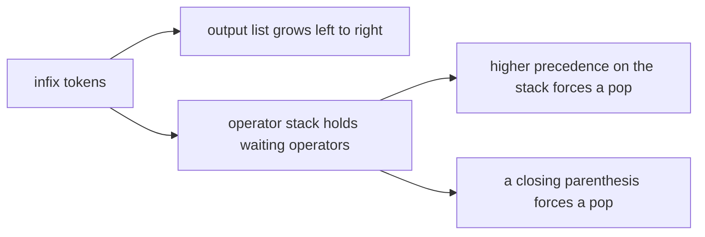
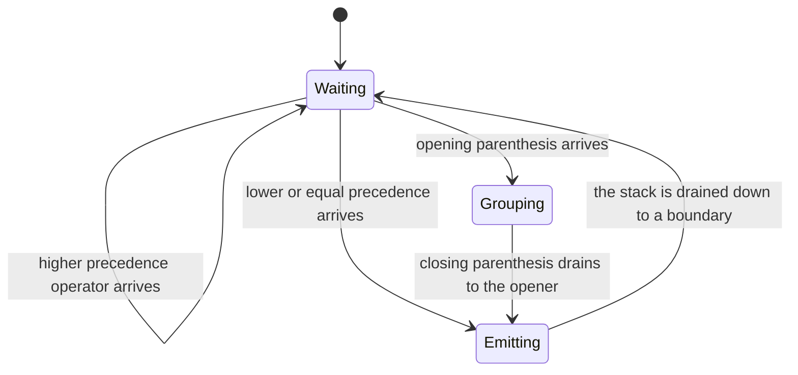
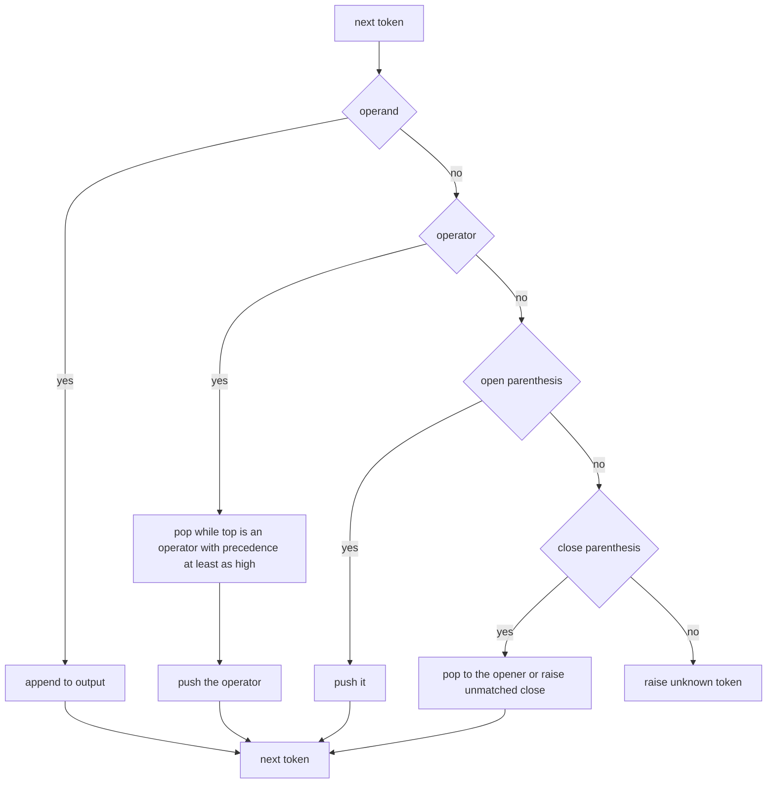
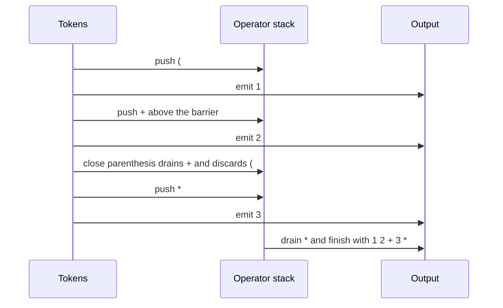

# 191 — Convert infix to postfix (shunting-yard simplified).

> **Tier:** Beginner · **CTCI chapter:** Ch 3 — Stacks and Queues
> **Task spec:** [191-convert-infix-to-postfix-shunting-yard-simplified.md](../../../tasks/beginner/191-convert-infix-to-postfix-shunting-yard-simplified.md)
> **Solutions:** [Python](../../../solutions/python/beginner/191-convert-infix-to-postfix-shunting-yard-simplified/solution.py) ·
> [Java](../../../solutions/java/beginner/191-convert-infix-to-postfix-shunting-yard-simplified/Solution.java) ·
> [JavaScript](../../../solutions/javascript/beginner/191-convert-infix-to-postfix-shunting-yard-simplified/solution.js) ·
> [C#](../../../solutions/csharp/beginner/191-convert-infix-to-postfix-shunting-yard-simplified/Solution.cs)

## 1. Problem restatement

**Input:** an infix arithmetic expression as a whitespace-separated token string using the
operators `+ - * /`, non-negative integer operands, and parentheses. All operators are
**left-associative**; unary operators and functions are not supported.

**Output:** the equivalent postfix expression as a space-separated token string, ready to be fed
to the evaluator of
[190-parse-and-evaluate-postfix-rpn-expression.md](../../../tasks/beginner/190-parse-and-evaluate-postfix-rpn-expression.md).

Mismatched parentheses and unknown tokens raise `ValueError` (Python), `Error` (JavaScript),
`IllegalArgumentException` (Java), `ArgumentException` (C#). The four files assert:

| Infix | Postfix | Why |
| --- | --- | --- |
| `3 + 4 * 2` | `3 4 2 * +` | `*` binds tighter than `+` |
| `( 1 + 2 ) * 3` | `1 2 + 3 *` | parentheses override precedence |
| `1 + 2 - 3` | `1 2 + 3 -` | left-associative `+ -` |
| `8 / 4 / 2` | `8 4 / 2 /` | left-associative `/` |
| `2 * 3 + 4 * 5` | `2 3 * 4 5 * +` | two equal-precedence groups |
| `( 1 + 2 ) * ( 3 - 4 )` | `1 2 + 3 4 - *` | two parenthesised operands |
| `( ( 12 ) )` | `12` | redundant parentheses vanish, they are not tokens in the output |
| `` (empty) | `` | nothing to convert |

Rejected inputs, asserted in every file: `1 + 2 )`, `( 1 + 2`, `( ( 1 ) + 2 ) )` (mismatched
parentheses), `1 + a` and `1 ^ 2` (unknown tokens).

## 2. Intuition

Writing `3 + 4 * 2` as `3 4 2 * +` moves each operator to the position where its operands are
already complete. The mechanical question is *when* an operator can be emitted: an operator may be
written out as soon as the operator that follows it can no longer be applied first.

That gives a single rule: **an operator waits until a more binding operator (or a closing
parenthesis) forces it out.**



The stack holds the operators whose right operand has not been fully read yet, and the output list
collects everything that is already final. Two container operations, one rule, one precedence
table:

- a higher-precedence operator arriving pushes on top and waits;
- a lower-or-equal-precedence operator arriving pops everything that can be resolved first.

Equal precedence is the left-associativity case: `8 / 4 / 2` must emit `8 4 / 2 /`, so the earlier
`/` is popped by the later one. That is the difference between `>=` and `>` in the pop condition,
and the tests pin it down.



## 3. Algorithm

1. Split the expression on whitespace into tokens.
2. Keep an `output` list and an operator `stack`, both empty.
3. For each token:
   1. **Operand** — append it to `output`.
   2. **Operator** — while the stack is non-empty, its top is an operator, and its precedence is
      `>=` the incoming operator's precedence, pop the top into `output`. Then push the incoming
      operator.
   3. **`(`** — push it on the stack. It acts as a barrier: the pop loop only compares operators,
      so a parenthesis stops the draining.
   4. **`)`** — pop operators into `output` until the top is `(`. If the stack empties first,
      raise "unmatched `)`". Otherwise pop the `(` and discard it.
   5. **Anything else** — raise "unknown token".
4. After the loop, drain the stack into `output`; if a `(` is still there, raise "unmatched `(`".
5. Join `output` with single spaces and return the string.

```text
function infix_to_postfix(expression)
    output ← empty list
    stack ← empty stack
    for token in split_on_whitespace(expression) do
        if token is an operand then
            append token to output
        else if token is an operator then
            while stack is not empty and top(stack) is an operator
                  and precedence(top(stack)) ≥ precedence(token) do
                append pop(stack) to output
            end
            push(stack, token)
        else if token = "(" then
            push(stack, token)
        else if token = ")" then
            while stack is not empty and top(stack) ≠ "(" do
                append pop(stack) to output
            end
            if stack is empty then
                raise "unmatched ')' in expression"
            end
            pop(stack)
        else
            raise "unknown token: " + token
        end
    end
    while stack is not empty do
        if top(stack) = "(" then
            raise "unmatched '(' in expression"
        end
        append pop(stack) to output
    end
    return join(output, " ")
end
```

The pop condition is the whole precedence and associativity logic in one line. `precedence(top) ≥
precedence(token)` means "everything on top can be finished before the new operator starts", and
`≥` rather than `>` is what makes equal-precedence operators come out in reading order.



## 4. Worked example

Trace `3 + 4 * 2`, whose postfix form must be `3 4 2 * +`:

| Token | Kind | Stack before | Pop loop | Output after | Stack after |
| --- | --- | --- | --- | --- | --- |
| `3` | operand | `[]` | — | `[3]` | `[]` |
| `+` | operator | `[]` | nothing to pop (stack empty) | `[3]` | `[+]` |
| `4` | operand | `[+]` | — | `[3, 4]` | `[+]` |
| `*` | operator | `[+]` | `+` has precedence 1, `*` has 2, so `1 ≥ 2` is false — no pop | `[3, 4]` | `[+, *]` |
| `2` | operand | `[+, *]` | — | `[3, 4, 2]` | `[+, *]` |
| end | drain | `[+, *]` | pop `*`, then `+` | `[3, 4, 2, *, +]` | `[]` |

The output joined is `3 4 2 * +`. The critical step is token `*`: the `+` underneath it stays
because `*` binds tighter, so the multiplication is forced to be emitted first when the drain
happens.

Now trace `( 1 + 2 ) * 3`, which must give `1 2 + 3 *`:

| Token | Kind | Pop loop | Output after | Stack after |
| --- | --- | --- | --- | --- |
| `(` | opener | — | `[]` | `[(]` |
| `1` | operand | — | `[1]` | `[(]` |
| `+` | operator | top is `(`, which is not an operator, so the loop stops immediately | `[1]` | `[(, +]` |
| `2` | operand | — | `[1, 2]` | `[(, +]` |
| `)` | closer | pop `+` into the output, then discard `(` | `[1, 2, +]` | `[]` |
| `*` | operator | stack is empty | `[1, 2, +]` | `[*]` |
| `3` | operand | — | `[1, 2, +, 3]` | `[*]` |
| end | drain | pop `*` | `[1, 2, +, 3, *]` | `[]` |

The parenthesised group became a self-contained postfix fragment `1 2 +`, and the outer `*`
follows it — exactly how the group behaves as a single operand.



Left-associativity is best seen on `8 / 4 / 2`. The first `/` is pushed; the second `/` arrives
with equal precedence, and the `≥` test pops the first one into the output before pushing the
second. Draining at the end appends the second, giving `8 4 / 2 /` — which
[190-parse-and-evaluate-postfix-rpn-expression.md](../../../tasks/beginner/190-parse-and-evaluate-postfix-rpn-expression.md)
then evaluates left to right as `(8 / 4) / 2 = 1`. With a strict `>` in the pop condition the
output would be `8 4 2 / /`, which evaluates as `8 / (4 / 2) = 4` — a silent change of meaning
rather than a crash, which is why the assertion exists.

## 5. Complexity

Let `t` be the number of tokens.

| Measure | Bound | Why it holds |
| --- | --- | --- |
| Time | `O(t)` | each token is pushed at most once and popped at most once; the pop loops are amortised |
| Space, stack | `O(t)` | in the worst case every operator waits, as in `1 + 2 + 3 + …` |
| Space, output | `O(t)` | the postfix form has the same number of tokens as the infix form |
| Precedence table | `O(1)` | four operators, two levels |
| Recursive-descent alternative | `O(t)` time, `O(depth)` stack | a parser replaces the explicit operator stack with the call stack |

The amortised argument is the same one that makes the prefix function linear: the inner `while`
loops look nested, but each operator is pushed once and popped once across the whole run, so the
total pop work is bounded by the number of tokens. The output token count equals the input token
count minus the parentheses, since parentheses are consumed into structure rather than emitted.

## 6. Pitfalls and edge cases

- **`≥` versus `>`, the associativity bug.** Equal precedence must pop, giving left associativity.
  Using `>` silently builds right-associative trees; the assertion `8 / 4 / 2 → 8 4 / 2 /` is
  there to catch it.
- **Parentheses stop the pop loop.** The condition must include "the top is an operator" (Python
  tests membership in the precedence table, the other files call `isOperator`). Without it, a `(`
  on the stack would be looked up in the precedence table and either raise or compare as
  undefined.
- **Two distinct parenthesis errors.** An unmatched `)` is detected during the loop (the stack
  empties while draining), while an unmatched `(` is detected only at the end, when the drain
  finds an opener. `( ( 1 ) + 2 ) )` triggers the first; `( 1 + 2` triggers the second.
- **Redundant parentheses disappear.** `( ( 12 ) )` yields `12`; parentheses do not survive into
  the postfix output because they carry no operation.
- **Empty input is not an error.** It yields the empty string, asserted in every file. Mismatched
  parentheses and unknown tokens are errors; emptiness is not.
- **Operands are non-negative digit runs.** The Python file uses `token.isdigit()`, the others a
  `\d+` test. A leading minus is not part of an operand — `-` is an operator — so negative numbers
  must be written as an expression such as `( 0 - 7 )`, exactly as the companion task 192 does.
- **Unknown tokens are rejected up front.** `1 ^ 2` and `1 + a` raise rather than being skipped,
  which keeps the conversion total: every accepted input has a postfix form.
- **Whitespace-separated tokens are required.** `3+4*2` is a single unknown token; the interface
  expects `3 + 4 * 2`. Splitting arithmetic without spaces is the tokenizer's job in
  [193-implement-simple-expression-tokenizer.md](../../../tasks/beginner/193-implement-simple-expression-tokenizer.md).
- **Output is a string, not a list.** All four files join with single spaces, so downstream code
  can re-split it or hand it straight to the RPN evaluator.
- **Associativity is fixed, not configurable.** `+ - * /` here are all left-associative; a real
  calculator would need a right-associative exponent operator, which this task deliberately does
  not support.

## 7. Variants and follow-ups

- **The consumer.** [190-parse-and-evaluate-postfix-rpn-expression.md](../../../tasks/beginner/190-parse-and-evaluate-postfix-rpn-expression.md)
  evaluates exactly the token stream this task produces, with the same truncating integer
  division.
- **Pipeline in one function.** [192-evaluate-arithmetic-expression-with-parentheses-shunting-yard-ev.md](../../../tasks/beginner/192-evaluate-arithmetic-expression-with-parentheses-shunting-yard-ev.md)
  chains tokenize, convert and evaluate, so the intermediate postfix form never has to be
  materialised by the caller.
- **Splitting the input.** [193-implement-simple-expression-tokenizer.md](../../../tasks/beginner/193-implement-simple-expression-tokenizer.md)
  turns a compact expression such as `3+4*2` into the whitespace-separated form expected here.
- **Right-associative operators.** Adding `^` with right associativity means comparing
  precedences with `>` for equal levels of the same operator class, and giving `^` a higher
  precedence than `* /`.
- **Compiling instead of evaluating.** The same shunting-yard output is a small bytecode stream: a
  postfix token list can be evaluated by a stack machine, which is how many interpreters execute
  expressions.
- The chapter walkthrough in [Stacks and Queues](../../ctci/03-stacks-and-queues.md) covers the
  operator-stack pattern this task is built on.

## 8. Check yourself

1. Why does an operator wait on the stack instead of being emitted immediately?

<details><summary>Show answer</summary>

Because its right operand may not be complete yet. `3 + 4 * 2` cannot emit the `+` when it is read:
the `*` that follows binds tighter, so the multiplication must appear before the addition in the
postfix stream. The stack holds operators in the order they must eventually be emitted.

</details>

2. When is an operator finally emitted, and what does the `≥` in the pop condition encode?

<details><summary>Show answer</summary>

It is emitted when a token arrives that has lower or equal precedence, or when a closing
parenthesis or the end of the input forces the stack to drain. `≥` encodes left associativity:
equal-precedence operators are drained in reading order, which is why `8 / 4 / 2` becomes
`8 4 / 2 /` and not `8 4 2 / /`.

</details>

3. What happens to the parentheses in the output?

<details><summary>Show answer</summary>

They are consumed rather than emitted. A `(` acts as a barrier that stops the pop loop, and a `)`
drains operators down to that barrier and then discards it. That is why `( ( 12 ) )` converts to
`12`: both pairs carried grouping information and nothing else.

</details>

4. Which input produces two different parenthesis errors in the same expression, and which error
   fires first?

<details><summary>Show answer</summary>

`( ( 1 ) + 2 ) )` ends with an extra `)`. The first four tokens balance fine, and the final `)`
drains the stack without ever finding an opener, so "unmatched `)`" is raised during the loop. The
"unmatched `(`" error can only be raised at the end, by the drain pass, as in `( 1 + 2`.

</details>

5. The conversion guarantees the postfix form has the same number of tokens as the infix form
   minus the parentheses. Why?

<details><summary>Show answer</summary>

Because every operand is emitted exactly once and every operator is emitted exactly once — pushed
onto the stack when read and popped exactly once. Parentheses are the only tokens with no output
representation, since they express structure rather than an operation.

</details>
