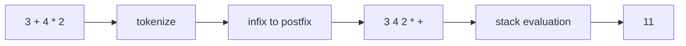
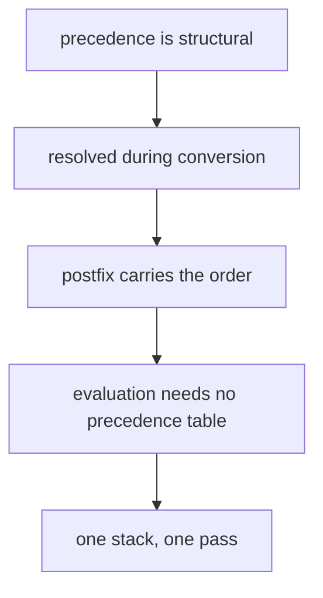
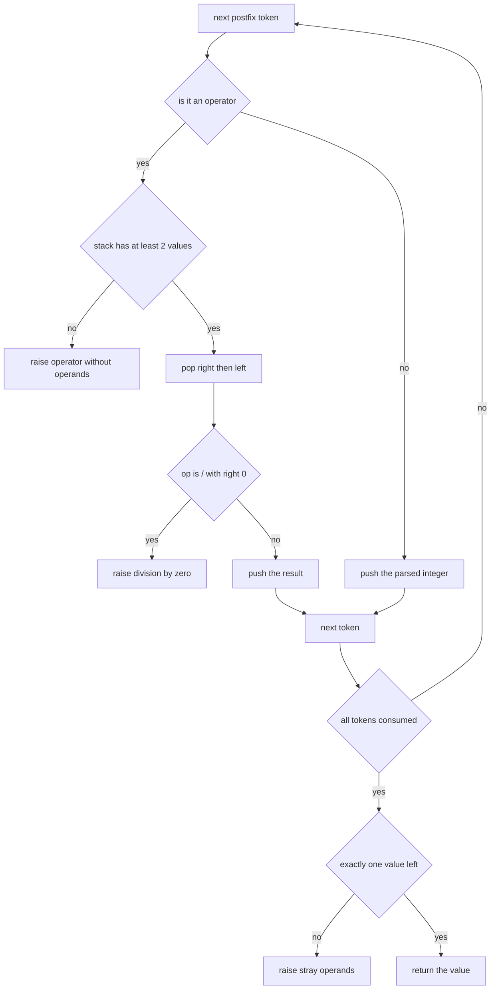
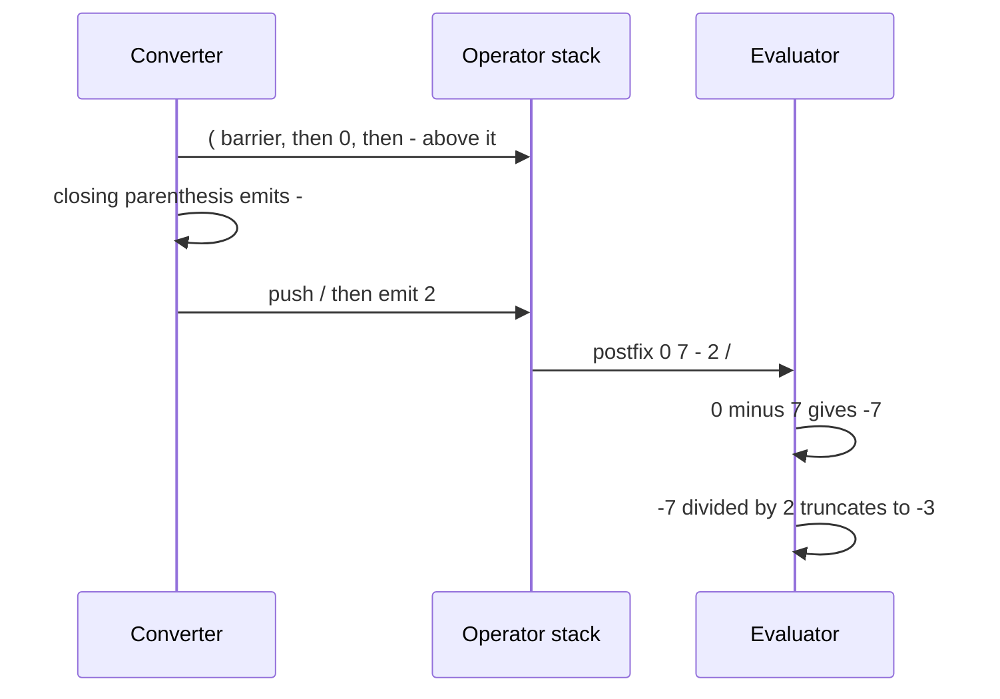

# 192 — Evaluate arithmetic expression with +,-,*,/, parentheses (shunting-yard + eval).

> **Tier:** Beginner · **CTCI chapter:** Ch 3 — Stacks and Queues
> **Task spec:** [192-evaluate-arithmetic-expression-with-parentheses-shunting-yard-ev.md](../../../tasks/beginner/192-evaluate-arithmetic-expression-with-parentheses-shunting-yard-ev.md)
> **Solutions:** [Python](../../../solutions/python/beginner/192-evaluate-arithmetic-expression-with-parentheses-shunting-yard-ev/solution.py) ·
> [Java](../../../solutions/java/beginner/192-evaluate-arithmetic-expression-with-parentheses-shunting-yard-ev/Solution.java) ·
> [JavaScript](../../../solutions/javascript/beginner/192-evaluate-arithmetic-expression-with-parentheses-shunting-yard-ev/solution.js) ·
> [C#](../../../solutions/csharp/beginner/192-evaluate-arithmetic-expression-with-parentheses-shunting-yard-ev/Solution.cs)

## 1. Problem restatement

**Input:** an infix expression over non-negative integer operands, the operators `+ - * /`, and
parentheses. The pipeline is stated in the files' own words: *tokenize → infix-to-postfix
(shunting-yard, left-associative `+ - * /`) → evaluate with a stack*. Arithmetic is integer-only and
division truncates toward zero, "like C/Java", so `( 0 - 7 ) / 2 == -3`.

**Output:** the integer value. Malformed expressions and division by zero raise an error
(`ValueError` in Python, `Error` in JavaScript, `ArgumentException` / `IllegalArgumentException`
in C# and Java).

The task spec is one line, so the four files define the contract. They assert:

| Expression | Result | Why |
| --- | --- | --- |
| `3 + 4 * 2` | `11` | `*` binds tighter than `+` |
| `( 1 + 2 ) * 3` | `9` | parentheses override precedence |
| `10 / 3` | `3` | integer division truncates |
| `2 * ( 3 + 4 ) - 5` | `9` | a group, then a subtraction |
| `( 0 - 7 ) / 2` | `-3` | truncation toward zero, not floor |
| `100 / 7 / 2` | `7` | left-associative division: `(100 / 7) / 2` |
| `7` | `7` | a bare number |
| `( ( 2 + 3 ) * ( 4 - 1 ) )` | `15` | nested groupings |

Rejected: `10 / 0` (division by zero), `( 1 + 2` and `( 1 + 2 ) )` and `1 + 2 )` (mismatched
parentheses), `1 +` (operator without operands), `""` (empty input), `3 @ 4` (unknown token).

Note how negative numbers appear: there is no unary minus in this grammar, so `-3` is written as
`( 0 - 7 ) / 2`. The files assert exactly that form when checking truncation.

## 2. Intuition

Evaluating infix directly requires precedence handling inside the evaluator. The task splits that
into two simpler problems, each of which is already solved by a stack:

1. **Convert** infix to postfix, where precedence and parentheses are resolved once and for all by
   [191-convert-infix-to-postfix-shunting-yard-simplified.md](../../../tasks/beginner/191-convert-infix-to-postfix-shunting-yard-simplified.md).
2. **Evaluate** the postfix stream left to right, where no precedence exists, as in
   [190-parse-and-evaluate-postfix-rpn-expression.md](../../../tasks/beginner/190-parse-and-evaluate-postfix-rpn-expression.md).



The insight is that the hard part — "which operator applies first" — is a *structural* question
that does not need the values at all. Once the structure is linearised into postfix, evaluation
becomes pure bookkeeping: push operands, pop two for an operator. Two small machines instead of one
big one.



The pipeline also gives each error a natural home: unknown characters are found while tokenising,
unmatched parentheses while converting, and missing operands or leftover values while evaluating.

## 3. Algorithm

1. **Tokenize.** Split on whitespace and validate every token: it must be a run of digits, one of
   `+ - * /`, or a parenthesis; otherwise raise "unknown token".
2. **Convert to postfix.**
   1. Operand → append to `output`.
   2. Operator → pop stack operators with precedence `>=` the incoming one into `output`, then push
      the incoming operator.
   3. `(` → push.
   4. `)` → pop into `output` until a `(` is on top (raise "unmatched `)`" if the stack empties),
      then discard the `(`.
   5. After the loop, drain the stack; a remaining `(` raises "unmatched `(`".
3. **Evaluate the postfix token list.**
   1. Operator → require at least two values, pop right then left, apply, push the result.
   2. Operand → parse and push.
   3. Division by zero → raise.
   4. After the loop, require exactly one value; otherwise raise "malformed expression: stray
      operands".
4. Return that value.

```text
function evaluate(expression)
    return evaluate_postfix(infix_to_postfix(tokenize(expression)))
end

function tokenize(expression)
    tokens ← split_on_whitespace(expression)
    for token in tokens do
        if token is not a digit run and token is not an operator
           and token is not "(" and token is not ")" then
            raise "unknown token: " + token
        end
    end
    return tokens
end

function apply(op, left, right)
    if op = "+" then return left + right end
    if op = "-" then return left - right end
    if op = "*" then return left * right end
    if right = 0 then raise "division by zero" end
    return truncate_toward_zero(left, right)
end
```

The conversion step is copied verbatim from task 191 — the only difference is that it takes an
already-tokenised list instead of re-splitting the string, which is what makes the three stages
independently testable.



## 4. Worked example

Evaluate `( 0 - 7 ) / 2`, the truncation check. Tokenising gives
`["(", "0", "-", "7", ")", "/", "2"]`.

**Conversion to postfix:**

| Token | Pop loop | Output | Stack |
| --- | --- | --- | --- |
| `(` | — | `[]` | `[(]` |
| `0` | — | `[0]` | `[(]` |
| `-` | top is `(`, not an operator — stop | `[0]` | `[(, -]` |
| `7` | — | `[0, 7]` | `[(, -]` |
| `)` | pop `-`, then discard `(` | `[0, 7, -]` | `[]` |
| `/` | stack empty | `[0, 7, -]` | `[/]` |
| `2` | — | `[0, 7, -, 2]` | `[/]` |
| end | drain `/` | `[0, 7, -, 2, /]` | `[]` |

The postfix form is `0 7 - 2 /`.

**Evaluation of `0 7 - 2 /`:**

| Token | Action | Stack after |
| --- | --- | --- |
| `0` | push | `[0]` |
| `7` | push | `[0, 7]` |
| `-` | pop `7` and `0`, push `0 - 7 = -7` | `[-7]` |
| `2` | push | `[-7, 2]` |
| `/` | divisor is not zero; truncate `-7 / 2` toward zero → `-3` | `[-3]` |

The result is `-3`, which is the assertion. A floored division would give `-4`, and that difference
is exactly what the test guards: Python's `//` floors, so the Python file computes
`abs(left) // abs(right)` and negates when the signs differ; Java and C# inherit truncation from
their `int` division; JavaScript applies `Math.trunc` to the floating-point quotient.



Two more assertions show the same machinery from other angles. `100 / 7 / 2` converts to
`100 7 / 2 /`: the first `/` is popped by the second because the precedence comparison uses `>=`,
so evaluation runs `(100 / 7) = 14` and then `14 / 2 = 7`. And `( ( 2 + 3 ) * ( 4 - 1 ) )` converts
to `2 3 + 4 1 - *`, an inner sum, an inner difference, and a multiplication — the postfix stream is
flat and precedence-free even though the source had two nested group levels.

Errors are best read as "which stage catches it":

| Input | Stage | Reason |
| --- | --- | --- |
| `3 @ 4` | tokenize | `@` is neither operand, operator nor parenthesis |
| `( 1 + 2 ) )` | convert | the second `)` drains an empty stack |
| `( 1 + 2` | convert | the final drain finds a `(` |
| `1 +` | evaluate | the postfix form is `1 +`, and `+` needs two values |
| `""` | evaluate | the postfix form is empty, so the stack holds 0 values, not 1 |
| `10 / 0` | evaluate | the divisor is zero |

## 5. Complexity

Let `t` be the number of tokens and `L` the length of the input string.

| Stage | Time | Space | Why |
| --- | --- | --- | --- |
| Tokenize | `O(L)` | `O(t)` | one pass over the characters |
| Convert | `O(t)` | `O(t)` | each operator pushed and popped once |
| Evaluate | `O(t)` | `O(t)` | one push or one pop-pop-push per token |
| Whole pipeline | `O(L)` | `O(t)` | three linear passes |
| Single-pass alternative | `O(L)` | `O(t)` | an operator stack plus a value stack, one token at a time |

Three linear passes are asymptotically the same as one, and the constant factor is small because
each pass is a simple loop. Materialising the postfix list costs `O(t)` memory that the interleaved
version would not need, but it buys two independently testable stages — which is why the files
expose `tokenize`, `infix_to_postfix` and `evaluate_postfix` separately in Python, JavaScript and
the other languages' helpers.

The `O(t)` stack bound is not tight for typical expressions: the operator stack depth is the
maximum nesting of pending operators (parentheses plus precedence levels), the postfix value stack
depth is the expression's tree depth, and both are far below `t` for real-world arithmetic.

## 6. Pitfalls and edge cases

- **Truncation versus floor.** `( 0 - 7 ) / 2` must be `-3`. Python's `//` floors to `-4`, so the
  file uses absolute values with a sign fix; Java and C# get truncation from `int` division;
  JavaScript needs `Math.trunc` — and note that `Math.trunc(-1 / 3)` is `-0`, which the sibling task
  190 normalises and this file leaves alone because no assertion exercises that value.
- **Left associativity.** The conversion compares precedence with `>=`, so `100 / 7 / 2` is
  `(100 / 7) / 2 = 7`. With `>` it would be `100 7 2 / /` and evaluate to `14` — wrong but not an
  error, which is why the assertion exists.
- **Two parenthesis errors, two stages.** An unmatched `)` is caught during conversion by the
  drain emptying; an unmatched `(` only at the end of the conversion.
- **`1 +` fails late.** Tokenising and conversion both succeed (`1 +` becomes the postfix stream
  `1 +`), and the missing operand is only detected by the evaluator. The error message says
  "malformed expression: operator without operands".
- **Empty input raises in the evaluator.** The postfix stream is empty, so the final stack check
  reports "stray operands" — the message names the general condition rather than the specific
  emptiness, because the check is a stack-size test.
- **No unary minus.** `-7` is not a token; negative values must be built as `( 0 - 7 )`. The
  tokenizer only accepts digit runs and `+ - * / ( )`.
- **Unknown tokens are rejected before conversion**, so `3 @ 4` never reaches the shunting yard;
  the message names the offending token.
- **Whitespace-separated tokens are expected.** `3+4*2` is one token and therefore "unknown".
  Turning compact input into tokens is
  [193-implement-simple-expression-tokenizer.md](../../../tasks/beginner/193-implement-simple-expression-tokenizer.md)'s
  job.
- **Division by zero is checked before dividing**, so the error is the same in all four languages
  instead of depending on the runtime's arithmetic fault behaviour.
- **The three stages share one grammar.** A change to precedence must be made in the conversion
  only; the evaluator reads the order from the token stream and never looks at precedence itself —
  which is precisely why it needs no precedence table at all.

## 7. Variants and follow-ups

- **The conversion alone.** [191-convert-infix-to-postfix-shunting-yard-simplified.md](../../../tasks/beginner/191-convert-infix-to-postfix-shunting-yard-simplified.md)
  isolates stage two and returns the intermediate string, which is useful when the postfix form is
  needed as an artifact.
- **Evaluation alone.** [190-parse-and-evaluate-postfix-rpn-expression.md](../../../tasks/beginner/190-parse-and-evaluate-postfix-rpn-expression.md)
  isolates stage three, including the operand-order and truncation rules this task also relies on.
- **Tokenising without spaces.** [193-implement-simple-expression-tokenizer.md](../../../tasks/beginner/193-implement-simple-expression-tokenizer.md)
  produces a typed token stream from a compact expression such as `12 + (3*4)`, which is the input
  shape this pipeline is usually fed in practice.
- **A single-pass evaluator.** Interleaving conversion and evaluation with an operator stack and a
  value stack avoids the intermediate list; the two-stack formulation is the standard way to add
  precedence while evaluating.
- **Extending the grammar.** Unary minus, exponentiation with right associativity, and functions
  each need a rule in the conversion (right associativity changes the comparison) and, for
  functions, a separate token type.
- The chapter walkthrough in [Stacks and Queues](../../ctci/03-stacks-and-queues.md) puts expression
  evaluation among the canonical stack problems.

## 8. Check yourself

1. Why does the evaluator need no precedence table when the pipeline handles three operators with
   two levels?

<details><summary>Show answer</summary>

Because precedence was resolved during conversion. The postfix stream already encodes the order in
which operations must be applied, so the evaluator only ever combines the two most recent values.
Its whole rule set is "push operands, pop two for operators".

</details>

2. What does `evaluate("100 / 7 / 2")` return, and what would a right-associative conversion give?

<details><summary>Show answer</summary>

`7`, because the conversion yields `100 7 / 2 /` and the evaluation is `(100 / 7) / 2 = 14 / 2 = 7`.
A right-associative conversion would yield `100 7 2 / /`, evaluating as `100 / (7 / 2) = 100 / 3 =
33` — the same code, a different answer, with no error raised to warn you.

</details>

3. Which stage rejects `3 @ 4`, and why not a later one?

<details><summary>Show answer</summary>

The tokenizer, because `@` is neither a digit run, an operator, nor a parenthesis. Rejecting it
early keeps the rest of the pipeline total: every accepted token list is convertible, and every
convertible postfix stream is evaluable.

</details>

4. `evaluate("1 +")` reaches the evaluator even though the expression is incomplete. Why?

<details><summary>Show answer</summary>

Because both earlier stages only look at token *shapes*: `1` is an operand and `+` is an operator,
and the conversion happily drains the stack to produce the postfix stream `1 +`. The missing operand
is a property of the stream's structure, which the evaluator detects when `+` finds only one value
on the stack.

</details>

5. Why is the pipeline `O(t)` overall rather than `O(t²)`, given that conversion contains a nested
   loop?

<details><summary>Show answer</summary>

Because each operator is pushed at most once and popped at most once across the entire conversion,
so the total work of the inner loops over the whole input is bounded by the token count. The same
amortised argument applies to the evaluator, where each token causes a constant number of stack
operations.

</details>
