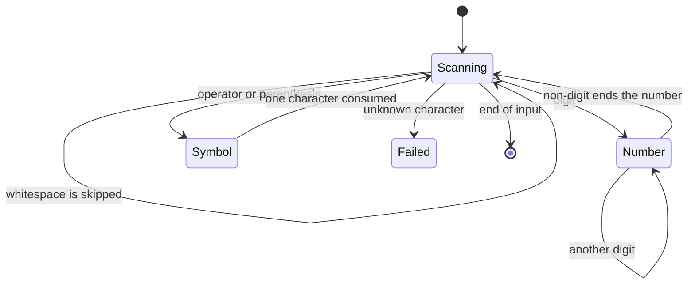
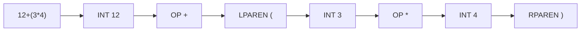
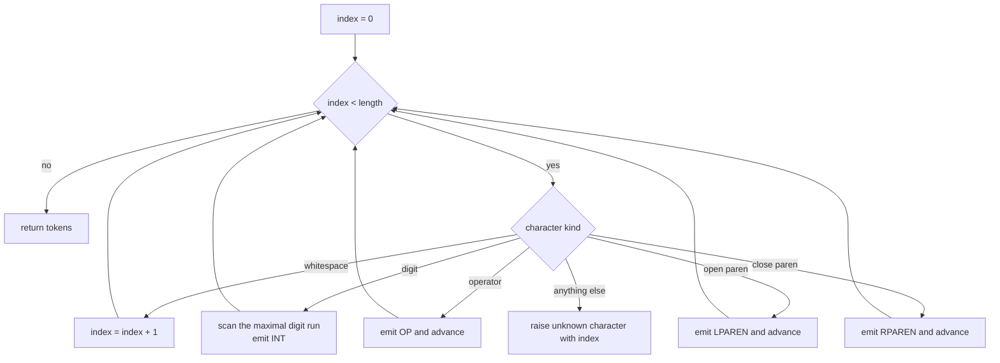
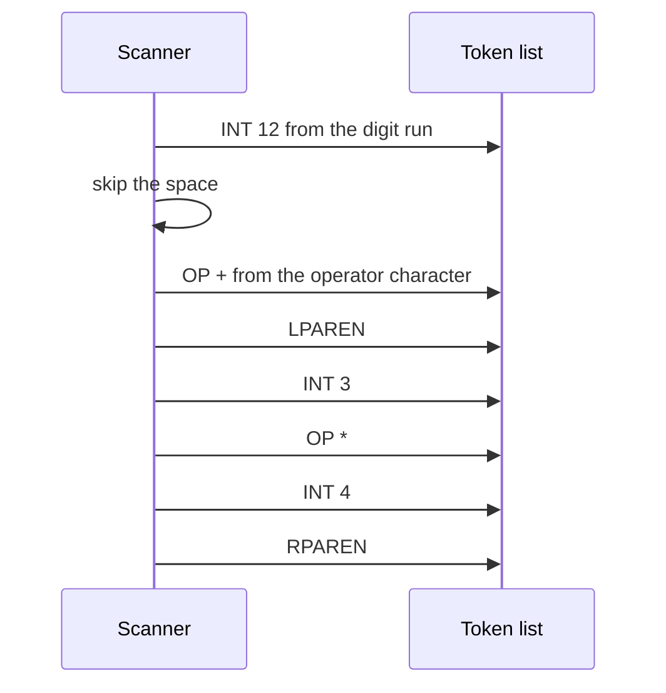

# 193 — Implement simple expression tokenizer.

> **Tier:** Beginner · **CTCI chapter:** Ch 3 — Stacks and Queues
> **Task spec:** [193-implement-simple-expression-tokenizer.md](../../../tasks/beginner/193-implement-simple-expression-tokenizer.md)
> **Solutions:** [Python](../../../solutions/python/beginner/193-implement-simple-expression-tokenizer/solution.py) ·
> [Java](../../../solutions/java/beginner/193-implement-simple-expression-tokenizer/Solution.java) ·
> [JavaScript](../../../solutions/javascript/beginner/193-implement-simple-expression-tokenizer/solution.js) ·
> [C#](../../../solutions/csharp/beginner/193-implement-simple-expression-tokenizer/Solution.cs)

## 1. Problem restatement

**Input:** an expression string. Whitespace is ignored **anywhere** in the input, so `12 + (3*4)` and
`12+(3*4)` are the same input.

**Output:** a list of typed tokens:

- `INT(n)` for an integer, carrying the numeric value,
- `OP(op)` for one of `+ - * /`,
- `LPAREN` and `RPAREN` for parentheses.

Unknown characters raise an error naming both the character and its index: "unknown character
`'.'` at index 2". Empty or blank input yields an empty token list.

The task spec is one line, so the four files define the contract. They assert:

| Input | Token stream | Why |
| --- | --- | --- |
| `12 + (3*4)` | `INT 12`, `OP +`, `LPAREN (`, `INT 3`, `OP *`, `INT 4`, `RPAREN )` | seven tokens, multi-digit number |
| `1+2` | `INT 1`, `OP +`, `INT 2` | no whitespace at all |
| `  7  ` | `INT 7` | surrounding whitespace is skipped |
| `10/2-3` | `INT 10`, `OP /`, `INT 2`, `OP -`, `INT 3` | maximal-munch digits, two operators |
| `` (empty) | `[]` | nothing to tokenize |
| `" \t\n "` | `[]` | blank input is not an error |

Rejected inputs, asserted in every file: `12.5` (the `.` is unknown, at index `2`), `a+b` (`a` at
index `0`), `1 $ 2` (`$` at index `2`), `#` (`#` at index `0`). Python, Java and C# also assert the
error *message* contains both the character and the index; JavaScript matches the same message with a
regular expression.

Tokens compare by type **and** value: Python defines `__eq__`, Java `equals`/`hashCode` and C#
`Equals`/`GetHashCode`, which is what lets the tests compare whole streams against expected lists.

## 2. Intuition

Splitting an expression on spaces is not tokenizing: `12+(3*4)` has no spaces, and `12` must become
one token rather than two. The task is a **character scanner** with one lookahead loop:

- whitespace characters carry no meaning, so skip them;
- a digit starts a number, and the number continues while digits keep coming — *maximal munch*;
- an operator or parenthesis is a token by itself;
- anything else is an error, reported with its position.



Two design points give the tokenizer its whole character. First, maximal munch: the scanner
commits to a number only when the digit run ends, so `12` is never `1` followed by `2`. Second, the
index of a failure is the index of the character *that started* the offending token, which makes
`12.5` fail at index `2` and not at the end of the string.



The output is a *stream*, not a tree: no precedence, no associativity, no balance checking. Those
belong to the parser, which is exactly why the tokenizer can stay a single forward pass with no
state beyond the position.

## 3. Algorithm

1. Set `index = 0` and create an empty token list.
2. While `index < length(expr)`:
   1. If the character is whitespace, advance `index` and continue.
   2. If it is a digit, scan forward while characters are digits; the maximal run
      `expr[index..end-1]` becomes `INT` with its numeric value; set `index = end`.
   3. If it is one of `+ - * /`, emit `OP` with that character and advance by one.
   4. If it is `(`, emit `LPAREN` and advance by one.
   5. If it is `)`, emit `RPAREN` and advance by one.
   6. Otherwise raise "unknown character `<ch>` at index `<index>`".
3. Return the token list — empty for empty and blank input.

```text
function tokenize(expression)
    tokens ← empty list
    index ← 0
    while index &lt; length(expression) do
        ch ← expression[index]
        if ch is whitespace then
            index ← index + 1
        else if ch is a digit then
            end ← index
            while end &lt; length(expression) and expression[end] is a digit do
                end ← end + 1
            end
            append INT(numeric value of expression[index .. end - 1]) to tokens
            index ← end
        else if ch is one of "+", "-", "*", "/" then
            append OP(ch) to tokens
            index ← index + 1
        else if ch = "(" then
            append LPAREN(ch) to tokens
            index ← index + 1
        else if ch = ")" then
            append RPAREN(ch) to tokens
            index ← index + 1
        else
            raise "unknown character " + ch + " at index " + index
        end
    end
    return tokens
end
```

The digit branch is the only one with an inner loop, and it is what makes multi-digit numbers a
single token. Every other branch consumes exactly one character, so the scanner never backs up:
`index` is strictly increasing, which is why the whole pass is linear.



The token types form a small closed set, which is why the tokenizer can be total over its alphabet:
every character either produces a token — `INT` carrying a number, `OP` carrying `+ - * /`,
`LPAREN`, `RPAREN` — or raises an error.

## 4. Worked example

Trace `tokenize("12 + (3*4)")`, whose characters are
`0:'1' 1:'2' 2:' ' 3:'+' 4:' ' 5:'(' 6:'3' 7:'*' 8:'4' 9:')'`.

| Step | `index` at entry | Character | Branch | Digits scanned | Token emitted | `index` after |
| --- | --- | --- | --- | --- | --- | --- |
| 1 | 0 | `1` | digit | `1`, `2` (stops at the space) | `INT 12` | 2 |
| 2 | 2 | ` ` | whitespace | — | — | 3 |
| 3 | 3 | `+` | operator | — | `OP +` | 4 |
| 4 | 4 | ` ` | whitespace | — | — | 5 |
| 5 | 5 | `(` | open parenthesis | — | `LPAREN (` | 6 |
| 6 | 6 | `3` | digit | `3` (stops at `*`) | `INT 3` | 7 |
| 7 | 7 | `*` | operator | — | `OP *` | 8 |
| 8 | 8 | `4` | digit | `4` (stops at `)`) | `INT 4` | 9 |
| 9 | 9 | `)` | close parenthesis | — | `RPAREN )` | 10 |

The result is exactly the seven tokens the assertions expect. Step 1 is maximal munch in action: the
digit run is consumed as one unit, so the value stored is the number `12` rather than the character
`1`. Step 3 and step 5 show that no whitespace is required for token separation: `(3*4)` produces
four tokens because the characters themselves change kind.

Failure reporting is the same walk stopping early:

| Input | `index` of failure | Character | Message |
| --- | --- | --- | --- |
| `12.5` | 2 | `.` | unknown character `'.'` at index 2 |
| `a+b` | 0 | `a` | unknown character `'a'` at index 0 |
| `1 $ 2` | 2 | `$` | unknown character `'$'` at index 2 |
| `#` | 0 | `#` | unknown character `'#'` at index 0 |

Note that the index is *0-based* and points at the offending character, so a caller can slice the
input to show context. The numbers in the table are the ones the tests assert.



Two assertions check the token *shape* rather than just the count: `tokenize("12 + (3*4)")` must
have types `[INT, OP, LPAREN, INT, OP, INT, RPAREN]` and values `[12, "+", "(", 3, "*", 4, ")"]`.
That is why the token type carries a typed value — the number is an integer, while an operator
carries a string — and why the files give tokens value equality rather than comparing object
identity.

## 5. Complexity

Let `L` be the length of the input and `t` the number of tokens produced.

| Measure | Bound | Why it holds |
| --- | --- | --- |
| Time | `O(L)` | each character is examined once; the digit loop consumes a run in one pass |
| Space, tokens | `O(t)` | one token object per token |
| Space, extra | `O(1)` | only the index and the current digit run's bounds |
| Number conversion | `O(d)` per number of `d` digits | the substring is parsed once |
| Regex-based alternative | `O(L · patterns)` | repeated matching at each position, usually with worse constants |

The linear bound follows from progress: every branch of the loop advances `index` by at least one
(the digit branch by the length of the run), so the loop body runs at most `L` times plus the extra
digit scans — and each extra digit scan advances `index` past the digits it examined. No character
is ever re-read, which is the invariant that makes scanning cheap and also what makes the error
index unambiguous.

Because tokens own their values, the output size is `O(t)` and independent of `L`; the token count is
what downstream stages consume, and for arithmetic input `t` is a constant fraction of `L`.

## 6. Pitfalls and edge cases

- **Maximal munch on digits.** `12` must be one token. A scanner that emits one token per digit
  character produces two `INT` tokens and destroys the number's value; the assertion on
  `10/2-3` covers multi-digit numbers next to operators.
- **Whitespace is skipped anywhere, not only between tokens.** `  7  ` and `" \t\n "` are both
  handled; blank input returns an empty list rather than raising. That also means `1 2` tokenizes to
  two `INT` tokens — the tokenizer does not judge whether the sequence is valid, so the parser must.
- **The index in the error is the starting index of the offending character**, 0-based. `12.5`
  fails at index `2`; asserting the message keeps the position meaningful.
- **Only ASCII digits are guaranteed.** The JavaScript file tests `[0-9]` explicitly. Python's
  `isdigit()` and `int()` also accept non-ASCII digits such as the Arabic-Indic `٣`, and the Java
  and C# files use the runtime's character classifier. Exotic digits are outside the task's contract,
  and the four implementations should not be assumed to agree on them.
- **No floats, no signs, no identifiers.** `12.5`, `+5`, `-7` and `a+b` are all errors or splits:
  `-` is an operator token, not part of a number, so a negative literal cannot be expressed here.
- **Parentheses are their own token types.** `LPAREN` and `RPAREN` carry the character as the value
  for readability, but the type is what a parser switches on.
- **No balance checking.** `tokenize("( )")` succeeds; unmatched parentheses are the converter's
  problem, as
  [191-convert-infix-to-postfix-shunting-yard-simplified.md](../../../tasks/beginner/191-convert-infix-to-postfix-shunting-yard-simplified.md)
  demonstrates.
- **Token equality must be by value.** The tests compare token lists, so Python needs `__eq__`,
  Java needs `equals` and `hashCode`, and C# needs `Equals` and `GetHashCode`; the JavaScript test
  uses deep structural comparison. A token without value equality makes every stream assertion fail
  for the wrong reason.
- **The scanner is not the evaluator.** Nothing here computes anything, which is the point: a
  tokenizer that also evaluates cannot be reused for syntax highlighting, formatting or analysis.
- **Inputs that need spaces elsewhere do not need them here.** Tasks 190, 191 and 192 split on
  whitespace and therefore require `3 + 4`; this tokenizer accepts `3+4`, so it is the natural front
  end when input arrives compactly.

## 7. Variants and follow-ups

- **Feeding the shunting yard.** [191-convert-infix-to-postfix-shunting-yard-simplified.md](../../../tasks/beginner/191-convert-infix-to-postfix-shunting-yard-simplified.md)
  consumes a token list and resolves precedence; swapping its whitespace split for this tokenizer is
  how compact expressions get parsed.
- **The full pipeline.** [192-evaluate-arithmetic-expression-with-parentheses-shunting-yard-ev.md](../../../tasks/beginner/192-evaluate-arithmetic-expression-with-parentheses-shunting-yard-ev.md)
  chains tokenize, convert and evaluate, and is where a token-type-aware parser would replace the
  string-based token matching.
- **Evaluating postfix directly.** [190-parse-and-evaluate-postfix-rpn-expression.md](../../../tasks/beginner/190-parse-and-evaluate-postfix-rpn-expression.md)
  shows the other end of the pipe, where integer tokens are the only input.
- **Other character-level scanners.** [189-implement-simple-csv-parser-line-fields.md](../../../tasks/beginner/189-implement-simple-csv-parser-line-fields.md)
  has the same shape with quoting states instead of token kinds, and
  [196-implement-file-line-reader-that-yields-lines-lazily.md](../../../tasks/beginner/196-implement-file-line-reader-that-yields-lines-lazily.md)
  scans a file one line at a time.
- **Extending the grammar.** Adding identifiers or function names means a fifth token type and a
  maximal-munch rule like the digit one, since identifiers are also runs of characters.
- The chapter walkthrough in [Stacks and Queues](../../ctci/03-stacks-and-queues.md) frames
  tokenising as the first stage of the stack-based expression machinery.

## 8. Check yourself

1. Why must the number branch loop while digits keep coming?

<details><summary>Show answer</summary>

Because a number is a maximal run of digits, not a single character. Consuming the whole run in one
step is what makes `12` one `INT` token with value `12`; stopping after the first digit would emit
`INT 1` and `INT 2`, changing the meaning of the expression.

</details>

2. What does `tokenize("1 2")` return, and is that a problem?

<details><summary>Show answer</summary>

Two tokens: `INT 1` and `INT 2`. The tokenizer's contract is lexical, not syntactic, so it does not
reject the sequence; deciding that two adjacent operands are invalid is the parser's job. The
documented job here is to turn characters into tokens, and this input does exactly that.

</details>

3. Why do the tokens carry both a type and a value?

<details><summary>Show answer</summary>

Because the consumer needs both: the type drives the control flow (`INT` pushes a value, `OP`
applies an operation, parentheses group), while the value carries the payload — a number for `INT`,
a character for `OP`. The tests assert types and values separately on `12 + (3*4)`, which is only
possible with both fields present.

</details>

4. What index does the error report for `12.5`, and why that one?

<details><summary>Show answer</summary>

Index `2`, the position of the `.`. The scanner reports the character that could not be classified
at the moment it was examined, so the position is exact and 0-based rather than being the end of the
string or a token count.

</details>

5. How would the design change to support a compact input such as `12+(3*4)` **and** whitespace
   inside a number, like `1 000`?

<details><summary>Show answer</summary>

The first requirement is already satisfied: whitespace is skipped, so compact input works today.
The second would need an explicit rule — the digit branch would have to accept a space between
digit groups — and that rule would have to be reconciled with the fact that adjacency of two numbers
is currently allowed lexically. Making a space meaningful inside a number removes it as a plain
separator, so the scanner state would need to distinguish "after a digit" from "at a token start".

</details>
