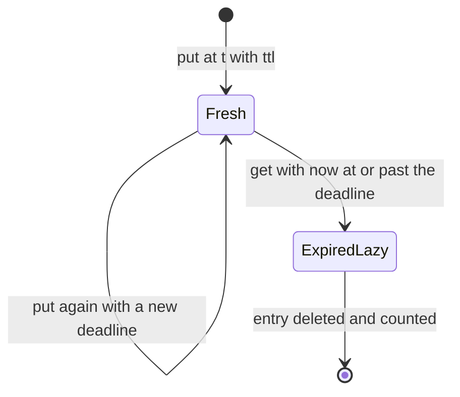
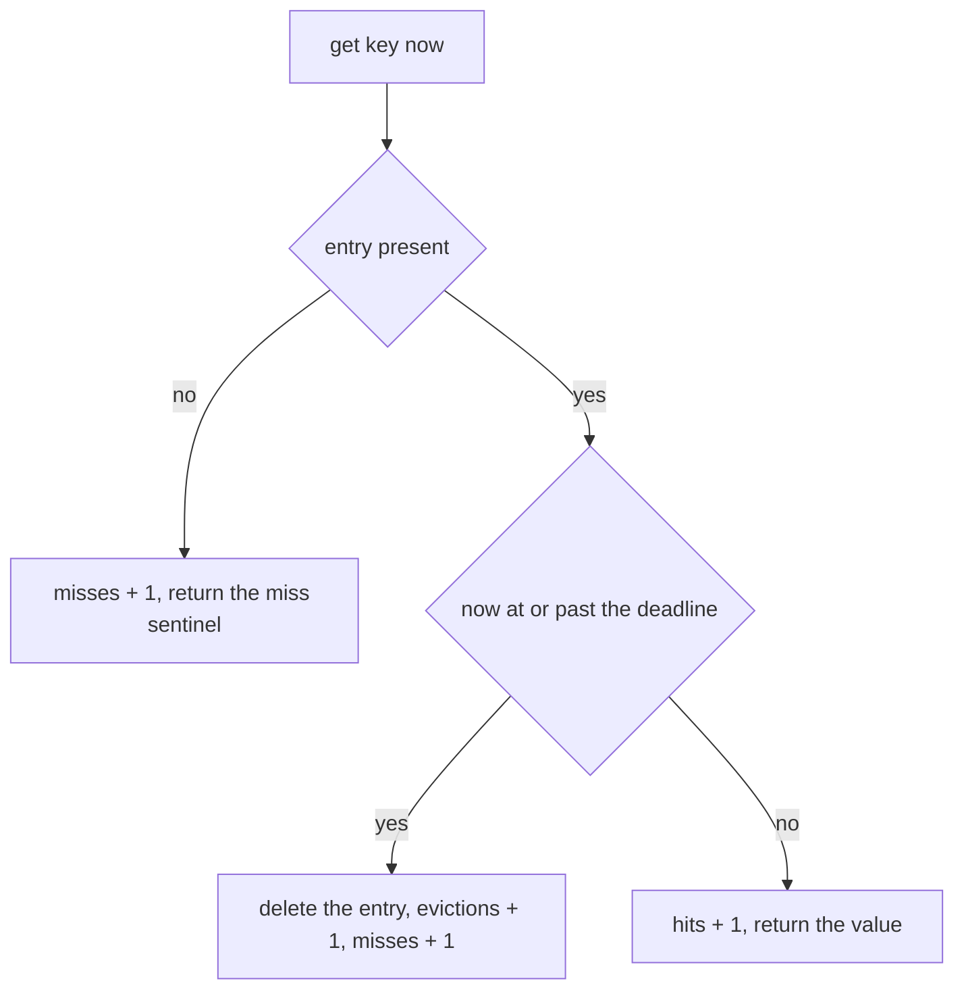
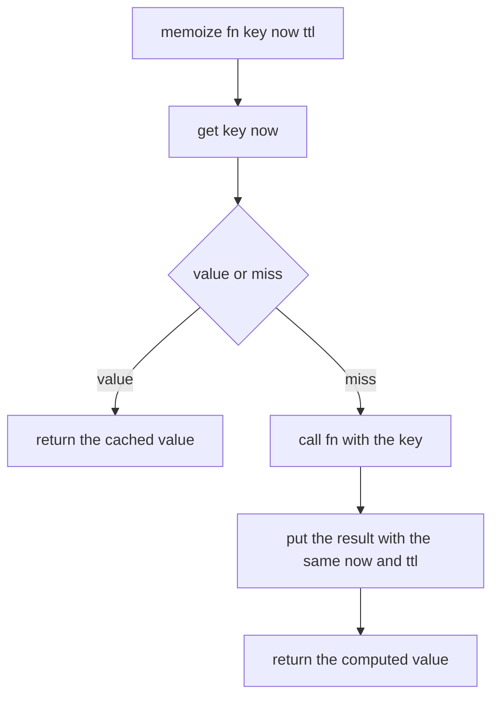
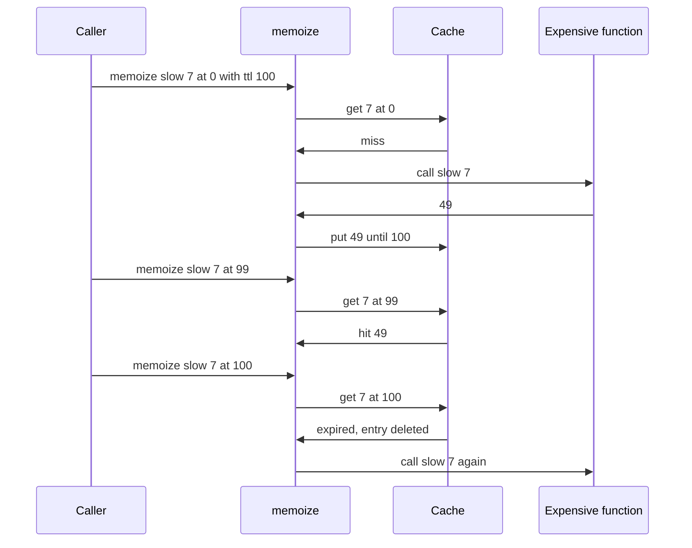

# 194 — Implement caching of expensive function results with TTL.

> **Tier:** Beginner · **CTCI chapter:** Ch 7 — Object-Oriented Design
> **Task spec:** [194-implement-caching-of-expensive-function-results-with-ttl.md](../../../tasks/beginner/194-implement-caching-of-expensive-function-results-with-ttl.md)
> **Solutions:** [Python](../../../solutions/python/beginner/194-implement-caching-of-expensive-function-results-with-ttl/solution.py) ·
> [Java](../../../solutions/java/beginner/194-implement-caching-of-expensive-function-results-with-ttl/Solution.java) ·
> [JavaScript](../../../solutions/javascript/beginner/194-implement-caching-of-expensive-function-results-with-ttl/solution.js) ·
> [C#](../../../solutions/csharp/beginner/194-implement-caching-of-expensive-function-results-with-ttl/Solution.cs)

## 1. Problem restatement

**Input:** a cache with `put(key, value, now_ms, ttl_ms)`, `get(key, now_ms)`,
`memoize(fn, key, now_ms, ttl_ms)` and `size()`. Time is **injected**: every call receives the
current time in milliseconds, so nothing depends on the system clock and tests are deterministic.

**Output:** the cached or freshly computed value, plus counters the files expose as
`hits`, `misses` and `evictions` (`Hits`, `Misses`, `Evictions` in C#). The validity rule is stated
in the files: an entry inserted at `t` with `ttl` is valid while `now < t + ttl`, so an access at
exactly `t + ttl` is a **miss on a strict boundary**. Expired entries are removed lazily on access
and counted as evictions.

The task spec is one line, so the contract comes from the four solution files, which assert:

| Scenario | Result | Why |
| --- | --- | --- |
| `put("a", 10, 1000, 100)`, `get("a", 1099)` | `10` | valid while `now < 1100` |
| `get("a", 1100)` | miss, **and** an eviction | exactly at the boundary means expired |
| counters after those two calls | `hits = 1`, `misses = 1`, `evictions = 1` | every access is accounted for |
| `size()` after the expired access | `0` | lazy removal happened during the miss |
| `put("b", 20, 0, 50)`, `get("b", 25)` | `20` | fresh entry |
| `put("b", 21, 30, 50)` then `get("b", 79)` | `21` | a refresh replaces the value **and** moves the expiry |
| `get("b", 80)` | miss | the refreshed expiry is `30 + 50 = 80` |
| `get("nope", 0)` on an empty cache | miss, `hits = 0`, `misses = 1` | a missing key is a miss |
| `put("x", 1, 0, 0)` | error | a non-positive TTL is rejected |
| `memoize(slow, 7, 0, 100)` | `49`, function called | first call computes |
| `memoize(slow, 7, 99, 100)` | `49`, function **not** called | cache hit |
| `memoize(slow, 7, 100, 100)` | `49`, function called again | expired, so recomputed |
| counters after those three calls | `hits = 1`, `misses = 2`, `evictions = 1` | one hit, two misses, one lazy eviction |

The files also document a representational choice: a miss is returned as `None` / `undefined` /
`null`, so **values are expected to be non-null**. The C# version sidesteps the ambiguity entirely by
returning a `(bool Found, T Value)` tuple, because an unconstrained generic `T` has no null.

## 2. Intuition

Caching is a lookup on a key. TTL caching adds one question: *is the entry still valid?* The
tempting answer — read the system clock inside `get` — makes the cache untestable and couples it to
global state. Both problems disappear when the caller passes the time in.

The design that follows is three fields and one comparison:

- each entry stores `(value, expires_at_ms = now_ms + ttl_ms)`,
- `get` compares the caller's `now_ms` against that deadline,
- nothing is scheduled, scanned or woken up in the background.



Expiry is decided at *access* time, not at *write* time — lazy invalidation. That is why the class
needs no timer thread, no background sweep and no ordering by deadline: a stale entry is simply
invisible and gets deleted the first time someone asks for it.



`memoize` is then just the composition of the two: ask, and if the answer is the miss sentinel,
compute it, store it and return it. The whole class is `get` plus `put` plus that three-line
pattern.

## 3. Algorithm

1. **Construct.** Create an empty map of `key → (value, expires_at_ms)` and three counters.
2. **`put(key, value, now_ms, ttl_ms)`.** Reject `ttl_ms <= 0`. Store `(value, now_ms + ttl_ms)`,
   overwriting any previous entry — including a live one, whose deadline is therefore reset.
3. **`get(key, now_ms)`.**
   1. If the key is absent: increment `misses`, return the miss sentinel.
   2. If the deadline is `<= now_ms`: delete the entry, increment `evictions` and `misses`, return
      the sentinel.
   3. Otherwise increment `hits` and return the value.
4. **`memoize(fn, key, now_ms, ttl_ms)`.** Call `get`. If it returned a real value, return it.
   Otherwise call `fn(key)`, `put` the result with the same `now_ms` and `ttl_ms`, and return it.
5. **`size()`.** The number of entries currently stored — including any expired entries that have
   not been touched yet.

```text
procedure put(key, value, now_ms, ttl_ms)
    if ttl_ms ≤ 0 then
        raise "ttl_ms must be positive"
    end
    entries[key] ← (value, now_ms + ttl_ms)
end

function get(key, now_ms)
    entry ← entries[key]
    if entry is missing then
        misses ← misses + 1
        return MISS
    end
    (value, expires_at) ← entry
    if now_ms ≥ expires_at then
        remove entries[key]
        evictions ← evictions + 1
        misses ← misses + 1
        return MISS
    end
    hits ← hits + 1
    return value
end

function memoize(fn, key, now_ms, ttl_ms)
    cached ← get(key, now_ms)
    if cached is not MISS then
        return cached
    end
    value ← fn(key)
    put(key, value, now_ms, ttl_ms)
    return value
end
```

The boundary comparison is the specification in one symbol: `now_ms >= expires_at` treats the exact
deadline as expired, matching the documented "valid while `now < t + ttl`".



## 4. Worked example

Trace the first assertion block, which deliberately walks across the expiry boundary:

| Step | Call | Comparison | Counters after | `size()` | Result |
| --- | --- | --- | --- | --- | --- |
| 1 | `put("a", 10, 1000, 100)` | deadline `1000 + 100 = 1100` | `0, 0, 0` | 1 | — |
| 2 | `get("a", 1099)` | `1099 < 1100` → live | `1, 0, 0` | 1 | `10` |
| 3 | `get("a", 1100)` | `1100 >= 1100` → expired | `1, 1, 1` | 0 | miss |

Step 3 is the strict boundary: at exactly the deadline the entry is dead, so the call counts both a
miss and an eviction, and the key disappears from the map — which is why `size()` drops to `0`.
Without the lazy deletion the entry would still be counted by `size()` even though every `get`
rejects it.

The second block shows a refresh, which is just a `put` over an existing key:

| Step | Call | Deadline after | `get` result |
| --- | --- | --- | --- |
| 1 | `put("b", 20, 0, 50)` | `50` | — |
| 2 | `get("b", 25)` | `50` | `20` |
| 3 | `put("b", 21, 30, 50)` | `80` | — |
| 4 | `get("b", 79)` | `80` | `21` |
| 5 | `get("b", 80)` | `80` | miss |

Step 3 overwrites the value *and* the deadline: a refresh is a write, not a read, so the new TTL is
measured from `now = 30`. The old deadline of `50` is gone, which is why step 4 still succeeds at
`79`.

The `memoize` block is the payoff — the expensive function's call log is the evidence:

| Step | Call | Cache state | Function calls so far | Counters |
| --- | --- | --- | --- | --- |
| 1 | `memoize(slow, 7, 0, 100)` | miss → compute → store until `100` | `[7]` | `0, 1, 0` |
| 2 | `memoize(slow, 7, 99, 100)` | hit (`99 < 100`) | `[7]` | `1, 1, 0` |
| 3 | `memoize(slow, 7, 100, 100)` | expired (`100 >= 100`) → evict → recompute → store until `200` | `[7, 7]` | `1, 2, 1` |

The assertions check the call log (`calls == [7]` then `calls == [7, 7]`) rather than only the
returned values, which is what makes "the memoization actually happened" observable.



## 5. Complexity

Let `n` be the number of stored entries and `C` the cost of the wrapped function.

| Operation | Time | Space | Why it holds |
| --- | --- | --- | --- |
| `put` | `O(1)` expected | `O(1)` per entry | one map assignment, plus a new entry record |
| `get` | `O(1)` expected | `O(1)` | one lookup, one comparison, at most one deletion |
| `memoize`, hit | `O(1)` expected | `O(1)` | it is a `get` |
| `memoize`, miss | `O(C)` | `O(1)` | the wrapped function dominates |
| `size` | `O(1)` | — | the map tracks its own size |
| Whole cache | — | `O(n)` entries | one record per live key |

Nothing in the design scans: there is no sweep for expired entries, no timer, and no ordering by
deadline, so both operations are constant-time in the expected case regardless of how many entries
have quietly expired. The price is memory: expired entries that are never touched again stay in the
map, so `size()` can exceed the number of live entries, and `O(n)` is really "entries ever inserted
and not yet accessed after expiry".

A cache that must bound memory rather than time would add eviction ordering — least-recently-used
as in [160-implement-lru-cache-using-linked-list-hashmap.md](../../../tasks/beginner/160-implement-lru-cache-using-linked-list-hashmap.md)
or least-frequently-used as in [161-implement-lfu-cache-basic-variant.md](../../../tasks/beginner/161-implement-lfu-cache-basic-variant.md)
— plus, if the sweep has to be autonomous, a background thread or a "purge on write" policy. Those
are exactly the complications the lazy scheme avoids.

## 6. Pitfalls and edge cases

- **The boundary is inclusive.** Valid means `now < t + ttl`, so `now == t + ttl` is expired. Every
  file asserts `get("a", 1100) is None` after `put("a", 10, 1000, 100)`; flipping the comparison to
  `>` would keep that entry alive one millisecond too long.
- **Expiry is lazy, so `size()` counts stale entries.** The test only asserts `size() == 0` *after*
  the expired access. A caller who expects `size()` to mean "live entries" is reading it wrong.
- **A refresh is a write.** `put` on an existing key replaces both the value and the deadline;
  whether that should also count as an eviction is a design decision the files make explicit by not
  counting it.
- **A miss sentinel makes null values unrepresentable.** The files document that values are expected
  to be non-`None`; the C# version instead returns `(bool Found, T Value)` because
  `default(T)` is not `null` for unconstrained generics. JavaScript is the sharpest case: a cached
  `undefined` is indistinguishable from a miss.
- **A non-positive TTL is rejected.** `ttl_ms <= 0` raises rather than meaning "cache forever" or
  "never cache".
- **`memoize` validates the TTL after computing.** It calls `get` (a miss), then `fn`, and only then
  `put`, which is where the `ttl_ms <= 0` check lives — so a caller who passes a bad TTL pays for the
  expensive call before the error surfaces. Validating at the top of `memoize` would avoid that.
- **Every access changes the counters**, including repeated misses for the same missing key: each
  `get` increments `misses`, so the counters measure calls, not distinct keys.
- **The clock is injected and trusted.** The cache never reads the system time and never checks that
  `now_ms` moves forward; a caller passing a time that goes backwards can resurrect data in effect,
  because validity is judged only against the stored deadline.
- **No thread safety.** The map and the counters are unsynchronised; concurrent callers need
  external locking, as
  [195-implement-basic-producer-consumer-using-threads-mutex-condition.md](../../../tasks/beginner/195-implement-basic-producer-consumer-using-threads-mutex-condition.md)
  illustrates for shared state.
- **Unbounded growth.** Nothing limits the number of entries; a cache keyed by a high-cardinality
  input can grow without limit, because stale entries are only removed when someone asks for the
  same key again.
- **Values are stored by reference.** The cache does not copy what it is given, so mutating a cached
  object mutates it for every later reader.

## 7. Variants and follow-ups

- **Bounded caches.** [160-implement-lru-cache-using-linked-list-hashmap.md](../../../tasks/beginner/160-implement-lru-cache-using-linked-list-hashmap.md)
  adds recency ordering so that the oldest entry is dropped when capacity is reached, and
  [161-implement-lfu-cache-basic-variant.md](../../../tasks/beginner/161-implement-lfu-cache-basic-variant.md)
  orders by access count instead. TTL and capacity are orthogonal policies and are often combined.
- **Time-based throttling.** [162-implement-rate-limiter-token-bucket-simple.md](../../../tasks/beginner/162-implement-rate-limiter-token-bucket-simple.md)
  also carries time on every call, but for a different purpose — refusing work rather than remembering
  results.
- **Shared state under concurrency.** [195-implement-basic-producer-consumer-using-threads-mutex-condition.md](../../../tasks/beginner/195-implement-basic-producer-consumer-using-threads-mutex-condition.md)
  shows the mutex-and-condition pattern that a thread-safe cache would need around this map.
- **Eager expiry.** A background sweep or a min-heap ordered by deadline removes stale entries
  without waiting for an access, trading a thread or an `O(log n)` insertion for bounded memory.
- **Negative caching.** Caching the fact that a key is absent requires a second sentinel, because a
  miss and a cached "nothing" are the same value in this design.
- The chapter walkthrough in [Object-Oriented Design](../../ctci/07-object-oriented-design.md) puts
  the cache next to the other container-with-policy designs.

## 8. Check yourself

1. Why does `get("a", 1100)` miss after `put("a", 10, 1000, 100)`?

<details><summary>Show answer</summary>

Because the documented rule is "valid while `now < t + ttl`", and here `now = 1100` equals
`t + ttl = 1100`. The comparison in the code is `now_ms >= expires_at`, so the entry is expired at
exactly the deadline — the boundary is exclusive on the live side.

</details>

2. Why is no background thread or timer needed?

<details><summary>Show answer</summary>

Because expiry is checked lazily, on access, against the caller-supplied `now_ms`. A stale entry
simply fails the comparison and is deleted at that moment. Nothing needs to happen while the cache
is idle, which also makes the class easy to test: all time comes in as a parameter.

</details>

3. What does `size()` return while an expired entry has not been touched yet?

<details><summary>Show answer</summary>

It still counts that entry, because the map is only cleaned on access. The test asserts `size() == 0`
only after the expired `get` has removed the entry — before that call the count would be one. Treat
`size()` as "stored entries", not "live entries".

</details>

4. What exactly do the counters prove in the `memoize` scenario?

<details><summary>Show answer</summary>

`hits = 1, misses = 2, evictions = 1` says the middle call was served from the cache, the first and
third calls were not, and the third miss was caused by a lazily deleted expired entry. Together with
the function's call log `[7, 7]`, they show the expensive function ran exactly twice for three
requests.

</details>

5. Why does the C# solution return `(bool Found, T Value)` instead of a plain value?

<details><summary>Show answer</summary>

Because the cache stores an unconstrained generic `T`, whose "no value" is `default(T)` — `0` for
`int`, not `null`. Using `null` as the miss sentinel therefore does not work in general, so the C#
version reports presence explicitly with a tuple. Python, Java and JavaScript get away with
`None`/`null`/`undefined` because their values are references, at the documented cost that a stored
null cannot be distinguished from a miss.

</details>
