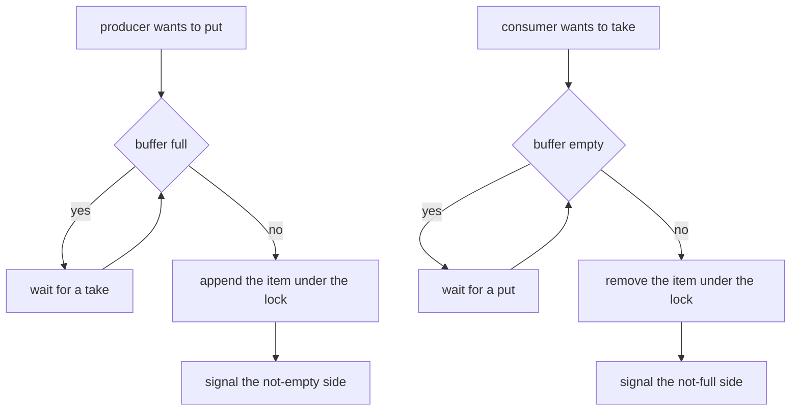
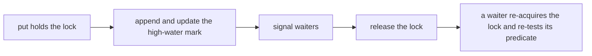
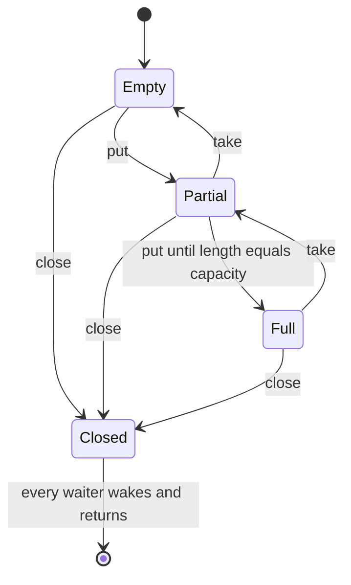
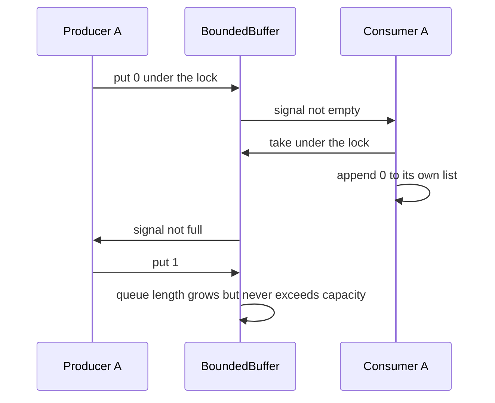

# 195 — Implement basic producer-consumer using threads (mutex/condition).

> **Tier:** Beginner · **CTCI chapter:** Ch 15 — Threads and Locks
> **Task spec:** [195-implement-basic-producer-consumer-using-threads-mutex-condition.md](../../../tasks/beginner/195-implement-basic-producer-consumer-using-threads-mutex-condition.md)
> **Solutions:** [Python](../../../solutions/python/beginner/195-implement-basic-producer-consumer-using-threads-mutex-condition/solution.py) ·
> [Java](../../../solutions/java/beginner/195-implement-basic-producer-consumer-using-threads-mutex-condition/Solution.java) ·
> [JavaScript](../../../solutions/javascript/beginner/195-implement-basic-producer-consumer-using-threads-mutex-condition/solution.js) ·
> [C#](../../../solutions/csharp/beginner/195-implement-basic-producer-consumer-using-threads-mutex-condition/Solution.cs)

## 1. Problem restatement

**Input:** a bounded buffer of `capacity` slots (the tests use `7`) and a stream of `ITEMS = 1000`
integers. Two producer threads fill disjoint halves of `0..999`; two consumer threads drain the
buffer until it is closed.

**Output:** a correct handoff. The files assert four properties about the finished run:

| Assertion | Meaning |
| --- | --- |
| `len(all_items) == ITEMS` | no item was lost or duplicated |
| `sorted(all_items) == list(range(ITEMS))` | every item was consumed exactly once |
| `max_seen <= CAPACITY` | the buffer never held more than `capacity` items |
| `max_seen >= 1` | the buffer was actually used, not bypassed |

**Failure modes the design must exclude:** producers blocking forever on a full buffer, consumers
blocking forever on an empty one, and the run never terminating. Every thread join has a 10-second
timeout and the tests assert `not thread.is_alive()` afterwards, so a lost wake-up fails the run
rather than hanging it.

The implementations differ in the concurrency primitive, and the files say so explicitly:

- **Python** uses `threading.Lock` plus **two** `threading.Condition` objects (one for "not empty",
  one for "not full") sharing that lock, and `threading.Condition.notify()`.
- **Java** uses `synchronized` methods with `wait()` / `notifyAll()` — one monitor for both roles.
- **C#** uses `lock (gate)` with `Monitor.Wait` / `Monitor.PulseAll` — the same single-monitor
  shape.
- **JavaScript** has no shared-memory locks in this repository, so the file is documented as "an
  equivalent async simulation": waiters are stored as promise resolvers that stand in for
  `condition.wait`/`signal`, and the event loop serialises the `take`/`put` operations.

## 2. Intuition

The buffer is a queue with two predicates and two waiting rooms:

- a **producer** may proceed when the buffer is not full;
- a **consumer** may proceed when the buffer is not empty.

Both predicates touch the same data, so both need the same mutual-exclusion lock. Each side must
also be able to *wake the other*: a `put` makes the buffer non-empty, and a `take` makes it
non-full. That is exactly what condition variables provide: wait on a predicate, signal when you
change the state that could make someone else's predicate true.



The single most important detail is that the predicate check is a **`while` loop, not an `if`**.
A wake-up is a hint, not a guarantee: another thread may have consumed the slot first, and some
runtimes may wake a thread spuriously. Re-checking after every wake-up is what makes the protocol
correct under both.



## 3. Algorithm

1. **Construct.** Allocate a queue, a counting field for the high-water mark, one lock, and the
   condition machinery; start with `closed = false`. Reject a non-positive capacity.
2. **`put(item)`.**
   1. Acquire the lock.
   2. While not closed and the queue length is `>= capacity`, wait on the not-full condition.
   3. If closed, return without storing (the shutdown protocol won).
   4. Append the item, update `max_seen`, signal the not-empty condition, release the lock.
3. **`take()`.**
   1. Acquire the lock.
   2. While not closed and the queue is empty, wait on the not-empty condition.
   3. If the queue is still empty (closed), return the shutdown sentinel (`None` / `null`).
   4. Remove the front item, signal the not-full condition, release the lock, return it.
4. **`close()`.** Under the lock set `closed = true` and signal **all** waiters on both sides, so no
   thread is left waiting for an event that will never come.
5. **Driver.** Start two consumers, start two producers, join the producers with a 10-second
   timeout, `close()`, join the consumers with the same timeout, then assert the four properties.

```text
procedure put(item)
    acquire lock
    while not closed and length(items) ≥ capacity do
        wait on not_full
    end
    if closed then
        release lock
        return
    end
    append item to items
    max_seen ← maximum(max_seen, length(items))
    signal not_empty
    release lock
end

function take()
    acquire lock
    while not closed and length(items) = 0 do
        wait on not_empty
    end
    if length(items) = 0 then
        release lock
        return SHUTDOWN
    end
    item ← remove the first element of items
    signal not_full
    release lock
    return item
end

procedure close()
    acquire lock
    closed ← true
    signal all waiters on not_empty and not_full
    release lock
end
```

The `closed` flag is what turns a blocking queue into a terminable one: without it, consumers would
wait forever once the producers stop. The checks read `not closed and …`, so a close immediately
unblocks every waiter, and the post-wait branch returns the sentinel instead of blocking again.



## 4. Worked example

Trace the driver's timeline for the `1000`-item run with `capacity = 7`:

| Phase | Producers | Consumers | Buffer | `max_seen` |
| --- | --- | --- | --- | --- |
| start | 2 threads, ranges `0..499` and `500..999` | 2 threads draining | empty | 0 |
| early | both push fast | both drain | oscillates between empty and full | rises to at most 7 |
| steady | blocked whenever the queue holds 7 | blocked whenever it is empty | — | ≤ 7 |
| producers done | both ranges exhausted, threads exit | still draining what is left | shrinking | ≤ 7 |
| `close()` | — | wake up, drain the remainder, then `take` returns the sentinel | drains to empty | ≤ 7 |
| final | joined | joined | empty | ≤ 7 |

The high-water mark is the observable evidence that the blocking actually happened: with
`capacity = 7` and 1000 items pushed by two producers, a buffer that ignored its capacity would
show a large `max_seen`, and `max_seen <= CAPACITY` would fail.

The wake-up protocol is best seen as a sequence rather than a table:



Two details in the driver matter for the assertions. First, producers are joined *before* `close()`
so that every produced item is already in the buffer when the shutdown begins; closing first would
make producers drop their remaining items on the `if closed then return` branch and the item-count
assertion would fail. Second, the consumers are joined after `close()`, and each `take` returns the
sentinel only once the buffer is both closed and empty, so the consumers drain whatever is left
instead of exiting early.

The failure modes map onto the same trace:

| Bug | Observable symptom |
| --- | --- |
| `if` instead of `while` around the predicate | a waiter proceeds without a free slot and `max_seen` exceeds the capacity |
| signalling the wrong side | one side blocks forever, and the 10-second join timeout fires |
| never closing | consumers wait on an empty buffer for ever; join times out |
| capacity check omitted | `max_seen` grows with the item count |
| signalling before the state change | a waiter wakes, finds nothing, and sleeps again — throughput loss, not a hang |

## 5. Complexity

Let `c` be the capacity, `n` the number of items and `t` the number of threads.

| Measure | Bound | Why it holds |
| --- | --- | --- |
| `put` / `take`, uncontended | `O(1)` | one queue operation plus constant bookkeeping |
| `put` / `take`, contended | `O(1)` amortised, `O(t)` wake-ups | signalling wakes the waiters of one side; a single-monitor implementation wakes all of them |
| Space | `O(c)` | at most `capacity` items are ever stored |
| Total work for the run | `O(n)` | each item is appended once and removed once |
| Waiter bookkeeping (JavaScript) | `O(t)` per wake-up | the simulation resolves all pending promises |

Space is the interesting bound: the buffer holds at most `c` items no matter how fast the producers
run, which is the entire point of the exercise — `ITEMS = 1000` items flow through a buffer that
never holds more than `7`. The high-water mark assertion is a direct test of that bound.

The Python version reduces contention slightly by using two condition objects on one lock, so a
`put` wakes only an empty-side waiter and a `take` wakes only a full-side waiter. Java and C# have a
single monitor per object and therefore use `notifyAll` / `PulseAll`, waking both kinds of waiter;
each woken thread re-tests its predicate, so the extra wake-ups cost CPU, not correctness. That
trade-off — one monitor with redundant wake-ups versus two conditions with precise signalling — is
the main structural difference between the four files.

## 6. Pitfalls and edge cases

- **`while` around the wait, always.** Condition variables are subject to spurious wake-ups and to
  lost races: another thread can consume the item between the signal and this thread's re-acquire.
  An `if` guard lets a producer write into a full buffer, which is exactly what the `max_seen`
  assertion detects.
- **Signal after changing the state, while holding the lock.** Appending and then signalling keeps
  the predicate and the signal consistent; signalling outside the critical section opens a window
  where a waiter wakes, sees the old state and sleeps again.
- **Shutdown is part of the protocol.** `close()` sets a flag *and* wakes every waiter. The flag
  makes `take` return the sentinel and `put` return early, so no thread is left blocked on an event
  that will never occur.
- **Put after close silently discards the item.** The `if closed then return` branch drops it, which
  is safe only because the driver joins the producers before calling `close()`. Closing earlier
  would lose items and fail the count assertion.
- **The sentinel limits the item type in three languages.** `take` returns `None` / `null` to mean
  "shut down", so `None` cannot be a payload; the C# version uses `int?` for the same reason.
- **`notify` versus `notify_all`.** Python signals one waiter per state change and both sides on
  close; Java and C# signal everyone on every change because they share a single monitor. With one
  waiter per side either choice is correct; with many, `notify` can wake a thread whose predicate is
  still false — harmless because of the `while`, but slower.
- **One lock, uniform acquisition order.** The design has a single lock and no nesting, so there is
  no lock-ordering cycle to deadlock on. A cache or queue pair acquired in different orders in
  different threads would not have that protection.
- **The lock is held only briefly.** Appending or removing from a deque under the lock is `O(1)`;
  holding the lock across the whole production loop would serialise everything and defeat the
  exercise.
- **JavaScript is a simulation, not parallelism.** The file's comment is explicit: there are no
  shared-memory locks here, so waiters are promise resolvers and the event loop serialises the
  operations. The assertions therefore also check a property a real race could break but this model
  cannot: each producer's own items keep their relative order
  (`consumed.filter(v => v < half)` equals `0..499` in order).
- **Timeouts are a sanity net, not a fix.** Joining with 10 seconds and asserting
  `not is_alive()` turns a lost wake-up into a test failure instead of an infinite run.
- **Daemon threads in Python.** The consumers are created with `daemon=True`, so a bug cannot keep
  the interpreter alive after the main thread finishes — the assertions still check that they
  terminated.

## 7. Variants and follow-ups

- **Making a cache thread-safe.** [194-implement-caching-of-expensive-function-results-with-ttl.md](../../../tasks/beginner/194-implement-caching-of-expensive-function-results-with-ttl.md)
  has exactly the shared mutable state (a map plus three counters) that this task's lock would have
  to protect, which is why that file documents itself as unsynchronised.
- **Bounded containers.** [160-implement-lru-cache-using-linked-list-hashmap.md](../../../tasks/beginner/160-implement-lru-cache-using-linked-list-hashmap.md)
  bounds by capacity rather than by blocking, dropping the least recently used entry instead of
  making the writer wait; the two policies are often combined.
- **Queues with extra operations.** [173-implement-queue-that-supports-getmin-in-o-1.md](../../../tasks/beginner/173-implement-queue-that-supports-getmin-in-o-1.md)
  shows the deque machinery used here, and [172-implement-stack-that-supports-getmin-in-o-1.md](../../../tasks/beginner/172-implement-stack-that-supports-getmin-in-o-1.md)
  the stack analogue.
- **Streaming producers.** [196-implement-file-line-reader-that-yields-lines-lazily.md](../../../tasks/beginner/196-implement-file-line-reader-that-yields-lines-lazily.md)
  is the single-threaded version of "produce items on demand", which is what a producer thread does
  with files or network sockets.
- **Two conditions instead of one.** Splitting a single monitor into a not-empty and a not-full
  condition, as the Python file does, is the standard refinement for throughput; the loss is that
  the programmer must signal the right side every time.
- The chapter walkthrough in [Threads and Locks](../../ctci/15-threads-and-locks.md) covers the
  monitor and condition-variable patterns this task exercises.

## 8. Check yourself

1. Why must the predicate be re-tested in a `while` loop rather than an `if`?

<details><summary>Show answer</summary>

Because a wake-up does not carry a guarantee. Another thread can grab the lock first and take the
item, or the runtime can wake a waiter spuriously. Re-testing the predicate after every wake-up
makes the code correct in both cases; an `if` would let a producer append into a full buffer, which
the `max_seen <= CAPACITY` assertion would catch.

</details>

2. What does `close()` do, and why is the flag not enough on its own?

<details><summary>Show answer</summary>

It sets `closed = true` **and** signals every waiter. The flag alone would leave threads blocked in
`wait()` — they would never run again to observe it. The signal brings them back to the predicate
check, where the flag turns into a sentinel return for consumers and an early return for producers.

</details>

3. Which assertion proves that the capacity was actually respected, and what would a buggy
   implementation show?

<details><summary>Show answer</summary>

`max_seen <= CAPACITY` (`7` in the tests). The high-water mark is updated under the same lock as the
append, so it is a true maximum. An implementation that skipped the full check would push hundreds
of items before consumers drained them, and `max_seen` would reflect that.

</details>

4. What is different about the JavaScript solution?

<details><summary>Show answer</summary>

There is no true parallelism: the file is an async simulation in which waiters are stored promise
resolvers and the event loop serialises `put` and `take`. The buffer logic mirrors the threaded
versions, and the assertions add an ordering property that holds in this model — each producer's own
items stay in relative order — while the shared-repository note in the file explains why shared
memory locks are not used.

</details>

5. Why are the producers joined before `close()` and the consumers after?

<details><summary>Show answer</summary>

Because `put` returns without storing when the buffer is closed, so closing before the producers
finish would silently discard items and the count assertion would fail. Consumers, by contrast, must
stay alive across the close: `take` keeps draining until the buffer is both closed and empty, and
only then returns the sentinel.

</details>
