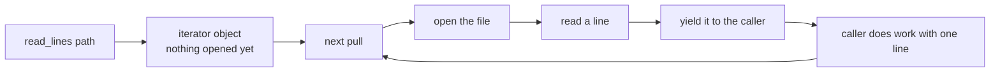
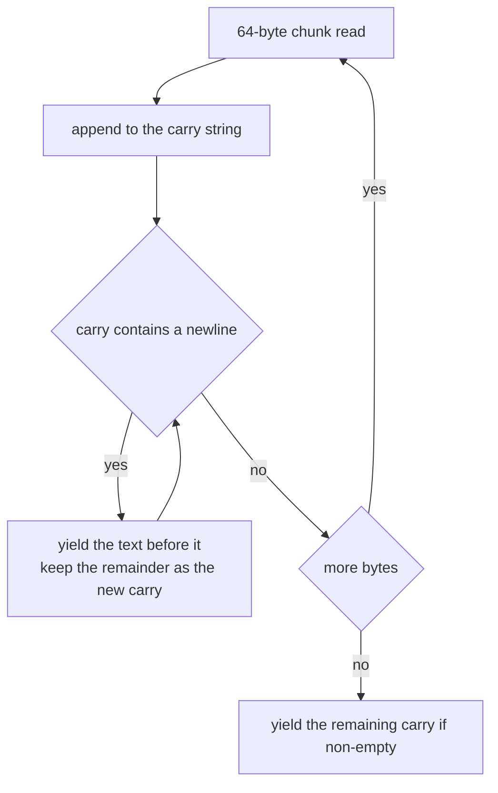
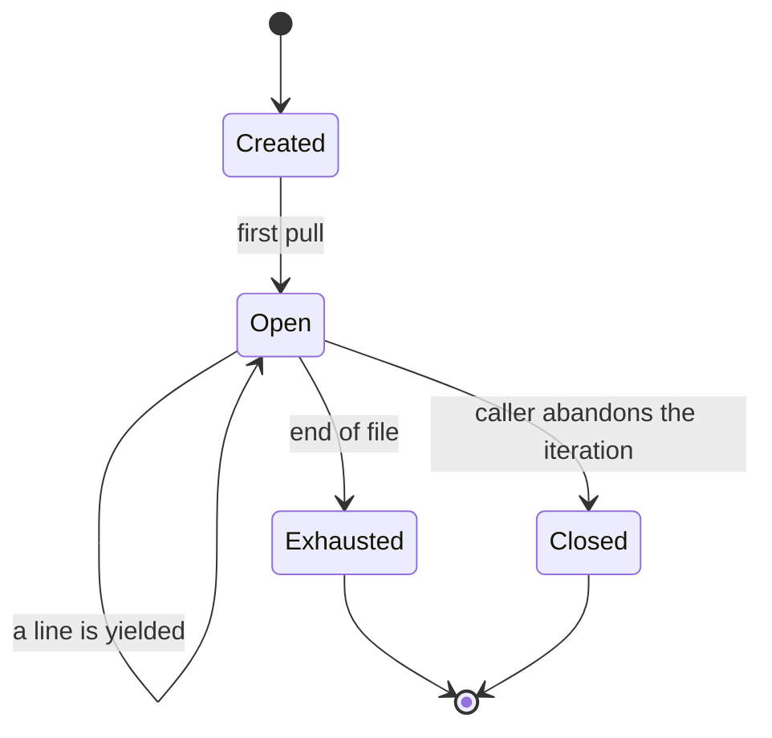
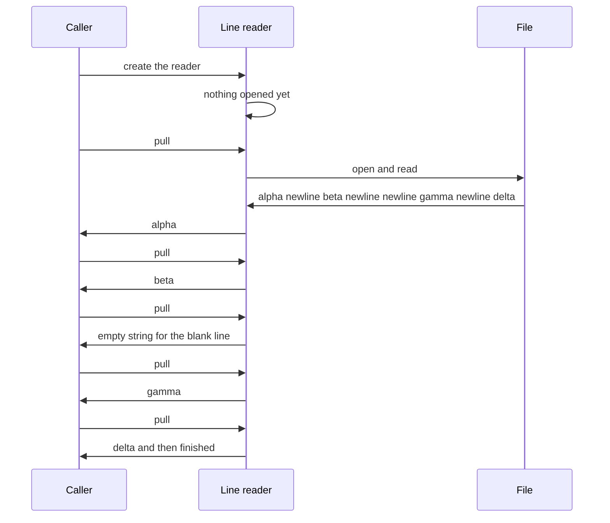

# 196 — Implement file line reader that yields lines lazily.

> **Tier:** Beginner · **CTCI chapter:** Ch 7 — Object-Oriented Design
> **Task spec:** [196-implement-file-line-reader-that-yields-lines-lazily.md](../../../tasks/beginner/196-implement-file-line-reader-that-yields-lines-lazily.md)
> **Solutions:** [Python](../../../solutions/python/beginner/196-implement-file-line-reader-that-yields-lines-lazily/solution.py) ·
> [Java](../../../solutions/java/beginner/196-implement-file-line-reader-that-yields-lines-lazily/Solution.java) ·
> [JavaScript](../../../solutions/javascript/beginner/196-implement-file-line-reader-that-yields-lines-lazily/solution.js) ·
> [C#](../../../solutions/csharp/beginner/196-implement-file-line-reader-that-yields-lines-lazily/Solution.cs)

## 1. Problem restatement

**Input:** a file path.

**Output:** the file's lines, delivered **one at a time**, without loading the whole file. The
documented rules are:

- the file is opened only when iteration starts, not when the reader is created,
- lines are pulled on demand and nothing is buffered up front,
- a trailing `\n` is stripped, but a final line without a newline is still yielded,
- blank lines yield the empty string.

All four files assert the same content: the file `"alpha\nbeta\n\ngamma\ndelta"` has **five** lines —
`alpha`, `beta`, `""`, `gamma`, `delta` — where the third is blank and the fifth is unterminated.
Every file also proves laziness by a deliberate trick: it creates the reader, **deletes the file**,
then asserts that the first pull fails because the file was opened only at that moment.

The four implementations differ in how laziness is expressed:

| Language | Mechanism | Notes from the files |
| --- | --- | --- |
| Python | generator function with `yield` and a `with open(...)` block | a generator does not run its body until the first `next` |
| Java | a hand-written `Iterator<String>` plus `AutoCloseable` | the `BufferedReader` is created inside `hasNext`, not in the constructor; `IOException` is wrapped in `UncheckedIOException` |
| C# | an iterator method (`IEnumerable<string>`) with `yield return` inside a `using` | "the iterator body (and the file open) runs only when enumeration starts" |
| JavaScript | a generator function over raw `fs` calls with a 64-byte buffer | the file descriptor is opened on the first `next()`, and lines are split out of a carry string |

The test files also check an extra case, in JavaScript and C#: `"x\ny\n"` yields `["x", "y"]` — a
trailing newline does not create an empty final line. Each test cleans up its temporary file and
directory in a `finally`/`try` block and then asserts that both are gone.

## 2. Intuition

Reading a file into an array of lines is one line of code in every one of these languages. It is also
the wrong thing to do when the file is larger than the memory you are willing to give it, or when the
consumer will stop early — searching for the first matching line does not need the last one.

The lazy version makes one change: instead of returning data, it returns a **pull-based iterator**
that owns an open file handle and produces the next line only when asked.



The consumer's loop now sets the pace, and the memory footprint is one line plus a small read buffer
instead of the whole file:

- **Python, Java, C#** get laziness from the language's generator/iterator support — the body does
  not run until the first pull, which is exactly the property the tests exploit by deleting the file
  before pulling.
- **JavaScript** has generators, but reading a line still means reading bytes: the file is opened with
  `fs.openSync` on the first pull, 64 bytes are read at a time, and a carry string holds the tail of a
  chunk that did not end on a line boundary.



That carry is the one piece of state the reader cannot avoid: a line may straddle any number of
chunk boundaries, and the reader must not emit a half-line or split a line at an arbitrary byte.

## 3. Algorithm

1. **Create the iterator.** Capture the path. Do **not** open the file — this is the laziness
   contract, and the tests verify it by removing the file before the first pull.
2. **First pull.** Open the file (Python/C#: inside the generator body; Java: inside `hasNext`).
3. **Each subsequent pull.**
   - Read the next line. Stop when the end of the file is reached.
   - Strip a trailing newline but keep everything else, so a blank line yields `""` and a line with
     trailing spaces keeps them.
   - If the last line has no terminating newline, still yield it.
4. **End of iteration.** Return the "finished" signal — `StopIteration` for a generator,
   `hasNext() == false` for an iterator — and close the file.
5. **Cleanup.** Close the handle on exhaustion, on an exception, or when the caller abandons the
   iteration early (`with` / `using` / `finally` / `close()`).

```text
function read_lines(path)
    return an iterator that, on each pull,
        if the file is not open then
            open the file for reading as UTF-8
        end
        raw ← read the next line, or NOTHING at end of file
        if raw is NOTHING then
            close the file
            signal finished
        end
        return raw without a trailing newline
end
```

The JavaScript version spells out the chunked form, which is what a language without a line-oriented
reader must do:

```text
function* read_lines(path)
    handle ← open path for reading
    try
        buffer ← new byte array of size 64
        carry ← empty string
        loop
            count ← read up to 64 bytes into buffer
            if count = 0 then
                exit loop
            end
            carry ← carry + decode(buffer[0 .. count - 1])
            while carry contains a newline do
                position ← index of the first newline in carry
                yield carry[0 .. position - 1]
                carry ← carry[position + 1 .. end]
            end
        end
        if carry is not empty then
            yield carry
        end
    finally
        close handle
    end
end
```

The `try`/`finally` is not decoration: it is what guarantees the descriptor is closed when the caller
abandons the generator half way through.



## 4. Worked example

Trace the Python generator over the test file, whose content is exactly
`alpha\nbeta\n\ngamma\ndelta` — 23 characters, five lines, the last one unterminated.

| Step | Call | What the generator does | Yielded |
| --- | --- | --- | --- |
| 1 | `gen = read_lines(path)` | body not started, file **not** opened | — |
| 2 | (file deleted, then `next(gen)`) | opening fails | `FileNotFoundError` — proof of laziness |
| 3 | file restored; `next(gen)` | open, read the first line | `"alpha"` |
| 4 | `list(gen)` | reads to the end, stripping each `\n` | `["beta", "", "gamma", "delta"]` |
| 5 | `list(read_lines(path))` | a fresh generator over the whole file | `["alpha", "beta", "", "gamma", "delta"]` |

Step 4 is the interesting one: after the explicit first pull, the remaining four lines come out with
the blank one preserved as `""` and the unterminated last line still yielded. Step 2 is not a test of
error handling but a test of *when* the open happens.

The JavaScript version reads the same 23 bytes in a single 64-byte chunk, which makes the carry
mechanism easy to follow:

| Action | `carry` after | Yielded |
| --- | --- | --- |
| read 23 bytes | `"alpha\nbeta\n\ngamma\ndelta"` | — |
| first newline found | `"beta\n\ngamma\ndelta"` | `"alpha"` |
| second newline | `"\ngamma\ndelta"` | `"beta"` |
| newline at the very front | `"gamma\ndelta"` | `""` (the blank line) |
| next newline | `"delta"` | `"gamma"` |
| no newline left | `"delta"` | — |
| next read returns 0 bytes | `"delta"` | loop ends |
| carry is non-empty | — | `"delta"` |

The blank line is emitted by the *front* of the carry being a newline, and the last line is emitted by
the post-loop check. A reader that only yielded inside the inner loop would silently lose the final
unterminated line — one of the two classic line-reader bugs, the other being an empty tail line.



The trailing-newline case is asserted separately (`"x\ny\n"` yields `["x", "y"]`): after the second
newline the carry is empty, so the post-loop check yields nothing. Without that condition the reader
would report a phantom third line.

## 5. Complexity

Let `L` be the number of lines, `B` the file size in bytes and `W` the length of the longest line.

| Measure | Bound | Why it holds |
| --- | --- | --- |
| Time | `O(B)` | every byte is read exactly once |
| Time per pull | `O(W)` amortised | one line plus whatever chunk was read to find its end |
| Space | `O(W)` | the current line plus a fixed-size read buffer (64 bytes in the JavaScript file) |
| Space, eagerly loaded alternative | `O(B)` | the whole file as one string, then a list of lines |
| Open file handles | `O(1)` | exactly one handle per active iterator |

The `O(W)` space bound is the point of the exercise: memory scales with the longest line, not with the
file. That is what lets the same code read a log file of gigabytes or a stream that has not finished
being written yet.

The constant factors differ across the files and the comments are explicit about it: Python's text
mode wraps the file in its own buffered reader, Java's `BufferedReader` holds its own buffer and
`readLine` does the splitting, C#'s `StreamReader` does the same, and the JavaScript file implements
the buffering by hand with a 64-byte array and a carry string. All four are linear with different
constants; only the JavaScript version exposes the buffer size as a named constant.

## 6. Pitfalls and edge cases

- **Laziness must be real, not cosmetic.** Creating the reader must not open the file. All four tests
  delete the file between creation and the first pull and expect the failure to surface only at the
  pull — that is the assertion, not a stylistic detail.
- **A final line without a newline is still a line.** `"alpha\nbeta\n\ngamma\ndelta"` has five lines;
  a reader that only yields on a newline loses `delta`. The JavaScript file's post-loop
  `if (carry.length > 0)` is exactly this fix.
- **A trailing newline does not add an empty line.** `"x\ny\n"` is two lines, asserted in JavaScript
  and C#. The mirror-image bug would report a phantom empty third line.
- **Blank lines are data.** The third line of the sample is `""` and must be yielded, not skipped,
  which matters for formats where a blank line is significant — CSV rows, paragraph breaks, log
  rotation markers.
- **Strip the newline, not whitespace.** The Python file uses `rstrip("\n")` deliberately; a bare
  `rstrip()` would also eat trailing spaces and tabs that belong to the data.
- **Line-ending variants.** Java's `readLine`, C#'s `ReadLine` and Python's universal-newline text
  mode all handle `\n`, `\r\n` and `\r`. The JavaScript file splits on `"\n"` only, so a CRLF file
  leaves a trailing `"\r"` on every line — a real difference to know about when comparing outputs.
- **Chunk boundaries in the JavaScript reader.** Lines are reassembled from a carry string, but the
  *decode* happens per chunk (`buffer.toString("utf8", 0, bytesRead)`), so a multi-byte UTF-8
  character split across the 64-byte boundary can be decoded as a replacement character. The carry
  mechanism solves boundaries at the character level, not at the byte level.
- **Resource cleanup on early exit.** Abandoning a generator half way leaves the file open unless the
  body has a `finally` (JavaScript), a `with` (Python), a `using` (C#), or the caller uses
  try-with-resources on the `AutoCloseable` (Java).
- **`hasNext` must not consume.** The Java iterator buffers the next line in a `pending` field so
  that a `hasNext()` followed by `next()` yields the same line; reading eagerly inside `hasNext` and
  discarding the result would lose lines.
- **Exceptions become unchecked in Java.** `readLine` throws `IOException`, which an `Iterator` cannot
  declare, so the file wraps it in `UncheckedIOException` — the fourth solution's way of keeping the
  iterator interface.
- **The path is captured, not validated.** A nonexistent file fails at the first pull with
  `FileNotFoundError` / `UncheckedIOException` / `FileNotFoundException` / `ENOENT`, not at creation.
- **One iterator, one pass.** These readers are not rewindable; a second pass means creating a second
  iterator (which the tests do when they call `read_lines(path)` again).

## 7. Variants and follow-ups

- **Consuming lines as they arrive.** [189-implement-simple-csv-parser-line-fields.md](../../../tasks/beginner/189-implement-simple-csv-parser-line-fields.md)
  parses one line into fields, which is the natural per-line step for this reader, and
  [193-implement-simple-expression-tokenizer.md](../../../tasks/beginner/193-implement-simple-expression-tokenizer.md)
  does the same at character level.
- **Reading two files in step.** [197-implement-checksum-based-file-difference-simplified-rsync-idea.md](../../../tasks/beginner/197-implement-checksum-based-file-difference-simplified-rsync-idea.md)
  compares block checksums between files, which is much easier to do lazily than after loading both.
- **Producers and consumers.** [195-implement-basic-producer-consumer-using-threads-mutex-condition.md](../../../tasks/beginner/195-implement-basic-producer-consumer-using-threads-mutex-condition.md)
  is the threaded version of "produce items on demand": a reader thread feeding a bounded buffer is
  the multi-threaded analogue of this iterator.
- **Streaming parsers.** The same pull-based shape underlies JSON and CSV parsers that must not load
  their input; [199-deserialize-json-with-arrays-objects-basic.md](../../../tasks/beginner/199-deserialize-json-with-arrays-objects-basic.md)
  is the in-memory version for comparison.
- **Memory-mapped alternatives.** For random access rather than sequential reads, memory mapping
  removes the read loop entirely and lets the OS page in what is needed.
- The chapter walkthrough in [Object-Oriented Design](../../ctci/07-object-oriented-design.md) frames
  this as designing a small object with an explicit lifecycle.

## 8. Check yourself

1. How do the tests prove that the file is opened lazily?

<details><summary>Show answer</summary>

They create the reader, delete the file, and then perform the first pull, expecting the failure to
happen *there* — `FileNotFoundError` in Python, `UncheckedIOException` in Java,
`FileNotFoundException` in C#, `ENOENT` in JavaScript. If the constructor or the call had opened the
file, the deletion would not matter and the error would have occurred earlier.

</details>

2. Why does `"x\ny\n"` produce two lines rather than three?

<details><summary>Show answer</summary>

Because the second newline terminates the second line; after it, the carry is empty, and the "remaining carry" step only yields when there is something left. A reader that yielded the empty tail would report a phantom line, and the JavaScript and C# files assert the two-line result explicitly.

</details>

3. What is the maximum memory this reader needs for a file whose longest line is `W` characters?

<details><summary>Show answer</summary>

`O(W)` — the current line plus a fixed read buffer (64 bytes in the JavaScript implementation, or the
language's own buffered reader elsewhere). The file size does not appear in the bound, which is the
whole reason to read lazily.

</details>

4. What has to happen if the caller stops iterating after the first line?

<details><summary>Show answer</summary>

The file handle must still be closed. That is what the `try`/`finally` in the JavaScript generator,
the `with` in Python, the `using` in C#, and the `AutoCloseable`/try-with-resources pairing in Java
provide: an exit path that runs whether the iteration finished, threw, or was abandoned.

</details>

5. Why does the JavaScript version keep a `carry` string?

<details><summary>Show answer</summary>

Because bytes arrive in fixed-size chunks and a line can straddle a chunk boundary. The carry holds
the tail of the previous chunk so it can be joined with the next one; text before each newline is
yielded as a complete line, and whatever remains after the last newline becomes the start of the
next line. Without it, long lines would be split and short chunks could lose data.

</details>
