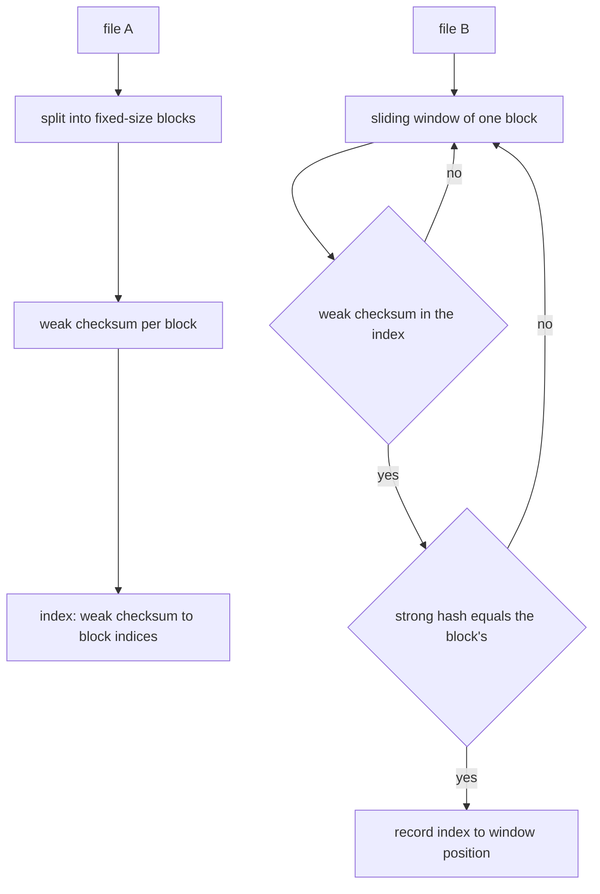
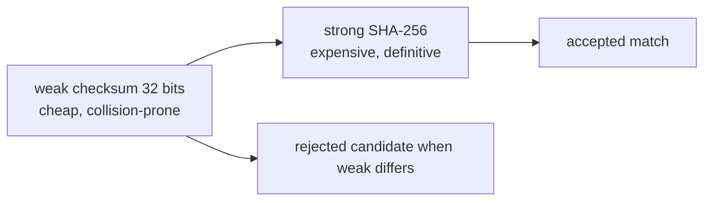
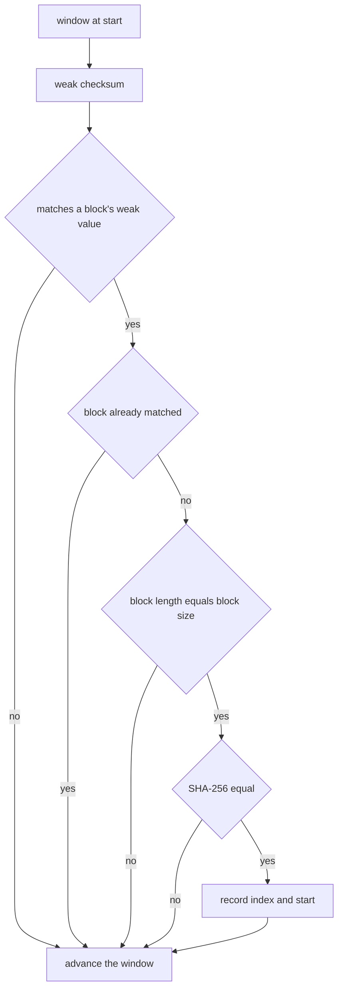
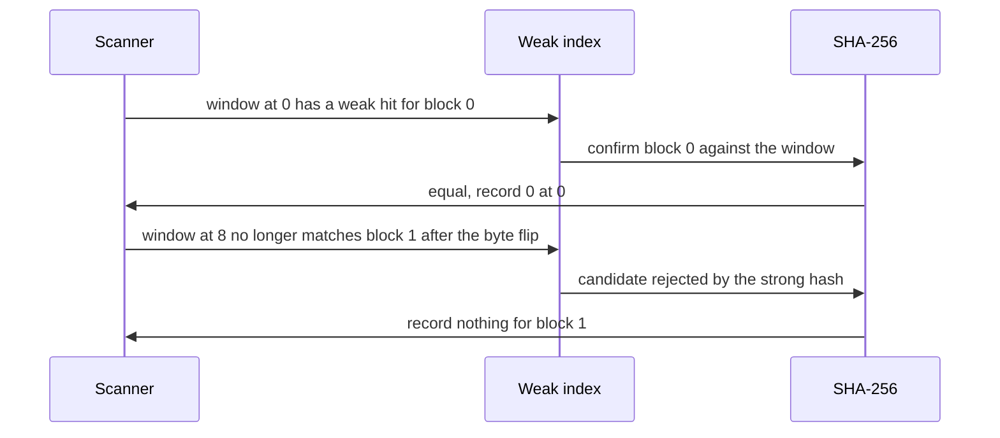

# 197 — Implement checksum-based file difference (simplified rsync idea).

> **Tier:** Beginner · **CTCI chapter:** Beyond — Networking, OS & Real-Time
> **Task spec:** [197-implement-checksum-based-file-difference-simplified-rsync-idea.md](../../../tasks/beginner/197-implement-checksum-based-file-difference-simplified-rsync-idea.md)
> **Solutions:** [Python](../../../solutions/python/beginner/197-implement-checksum-based-file-difference-simplified-rsync-idea/solution.py) ·
> [Java](../../../solutions/java/beginner/197-implement-checksum-based-file-difference-simplified-rsync-idea/Solution.java) ·
> [JavaScript](../../../solutions/javascript/beginner/197-implement-checksum-based-file-difference-simplified-rsync-idea/solution.js) ·
> [C#](../../../solutions/csharp/beginner/197-implement-checksum-based-file-difference-simplified-rsync-idea/Solution.cs)

## 1. Problem restatement

**Input:** two byte strings `a` and `b`, and a `block_size`. The task models the core of rsync: find
which parts of `a` already exist somewhere in `b`.

**Output:** a map from each block index of `a` to **the first position in `b` where that block's
content occurs**. Blocks of `a` that do not occur in `b` are absent from the map.

The pipeline is documented in the files:

- `a` is split into fixed-size blocks, the last one possibly shorter;
- every block gets a cheap 32-bit **weak** checksum — two byte sums, `(a_sum << 16) | b_sum`, with
  the `b` term weighted so that the checksum is order-sensitive;
- `b` is scanned with a sliding window of `block_size`, and every window is confirmed with a
  **strong** SHA-256 hash before it is accepted;
- the window's weak checksum is **recomputed from scratch**, which the file calls out as "the
  documented simplification" — no rolling update;
- a partial trailing block of `a` is looked up with a direct search, also documented as a
  simplification.

The four files assert the same scenarios:

| Scenario | Result | Why |
| --- | --- | --- |
| `a` = bytes `0..39`, `b = a`, `block_size = 8` | `{0: 0, 1: 8, 2: 16, 3: 24, 4: 32}` | five blocks, each at its own offset |
| one byte flipped at index `10` inside block 1 | `{0: 0, 2: 16, 3: 24, 4: 32}` | only the damaged block is missing |
| `b` = 64 bytes all `9` | `{}` | nothing matches |
| `b` = `"HEADER"` + `a` | `{0: 6, 1: 14, 2: 22, 3: 30, 4: 38}` | every block found, shifted by the 6-byte insert |
| `a` = `"ABABABAB"`, `b` = `"ZZABABABAB"`, `block_size = 4` | `{0: 2, 1: 2}` | duplicate blocks both report the *first* position |
| `a` = `"abc"`, `b` = `"xxabcxx"`, `block_size = 8` | `{0: 2}` | the partial trailing block is found by direct search |
| `a` = empty | `{}` | no blocks to look for |
| `weak_checksum("AB")` vs `weak_checksum("BA")` | different values | the weighting makes the checksum order-sensitive |
| `block_size = 0` | error | a block size must be positive |

## 2. Intuition

Comparing two files byte by byte costs as much as transferring the smaller one. rsync's idea is to
compare *fingerprints* instead: the receiver describes its data with short checksums, the sender
looks for blocks whose fingerprints match, and only the unmatched gaps travel over the wire.

The reason two fingerprints are used is asymmetric cost:

- a **weak** checksum is cheap and can be computed for every window position — but 32 bits cannot
  distinguish all inputs, so equal weak checksums are only a hint;
- a **strong** hash (SHA-256 here) is expensive, so it is computed only when the weak checksums agree,
  and it is what makes a match a fact.



The two-stage design is the whole lesson: **use a cheap filter first, and a definitive test only on
the survivors.** The same pattern appears wherever the cost of verification dominates — hash tables
with equality checks, in-memory caches with value comparison, and the rolling-hash tasks in this
repository.



Because the scan recomputes each window's weak checksum from scratch rather than rolling it, the
matching is `O(|B| · block_size)` instead of `O(|B|)`; the file names this as the simplification, and
[187-implement-basic-rolling-hash-for-integer-arrays.md](../../../tasks/beginner/187-implement-basic-rolling-hash-for-integer-arrays.md)
shows the rolled version.

## 3. Algorithm

1. Reject a non-positive `block_size`.
2. Split `a` into consecutive blocks of `block_size`; the final block may be shorter.
3. Compute each block's weak checksum and build an index from checksum value to the list of block
   indices that produced it — a list, because different blocks can share a checksum.
4. Slide a window of `block_size` across `b`, from position `0` to `|b| - block_size`:
   1. Compute the window's weak checksum.
   2. For each candidate block index in the index entry (if any), skip it when it is already matched
      or when its length is not `block_size` (that is the partial tail, handled separately).
   3. Confirm with a strong hash comparison; on success record `index → window position`.
5. If `a`'s last block is shorter than `block_size` and is not already matched, search for it
   directly in `b` and record the first position if found.
6. Return the map.

```text
function weak_checksum(block)
    sum_a ← 0
    sum_b ← 0
    length ← length(block)
    for i ← 0 to length - 1 do
        sum_a ← (sum_a + block[i]) mod 65536
        sum_b ← (sum_b + (length - i) * block[i]) mod 65536
    end
    return (sum_a shifted left by 16) or sum_b
end

function find_block_matches(a, b, block_size)
    if block_size ≤ 0 then
        raise "block_size must be positive"
    end
    blocks ← split a into consecutive pieces of block_size
    index_by_weak ← empty map from checksum to list of block indices
    for index ← 0 to length(blocks) - 1 do
        append index to index_by_weak[weak_checksum(blocks[index])]
    end
    matches ← empty map
    for start ← 0 to length(b) - block_size do
        window ← b[start .. start + block_size - 1]
        for index in index_by_weak[weak_checksum(window)] do
            if index is already in matches or length(blocks[index]) ≠ block_size then
                continue
            end
            if strong_hash(window) = strong_hash(blocks[index]) then
                matches[index] ← start
            end
        end
    end
    if blocks is not empty then
        tail_index ← length(blocks) - 1
        tail ← blocks[tail_index]
        if length(tail) &lt; block_size and tail_index is not in matches then
            position ← first occurrence of tail in b
            if position ≥ 0 then
                matches[tail_index] ← position
            end
        end
    end
    return matches
end
```

Three guards inside the candidate loop carry the semantics: `already matched` makes the result the
*first* position, `length ≠ block_size` keeps the partial tail out of the window scan, and the strong
hash is what turns a candidate into a match.



## 4. Worked example

Take `a` = bytes `0..39` and `b` = bytes `0..39` with `block_size = 8`. `a` splits into five blocks:

| Block index | Bytes | Weak checksum (two 16-bit sums) |
| --- | --- | --- |
| 0 | `0..7` | `a_sum = 0+1+…+7 = 28`, `b_sum` weights them by distance from the block end |
| 1 | `8..15` | different sums again |
| 2 | `16..23` | — |
| 3 | `24..31` | — |
| 4 | `32..39` | — |

The window scan then walks `b` from position `0` to `32`, and each window lands exactly on a block
boundary, so every window's weak checksum hits the index and the SHA-256 confirmation succeeds. The
result is `{0: 0, 1: 8, 2: 16, 3: 24, 4: 32}` — an identity alignment, as expected when the files are
equal.

**One changed byte** flips the picture. Flipping byte `10` (inside block 1) changes that block's weak
sums and its strong hash, so:

| Block | Position in `b` | Weak hit? | Strong hit? | Reported |
| --- | --- | --- | --- | --- |
| 0 | 0 | yes | yes | `0 → 0` |
| 1 | 8 | yes (the window at `8` is the *old* block 1, which differs from `a`'s) | no | omitted |
| 2 | 16 | yes | yes | `2 → 16` |
| 3 | 24 | yes | yes | `3 → 24` |
| 4 | 32 | yes | yes | `4 → 32` |

This is the case that shows why the strong hash matters: the weak checksum is a *filter*, and the
reported map is what survives the filter. A scheme that trusted the weak checksum alone would be
wrong here — and the "completely different content" case (`{}`) is the same mechanism with the filter
rejecting early.

**A six-byte insert at the front** (`"HEADER"` + `a`) shifts everything:

| Block | Position in `b` | Window start at match |
| --- | --- | --- |
| 0 | `6` | window `6..13` covers `a[0..7]` |
| 1 | `14` | window `14..21` |
| 2 | `22` | window `22..29` |
| 3 | `30` | window `30..37` |
| 4 | `38` | window `38..45` |

The result is `{0: 6, 1: 14, 2: 22, 3: 30, 4: 38}` — the insert cost nothing but the offset
arithmetic, which is precisely rsync's point: only the 6-byte difference would need to travel.



Two more cases exercise the edges. With `a = "ABABABAB"` and `block_size = 4` the two blocks of `a`
are identical strings, so the index lists both indices under the same weak checksum; the first window
in `b` that matches, at position `2`, sets **both** entries — the reported map is `{0: 2, 1: 2}`, one
position per block index, and the later window at position `4` is skipped because both indices are
already matched. With `a = "abc"` and `block_size = 8` the only block is shorter than the window, so
the window loop cannot produce it (its range is `0..|b|-block_size`, empty here) and the direct tail
search finds `abc` at position `2`, giving `{0: 2}`.

## 5. Complexity

Let `A` and `B` be the sizes of the two inputs, `s` the block size, and `n = ⌈A / s⌉` the number of
blocks.

| Stage | Time | Space | Why |
| --- | --- | --- | --- |
| Split and checksum `a` | `O(A)` | `O(A)` | every byte is touched once, blocks are stored |
| Index build | `O(n)` expected | `O(n)` | one map insertion per block |
| Window scan | `O((B - s + 1) · s)` | `O(s)` | each window's weak checksum is recomputed from scratch — the documented simplification |
| Strong confirmations | `O(s)` per candidate | `O(1)` | SHA-256 over one block, only on weak hits |
| Tail lookup | `O((B - |tail| + 1) · |tail|)` | `O(1)` | direct search, the second simplification |
| Whole operation | `O(A + B · s)` | `O(A)` | dominated by the per-window recomputation |

The `B · s` factor is the price of skipping the rolling update: a real rsync scan updates the weak
checksum in `O(1)` per window and yields `O(B)` scanning, with the checksum index built in
`O(n log n)` or `O(n)` expected. The simplification is documented precisely so the comparison is
visible — the algorithm's *structure* (weak filter, strong confirm, unmatched gap) is the real
subject, and the constant factor is where the engineering effort in a production rsync goes.

Where the two hashes pay off: one SHA-256 per weak hit, and weak hits are the interesting cases
(genuine matches plus a small number of 32-bit collisions). A scheme that hashed every window would
cost `O(B · s)` hashing work with a much larger constant, and one that trusted only the weak checksum
would be fast and sometimes wrong.

## 6. Pitfalls and edge cases

- **Weak alone is never enough.** The weak checksum is two 16-bit sums; completely different content
  can collide, so every candidate must be confirmed with the strong hash. The "64 bytes of `9`"
  assertion (`{}`) and the one-byte-flip assertion (block 1 dropped) are the two sides of that rule.
- **The weak checksum must be order-sensitive.** Weighting byte `i` by `length - i` is what makes
  `weak_checksum("AB")` differ from `weak_checksum("BA")`, which the files assert. A plain byte sum
  would treat anagrams as identical.
- **The window loop only covers full blocks.** The range is `0 … |b| - block_size`, so a short block
  can never be found by scanning; that is why the partial tail needs its own direct lookup, which the
  files document as a simplification.
- **The tail is also excluded from the candidate loop.** The guard `length(blocks[index]) != block_size`
  prevents the partial block from being "confirmed" against a full-size window; without it a short
  tail could match a prefix of unrelated data.
- **First position wins.** The `already matched` guard means a block maps to the first window position
  where it occurs, and duplicate blocks in `a` each report that same first position — `{0: 2, 1: 2}`
  for the `ABAB` case.
- **Blocks are keyed by index, not by content.** Duplicate blocks stay separate entries, so the map
  describes `a`'s layout rather than a set of distinct contents.
- **Signed bytes.** Java's `byte` is signed, so the checksum masks each element with `0xFF` before
  summing; Python, JavaScript `Buffer` and C# `byte` give `0 … 255` directly. Forgetting the mask in
  Java produces negative sums and a wrong checksum.
- **The 16-bit masks are part of the contract.** Both sums are reduced modulo `65536`, so the combined
  value fits in 32 bits. Dropping the mask makes the checksum grow unboundedly and changes which
  candidates collide.
- **`block_size <= 0` is rejected**, and an empty `a` yields `{}` — the tail branch is skipped
  because there are no blocks.
- **A match is not an alignment.** The report says where each block of `a` *first* occurs in `b`, not
  how the two files correspond; reconstructing a real delta would need the unmatched gaps as well.

## 7. Variants and follow-ups

- **The rolling version.** [187-implement-basic-rolling-hash-for-integer-arrays.md](../../../tasks/beginner/187-implement-basic-rolling-hash-for-integer-arrays.md)
  shows the `O(1)` slide that removes the `· s` factor, and
  [186-rabin-karp-rolling-hash-string-search.md](../../../tasks/beginner/186-rabin-karp-rolling-hash-string-search.md)
  applies it to string search.
- **Simpler checksums.** [168-implement-basic-checksum-sum-bytes.md](../../../tasks/beginner/168-implement-basic-checksum-sum-bytes.md)
  is the byte-sum building block that the weak checksum generalises into a position-weighted form.
- **Feeding the comparator.** [196-implement-file-line-reader-that-yields-lines-lazily.md](../../../tasks/beginner/196-implement-file-line-reader-that-yields-lines-lazily.md)
  shows how to stream a file instead of holding it, which is what a real synchroniser does with both
  sides.
- **Content-defined chunking.** Choosing block boundaries by content (a rolling hash hitting a
  pattern) instead of by fixed offsets makes the comparison robust to insertions, at the cost of
  variable block sizes.
- **Hierarchical matching.** Real rsync sorts the weak checksums to find candidates in `O(log n)`
  time and reuses unfound blocks across rounds, which is the step from this teaching version to a
  production implementation.
- The chapter walkthrough in [Sorting and Searching](../../ctci/10-sorting-and-searching.md) covers
  the hashing and lookup machinery this task builds on.

## 8. Check yourself

1. Why does the algorithm need two kinds of fingerprint instead of one?

<details><summary>Show answer</summary>

Because they trade cost against certainty. The weak checksum is cheap enough to compute for every
window position but only 32 bits wide, so it decides *which* comparisons are worth making. The strong
SHA-256 hash is too expensive to compute everywhere, but it is definitive, so it is used only on the
weak hits. Weak alone would report false matches; strong alone would be too slow.

</details>

2. What happens to the report when a single byte inside one block changes?

<details><summary>Show answer</summary>

That block's weak and strong fingerprints both change, so the window covering it fails the strong
confirmation and the block is absent from the map; the other blocks still match at their offsets. For
`a` = bytes `0..39` with a flipped byte at index `10`, the result is `{0: 0, 2: 16, 3: 24, 4: 32}`.

</details>

3. `a = "ABABABAB"` and `block_size = 4` produce two blocks with identical content. What does the
   report look like and why?

<details><summary>Show answer</summary>

`{0: 2, 1: 2}`. Both block indices share one weak checksum bucket, and the first window in `b` whose
content matches — at position `2` — sets both entries. Each block index reports the first position at
which its content occurs, so identical blocks naturally share a position, and the later window at `4`
is skipped because the indices are already matched.

</details>
