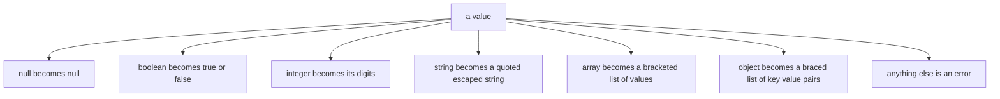
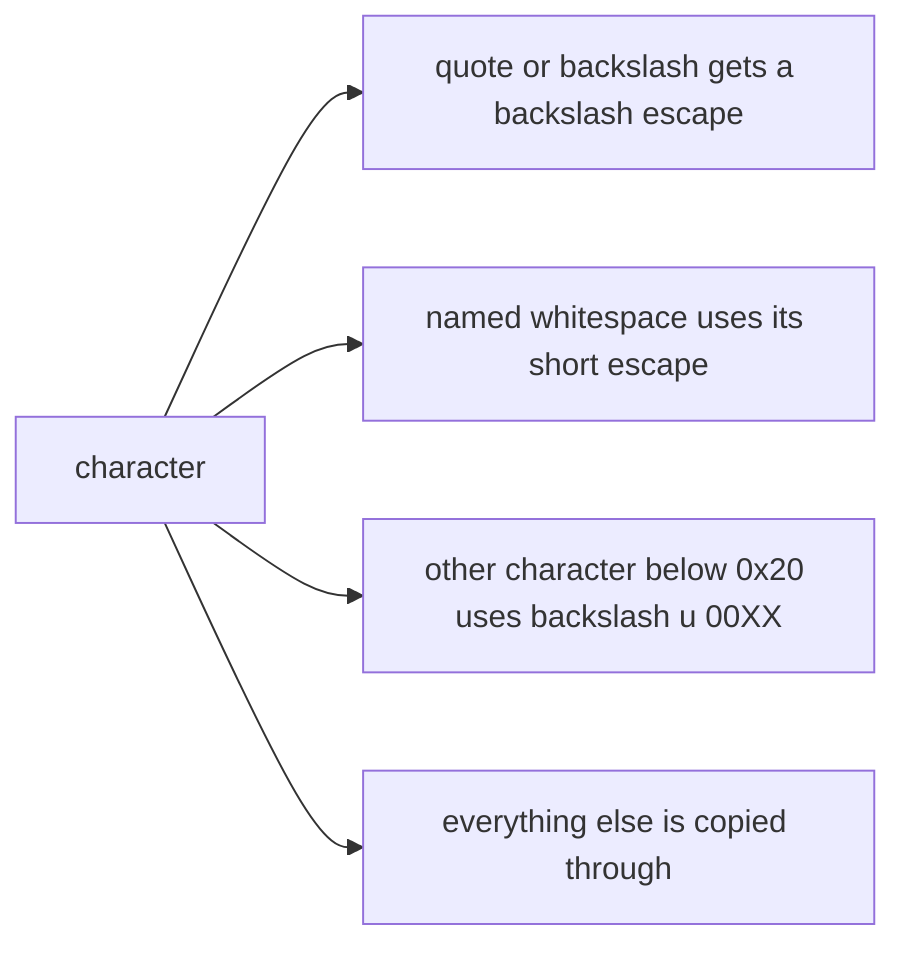
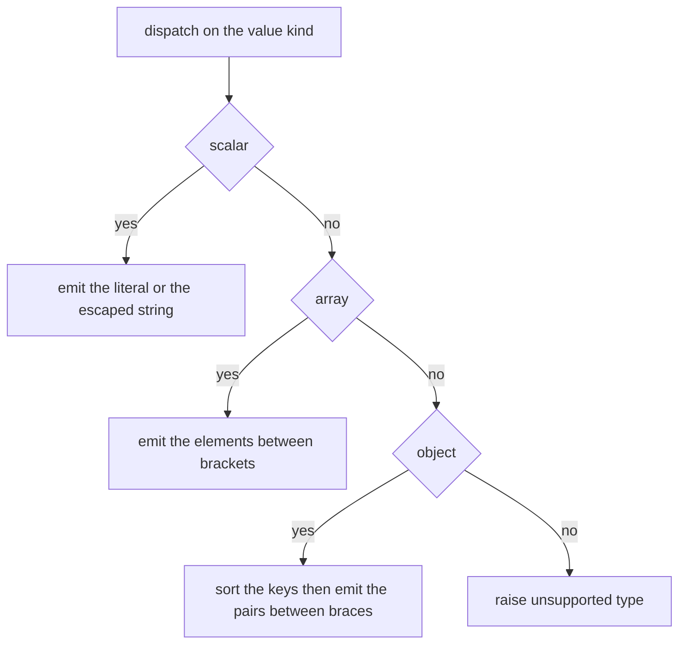
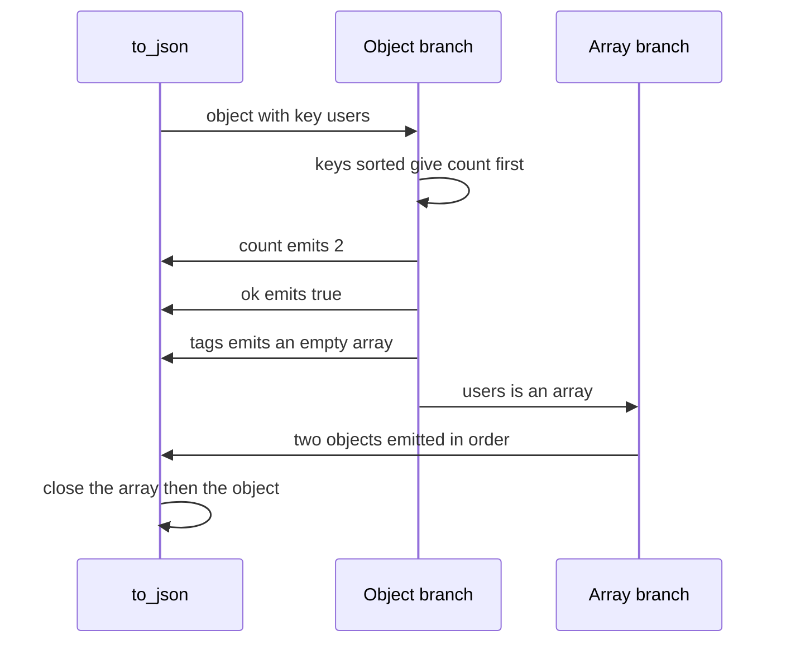

# 198 — Serialize object to JSON string (manual).

> **Tier:** Beginner · **CTCI chapter:** Ch 7 — Object-Oriented Design
> **Task spec:** [198-serialize-object-to-json-string-manual.md](../../../tasks/beginner/198-serialize-object-to-json-string-manual.md)
> **Solutions:** [Python](../../../solutions/python/beginner/198-serialize-object-to-json-string-manual/solution.py) ·
> [Java](../../../solutions/java/beginner/198-serialize-object-to-json-string-manual/Solution.java) ·
> [JavaScript](../../../solutions/javascript/beginner/198-serialize-object-to-json-string-manual/solution.js) ·
> [C#](../../../solutions/csharp/beginner/198-serialize-object-to-json-string-manual/Solution.cs)

## 1. Problem restatement

**Input:** a value tree built from `null`, booleans, integers, strings, lists/arrays and
maps/objects with string keys.

**Output:** the compact JSON text for that tree — no spaces anywhere. The rules are documented in
the files:

- `null`, `true`, `false` and integers are emitted literally;
- strings are quoted and escape `\"`, `\\`, `\n`, `\t`, `\r`, `\b`, `\f`, with every other control
  character emitted as `\u00XX`;
- arrays are `[` … `]` with commas;
- objects are `{` … `}` with **keys sorted**, so the output is deterministic;
- any other type, a non-string key, or a floating-point number is an error.

The task spec is one line, so the contract comes from the assertions the four files share:

| Input | Output | Why |
| --- | --- | --- |
| `null`, `true`, `false` | `null`, `true`, `false` | literals |
| `42`, `-7` | `42`, `-7` | integers survive verbatim |
| `""` | `""` | an empty string is still a quoted string |
| `[]`, `{}` | `[]`, `{}` | empty containers |
| `"a\"b\\c\nd\te\rf"` | `"a\"b\\c\nd\te\rf"` | the named escapes |
| `"x\u0001y"` | `"x\u0001y"` | other control characters use `\u00XX` |
| `{"b": 1, "a": [true, null, "x"]}` | `{"a":[true,null,"x"],"b":1}` | keys are sorted, not emitted in insertion order |
| `{"a": {"b": {"c": [1, [2, [3, null]]]}}}` | `{"a":{"b":{"c":[1,[2,[3,null]]]}}}` | nesting is handled recursively |
| the user document below | `{"count":2,"ok":true,"tags":[],"users":[{"id":2,"name":"Bob"},{"id":1,"name":"Ann"}]}` | arrays keep their order, object keys are sorted |

Rejected inputs, asserted in every file: an unsupported object (`object()`, a lambda,
`new Object()`), a float (`3.5`) and a non-string key (`{1: "x"}`).

Python, JavaScript and C# cross-check the output against their standard library parser
(`json.loads`, `JSON.parse`, `JsonNode.Parse`) — using the parser only as an **oracle**, which the
Python docstring states explicitly ("stdlib json is used only as a cross-check oracle"). Java has no
built-in JSON parser in the JDK, so its file notes that exact-string assertions are the primary check
and that the parser of
[199-deserialize-json-with-arrays-objects-basic.md](../../../tasks/beginner/199-deserialize-json-with-arrays-objects-basic.md)
can round-trip the output.

## 2. Intuition

JSON's grammar is small enough to write by hand, and the shape of the serializer is fixed by the
grammar: a value is either a scalar, a sequence of values, or a mapping from strings to values. That
is a recursive-descent problem with five cases and one error case.



The two decisions that go beyond "print the value" are the ones that make output comparable across
runs and machines:

- **Object keys are sorted.** JSON itself does not require it, so an insertion-ordered output would
  be correct and non-deterministic — two logically equal documents would serialize differently. The
  files all sort, which is why the expected strings have `"a"` before `"b"` and `"count"` before
  `"users"`.
- **Strings are escaped by an explicit table.** Only the seven named escapes get short forms; every
  other control character goes out as `\u00XX`. Characters above the control range are emitted
  unchanged, which is legal JSON and keeps the text UTF-8 friendly.



The dispatch order matters in a way the type systems hide: `True` is an instance of `int` in Python,
and a number is a number in JavaScript, so "boolean before integer" and "integer only, no floats" are
checks the serializer has to make deliberately rather than inherit.

## 3. Algorithm

1. **`to_json(value)`.**
   1. `null` → `null`.
   2. boolean → `true` or `false`.
   3. integer → the decimal digits with a leading `-` when negative.
   4. string → `serialize_string`.
   5. list/array → `[` + values serialized recursively, joined with `,` + `]`.
   6. map/object → validate that every key is a string, sort the keys, then emit
      `{` + `"key":value` pairs joined with `,` + `}`.
   7. anything else → error.
2. **`serialize_string(value)`.** Emit `"`, then for each character: use the escape table when the
   character is one of the seven, `\u00XX` when its code is below `0x20`, and the character itself
   otherwise; close with `"`.

```text
function to_json(value)
    if value is null then return "null" end
    if value is a boolean then return "true" if value else "false" end
    if value is an integer then return decimal text of value end
    if value is a string then return serialize_string(value) end
    if value is a list then
        parts ← empty list
        for item in value do
            append to_json(item) to parts
        end
        return "[" + join(parts, ",") + "]"
    end
    if value is a map then
        keys ← sorted list of the map keys
        for key in keys do
            if key is not a string then
                raise "object keys must be strings"
            end
        end
        parts ← empty list
        for key in keys do
            append serialize_string(key) + ":" + to_json(map[key]) to parts
        end
        return "{" + join(parts, ",") + "}"
    end
    raise "unsupported type"
end

function serialize_string(text)
    out ← "\""
    for ch in text do
        if ch is in the escape table then
            out ← out + escape table entry of ch
        else if code of ch &lt; 0x20 then
            out ← out + "\\u" + four hexadecimal digits of code of ch
        else
            out ← out + ch
        end
    end
    return out + "\""
end
```

The recursion terminates because every recursive call is on a strictly smaller value — an element of
an array or a value of a map — and scalars cannot recurse.



## 4. Worked example

Trace the composite document from the tests:

```text
{ "users": [ {"id": 2, "name": "Bob"}, {"id": 1, "name": "Ann"} ],
  "count": 2, "ok": true, "tags": [] }
```

The serializer walks it like this:

| Step | Value | Action | Emitted so far |
| --- | --- | --- | --- |
| 1 | the outer map | four keys, sorted to `count`, `ok`, `tags`, `users` | `{` |
| 2 | `count` → `2` | integer | `{"count":2` |
| 3 | `ok` → `true` | boolean | `{"count":2,"ok":true` |
| 4 | `tags` → `[]` | empty array | `{"count":2,"ok":true,"tags":[]` |
| 5 | `users` → array of two maps | array | `…,"users":[` |
| 6 | first user | map with keys `id`, `name` | `{"id":2,"name":"Bob"}` |
| 7 | second user | map with keys `id`, `name` | `,{"id":1,"name":"Ann"}` |
| 8 | close | array and object terminators | `]}` |

The final text is
`{"count":2,"ok":true,"tags":[],"users":[{"id":2,"name":"Bob"},{"id":1,"name":"Ann"}]}` — note that
the array order is `Bob` then `Ann`, exactly as given, while the object keys were reordered. Only
*keys* are sorted; array positions are data.

The escape table is easiest to check character by character on the assertion string
`"a\"b\\c\nd\te\rf"` (already JSON-escaped in the source), whose characters are
`a`, `"`, `b`, `\`, `c`, newline, `d`, tab, `e`, carriage return, `f`:

| Character | Escape used | Appears in the output as |
| --- | --- | --- |
| `a`, `b`, `c`, `d`, `e`, `f` | none | themselves |
| `"` | `\"` | `\"` |
| `\` | `\\` | `\\` |
| newline | `\n` | `\n` |
| tab | `\t` | `\t` |
| carriage return | `\r` | `\r` |

And for a character with no named escape, `"x\u0001y"` shows the general rule: `0x01` is below
`0x20`, so it becomes the four-digit escape `\u0001` while `x` and `y` are copied through.



The round-trip oracle closes the loop in the three languages that have a parser: parsing the output
back must reproduce the input value (`json.loads(to_json(doc)) == doc`, `JSON.parse(...)` deep-equals
the document, `JsonNode.Parse` reports `count == 2`, `ok` true, two users). That check catches the
class of bug that string assertions alone can miss — an escape that is legal-looking but wrong.

## 5. Complexity

Let `n` be the total number of characters in the output and `d` the nesting depth.

| Measure | Bound | Why it holds |
| --- | --- | --- |
| Time | `O(n)` | each output character is produced once; each value is visited once |
| Key sorting | `O(k log k)` per object with `k` keys | the only non-linear step, and it is per object |
| Space, output | `O(n)` | the result string itself |
| Space, recursion | `O(d)` | one frame per level of nesting |
| Space, Java/C# | `O(k)` extra per object | the sorted key list is materialised |

The traversal is linear in the size of the *output* rather than the input, which is why the escape
table's constant factor shows up in practice: an input string full of newlines and quotes produces a
proportionally longer result. Sorting is the only step that is not proportional to the text, and it is
what buys determinism; for a document with few keys per object it is negligible.

Recursion depth is the resource to watch: the tests nest three levels, but a hostile input of ten
thousand nested arrays would exhaust the call stack in every one of these implementations. A
production serializer either bounds the depth or uses an explicit stack.

## 6. Pitfalls and edge cases

- **A boolean is not an integer, even when the language says it is.** Python's `bool` is a subclass of
  `int`, so the boolean check must come *before* the integer check; otherwise `True` serializes as
  `1`. JavaScript hits the same fork from the other side, testing `typeof value === "boolean"` before
  `"number"`. The Java and C# files order `Boolean` before `Integer`/`int` for the same reason.
- **Floats are rejected on purpose.** `3.5` raises in all four files ("only integers are supported" in
  JavaScript, "unsupported type" elsewhere). Serializing a float without a decision about precision
  and formatting produces locale- and platform-dependent output.
- **Keys must be strings and are sorted.** `{1: "x"}` raises; `{"b": 1, "a": 2}` must emit
  `{"a":2,"b":1}`. Sorting is a contract, not an optimization: the expected strings in the tests
  depend on it.
- **Arrays keep their order.** Sorting applies to object keys only — the `users` array keeps `Bob`
  before `Ann` even though `"Bob" > "Ann"` as strings.
- **Only seven named escapes exist.** `\n`, `\t`, `\r`, `\b`, `\f`, `\"` and `\\`; everything else
  below `0x20` becomes `\u00XX`, and `/` is *not* escaped (escaping it is legal but not required, and
  it would break the exact-string assertions).
- **Characters above the ASCII range are emitted raw.** Non-ASCII text stays as-is, which is valid
  JSON and keeps the output short; a serializer that escaped everything non-ASCII would produce
  different (still valid) bytes and fail these assertions.
- **Output is compact.** No spaces after `:`, `,` or the brackets — every expected string in the tests
  is written without whitespace.
- **Empty containers are `[]` and `{}`**, not `null` and not empty strings; the object branch must not
  emit a stray comma.
- **Tuples serialize as arrays in Python.** The docstring says "lists/tuples", and the check accepts
  both, so a tuple is not an error.
- **Unsupported types raise rather than being stringified.** A lambda, a plain `object()`, a class
  instance — none of them silently become `"<object>"`, because a wrong-but-parseable document is
  worse than a loud failure.
- **Lone surrogates.** Java and C# strings are UTF-16; a string containing an unpaired surrogate is
  copied through as-is, producing text that a strict parser may reject. The escape table only covers
  control characters, not malformed UTF-16.
- **Duplicate keys cannot occur** in a map or dictionary, so the serializer never has to decide what
  to do with them — a JSON text with duplicates is a parser-side concern.
- **The oracle is a test, not a dependency.** Python, JavaScript and C# parse the output only to
  verify it; the serializer itself uses no JSON library, and the Java file simply has no oracle
  available in the JDK.

## 7. Variants and follow-ups

- **The other direction.** [199-deserialize-json-with-arrays-objects-basic.md](../../../tasks/beginner/199-deserialize-json-with-arrays-objects-basic.md)
  parses JSON back into values and is the natural round-trip partner; the Java serializer's comment
  points at it explicitly.
- **A simpler line format.** [189-implement-simple-csv-parser-line-fields.md](../../../tasks/beginner/189-implement-simple-csv-parser-line-fields.md)
  solves the same "text becomes structure" problem with quoting rules instead of nesting.
- **Token-level text handling.** [193-implement-simple-expression-tokenizer.md](../../../tasks/beginner/193-implement-simple-expression-tokenizer.md)
  classifies characters into typed tokens, which is the first half of writing a JSON *parser*.
- **Pretty printing.** Adding indentation means tracking depth and inserting newlines; the escaping
  and dispatch logic is unchanged, which is a good sign that the two concerns were separated.
- **Streaming serialization.** Emitting into a writer instead of building a string keeps the `O(n)`
  output from being materialised twice, which matters for large documents.
- The chapter walkthrough in [Object-Oriented Design](../../ctci/07-object-oriented-design.md) puts
  this task among the small-format implementations with sharp contracts.

## 8. Check yourself

1. Why must the boolean check come before the integer check in Python?

<details><summary>Show answer</summary>

Because `bool` is a subclass of `int`, so `isinstance(True, int)` is true. Testing `int` first would
send `True` down the integer branch and emit `1` instead of `true`. The JavaScript file faces the same
issue through `typeof`, and Java and C# order their type checks the same way.

</details>

2. Why are object keys sorted when JSON does not require it?

<details><summary>Show answer</summary>

For determinism. Two runs over equal documents would otherwise produce different byte strings, making
tests, caches and diffs unreliable. Sorting makes the serialization a function of the value rather
than of the container's internal order — which is why every expected string in the tests has its keys
in alphabetical order.

</details>

3. What is emitted for the string containing a single `0x01` character, and why not something
   shorter?

<details><summary>Show answer</summary>

`\u0001`. The escape table only has short forms for the seven common characters (`"`, `\`, `\n`,
`\t`, `\r`, `\b`, `\f`); every other character below `0x20` has no named escape in JSON, so the
four-digit `\u00XX` form is the only legal representation.

</details>

4. What does the round-trip oracle add over the exact-string assertions?

<details><summary>Show answer</summary>

A standard-library parser is an independent implementation of the grammar, so a parse-back check
validates the *meaning* of the output rather than its exact spelling. It would catch an escape that
produces the wrong character even though the string looks plausible, while the exact-string
assertions pin down the deliberate choices (sorted keys, compact output, which characters are
escaped) that a parser would not notice.

</details>
