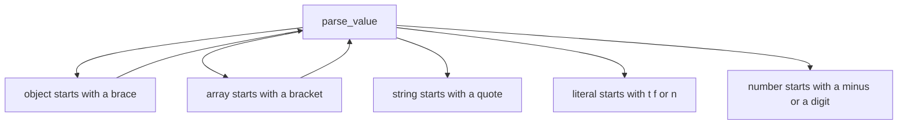
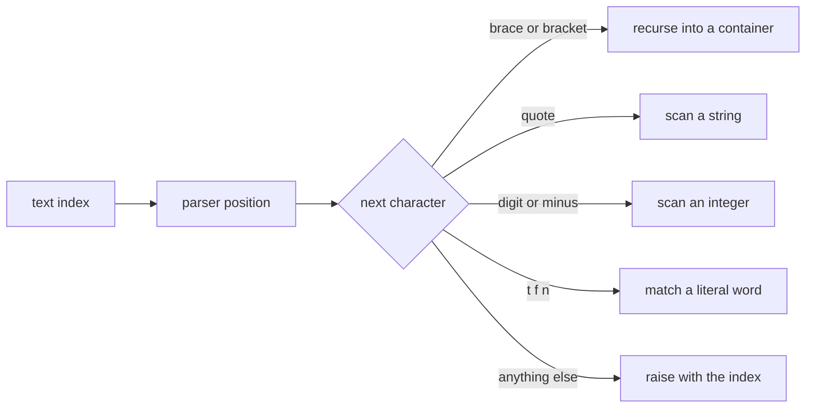
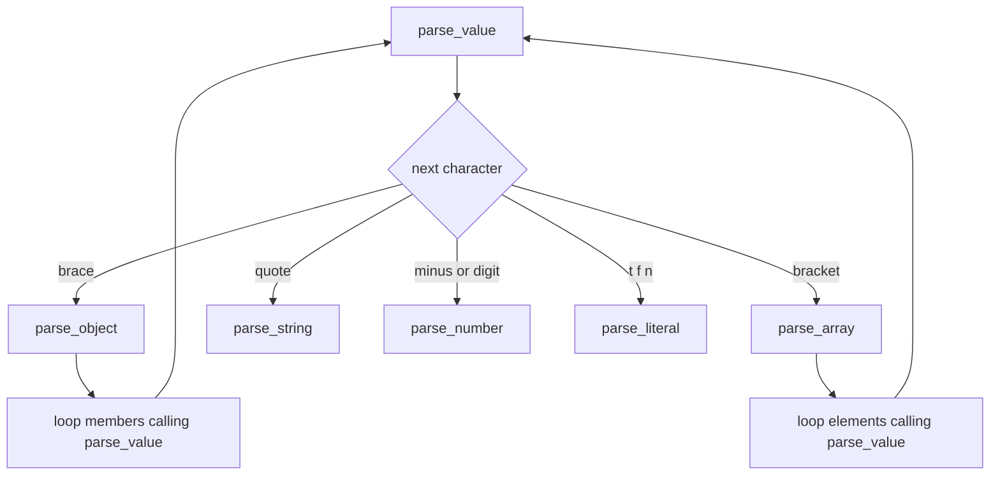
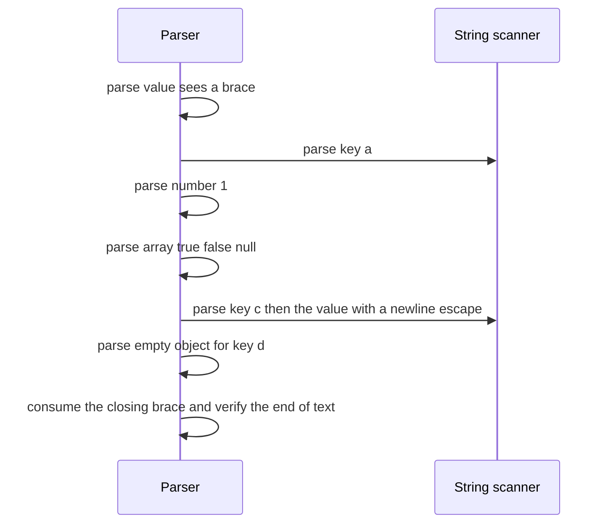

# 199 — Deserialize JSON with arrays & objects (basic).

> **Tier:** Beginner · **CTCI chapter:** Ch 7 — Object-Oriented Design
> **Task spec:** [199-deserialize-json-with-arrays-objects-basic.md](../../../tasks/beginner/199-deserialize-json-with-arrays-objects-basic.md)
> **Solutions:** [Python](../../../solutions/python/beginner/199-deserialize-json-with-arrays-objects-basic/solution.py) ·
> [Java](../../../solutions/java/beginner/199-deserialize-json-with-arrays-objects-basic/Solution.java) ·
> [JavaScript](../../../solutions/javascript/beginner/199-deserialize-json-with-arrays-objects-basic/solution.js) ·
> [C#](../../../solutions/csharp/beginner/199-deserialize-json-with-arrays-objects-basic/Solution.cs)

## 1. Problem restatement

**Input:** a JSON text with objects, arrays, strings (including escapes), integers, `true`, `false`
and `null`. Whitespace is allowed between any two tokens.

**Output:** the value tree — maps/objects, lists/arrays, strings, integers, booleans and `null` —
matching what a standard parser would produce. The documented boundary: **numbers are integers only**,
so floats are rejected, and `\uXXXX` escapes decode to single code units. Malformed input raises a
parse error carrying the offending index.

The task spec is one line, so the contract comes from the four solution files. They accept:

| Input | Result | Why |
| --- | --- | --- |
| `{}`, `[]` | empty object, empty array | the empty-container shortcuts |
| `null`, `true`, `false` | the corresponding values | literals |
| `-42`, `0` | `-42`, `0` | integers with a sign, and the zero special case |
| `  {  "x" : [ 1 , 2 ]  } ` | `{"x": [1, 2]}` | whitespace is allowed anywhere between tokens |
| `"a\"b\\c\n"` | `a"b\c` + newline | the named escapes are decoded |
| `"\u0041"` | `A` | `\uXXXX` becomes a character |
| `"\/"` | `/` | the solidus escape is legal even though it is never required |
| `[1,[2,[3]]]` | nested arrays | recursion through arrays |
| `{"a":1,"b":[true,false,null],"c":"hi\n","d":{}}` | the nested document | recursion through objects |

And they reject all of these: `{"a":1,}`, `[1,]` (trailing commas), `"abc` (unterminated string),
`{"a" 1}` (missing colon), `tru` (bad literal), `@` (bad character), `` (empty), `1 2` (trailing
characters), `01` (leading zeros), `1.5` (float), `{"a":}` (missing value), `[`, `]`, `[1 2]`,
`"\x"` (unknown escape) and `"\u12"` (short `\u` escape).

Python and JavaScript check the result against `json.loads` / `JSON.parse` on the same documents — the
parser used only as an oracle. Java has no JSON parser in the JDK, so its file says so and compares
against hand-built `Map`/`List` structures instead. C# reserializes its parsed value with
`JsonSerializer` and compares the two documents with `JsonNode.DeepEquals`.

## 2. Intuition

Parsing JSON is a single pass over the text with one index that never moves backwards. The grammar is
small enough to write as five recursive functions:

- `parse_value` inspects the next character and dispatches;
- `parse_object` and `parse_array` consume their delimiters and loop over members, calling
  `parse_value` recursively;
- `parse_string` consumes characters until the closing quote, decoding escapes;
- `parse_number` and the literal reader handle the scalars.



The key insight is that a recursive-descent parser writes the grammar *as* the code: each production
becomes a function, and the nesting of the data becomes the nesting of the calls. There is no
pre-tokenising step, no backtracking and no lookahead beyond the current character — the format was
designed so that one character of lookahead is enough.



The second half of the design is error reporting. Every failure is raised with the index where the
parser noticed the problem, which turns "invalid JSON" into a pointer at the offending character —
the difference between a usable parser and a frustrating one.

## 3. Algorithm

1. Keep the text and a position `pos`.
2. **`parse()`**: read one value, skip trailing whitespace, and require the position to be at the end
   of the text — leftover characters are an error.
3. **`parse_value()`**: skip whitespace, look at the current character, and dispatch:
   `{` → object, `[` → array, `"` → string, `t`/`f`/`n` → literal, `-` or a digit → number, anything
   else → error with the index.
4. **`parse_object()`**: consume `{`; if the next character is `}`, return the empty map; otherwise
   loop: parse a string key, skip whitespace, expect `:`, parse a value, then accept either `,`
   (which may not be followed by `}`) or `}`.
5. **`parse_array()`**: consume `[`; if the next character is `]`, return the empty list; otherwise
   loop: parse a value, then accept either `,` (which may not be followed by `]`) or `]`.
6. **`parse_string()`**: consume the opening quote; read characters, decoding `\` escapes; reject a
   raw control character below `0x20`; stop at the closing quote.
7. **`parse_escape()`**: map the eight simple escapes (`" \ / b f n r t`), decode `\uXXXX` as four
   hex digits, and reject anything else.
8. **`parse_number()`**: optional `-`, then either a single `0` (no digit may follow) or a non-zero
   digit run; a following `.`, `e` or `E` is rejected as a float.

```text
function parse(text)
    position ← 0
    value ← parse_value()
    skip whitespace
    if position ≠ length(text) then
        raise "trailing characters after JSON value at index " + position
    end
    return value
end

function parse_value()
    skip whitespace
    ch ← current character, raising "unexpected end of input" if none
    if ch = "{" then return parse_object() end
    if ch = "[" then return parse_array() end
    if ch = quote then return parse_string() end
    if ch is in "tfn" then return parse_literal() end
    if ch = "-" or ch is a digit then return parse_number() end
    raise "unexpected character at index " + position
end

procedure parse_object()
    expect "{"
    result ← empty map
    skip whitespace
    if current character = "}" then
        position ← position + 1
        return result
    end
    loop
        skip whitespace
        key ← parse_string()
        skip whitespace
        expect ":"
        result[key] ← parse_value()
        skip whitespace
        ch ← current character
        if ch = "," then
            position ← position + 1
            skip whitespace
            if current character = "}" then
                raise "trailing comma in object"
            end
        else if ch = "}" then
            position ← position + 1
            return result
        else
            raise "expected ',' or '}'"
        end
    end
end
```

The recursion mirrors the data: `parse_object` calls `parse_value`, which may call `parse_object`
again. Depth is bounded by the nesting of the input, which is why a hostile document can exhaust the
stack.



## 4. Worked example

Trace `{"a":1,"b":[true,false,null],"c":"hi\n","d":{}}` — the nested document every file checks.

| Step | Call | Consumes | Result so far |
| --- | --- | --- | --- |
| 1 | `parse_value` | sees `{` | dispatch to `parse_object` |
| 2 | `parse_object` | `{` then key `"a"`, `:`, value `1` | `{"a": 1}` |
| 3 | member loop | `,` then key `"b"`, `:`, value `[true,false,null]` | `{"a": 1, "b": [true, false, null]}` |
| 4 | `parse_array` (nested) | `[`, `true`, `,`, `false`, `,`, `null`, `]` | the three-element list |
| 5 | member loop | `,` then key `"c"`, `:`, string with `\n` | `"hi" + newline` |
| 6 | `parse_string` | characters `h`, `i`, the escape `\n`, closing quote | escaped newline decoded |
| 7 | member loop | `,` then key `"d"`, `:`, value `{}` | empty map |
| 8 | `parse_object` | `}` | returns the four-key map |
| 9 | `parse` | end of text reached | position equals length, accepted |

The order matters at steps 3 and 4: the string key is parsed by the *string* routine, so escapes in
keys work exactly as in values, and the array is parsed by the *array* routine, so nesting is handled
by recursion rather than by a special case.

Error reporting is the other half of the trace, and every failing document names an index:

| Input | Failure point | Message shape |
| --- | --- | --- |
| `{"a":1,}` | after the comma, the parser sees `}` | trailing comma in object |
| `[1,]` | the same for arrays | trailing comma in array |
| `"abc` | the string scan reaches the end | unterminated string |
| `{"a" 1}` | after the key, instead of `:` | expected `':'` |
| `tru` | the literal match fails | invalid literal |
| `@` | dispatch finds no production | unexpected character |
| `` (empty) | the first `peek` is past the end | unexpected end of input |
| `1 2` | a value was parsed but text remains | trailing characters after JSON value |
| `01` | a zero followed by another digit | leading zeros are not allowed |
| `1.5` | a `.` after the integer part | only integer numbers are supported |
| `{"a":}` | the value position holds `}` | unexpected character |
| `[`, `]` | end of input, or a stray closer | unexpected end of input / unexpected character |
| `[1 2]` | after `1`, neither `,` nor `]` | expected `','` or `']'` |
| `"\x"` | an escape letter outside the table | invalid escape |
| `"\u12"` | fewer than four hex digits | incomplete `\u` escape |



The oracle check closes the loop: Python compares against `json.loads`, JavaScript against
`JSON.parse`, and C# against a reserialized document compared with `JsonNode.DeepEquals`, so where a
standard parser exists the results are verified against it. Java, which has none in the JDK, compares
against hand-built `Map` and `List` structures — and, as its comment notes, the serializer of
[198-serialize-object-to-json-string-manual.md](../../../tasks/beginner/198-serialize-object-to-json-string-manual.md)
can produce input this parser reads.

## 5. Complexity

Let `n` be the number of characters and `d` the nesting depth.

| Measure | Bound | Why it holds |
| --- | --- | --- |
| Time | `O(n)` | `pos` only moves forward; each character is examined once |
| Space, output | `O(n)` | the parsed structure is proportional to the text |
| Space, recursion | `O(d)` | one frame per open container |
| Hash lookups per object member | `O(1)` expected | each key is inserted once |
| Comparison with a naive substring search | — | none needed: no production requires lookahead beyond one character |

The linear bound is the reason a one-character-lookahead grammar is worth having: there is no
backtracking to undo work, so the parser visits each character exactly once and the parse tree is
built in a single pass. The `O(d)` stack is the only resource that depends on the input's *shape*
rather than its size; the tests nest at most three levels, but a pathological document of ten thousand
nested arrays would overflow the call stack in all four implementations.

Integer parsing is the one place where an implementation detail leaks: the number is converted from
its textual digits and stored, so the range is bounded by the host language's integer type — the
tests use `-42` and `0`, far inside it. A production parser would need a documented decision for
large numbers (a big-integer type or a float fallback).

## 6. Pitfalls and edge cases

- **Trailing commas are rejected everywhere.** `{"a":1,}` and `[1,]` both fail — after a comma, the
  parser skips whitespace and refuses to accept the closing delimiter. JSON does not allow them, and
  the tests assert the error.
- **Trailing characters are checked once, at the top level.** `1 2` parses `1` and then fails because
  the position is not at the end; the check lives in `parse`, not in `parse_value`, so nested values
  do not need it.
- **Leading zeros are invalid.** `01` is rejected by a dedicated rule, which is why the number scan
  handles `0` as a special case rather than just running the digit loop.
- **Floats are rejected by design.** `1.5` fails with "only integer numbers are supported" as soon as
  a `.`, `e` or `E` follows the integer part — the documented boundary of this task, not an oversight.
- **A raw control character inside a string is an error.** A literal newline in a string must be
  escaped; the scanner rejects any character below `0x20` for that reason.
- **The escape table has eight entries, not seven.** `\/` is legal (and the tests assert it decodes to
  `/`), even though a serializer never needs to produce it.
- **`\uXXXX` is decoded as a single code unit.** Two escapes forming a surrogate pair decode to two
  code units, which Python and JavaScript concatenate into one character, while Java and C# keep them
  as a `char` pair — the same text, represented as the host language represents strings.
- **Malformed `\u` escapes are distinguished.** `"\u12"` (too few digits) reports an incomplete escape,
  while `"\x"` reports an invalid escape; the messages differ because the failure reasons do.
- **Objects preserve key order where the language can.** Java builds a `LinkedHashMap`, and
  JavaScript object property order follows insertion for string keys — which is what makes the
  hand-built expectations in the Java file comparable with `Map.of`/`equals`.
- **Whitespace is only four characters.** The skip routine accepts space, tab, newline and carriage
  return — exactly what JSON allows; a non-breaking space or a form feed is an error rather than
  whitespace.
- **Deep nesting is unbounded.** Recursion depth is the input's nesting depth, so a hostile document
  can exhaust the stack before it is rejected.
- **Error messages carry the index.** Every failure formats the position where it was detected, which
  is the single most useful debugging feature a parser can have — and it is asserted in the Python and
  Java files.
- **The parser is not a validator of application semantics.** Nothing checks that `"id"` is a number
  or that required keys exist; that is the caller's job once the tree is built.
- **The oracle is a test, not a dependency.** Python, JavaScript and C# invoke the standard library
  only to verify results; the parsers themselves are hand-written, and the Java file documents the
  absence of a JDK parser.

## 7. Variants and follow-ups

- **The other direction.** [198-serialize-object-to-json-string-manual.md](../../../tasks/beginner/198-serialize-object-to-json-string-manual.md)
  emits the text this parser consumes; running the two in sequence is the round trip the Java
  serializer's comment points at.
- **A simpler format.** [189-implement-simple-csv-parser-line-fields.md](../../../tasks/beginner/189-implement-simple-csv-parser-line-fields.md)
  parses one line into fields with quoting rules instead of nested structures, and shows how much of
  a parser is "state, not grammar".
- **Tokenising first.** [193-implement-simple-expression-tokenizer.md](../../../tasks/beginner/193-implement-simple-expression-tokenizer.md)
  splits text into typed tokens, which is the alternative architecture: tokenise, then parse the token
  stream instead of the characters.
- **Streaming parsing.** Feeding a
  [196-implement-file-line-reader-that-yields-lines-lazily.md](../../../tasks/beginner/196-implement-file-line-reader-that-yields-lines-lazily.md)
  into the parser removes the need to hold the whole document, at the cost of a more complex scanner.
- **Beyond the basics.** Floating-point numbers, exponent notation, surrogate-pair combining and
  duplicate-key policies are the four extensions a production JSON parser adds.
- The chapter walkthrough in [Object-Oriented Design](../../ctci/07-object-oriented-design.md) places
  this task alongside the other small-format implementations with explicit error contracts.

## 8. Check yourself

1. Why does the parser need only one character of lookahead?

<details><summary>Show answer</summary>

Because every production of the JSON grammar is decided by the character that starts it: `{` begins an
object, `[` an array, `"` a string, `t`/`f`/`n` a literal and `-` or a digit a number. Nothing else has
to be examined before committing, so the parser never backtracks and `pos` only moves forward — which
is also why the whole parse is linear.

</details>

2. `01` and `1.5` are both rejected. Which rule catches each?

<details><summary>Show answer</summary>

`01` trips the leading-zero rule: after consuming a single `0`, the scanner refuses a following digit.
`1.5` trips the integer-only rule: after the digit run, a `.`, `e` or `E` raises "only integer numbers
are supported". They are separate checks because they are separate mistakes.

</details>

5. What resource is bounded by the input's shape rather than its size?

<details><summary>Show answer</summary>

The call stack: one frame per open container, so `O(d)` for nesting depth `d`. A 20-byte document of
nested brackets can overflow the stack while a megabyte of flat array does not. Time and output size
are both `O(n)`, and neither depends on the nesting.

</details>
