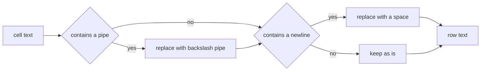
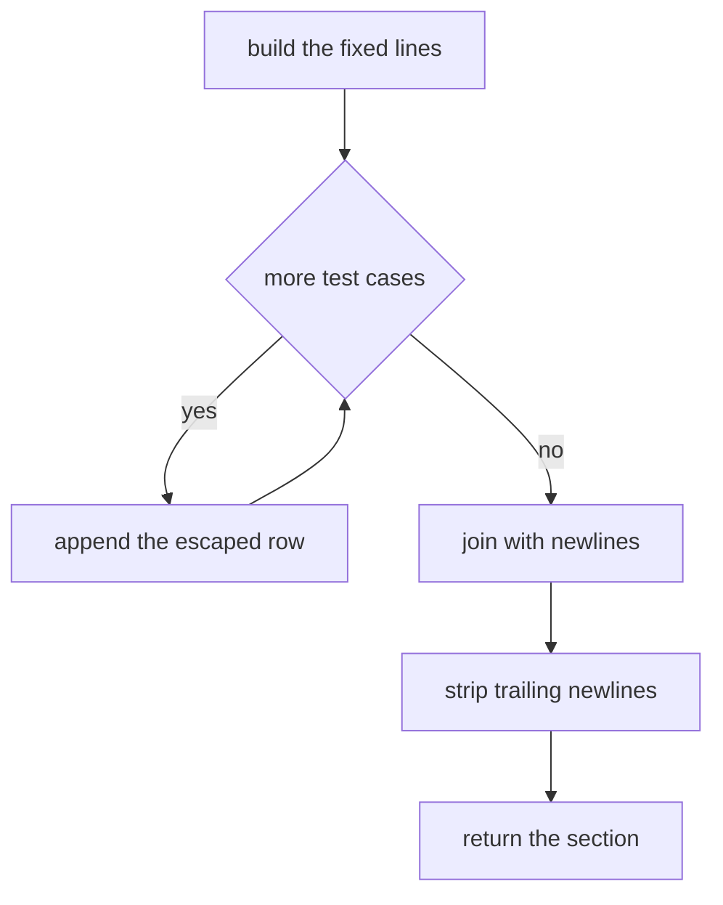
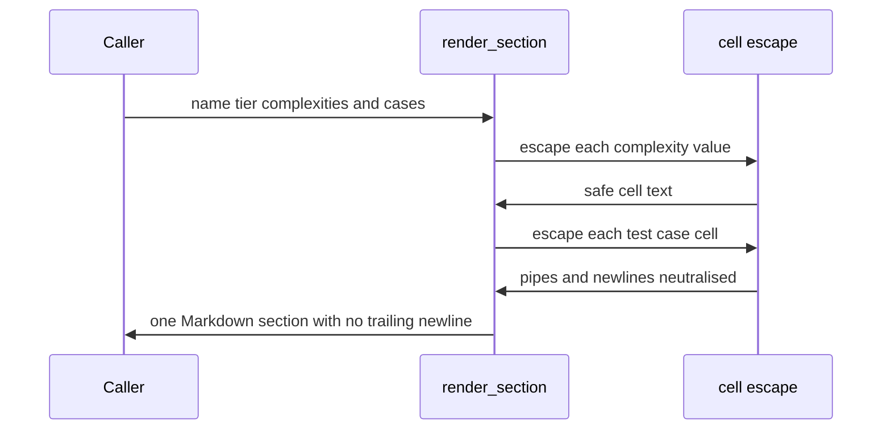

# 200 — Build README template that documents test cases and complexity.

> **Tier:** Beginner · **CTCI chapter:** Beyond — Software Engineering & Tooling
> **Task spec:** [200-build-readme-template-that-documents-test-cases-and-complexity-f.md](../../../tasks/beginner/200-build-readme-template-that-documents-test-cases-and-complexity-f.md)
> **Solutions:** [Python](../../../solutions/python/beginner/200-build-readme-template-that-documents-test-cases-and-complexity-f/solution.py) ·
> [Java](../../../solutions/java/beginner/200-build-readme-template-that-documents-test-cases-and-complexity-f/Solution.java) ·
> [JavaScript](../../../solutions/javascript/beginner/200-build-readme-template-that-documents-test-cases-and-complexity-f/solution.js) ·
> [C#](../../../solutions/csharp/beginner/200-build-readme-template-that-documents-test-cases-and-complexity-f/Solution.cs)

## 1. Problem restatement

**Input:** an exercise name, a tier, a time complexity, a space complexity, and a list of
`(input, expected)` test cases.

**Output:** one Markdown section — the exact shape this repository uses to document an exercise —
with a heading, a tier line, a complexity table and a test-case table. The rules the files document:

- table cells escape `|` as `\|` and newlines as a single space;
- the returned string never ends with a trailing newline;
- an empty test-case list still emits the table header, so the section is valid Markdown.

The task spec is one line, so the contract comes from the assertions in the four files, which all
render three sections and compare them character for character:

| Argument | Rendered section |
| --- | --- |
| `("Two Sum", "Beginner", "O(n)", "O(n)", [("1, 2", "3"), ("[]", "0")])` | heading, tier line, complexity rows `O(n)` / `O(n)`, then two test rows |
| `("Escape | Demo", "Beginner", "O(1)", "O(1)", [("a | b", "c\nd"), ("x\ny", "z")])` | the `\|` escapes are asserted here; the newline in `"c\nd"` becomes a space |
| `("Empty Cases", "Beginner", "O(1)", "O(1)", [])` | the test table ends after its header row |

The exact text of the first section, as asserted:

```text
## Two Sum

**Tier:** Beginner

| Complexity | Value |
| --- | --- |
| Time | O(n) |
| Space | O(n) |

| Input | Expected |
| --- | --- |
| `1, 2` | `3` |
| `[]` | `0` |
```

Every file also asserts `not text.endsWith("\n")` for all three sections.

## 2. Intuition

Documentation that is written by hand drifts: the complexity table says one thing, the code does
another, and the test cases listed in the README stop matching the tests. The fix is to *generate*
the section from the same data a test already has, so the text is a pure function of facts.

That makes the task a small string-formatting problem with three concerns:

- **fixed scaffolding** — the heading, the tier line and the two table headers, which are always the
  same;
- **rows** — one per complexity value and one per test case;
- **cell hygiene** — a raw `|` inside a cell would split the row into extra columns, and a raw newline
  would break the table entirely.

```mermaid
flowchart TD
    A["name tier complexities test cases"] --> B["heading line"]
    A --> C["tier line"]
    A --> D["complexity table with two rows"]
    A --> E["test table with one row per case"]
    B --> F["join with newlines"]
    C --> F
    D --> F
    E --> F
    F --> G["strip a trailing newline"]
```

The escaping rule is the whole reason this is not a one-line `f-string`: `|` and newlines are the only
characters that can destroy a Markdown table, so they are the only two the formatter rewrites.



## 3. Algorithm

1. **`cell(value)`**: convert the value to text, replace every `|` with `\|` and every newline with a
   space. Single line, single return.
2. **`render_section(name, tier, time_complexity, space_complexity, test_cases)`**:
   1. Start the line list with `## <name>`.
   2. Add a blank line and the tier line `**Tier:** <tier>`.
   3. Add a blank line, the complexity table header (`| Complexity | Value |` and its separator row),
      then the `Time` and `Space` rows with escaped values.
   4. Add a blank line and the test-case table header (`| Input | Expected |` and its separator row).
   5. For each test case, append `| \`<input>\` | \`<expected>\` |` with both cells escaped and wrapped
      in backticks.
   6. Join the lines with newlines and remove any trailing newlines.
3. Return the string.

```text
function cell(value)
    return text of value with "|" replaced by "\\|" and newline replaced by " "
end

function render_section(name, tier, time_complexity, space_complexity, test_cases)
    lines ← empty list
    append "## " + name to lines
    append "" to lines
    append "**Tier:** " + tier to lines
    append "" to lines
    append "| Complexity | Value |" to lines
    append "| --- | --- |" to lines
    append "| Time | " + cell(time_complexity) + " |" to lines
    append "| Space | " + cell(space_complexity) + " |" to lines
    append "" to lines
    append "| Input | Expected |" to lines
    append "| --- | --- |" to lines
    for each (input_value, expected) in test_cases do
        append "| `" + cell(input_value) + "` | `" + cell(expected) + "` |" to lines
    end
    return join(lines, newline) with trailing newlines removed
end
```

Three details are load-bearing. The blank lines separate the heading, the tier line and the two
tables so Markdown renders them as distinct blocks. The separator row `| --- | --- |` is what makes
Markdown treat the preceding line as a header. And the trailing-newline removal makes the section
composable: a caller concatenating sections controls the spacing rather than inheriting it.



Note that only the complexity values and the test cells are escaped. The heading is emitted raw —
which is correct, because a `|` inside a heading is ordinary text and escaping it would show a stray
backslash in the rendered document.

## 4. Worked example

Trace `render_section("Two Sum", "Beginner", "O(n)", "O(n)", [("1, 2", "3"), ("[]", "0")])` step by
step:

| Step | Action | Line appended |
| --- | --- | --- |
| 1 | heading | `## Two Sum` |
| 2 | blank | `` |
| 3 | tier line | `**Tier:** Beginner` |
| 4 | blank | `` |
| 5 | table header | `| Complexity | Value |` |
| 6 | separator | `| --- | --- |` |
| 7 | time row, cell unescaped (`O(n)` has no pipe or newline) | `| Time | O(n) |` |
| 8 | space row | `| Space | O(n) |` |
| 9 | blank | `` |
| 10 | test header | `| Input | Expected |` |
| 11 | separator | `| --- | --- |` |
| 12 | first test case | ``| `1, 2` | `3` |`` |
| 13 | second test case | ``| `[]` | `0` |`` |
| 14 | join and strip | the 13-line string, no trailing newline |

The second assertion is the escaping case. Its arguments are deliberately hostile:

| Value | Contains | Escaped to | Appears in the output as |
| --- | --- | --- | --- |
| `"Escape | Demo"` (the name) | a pipe | **not escaped** | `## Escape | Demo` |
| `"a | b"` (an input) | a pipe | `a \| b` | ``| `a \| b` | `c d` |`` |
| `"c\nd"` (an expected value) | a newline | `c d` | ``| `a \| b` | `c d` |`` |
| `"x\ny"` (an input) | a newline | `x y` | ``| `x y` | `z` |`` |

Without the escaping, the row containing `a | b` would have five cells instead of two and the table
would silently gain columns — a formatting bug that is invisible in the source string and obvious in
the rendered output. The name is left alone because a heading is not a table.

The third assertion covers the empty case: with no test cases the section ends at `| --- | --- |`, so
the table has a header and no rows. Markdown renders that as an empty table, which is the intended
"documented, no cases yet" state, and it keeps the generated document structurally uniform.



## 5. Complexity

Let `c` be the number of test cases and `n` the total number of characters produced.

| Measure | Bound | Why it holds |
| --- | --- | --- |
| Time | `O(n)` | one pass over each value's characters for escaping, one join of all lines |
| Space | `O(n)` | the rendered section is the output |
| Lines produced | `12 + c` | 12 fixed lines (heading, tier, two headers, two separators, two complexity rows, blanks) plus one per test case |
| Escape work | `O(len(value))` per cell | a single pass replacing two characters |
| Repeated calls | `O(c)` per section | the fixed scaffolding is constant work |

The cost model is dominated by the escaping passes and the join, both linear in the text produced. The
only thing that scales with the number of cases is the row loop, which appends one line per case — so
rendering `c` cases costs `O(c)` on top of the constant scaffolding, which is why a generator is a
reasonable way to produce a large README: the work is proportional to the document, not to the
document times the number of fields.

## 6. Pitfalls and edge cases

- **A raw `|` breaks the table.** It must become `\|` in every cell that goes inside a table row —
  the complexity values and the test cases here — but *not* in the heading, which is not a table.
- **A raw newline breaks the table just as badly**, by ending the row early; replacing it with a space
  keeps the cell on one line. The tests use `"c\nd"` and `"x\ny"` precisely to force this path.
- **No trailing newline.** All four files assert `not ... endsWith("\n")`. Python strips explicitly
  (`rstrip("\n")`), JavaScript uses a trailing-newline regex, and Java and C# get the property for free
  because joining lines never appends a terminator — but every file still asserts it, so a future edit
  that appends a newline cannot pass unnoticed.
- **The separator row is mandatory.** Without `| --- | --- |` Markdown renders the header line as an
  ordinary paragraph and the table disappears; it is generated unconditionally rather than left to the
  caller.
- **Empty test-case lists are legal.** The table header is still emitted, so the section is valid
  Markdown with zero rows — the "documented but untested" case.
- **Blank lines are structural.** They separate the heading, the tier line and the two tables; joining
  without them produces a single run-on block that renders incorrectly. Because they are part of the
  line list, they are part of every exact-string assertion.
- **Values are treated as text.** `cell` stringifies its argument, so a numeric or boolean value is
  rendered by the host language's conversion — the tests only pass strings.
- **Backticks come from the template, not the cell.** The test rows wrap the escaped cell in
  backticks, which is what makes the rendered row show the value as code; a value that itself contains
  a backtick would close the code span early, and the escaping rules of this task do not cover that.
- **Escaping order matters in principle.** Replacing `|` and then newlines is unambiguous here because
  the replacements do not introduce each other's targets; the reverse order would be equally correct,
  but mixing them with a general "escape everything" routine would not produce these exact strings.
- **The output is a value, not a side effect.** Nothing is written to a file; the caller decides where
  the section goes, which is what makes the function testable by string comparison.
- **Determinism.** The output depends only on the arguments — no timestamps, no environment, no
  locale-sensitive formatting — which is what allows the assertions to compare full strings.

## 7. Variants and follow-ups

- **The material this template documents.** The exercises the section describes have their own
  contracts: [198-serialize-object-to-json-string-manual.md](../../../tasks/beginner/198-serialize-object-to-json-string-manual.md)
  and [199-deserialize-json-with-arrays-objects-basic.md](../../../tasks/beginner/199-deserialize-json-with-arrays-objects-basic.md)
  are examples whose complexity tables come straight from the code, and
  [196-implement-file-line-reader-that-yields-lines-lazily.md](../../../tasks/beginner/196-implement-file-line-reader-that-yields-lines-lazily.md)
  documents a resource bound rather than a time bound.
- **Generated documentation.** The same idea applied to a whole file — render every exercise's section
  and join them — turns documentation into a build artifact that cannot drift from its inputs.
- **Table-driven test reports.** Feeding real test results into the same renderer produces the
  "Input / Expected" tables the repository uses, directly from a test run.
- **Escaping for other formats.** CSV quoting (`"` doubling) and JSON string escaping are the same
  problem with different reserved characters; see
  [189-implement-simple-csv-parser-line-fields.md](../../../tasks/beginner/189-implement-simple-csv-parser-line-fields.md)
  for the parsing side of one of them.
- **Template engines.** Scaling past a handful of fields usually means a template language, at the cost
  of a dependency and a less obvious mapping from inputs to output than this straight-line builder.
- The chapter walkthrough in [Sorting and Searching](../../ctci/10-sorting-and-searching.md) covers the
  complexity notation these tables record.

## 8. Check yourself

1. Which parts of the section are escaped, and which are emitted verbatim?

<details><summary>Show answer</summary>

Only content that goes inside a table cell: the time and space complexity values and the two cells of
every test case. The heading, the tier line and the literal scaffold (table headers, separator rows,
blank lines, backticks) are emitted verbatim. Escaping the heading would insert a visible backslash;
not escaping a test cell would add columns to the table.

</details>

2. What would the `"a | b"` test case do to the output without the escaping rule?

<details><summary>Show answer</summary>

The row would read ``| `a | b` | `c d` |``, which is four cells instead of two — Markdown splits on
every unescaped pipe. The rendered table would gain two phantom columns and every later row would
shift, so the failure is a silent formatting corruption rather than an error.

</details>

3. Why does every file assert that the result does not end with a newline?

<details><summary>Show answer</summary>

Because sections are meant to be concatenated. If each renderer ended with a newline, the caller would
have to guess how many blank lines separate sections, and the exact-string tests would be brittle.
Removing it makes the section a self-contained block and pushes spacing decisions to the caller —
Python trims explicitly, JavaScript strips a trailing-newline run, and Java and C# never add one.

</details>

4. What is rendered for a section with no test cases, and why is that better than omitting the table?

<details><summary>Show answer</summary>

The test table appears with its header and separator rows and no data rows. Keeping it makes every
generated section structurally identical, so a document assembled from many sections has a uniform
shape, and it makes the "no cases documented yet" state explicit rather than invisible.

</details>

5. How many lines does a section with three test cases contain, and which ones are fixed?

<details><summary>Show answer</summary>

`12 + 3 = 15` lines: twelve fixed ones (heading, blank, tier, blank, complexity header, separator,
time row, space row, blank, test header, separator — counting the blanks as lines) plus one per test
case. Only the last group scales with the input; the scaffolding and the blank-line structure are
constant.

</details>
