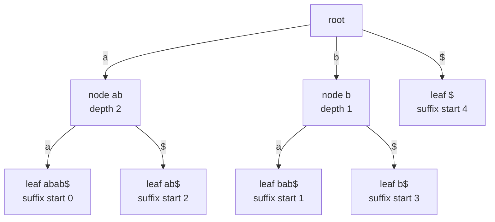
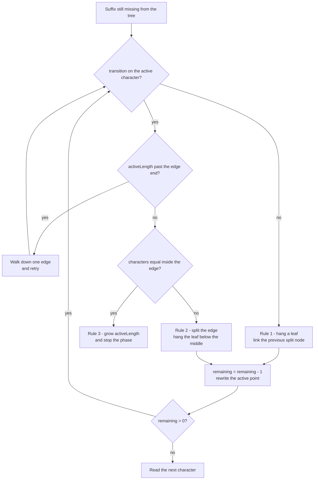
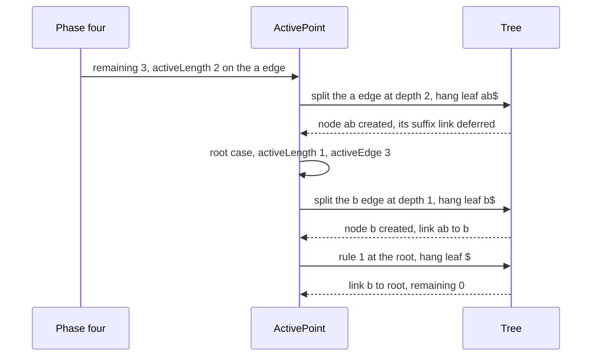

# 601 — Implement full suffix tree (Ukkonen) and test with large text

> **Tier:** Expert · **CTCI chapter:** Beyond — Advanced Data Structures & Algorithms
> **Task spec:** [601-implement-full-suffix-tree-ukkonen-and-test-with-large-text.md](../../../tasks/expert/601-implement-full-suffix-tree-ukkonen-and-test-with-large-text.md)
> **Solutions:** [Python](../../../solutions/python/expert/601-implement-full-suffix-tree-ukkonen-and-test-with-large-text/solution.py) ·
> [Java](../../../solutions/java/expert/601-implement-full-suffix-tree-ukkonen-and-test-with-large-text/Solution.java) ·
> [JavaScript](../../../solutions/javascript/expert/601-implement-full-suffix-tree-ukkonen-and-test-with-large-text/solution.js) ·
> [C#](../../../solutions/csharp/expert/601-implement-full-suffix-tree-ukkonen-and-test-with-large-text/Solution.cs)

## 1. Problem restatement

Build the **full suffix tree** of a text with Ukkonen's *online* construction (phase `i` appends
`text[i]` to the tree of `text[0..i-1]`) and answer the classic queries on it. The four solution
files expose the same interface:

| Query | Answer |
| --- | --- |
| `node_for(pattern)` / `contains(pattern)` | the node (or leaf) where the walk of `pattern` ends, `-1` if absent |
| `occurrences(pattern)` | number of leaves below that node |
| `positions(pattern)` | sorted list of the suffix starts of those leaves |
| `distinct_substrings()` | number of distinct substrings of the text |
| `longest_repeated_substring()` | the path label of the deepest internal node |
| `path_label(node)` | the substring spelled by the path root → node |

Input: a text of length `n`. Output: the tree plus those queries, built in **O(n) amortised** time —
which is what makes the large check feasible: the solutions generate a 12000-character LCG text over
`abcd`, splice the literal `abababababababab` in at position 2000 and append the first 1500
characters again (13516 characters), then verify the distinct-substring count against an independent
suffix automaton and the longest repeat against a binary search over duplicate substring lengths.

Concrete expected results (every one of them is asserted by the checks):

- `"banana"` → `occurrences("ana") == 2` with `positions("ana") == [1, 3]`, `occurrences("na") == 2`,
  `occurrences("a") == 3`, `occurrences("banana") == 1`, `distinct_substrings() == 15`,
  `longest_repeated_substring() == "ana"`.
- `"mississippi"` → `occurrences("issi") == 2`, `occurrences("i") == 4`,
  `positions("ssi") == [2, 5]`, `longest_repeated_substring() == "issi"`.
- `""` (empty text) → the tree of the sentinel alone: 1 leaf, `distinct_substrings() == 0`,
  `occurrences("") == 0`, `positions("") == []` (the empty pattern is deliberately *not* searched),
  `contains("z") == false`.
- `"abab"` → `distinct_substrings() == 7` (`a`, `b`, `ab`, `ba`, `aba`, `bab`, `abab`) and the longest
  repeat has length 2.

## 2. Intuition

The naive idea is a *trie of all suffixes*: insert every suffix of the text character by character.
It answers queries in O(m) per pattern, but it has O(n²) nodes for a text like `aaaa`, and inserting
one suffix costs O(n) — O(n²) in total. Merging the single-child chains gives the **suffix tree** (a
compressed trie): O(n) nodes, one branching position each. The remaining problem is incremental
insertion, because appending one character can create one new leaf *per suffix*, which is again O(n)
per phase.

Three observations remove that cost:

1. **Implicit-end trick** — every leaf edge ends at the current text position. Appending a character
   therefore *extends all leaves at once*: nothing has to be touched.
2. **Suffix links** — an internal node whose path label is `X` links to the node of `X[1:]`. After one
   extension you jump to the next suffix's active position in O(1) instead of re-walking from the root.
3. **A unique sentinel** — with `text + SENTINEL`, no suffix is a prefix of another, so every suffix
   ends at its own leaf and the tree becomes *full*: `occurrences(pattern)` is exactly the number of
   leaves below the node where the pattern ends.



The tree above is the finished tree of `abab$`; section 4 derives it phase by phase. A leaf stores a
*suffix start* (recovered as `len(s) - depth`, because a split may leave its edge label starting
somewhere else in the text) and an internal node stores its suffix link.

## 3. Algorithm

One phase per character of `s = text + SENTINEL`:

1. `remaining++` and reset `lastNew = none`. `remaining` is the number of suffixes of `s[0..i]` that
   are still not explicit in the tree.
2. While `remaining > 0`, look at the character `s[activeEdge]`. If `activeLength = 0`, the active
   edge is simply `i`.
3. No transition on that character from `activeNode` → **rule 1**: hang a new leaf with label
   `s[i..n]`.
4. A transition exists but `activeLength` reaches past the edge end → *walk down* one edge and retry.
5. A transition exists and `s[edgeStart(next) + activeLength] = s[i]` → **rule 3**: the suffix is
   already implicit; grow `activeLength` and stop the whole phase (every remaining suffix of this
   phase is implicit too).
6. A transition exists and the characters differ inside the edge → **rule 2**: split the edge with a
   new middle node, re-hang the old child below it, hang the new leaf, then record the deferred
   suffix link `link(lastNew) = middle`.
7. Finish the extension: `remaining--`, then rewrite the active point — at the root shrink the active
   length (the root has no suffix link), otherwise follow `link(activeNode)`.
8. Once all phases are done, compute depths top-down in BFS order, leaf starts `n - depth`, and
   subtree leaf counts bottom-up (that count is the occurrence count).

```text
procedure build(text)
    s ← text + SENTINEL
    n ← length(s)
    create the root node
    activeNode ← root
    activeEdge ← 0
    activeLength ← 0
    remaining ← 0
    for i ← 0 to n - 1 do
        remaining ← remaining + 1
        lastNew ← none
        while remaining > 0 do
            if activeLength = 0 then
                activeEdge ← i
            ch ← s[activeEdge]
            if activeNode has no transition on ch then
                leaf ← new node labelled s[i .. n]
                children(activeNode)[ch] ← leaf                     // rule 1
                if lastNew exists then link(lastNew) ← activeNode, lastNew ← none
            else
                next ← children(activeNode)[ch]
                edgeLength ← edgeEnd(next) - edgeStart(next)
                if activeLength >= edgeLength then
                    activeNode ← next                               // walk down, retry
                    activeEdge ← activeEdge + edgeLength
                    activeLength ← activeLength - edgeLength
                    continue
                if s[edgeStart(next) + activeLength] = s[i] then
                    if lastNew exists then link(lastNew) ← activeNode, lastNew ← none
                    activeLength ← activeLength + 1                 // rule 3: stop the phase
                    break
                middle ← new node labelled s[edgeStart(next) .. edgeStart(next) + activeLength]
                children(activeNode)[ch] ← middle                   // rule 2: split the edge
                children(middle)[s[edgeStart(next) + activeLength]] ← next
                edgeStart(next) ← edgeStart(next) + activeLength
                children(middle)[s[i]] ← new node labelled s[i .. n]
                if lastNew exists then link(lastNew) ← middle
                lastNew ← middle
            remaining ← remaining - 1
            if activeNode = root and activeLength > 0 then
                activeLength ← activeLength - 1                     // the root links nowhere
                activeEdge ← i - remaining + 1
            else if activeNode ≠ root then
                activeNode ← link(activeNode)

procedure finalize
    order ← breadth-first order of the nodes, starting at the root
    for node in order do
        for child in children(node) do
            depth(child) ← depth(node) + edgeEnd(child) - edgeStart(child)
    for node in reverse(order) do
        if node is a leaf then
            leafStart(node) ← n - depth(node)
            leafCount(node) ← 1
        else
            leafCount(node) ← sum of leafCount(child) over children(node)
```



Because rule 3 leaves `remaining` untouched, the next phase starts with more pending suffixes; that is
exactly the mechanism that keeps the total number of extensions linear.

## 4. Worked example

Text `abab`, `s = abab$` with the sentinel `$` smaller than `a` and `b`.

| Phase `i` | char | `remaining` at entry | active point at entry | rule per extension | tree change |
| --- | --- | --- | --- | --- | --- |
| 0 | `a` | 1 | root, length 0 | rule 1 | leaf `abab$` on the `a` edge of the root |
| 1 | `b` | 1 | root, length 0 | rule 1 | leaf `bab$` on the `b` edge of the root |
| 2 | `a` | 1 | root, length 0 | rule 3 | the `a` edge matches, `activeLength` becomes 1, phase stops |
| 3 | `b` | 2 | root, edge `a`, length 1 | rule 3 | `activeLength` becomes 2, phase stops, `remaining` stays 2 |
| 4 | `$` | 3 | root, edge `a`, length 2 | rule 2, rule 2, rule 1 | nodes `ab` and `b` created, leaves `ab$`, `b$`, `$` |

Phase 4 in detail:

- extension 1 — the `a` edge diverges at depth 2, so it is split: node `ab` is created, the old leaf
  moves below it, and a leaf for suffix 2 (`ab$`) is hung. `lastNew = ab`. The active point sits at
  the root, so the root case applies: `activeLength = 1`, `activeEdge = i - remaining + 1 = 3` (`b$`).
- extension 2 — the `b` edge diverges at depth 1: node `b` is created (and `link(ab) = b`, because the
  previous split node finally learns its active node), and a leaf for suffix 3 (`b$`) is hung.
- extension 3 — the root has no `$` transition, so rule 1 hangs the leaf for suffix 4 (`$`) and writes
  the pending `link(b) = root`.

The finished tree is the diagram of section 2: 5 leaves with suffix starts `0, 1, 2, 3, 4` and 2
internal nodes with `link(ab) = b` and `link(b) = root`. The checks verify `path_label(link(v))`
equals `path_label(v)[1:]` and that the node depth drops by exactly one along every suffix link.



Query trace on the finished tree (`$` is never a query character):

| `pattern` | node returned by `node_for` | leaves below | `occurrences` | `positions` |
| --- | --- | --- | --- | --- |
| `"ab"` | node `ab` | 2 | 2 | `[0, 2]` |
| `"a"` | node `ab` (the pattern ends *inside* the `a` edge) | 2 | 2 | `[0, 2]` |
| `"b"` | node `b` | 2 | 2 | `[1, 3]` |
| `"ba"` | leaf `bab$` (its path label is `bab$`, not the pattern) | 1 | 1 | `[1]` |
| `"ababz"` | none | 0 | 0 | `[]` |
| `""` | none (documented convention) | 0 | 0 | `[]` |

`distinct_substrings()` sums the stored edge-label lengths of all non-root nodes
(`2 + 1 + 3 + 3 + 1 + 1 + 1 = 12`, the distinct substrings of `abab$`) and subtracts
`len(leaves) = 5` (the substrings containing the sentinel) → `7`, the distinct substrings of `abab`.
For `banana` the same formula gives `22 - 7 = 15`, and the deepest internal node is `ana`.

## 5. Complexity

Let `n` be the text length, `m` a pattern length and `k` the number of occurrences.

| Operation | Best | Average | Worst | Why the bound holds |
| --- | --- | --- | --- | --- |
| Construction | O(n) | O(n) | O(n) | one increment of `remaining` per phase and one extension per decrement, so at most 2n extensions; rule 3 stops a phase early; every edge walked down is charged to an earlier suffix-link jump, which makes the walkdown amortised O(1); child lookup is a hash probe |
| `node_for` / `contains` | O(1) | O(m) | O(m) | each iteration consumes at least one pattern character, or stops inside an edge and returns |
| `occurrences` | O(1) | O(1) | O(1) | bottom-up leaf counts are precomputed; a pattern ending inside an edge inherits the child's count |
| `positions` | O(1) | O(k) | O(k + leaves below) | the leaves below the node are enumerated iteratively (no recursion) and sorted |
| `path_label` | O(1) | O(height) | O(n) | descend to any leaf below the node, then slice `depth` characters of `s` |
| `distinct_substrings` | O(n) | O(n) | O(n) | one pass over the nodes adding edge-label lengths |
| `longest_repeated_substring` | O(n) | O(n) | O(n) | one scan for the deepest node with children plus one `path_label` |
| Space | O(n) | O(n) | O(n) | `n + 1` leaves and at most `n - 1` internal nodes (the checks assert nodes ≤ 2n), each holding a map of its real children |

Alternatives the checks compare against:

| Approach | Build | Query `count` | Query `locate` | Space |
| --- | --- | --- | --- | --- |
| Trie of all suffixes | O(n²) | O(m) | O(k · n) | O(n²) |
| Plain suffix tree (this task) | O(n) | O(m) | O(k + output) | O(n) |
| Suffix array + LCP | O(n log n) doubling, O(n) Kasai | O(m log n) | O(k log n) | O(n) |
| Suffix automaton | O(n) | O(m) | occurrence counts only | O(n) |

## 6. Pitfalls and edge cases

- **The sentinel must not occur in the text.** JavaScript throws for an input containing `\u0000`;
  Python uses `"\x00"`, Java uses `'\u0001'` and C# uses `'\0'`. Without a unique sentinel, suffixes
  can be prefixes of each other and `occurrences` stops being the leaf count.
- **A leaf's stored edge start is only the label position.** After a split it points into the text,
  not at the suffix start; the start is `len(s) - depth`. The checks confirm
  `depth[leaf] == n + 1 - leaf_start[leaf]` and that the leaf labels are exactly the `n + 1` suffixes
  in sorted order.
- **Empty text.** The tree still holds one leaf (the sentinel) and `distinct_substrings()` is 0; the
  empty pattern is never searched, so `occurrences("") == 0` and `positions("") == []`.
- **A pattern may end inside an edge.** `node_for` then returns the child node, and `positions` uses
  that child's leaves — correct, because every leaf below the point where the pattern ends spells the
  pattern as a prefix.
- **Internal nodes are exactly the right-maximal repeats** (verified exhaustively for `n ≤ 12`), so
  the longest repeat is read off an internal node, never a leaf.
- **Degenerate shapes.** `"a" * 500`, `"aaaaaaaa"` and `"abcab" * 120` are in the checks: one long
  chain, many rule 3 hits, and a periodic text.
- **Unicode.** Python indexes code points, while Java/C#/JS index UTF-16 units, so a non-BMP character
  counts as two positions there.
- **No recursion.** Finalisation uses an explicit BFS order list, so a 500-character unary text cannot
  overflow the stack.
- **Documented simplification (C#).** Its "large text" is 1500 characters — enough for both split
  cases to run hard, small enough for the brute-force oracles — and children are
  `Dictionary<char,int>` maps instead of a `sigma`-sized array; the tree itself is a complete full
  suffix tree.

## 7. Variants and follow-ups

- Several texts at once: give every document its own sentinel and carry a document bitmask per node →
  [603 — generalized suffix tree for multiple texts](../../../tasks/expert/603-implement-generalized-suffix-tree-for-multiple-texts-and-lcs-of.md).
- Same queries from the automaton side (occurrence counts, distinct substrings, k-th substring) →
  [602 — compressed suffix automaton](../../../tasks/expert/602-implement-compressed-suffix-automaton-with-substring-queries-opt.md)
  and the earlier [404 — suffix automaton and distinct substrings](../../../tasks/advanced/404-implement-suffix-automaton-and-count-different-substrings.md).
- A first, structural pass at Ukkonen without the query layer →
  [406 — online suffix tree (Ukkonen outline)](../../../tasks/advanced/406-implement-online-suffix-tree-ukkonen-outline.md)
  and [408 — pattern matching with a suffix tree (outline)](../../../tasks/advanced/408-pattern-matching-with-suffix-tree-outline.md).
- The array-based route to the same answers: build a suffix array, then Kasai's LCP array →
  [402 — LCP array with Kasai](../../../tasks/advanced/402-build-lcp-array-from-suffix-array-kasai.md) and
  [403 — longest repeated substring from SA + LCP](../../../tasks/advanced/403-use-suffix-array-lcp-for-longest-repeated-substring.md).
- Texts that do not fit in memory, and a BWT index on top of the array →
  [607 — external-memory suffix array](../../../tasks/expert/607-implement-external-memory-suffix-array-construction-disk-based.md),
  [608 — BWT-based full-text index with fast locate](../../../tasks/expert/608-implement-bwt-based-full-text-index-with-fast-locate.md).

## 8. Check yourself

<details><summary>Show answer</summary>
**Why does the implicit-end trick make the construction linear?** Because a leaf edge has no stored
end: its end *is* the current position. Appending a character extends every leaf at once, so only the
suffixes that are still not explicit — tracked by `remaining` — need work, and each of those costs a
deferred suffix-link write plus one rule application.
</details>

<details><summary>Show answer</summary>
**Why is a sentinel needed before `occurrences` can be a leaf count?** Without it a suffix can be a
prefix of another suffix, so some suffixes end inside an edge and have no leaf of their own. With a
unique sentinel every suffix has its own leaf, and the leaves below a node are exactly the
occurrences of its path label.
</details>

<details><summary>Show answer</summary>
**In the `abab$` trace, why does the leaf under node `ab` on `a` have suffix start 0 although its
stored edge start is 2?** The split shifted the leaf's label to `s[2..5]`, but the leaf still
represents suffix 0. Its path label `abab$` has depth 5, and `leaf_start = n - depth = 5 - 5 = 0`.
</details>

<details><summary>Show answer</summary>
**What does `distinct_substrings()` subtract and why?** The sum of edge-label lengths counts the
distinct substrings of `text + SENTINEL`. Exactly one leaf per suffix contributes a locus containing
the sentinel, and a sentinel locus is unique to that leaf, so subtracting `len(leaves)` removes the
`n + 1` sentinel substrings and leaves the count for `text`.
</details>

<details><summary>Show answer</summary>
**Why is the longest repeated substring read from an internal node?** A repeat has at least two
occurrences, hence at least two leaves below the locus where it ends; such a locus is a branching node
(a locus inside an edge has the same leaves as the edge's lower end). The deepest internal node
therefore spells a maximal repeat, and the checks confirm its length against a binary search over
duplicate substring lengths.
</details>
