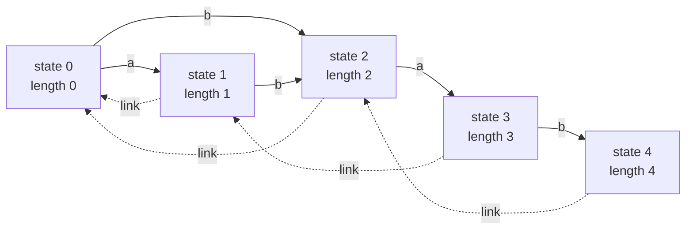
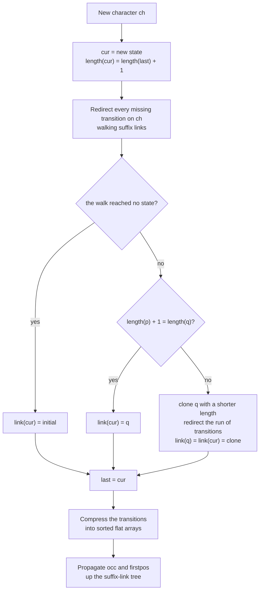
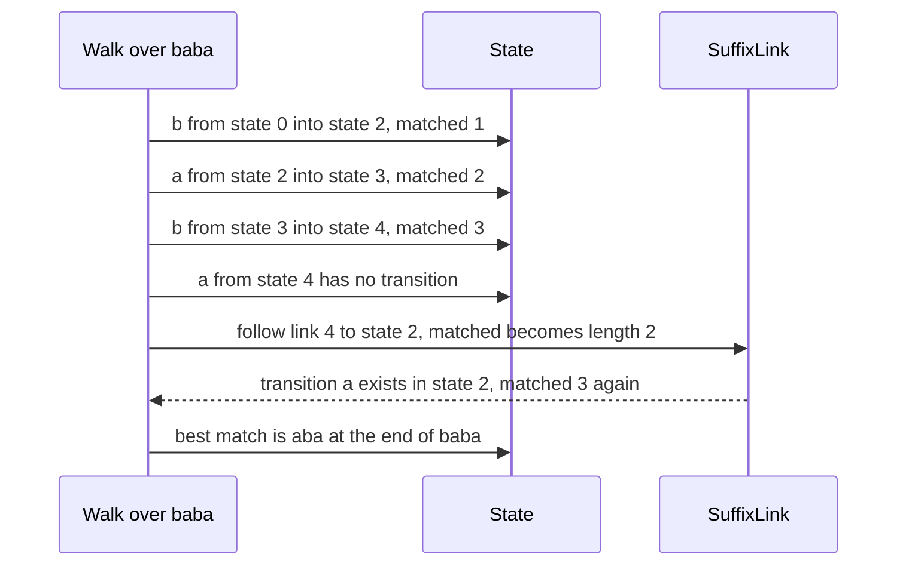

# 602 — Implement compressed suffix automaton with substring queries optimized

> **Tier:** Expert · **CTCI chapter:** Beyond — Advanced Data Structures & Algorithms
> **Task spec:** [602-implement-compressed-suffix-automaton-with-substring-queries-opt.md](../../../tasks/expert/602-implement-compressed-suffix-automaton-with-substring-queries-opt.md)
> **Solutions:** [Python](../../../solutions/python/expert/602-implement-compressed-suffix-automaton-with-substring-queries-opt/solution.py) ·
> [Java](../../../solutions/java/expert/602-implement-compressed-suffix-automaton-with-substring-queries-opt/Solution.java) ·
> [JavaScript](../../../solutions/javascript/expert/602-implement-compressed-suffix-automaton-with-substring-queries-opt/solution.js) ·
> [C#](../../../solutions/csharp/expert/602-implement-compressed-suffix-automaton-with-substring-queries-opt/Solution.cs)

## 1. Problem restatement

Build the **suffix automaton** (the minimal DFA of all suffixes, equivalently the DAG of the
endpos-equivalence classes) of a text, store it in a *compressed* layout instead of one hash map per
state, and answer substring queries on it:

| Query | Answer |
| --- | --- |
| `contains(pattern)` / `walk(pattern)` | whether the pattern is a substring, and the state where it ends |
| `occurrences(pattern)` | size of `endpos` of that state |
| `first_position(pattern)` | start of the leftmost occurrence |
| `distinct_substrings()` | `sum(length[v] - length[link[v]])` |
| `kth_distinct_substring(k)` | the k-th distinct substring in lexicographic order (1-indexed, out of range raises) |
| `longest_common_substring(other)` | longest string common to the text and `other` |
| `prefix_occurrences(s)` | occurrence count of *every* non-empty prefix of `s`, in one pass |

Input: a text. Output: the automaton plus those queries. Structural bounds asserted by the checks:
states ≤ `2n`, transitions ≤ `3n` (the classical tighter bounds are `2n - 1` and `3n - 4`); the empty
pattern is never a substring and has zero occurrences; the automaton of the empty text is the initial
state alone.

Concrete expected results from the checks:

- `"banana"` → `distinct_substrings() == 15`, `occurrences("ana") == 2`, `occurrences("na") == 2`,
  `occurrences("a") == 3`, `occurrences("banana") == 1`, `first_position("ana") == 1`,
  `first_position("nana") == 2`, `first_position("x") == -1`,
  `longest_common_substring("ananas") == "anana"`.
- `"aaaa"` → `distinct_substrings() == 4`; `""` → `0`; for `"abab"` and `"banana"` the values
  `k = 0`, `k = total + 1` and `k = -1` are all rejected with an error.
- A 20000-character LCG text: `occurrences(text) == 1`, `first_position(text) == 0`,
  `longest_common_substring(text) == text`, and for a mutated copy (one character of the 20000
  changed) the returned answer still has length ≥ 7999.

## 2. Intuition

A trie of suffixes is quadratic. The suffix automaton is the opposite extreme: *one state per
endpos-equivalence class*, so O(n) states, and every substring is the label of a path from the
initial state. The incremental build is cheap — extend with a new character, redirect the missing
transitions to the new state, and **clone** the state whose class becomes too long — but the textbook
representation (a `sigma × states` matrix) is not compact for a real alphabet.

The compression used here keeps the automaton and flattens its *storage*: all transition maps are
serialised into **one sorted character array plus one target array shared by every state, with an
offset table** (a compressed sparse row layout). A transition lookup becomes a binary search inside
the state's slice — `O(log out-degree)` instead of a hash probe — and the whole transition table is
two flat arrays instead of `n` small dictionaries. The Python version keeps the hash maps around
*only* so the checks can prove that every binary-search lookup returns exactly what the hash lookup
returned.



The state graph of `abab` (section 4 derives it): solid edges are transitions, dotted edges are
suffix links. Queries are answered from the arrays every state carries — `length` (longest substring
of the class), `link` (suffix link) and, after one bottom-up pass, `occ` (`endpos` size) and
`firstpos` (minimum end position).

For an *optimized* query the interesting one is the batch: the solution answers **all prefixes of a
string in a single left-to-right pass** (`prefix_occurrences`), by keeping one matched state and
reading `occ[state]` whenever the whole prefix matched, instead of performing `|s|` independent walks.
The same walk type answers `longest_common_substring`: keep the longest match ending at each position
and follow suffix links when a transition is missing, which is amortised O(n + m).

## 3. Algorithm

Construction, one character at a time:

1. Create state `cur` with `length[cur] = length[last] + 1`, `occ[cur] = 1` and
   `firstpos[cur] = i`.
2. Walk `p = last, link[last], ...` while the transition on the character is missing, and point it at
   `cur`.
3. If that walk reached no state, `link[cur] = 0`. If `length[p] + 1 = length[q]` for the transition
   `q` found on the way, set `link[cur] = q`.
4. Otherwise clone: `clone` copies `q`'s transitions and `firstpos`, gets `length[p] + 1` and
   `link[q]`, redirects the run of transitions that pointed to `q`, then `link[q] = link[cur] =
   clone`. Clones start with `occ = 0`.
5. After the build, propagate `occ` and `firstpos` up the suffix-link tree in **decreasing length
   order** (a topological order of that tree), so each state accumulates the sizes and minimum end
   positions of its whole `endpos` class.
6. Compress: iterate the states in order, sort each state's characters, and emit them into the flat
   `labels`/`targets` arrays while recording `offsets[state]`.

`kth_distinct_substring` first computes `count[v]`, the number of distinct non-empty strings
spellable from `v` (again in decreasing length order), then descends the transitions in sorted
character order, subtracting `1 + count[target]` for every skipped character.

```text
procedure extend(ch)
    cur ← new state
    length(cur) ← length(last) + 1
    occ(cur) ← 1
    firstpos(cur) ← position of ch
    p ← last
    while p ≠ none and transition(p, ch) is missing do
        transition(p, ch) ← cur
        p ← link(p)
    if p = none then
        link(cur) ← initial
    else if length(p) + 1 = length(transition(p, ch)) then
        link(cur) ← transition(p, ch)
    else
        q ← transition(p, ch)
        clone ← copy of q
        length(clone) ← length(p) + 1
        link(clone) ← link(q)
        occ(clone) ← 0
        while p ≠ none and transition(p, ch) = q do
            transition(p, ch) ← clone
            p ← link(p)
        link(q) ← clone
        link(cur) ← clone
    last ← cur

procedure propagate
    for state in states sorted by length descending do
        parent ← link(state)
        occ(parent) ← occ(parent) + occ(state)
        firstpos(parent) ← min(firstpos(parent), firstpos(state))

procedure compress
    for state in state order do
        offsets(state) ← length(labels)
        for ch in sorted characters of state do
            labels ← labels + ch
            targets ← targets + transition(state, ch)

function occurrences(pattern)
    state ← walk the compressed transitions from the initial state, one character each
    if state = none or pattern is empty then return 0
    return occ(state)

function kth_distinct_substring(k)
    if k < 1 or k > distinct_substrings() then raise an error
    counts ← number of distinct strings spellable from each state, in decreasing length order
    state ← initial
    output ← empty
    while true do
        for ch in sorted transitions of state do
            width ← 1 + counts(transition(state, ch))
            if k <= width then
                output ← output + ch
                k ← k - 1
                if k = 0 then return output
                state ← transition(state, ch)
                continue the while loop
            k ← k - width
```



## 4. Worked example

Building the automaton of `abab`. One row per call of `extend`:

| Step | char | new state | transitions added | link decision |
| --- | --- | --- | --- | --- |
| 0 | `a` | 1 (`length 1`) | `0 -a-> 1` | the walk ends past the initial state, so `link(1) = 0` |
| 1 | `b` | 2 (`length 2`) | `1 -b-> 2`, then `0 -b-> 2` | `link(2) = 0` |
| 2 | `a` | 3 (`length 3`) | `2 -a-> 3`; the walk stops at state 0, which already has `a -> 1` | `length(0) + 1 = length(1)`, so `link(3) = 1` |
| 3 | `b` | 4 (`length 4`) | `3 -b-> 4`, then `1 -b-> 4`; the walk stops at 0, which already has `b -> 2` | `length(1) + 1 = length(2)`, so `link(4) = 2` — no clone needed |

Final structure: `0 {a:1, b:2}`, `1 {b:2}`, `2 {a:3}`, `3 {b:4}`, `4 {}`, with
`link = [-1, 0, 0, 1, 2]` and `length = [0, 1, 2, 3, 4]`. A clone appears for texts such as `ababa`,
which the checks exercise on the longer LCG strings.

Propagation, in decreasing length order (4, 3, 2, 1):

| Step | state | parent | `occ` after the step | `firstpos` after the step |
| --- | --- | --- | --- | --- |
| start | — | — | `[0, 1, 1, 1, 1]` | `[-1, 0, 1, 2, 3]` |
| 1 | 4 | 2 | `[0, 1, 2, 1, 1]` | `[-1, 0, 1, 2, 3]` |
| 2 | 3 | 1 | `[0, 2, 2, 1, 1]` | `[-1, 0, 1, 2, 3]` |
| 3 | 2 | 0 | `[2, 2, 2, 1, 1]` | `[-1, 0, 1, 2, 3]` |
| 4 | 1 | 0 | `[4, 2, 2, 1, 1]` | `[-1, 0, 1, 2, 3]` |

Query trace:

| Query | Walk | Answer |
| --- | --- | --- |
| `occurrences("ab")` | `0 -a-> 1 -b-> 2` | `occ(2) = 2` |
| `occurrences("a")` | `0 -a-> 1` | `occ(1) = 2` |
| `occurrences("abab")` | `0 -a-> 1 -b-> 2 -a-> 3 -b-> 4` | `occ(4) = 1` |
| `first_position("ab")` | state 2 has `firstpos = 1` | `1 - 2 + 1 = 0` |
| `distinct_substrings()` | `1 + 2 + 2 + 2` | `7` |
| `kth_distinct_substring(3)` | sorted set is `a, ab, aba, abab, b, ba, bab` | `aba` |
| `longest_common_substring("baba")` | the diagram below | `aba` (length 3) |

The k-th query descends like this: at state 0 the character `a` covers `1 + count(1) = 4` strings, so
`k = 3` enters it and becomes 2; at state 1 the only edge `b` covers `1 + count(2) = 3`, so `k = 2`
enters it and becomes 1; at state 2 the edge `a` covers `1 + count(3) = 2`, so `k = 1` enters it and
becomes 0 → `aba`.



The compressed layout of this automaton is `offsets = [0, 1, 2, 3, 4, 4]`,
`labels = [a, b, b, a, b]`, `targets = [1, 2, 2, 3, 4]`: state 2 owns the slice `labels[2..3]`, so a
lookup of `a` there is one binary search inside a two-element range.

## 5. Complexity

Let `n` be the text length, `m` a pattern length, `sigma` the alphabet size and `d` a state's
out-degree.

| Operation | Best | Average | Worst | Why the bound holds |
| --- | --- | --- | --- | --- |
| Construction | O(n) | O(n) | O(n) | one state per `extend` plus at most one clone, so ≤ 2n states and ≤ 3n transitions; the redirect loops are amortised over the suffix links they shorten |
| Compress | O(n + sigma log sigma) | same | same | every state's characters are sorted and appended once |
| `occ` / `firstpos` propagation | O(n) | O(n) | O(n) | one pass in decreasing-length order, a topological order of the suffix-link tree |
| `walk` / `contains` / `occurrences` | O(m) | O(m log d) | O(m log d) | one binary search per character inside the state's flat slice |
| `first_position` | O(m log d) | O(m log d) | O(m log d) | the walk plus one array read and one subtraction |
| `distinct_substrings` | O(n) | O(n) | O(n) | one sum over `length[v] - length[link[v]]` |
| `kth_distinct_substring` | O(m) | O(m + n) | O(m + n) | one bottom-up `count` pass plus one descent of length ≤ m |
| `longest_common_substring` | O(|other| log d) | same | same | each character grows the match by at most one and each suffix-link climb shortens it, so the climbs are amortised |
| `prefix_occurrences(s)` | O(|s| log d) | same | same | one pass instead of `|s|` independent walks; the checks assert it equals the individual queries |
| Space | O(n) | O(n) | O(n) | `2n` states × a few integers, plus flat transition arrays of size ≤ 3n |

Alternatives for comparison: the plain suffix tree of task 601 answers `occurrences` in O(m) but needs
a leaf enumeration for positions; a suffix array with LCP answers `occurrences` in O(m log n) and
answers `k`-th substring through the LCP array instead of a path count.

## 6. Pitfalls and edge cases

- **The empty pattern is not a substring** in these solutions: `contains("")` is false,
  `occurrences("") == 0` and `first_position("") == -1`; the checks assert exactly that.
- **A character outside the alphabet** must be rejected in O(m); the compressed lookup returns `-1`
  and `contains` must not mistake that for a state.
- **Clones have `occ = 0` and inherit `firstpos`** from the copied state; initialising a clone with
  `occ = 1` silently inflates every count that passes through it.
- **The propagation order matters.** Decreasing `length` is a valid topological order of the
  suffix-link tree; reverse array order is not.
- **`k` is 1-indexed** and out of range must raise (`ValueError` in Python, an exception elsewhere);
  the checks probe `0`, `total + 1` and `-1` for two automata.
- **Degenerate texts.** `""` (single initial state, 0 distinct substrings), `"a"`, `"aaaa"`
  (4 distinct substrings), `"zz"/"zzz"/"zzzz"`-style repeats and `"abab"` are all in the checks.
- **The LCS for a tie is not unique.** The walk returns one optimum — the Python checks compare
  *lengths* and membership in both strings, never a specific 3-character answer where two exist.
- **Documented variants.** Python, Java and C# keep the automaton and compress only its storage; the
  JavaScript solution instead *path-compresses* the automaton (contracting every state with one
  incoming and one outgoing transition, i.e. a CDAWG), stores the endpos count of every contracted
  state on the resulting edge, and lets a walk stop inside a compressed edge. Both answer the same
  queries and both are cross-checked against brute force.

## 7. Variants and follow-ups

- The same automaton with the counting-first angle (distinct substrings, `endpos` sizes) →
  [404 — suffix automaton and distinct substrings](../../../tasks/advanced/404-implement-suffix-automaton-and-count-different-substrings.md),
  [431 — suffix automaton for distinct substring queries](../../../tasks/advanced/431-implement-suffix-automaton-for-distinct-substring-queries.md),
  [526 — suffix automaton with endpos count](../../../tasks/advanced/526-implement-suffix-automaton-with-endpos-count-advanced.md).
- Occurrence *positions* rather than counts, and the tree-shaped alternative →
  [601 — full suffix tree (Ukkonen)](../../../tasks/expert/601-implement-full-suffix-tree-ukkonen-and-test-with-large-text.md).
- Several texts and their longest common substring →
  [603 — generalized suffix tree for multiple texts](../../../tasks/expert/603-implement-generalized-suffix-tree-for-multiple-texts-and-lcs-of.md) and
  [407 — generalized suffix array for multiple strings](../../../tasks/advanced/407-implement-generalized-suffix-array-for-multiple-strings.md).
- Replacing the automaton with a suffix array + LCP for the same queries →
  [312 — substring occurrences with suffix array + LCP](../../../tasks/intermediate/312-find-substring-occurrences-with-suffix-array-lcp.md).
- Compressed *rank/select* storage under the same queries →
  [609 — advanced compressed bitvectors (RRR) and rank/select](../../../tasks/expert/609-implement-advanced-compressed-bitvectors-rrr-and-rank-select.md).

## 8. Check yourself

<details><summary>Show answer</summary>
**Why does cloning produce a state with `occ = 0`?** A clone represents a class that exists only
because an existing class was split; it is not the end position of any new prefix, so it starts with
an empty `endpos`. Its members' end positions arrive later through the propagation pass, up the
suffix-link tree.
</details>

<details><summary>Show answer</summary>
**What exactly does the CSR compression change?** Only the storage and the lookup cost of the
transitions: one sorted `labels` array plus a `targets` array shared by all states, with an `offsets`
table, instead of a dictionary per state. A step costs `O(log out-degree)` by binary search inside the
state's slice instead of an average O(1) hash probe, and memory becomes two flat arrays. The Python
checks assert the binary-search answer equals the hash-map answer for every state and character.
</details>

<details><summary>Show answer</summary>
**Why is `sum(length[v] - length[link[v]])` the number of distinct substrings?** Every state `v`
represents exactly the substrings whose lengths lie in `(length[link[v]], length[v]]` — the strings of
its endpos class. Those intervals are disjoint and together cover every distinct substring, so adding
their sizes counts each substring exactly once.
</details>

<details><summary>Show answer</summary>
**What makes `prefix_occurrences` cheaper than `|s|` walks?** It keeps one matched state while scanning
`s` once. When the whole prefix matched (`matched` equals the prefix length) the answer is
`occ[state]`; otherwise that prefix does not occur as a whole and the answer is 0. The checks compare
the batch answers with `occurrences(s[:i+1])` for every `i`.
</details>

<details><summary>Show answer</summary>
**Why does the LCS walk follow suffix links when a transition is missing?** A missing transition means
the match cannot be extended, so the walk retreats to the longest suffix of the current match that can
be extended — that is `link(state)`, whose `length` is already the shortened match length. Each
character of `other` increases the match by at most one and each climb decreases it, so the total is
linear.
</details>
