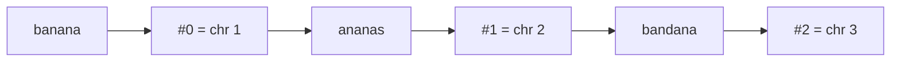
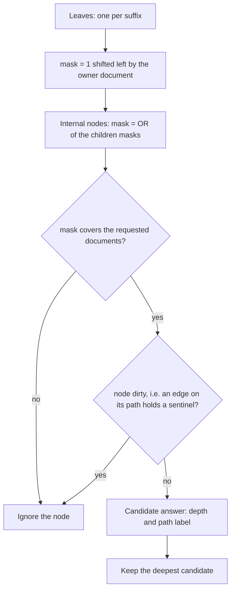
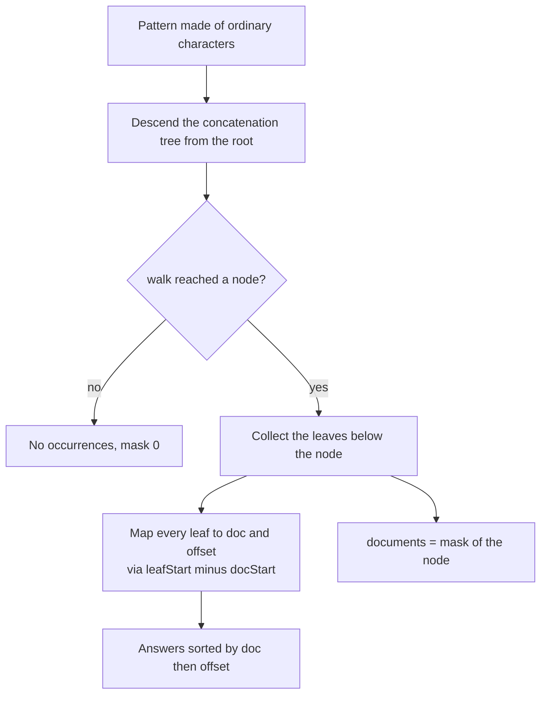
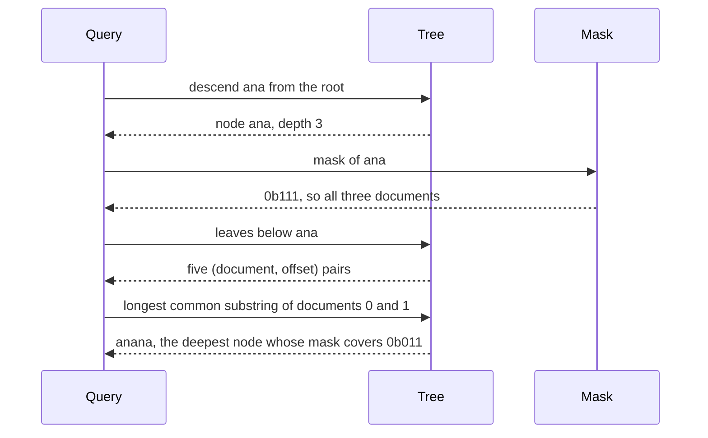

# 603 — Implement generalized suffix tree for multiple texts and LCS of many strings

> **Tier:** Expert · **CTCI chapter:** Beyond — Advanced Data Structures & Algorithms
> **Task spec:** [603-implement-generalized-suffix-tree-for-multiple-texts-and-lcs-of.md](../../../tasks/expert/603-implement-generalized-suffix-tree-for-multiple-texts-and-lcs-of.md)
> **Solutions:** [Python](../../../solutions/python/expert/603-implement-generalized-suffix-tree-for-multiple-texts-and-lcs-of/solution.py) ·
> [Java](../../../solutions/java/expert/603-implement-generalized-suffix-tree-for-multiple-texts-and-lcs-of/Solution.java) ·
> [JavaScript](../../../solutions/javascript/expert/603-implement-generalized-suffix-tree-for-multiple-texts-and-lcs-of/solution.js) ·
> [C#](../../../solutions/csharp/expert/603-implement-generalized-suffix-tree-for-multiple-texts-and-lcs-of/Solution.cs)

## 1. Problem restatement

Given `k` texts, build their **generalized suffix tree** — the compressed trie of *all* suffixes of
*all* texts — and answer multi-document queries on it:

| Query | Answer |
| --- | --- |
| `occurrences(pattern)` | every `(document, offset)` pair where the pattern occurs, sorted |
| `documents(pattern)` | bitmask of the documents containing the pattern (0 when absent) |
| `longest_common_substring_of(docs)` | longest string occurring in **every** document of the set |
| `longest_common_substring_of_all()` | the same for all `k` documents |
| `leaves`, `mask`, `depth` | the structural arrays the queries above read |

Input: a set of texts. Output: the tree plus those queries. The standard trick is to concatenate
`s_0 #0 s_1 #1 ... s_(k-1) #(k-1)` with **one distinct sentinel character per text** (the Python and
Java solutions use the control characters `chr(1 + doc)`, JavaScript uses the private-use area
`0xE000 + doc`, all below every ordinary character). Because the last character of the concatenation
is a sentinel that occurs nowhere else, Ukkonen's construction over that string yields a *full*
suffix tree: every suffix ends at its own leaf, and a leaf's suffix start is `|T| + 1 - depth`.

Concrete expected results from the checks:

- `["banana", "ananas", "bandana"]` → `longest_common_substring_of_all() == "ana"`,
  `longest_common_substring_of([0, 1]) == "anana"`,
  `longest_common_substring_of([0, 2])` is a length-3 tie (`"ban"` or `"ana"`),
  `longest_common_substring_of([1, 2]) == "ana"`,
  `occurrences("ana") == [(0, 1), (0, 3), (1, 0), (1, 2), (2, 4)]`,
  `occurrences("ban") == [(0, 0), (2, 0)]`, `occurrences("nanas") == [(1, 1)]`,
  `documents("ana") == 0b111`, `documents("band") == 0b100`, `documents("xyz") == 0`.
- `["ab", "ba", "aba"]` → LCS `"a"` (length 1); `["aaaa", "aa", "a"]` → `"a"`;
  `["zz", "zzz", "zzzz"]` → `"zz"`; `["x", "y"]`, `["a", "b", "c"]` and `["", "ab"]` → the empty
  string; `["abc", "abc"]` → `"abc"`; a single `["abc"]` → the text itself.
- 40 documents of about 100 characters with one 14-character block injected into all of them: the
  answer has length ≥ 14, occurs in every document, `documents(answer)` is `(1 << 40) - 1`, and no
  substring one character longer is common to all 40 — the candidate scan over the first document is
  a complete maximality proof.

## 2. Intuition

Building one suffix tree per document answers single-text queries but not "which documents contain
this pattern" or "what is the longest string shared by these five documents". Concatenating the
documents with **distinct** separators fixes both problems in one structure:

- distinct sentinels keep suffixes of different documents apart, so no suffix of one text is a prefix
  of a suffix of another, every suffix ends in a leaf, and a leaf's owner document is known;
- a pattern made only of ordinary characters can never pass a sentinel, so the leaves below the locus
  of the pattern are exactly its occurrences, each inside one document;
- attaching to every node the **bitmask of the documents below it** turns "does document `d` contain
  this pattern" into one bit test.

The subtlety is the *dirty* flag: paths that run through a sentinel describe strings such as
`"ana\x01"`, which are not shared substrings of anything. A node is marked dirty when any edge on its
path holds a sentinel (computed in O(1) per edge from a prefix count of sentinels in the
concatenation), and dirty nodes are excluded from the LCS scan.



The concatenation of the worked example is `banana\x01ananas\x02bandana\x03`, length 22, with
`docStart = [0, 7, 14]`.

The last ingredient is *why a longest common substring must be a node*. Take two or more documents
and a string `p` that occurs in all of them. Each occurrence of `p` inside a document is followed by
either an ordinary character or (when `p` reaches the end of that document) that document's own
sentinel — and different documents have different sentinels. So `p` has to be followed by at least two
different characters, i.e. it is right-maximal, i.e. it is the path label of a node.



## 3. Algorithm

1. Concatenate: for each document, append its characters, remember `docStart[doc]`, append its own
   sentinel, and record the owning document for every position of that block.
2. Build the tree with the same Ukkonen phase loop as task 601 over the concatenation.
3. Finalise top-down: `depth` and the `dirty` flag (an edge holds a sentinel iff the sentinel prefix
   count grows across `[start, end)`), in breadth-first order so parents are processed first.
4. Finalise bottom-up: a leaf gets `leafStart = |T| - depth` and the mask of its owner document; an
   internal node gets the bitwise OR of its children's masks (so `mask[0]` covers every document).
5. `occurrences(pattern)` descends from the root by the pattern's characters, then maps every leaf
   below the reached node to `(doc, leafStart - docStart[doc])`.
6. `documents(pattern)` returns the mask of that node (0 if the walk fails).
7. `longest_common_substring_of(docs)` builds the wanted mask, then takes the deepest node that is not
   dirty and whose mask covers it. An empty set answers the empty string; a one-element set answers
   that document itself, because its whole text is trivially "common to one document".

```text
procedure build(texts)
    s ← empty
    for doc ← 0 to length(texts) - 1 do
        docStart(doc) ← length(s)
        s ← s + texts(doc) + chr(1 + doc)
        append doc to docOf once for every character appended
    run the Ukkonen phases of task 601 over s

procedure finalize
    compute prefix(p) = number of sentinels in s[0 .. p] for every p
    order ← breadth-first order of the nodes, starting at the root
    for node in order do
        for child in children(node) do
            depth(child) ← depth(node) + end(child) - start(child)
            dirty(child) ← dirty(node) or prefix(end(child)) - prefix(start(child)) > 0
    for node in reverse(order) do
        if node is a leaf then
            leafStart(node) ← length(s) - depth(node)
            mask(node) ← 1 shifted left by docOf(leafStart(node))
        else
            mask(node) ← bitwise or of mask(child) over children(node)

function occurrences(pattern)
    node ← descend from the root by the characters of pattern, possibly stopping inside an edge
    if node = none or pattern is empty then return the empty list
    answer ← empty list
    for leaf in the leaves below node do
        doc ← docOf(leafStart(leaf))
        answer ← answer + (doc, leafStart(leaf) - docStart(doc))
    return answer sorted

function longest_common_substring_of(docs)
    if docs is empty then return the empty string
    if docs has exactly one element then return texts(docs(0))
    want ← bitwise or of 1 shifted left by doc over docs
    best ← 0
    chosen ← none
    for node in all nodes except the root do
        if not dirty(node) and mask(node) covers want and depth(node) > best then
            best ← depth(node)
            chosen ← node
    if chosen = none then return the empty string
    return pathLabel(chosen)
```



## 4. Worked example

Texts `["banana", "ananas", "bandana"]`, so `s = banana\x01ananas\x02bandana\x03` with
`sentinels = {\x01, \x02, \x03}`, `docStart = [0, 7, 14]` and `|s| = 22`. The generalized tree has 22
leaves (one per suffix) and the root mask `0b111`.

Key nodes and the masks the bottom-up pass computes:

| Path label | Depth | Occurrences in the concatenation | `mask` | `dirty` |
| --- | --- | --- | --- | --- |
| root | 0 | every document | `111` | no |
| `ban` | 3 | `s[0..]`, `s[14..]` | `101` | no |
| `band` | 4 | `s[14..]` only — `bandana` itself sits inside the edge below this node and inherits its mask | `100` | no |
| `ana` | 3 | `s[1..]`, `s[3..]`, `s[9..]`, `s[18..]` | `111` | no |
| `nana` | 4 | `s[2..]`, `s[8..]` | `011` | no |
| `anana` | 5 | `s[1..]`, `s[7..]` — `nanas` sits inside this node's `s` edge | `011` | no |
| any path crossing a sentinel | ≥ 2 | one leaf only | one bit | yes |

The reason `ana` is a node: its occurrences are followed by `n`, `\x01`, `s` and `\x03`, so it is
right-maximal. `anana` is a node for the same reason — the occurrence in `banana` is followed by
the sentinel `\x01`, the occurrence in `ananas` by `s`.

Subset queries (the wanted mask in the third column is `1 << doc` OR-ed over the subset):

| Subset | `want` | Deepest node covering `want` | Answer |
| --- | --- | --- | --- |
| `[0, 1, 2]` | `111` | `ana`, depth 3 (`ban`, `band`, `nana` and `anana` all miss a document) | `"ana"` |
| `[0, 1]` | `011` | `anana`, depth 5 (beats `nana`, depth 4) | `"anana"` |
| `[1, 2]` | `110` | `ana`, depth 3 | `"ana"` |
| `[0, 2]` | `101` | `ban`, depth 3 — tied with `ana`, and the scan returns the first strictly deeper candidate in node order, so the checks accept either | `"ban"` |
| `[1]` | — | returned directly, no scan | the whole text `"ananas"` |

Occurrence trace for `"ana"`: descend root → `a` → `na` (the node `ana`, depth 3), collect its leaves
and map them back through `docStart`:

| Leaf suffix start | Document | Offset (`start - docStart[doc]`) |
| --- | --- | --- |
| 1 | 0 | 1 |
| 3 | 0 | 3 |
| 7 | 1 | 0 |
| 9 | 1 | 2 — `s[9]` is the second `ana` inside `ananas`, and `9 - docStart[1] = 9 - 7 = 2` |
| 18 | 2 | 4 |

Sorted, that is `[(0, 1), (0, 3), (1, 0), (1, 2), (2, 4)]` — exactly the asserted answer.



## 5. Complexity

Let `N` be the total length of all texts (including the `k` sentinels), `m` a pattern length, `k` the
number of documents and `occ` the number of reported occurrences.

| Operation | Best | Average | Worst | Why the bound holds |
| --- | --- | --- | --- | --- |
| Concatenate + build | O(N) | O(N) | O(N) | Ukkonen's amortised linear bound applies to the concatenation exactly as in task 601 |
| Finalise (depths, dirty, masks) | O(N) | O(N) | O(N) | one BFS plus one reverse pass; each edge is visited once and the dirty test is an O(1) prefix difference |
| `occurrences(pattern)` | O(m) | O(m + occ log occ) | O(m + occ log occ) | the descent costs the pattern length, then each leaf below the node is emitted once and the list is sorted |
| `documents(pattern)` | O(m) | O(m) | O(m) | one descent plus one array read |
| `longest_common_substring_of(docs)` | O(N) | O(N) | O(N) | one scan over all nodes with constant work per node, plus one `pathLabel` |
| Space | O(N) | O(N) | O(N) | at most 2N nodes; the mask is one machine word, which is why the constructor asserts `k ≤ 64` |

| Approach | Build | LCS of `k` texts | Space |
| --- | --- | --- | --- |
| Generalized suffix tree (this task) | O(N) | O(N) after the build | O(N) |
| One suffix tree per document | O(N) | O(N · total) with repeated descents, no shared structure | O(N) |
| Dynamic programming for two texts | — | O(n · m) time, O(min(n, m)) space | O(min(n, m)) |
| Generalized suffix array | O(N log N) | O(N) with the LCP array | O(N) |

## 6. Pitfalls and edge cases

- **One distinct sentinel per document, all smaller than every ordinary character.** Sharing a single
  sentinel lets a suffix of one document move into the next, which corrupts both `occurrences` and the
  masks.
- **`k ≤ 64`** because the document set is stored in one machine word (the Python/Java/C# constructors
  assert it; JavaScript caps the number of texts at 32 for the same reason and rejects texts that
  already contain a terminator character).
- **Dirty nodes must be skipped.** A node on a path through a sentinel has exactly one leaf below it,
  so it can never be a shared substring; without the flag, strings such as `ana\x01` would win.
- **A one-element subset is not a scan.** Python returns that document itself; Java documents that
  singleton subsets are excluded by definition because the whole text is trivially common to one
  document. The checks accept both conventions.
- **An empty document contains nothing, not even the empty pattern.** `["", "ab"]` gives the empty
  answer, and the checks skip every candidate containing a sentinel.
- **Ties are real.** `["banana", "bandana"]` shares `ban` and `ana`, both of length 3; the checks
  compare lengths and verify membership in both documents rather than asserting one string.
- **`path_label` for a node is recovered from a leaf below it**, so labels containing a sentinel are
  possible mid-path — the filters, not the labels, are what make answers valid.
- **Documented simplification (C#).** It inserts the suffixes one by one with skip-down navigation
  instead of the online linearisation, so its construction costs O(total length × depth) rather than
  O(total length); the tree it produces is still a complete generalized suffix tree. The Python, Java
  and JavaScript solutions scan the concatenation with Ukkonen.

## 7. Variants and follow-ups

- One text only, with occurrence positions and the longest repeated substring →
  [601 — full suffix tree (Ukkonen)](../../../tasks/expert/601-implement-full-suffix-tree-ukkonen-and-test-with-large-text.md).
- The same LCS question answered from the automaton side →
  [602 — compressed suffix automaton](../../../tasks/expert/602-implement-compressed-suffix-automaton-with-substring-queries-opt.md).
- The array-based multi-text structure (concatenation plus LCP intervals instead of masks) →
  [407 — generalized suffix array for multiple strings](../../../tasks/advanced/407-implement-generalized-suffix-array-for-multiple-strings.md).
- More pattern-matching machinery over several texts (multiple patterns at once) →
  [314 — Aho-Corasick for multiple pattern matching](../../../tasks/intermediate/314-implement-aho-corasick-for-multiple-pattern-match-outline.md).
- Succinct tree representations when even O(N) pointers are too much →
  [610 — succinct tree representations (DFUDS)](../../../tasks/expert/610-implement-succinct-tree-representations-dfuds-and-navigation-ops.md).

## 8. Check yourself

<details><summary>Show answer</summary>
**Why does every document need its own sentinel rather than one shared separator?** A shared
separator would make a suffix that starts near the end of document `i` identical to a suffix starting
near the end of document `i + 1`; the tree would merge them and the leaf masks would credit
occurrences to the wrong documents. Distinct sentinels make the end of every suffix unique.
</details>

<details><summary>Show answer</summary>
**Why is a longest common substring of two or more documents a node of the tree?** For each occurrence
inside a document, the string is followed by the next ordinary character, or by that document's own
sentinel when the occurrence ends the document. With at least two occurrences in different documents
those following characters differ (different sentinels, or a sentinel versus an ordinary character),
so the string is right-maximal and therefore a node's path label.
</details>

<details><summary>Show answer</summary>
**What does the `dirty` flag protect against?** Nodes whose path crosses a sentinel describe strings
like `ana\x01`. Those strings occur in one document only, but their mask still looks usable, so
without the flag the LCS scan could return a string that is not a substring of any document.
</details>

<details><summary>Show answer</summary>
**Why is the mask the same for a node and for the interior of an edge below it?** Every leaf below the
edge is also below the node, and every leaf below the node is below exactly one of its edges, so the
set of leaves — and therefore the set of owning documents — does not change while descending an edge.
That is why the scan only ever has to look at nodes.
</details>

<details><summary>Show answer</summary>
**In the worked example, why does `occurrences("ana")` contain `(1, 2)` as well as `(1, 0)`?** The
document `ananas` contains `ana` twice: at offset 0 (`a`, `n`, `a`) and at offset 2 (`a`, `n`, `a`).
Both leaves hang below the node `ana` and both map back through `docStart[1] = 7` to offsets 0 and 2.
</details>
