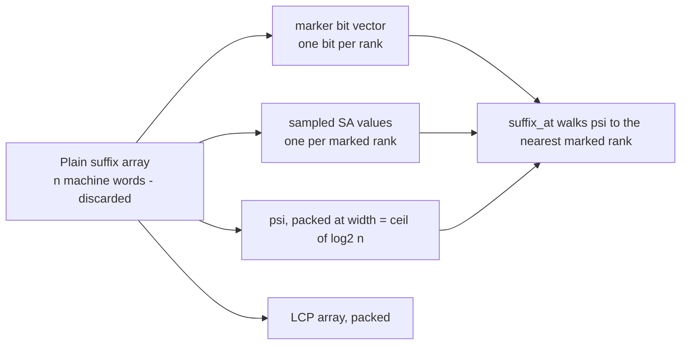
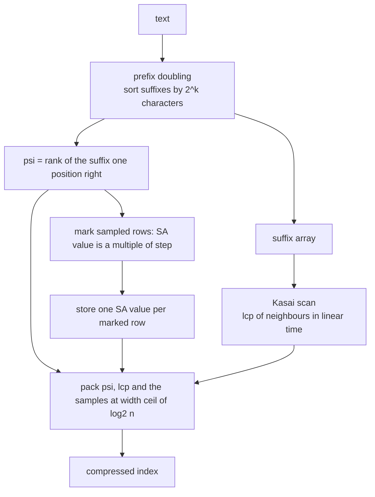
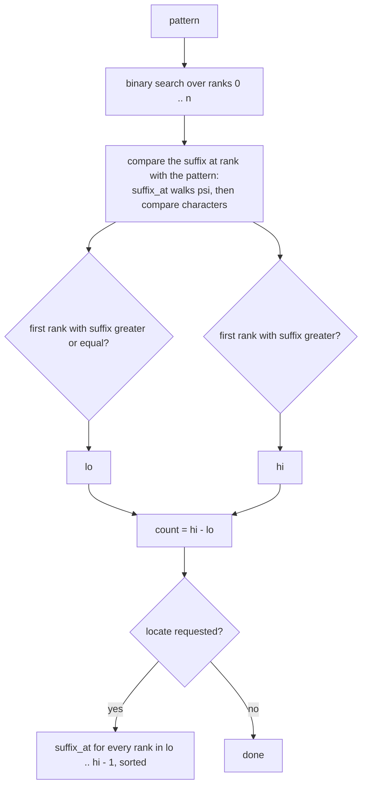
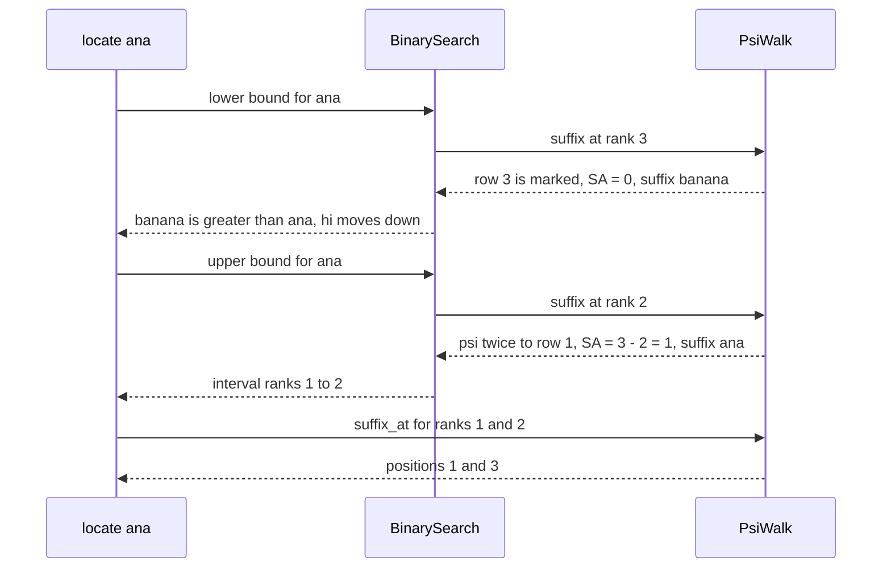

# 604 — Implement compressed suffix array (CSA) advanced

> **Tier:** Expert · **CTCI chapter:** Beyond — Advanced Data Structures & Algorithms
> **Task spec:** [604-implement-compressed-suffix-array-csa-advanced.md](../../../tasks/expert/604-implement-compressed-suffix-array-csa-advanced.md)
> **Solutions:** [Python](../../../solutions/python/expert/604-implement-compressed-suffix-array-csa-advanced/solution.py) ·
> [Java](../../../solutions/java/expert/604-implement-compressed-suffix-array-csa-advanced/Solution.java) ·
> [JavaScript](../../../solutions/javascript/expert/604-implement-compressed-suffix-array-csa-advanced/solution.js) ·
> [C#](../../../solutions/csharp/expert/604-implement-compressed-suffix-array-csa-advanced/Solution.cs)

## 1. Problem restatement

Build a **compressed suffix array**: answer the usual suffix-array queries without storing one machine
word per suffix-array entry. Two equivalent compressed representations appear in the solutions:

| Storage | Content | Recovering `SA[rank]` |
| --- | --- | --- |
| psi (Python) | `psi[rank] = SA⁻¹[(SA[rank] + 1) mod n]`, a marker bit vector over the rank axis, one sampled `SA` value per marked rank, and the packed LCP array | follow `psi` until a marked row is reached, then `SA[rank] = SA[marked] - steps (mod n)` |
| BWT (Java, JS, C#) | the BWT of `text + sentinel`, the `C` table and a rank structure, plus a sampled `SA` | follow `LF(row) = C[L[row]] + rank(L[row], row)` until a sampled row is hit; `psi` is `LF⁻¹` |

Interface shared by the four files: `count(pattern)`, `locate(pattern)` (sorted positions),
`suffix_at(rank)`, `lcp(rank)` (Python), `longest_repeated_substring()`, and a storage measurement
(`stored_bits()` in Python, an array-size report in the other languages). Sampling is by **text
position** — the ranks whose `SA` value is a multiple of `step` are stored — which bounds every walk:
one `psi`/`LF` step moves the text position by one, so a multiple of `step` is reached within
`step - 1` steps. Python asserts that bound on every walk and raises if it is exceeded.

Concrete expected results from the checks:

- `"banana"` with `step = 3`: `count("ana") == 2` with `locate("ana") == [1, 3]`, `count("na") == 2`,
  `count("a") == 3`, `count("banana") == 1` with `locate("banana") == [0]`,
  `count("bananas") == count("x") == count("") == 0`, `suffix_at(0) == 5`, `suffix_at(5) == 2`,
  `psi(0) == 3`, `psi(4) == 0`.
- `"mississippi"`: every sampling step in `1, 2, 3, 5, 8, 16` gives identical `count` and `locate`
  answers, and `stored_bits() ≤ 40 · 11` for all of them.
- 8000-character LCG text with `step = 11`: the suffix array passes an independent character-by-
  character comparator oracle, `count`/`locate` match a naive scan for sampled 20-character windows,
  and the longest repeated substring equals `max(lcp)` and really occurs at least twice.
- Storage demo: for `"banana"` the index measures **42 bits** against **768 bits** for a plain suffix
  array with its LCP (`2 · 6 · 64`).

## 2. Intuition

A suffix array is `n` integers plus an LCP array — `8n` bytes for the ranks alone. The observation that
makes compression possible is that the array does not have to be *stored*, only *navigable*:

- `psi[rank]` is the rank of the suffix one position to the right, so `SA[psi[rank]] = SA[rank] + 1`.
  Iterating `psi` walks through the text positions in increasing order, one step per text position.
- Therefore a **sparse sample** of `SA` suffices: to get `SA[rank]`, walk `psi` until a sampled rank is
  reached and subtract the number of steps. Sampling by text position (`SA[rank] % step == 0`) is what
  bounds the walk: each step decrements the (mod-n) text position, so after at most `step - 1` steps a
  multiple of `step` must appear.
- The `BWT + C + rank` trio gives the *inverse* navigation `LF`, and `psi = LF⁻¹`; the Java, JS and C#
  files keep that form because it also answers pattern counting directly by backward search.



Everything is bit-packed at width `ceil(log2 n)` (and `ceil(log2 max(lcp))` for the LCP array) instead
of machine words, which is why the measured size drops far below `64` bits per entry.



## 3. Algorithm

1. Build the suffix array by **prefix doubling**: start with the character ranks, sort the suffixes by
   their first `2^k` characters (the key of a suffix is the pair of its rank and the rank `2^k`
   positions later), rerank, and double `k` until all ranks are distinct. The task documents that the
   construction is orthogonal to the compression (SA-IS is the "advanced" construction, covered
   separately); the doubling sort is O(n log² n) with tuple keys.
2. Build the LCP array with **Kasai's scan**: walk the text left to right, keep the previous match
   length `h`, and only ever decrease `h` by one between positions, which makes the whole scan linear.
3. Compute `rankOf[position]` and then `psi[rank] = rankOf[(SA[rank] + 1) mod n]`; pack `psi` at width
   `ceil(log2 n)` into one integer (or a flat array in the other languages).
4. Mark the rows whose `SA` value is a multiple of `step` in a bit vector with `rank1`/`select1`
   support, and store those `SA` values in rank order.
5. Pack the LCP array too, at width `ceil(log2 max(lcp))`.
6. `suffix_at(rank)`: walk `psi` until a marked row is found (asserting the walk never exceeds `step`
   steps), then return `(sampled_value - steps) mod n`.
7. `count(pattern)` / `locate(pattern)`: binary search the ranks, comparing the suffix that
   `suffix_at(rank)` points at with the pattern. The lower bound is the first rank whose suffix is
   `≥ pattern`, the upper bound the first one that is `> pattern`; their difference is the count and
   the ranks in between are the occurrence positions.
8. `longest_repeated_substring()`: the largest interior `lcp` value, read from the corresponding
   suffix.
9. `stored_bits()`: `n · (width + width_lcp + 1)` for packed `psi`, LCP and marker bits, plus
   `sampled_count · width` for the samples, plus one rank sample per 64-bit word of the marker.

```text
procedure suffix_array(text)
    n ← length(text)
    if n = 0 then return the empty array
    ranks ← character codes of text
    k ← 1
    while true do
        key(i) ← (ranks(i), ranks(i + k) if i + k < n else -1)
        sort the indices 0 .. n - 1 by key
        rerank: equal keys get equal ranks
        if all ranks are distinct then return the sorted indices
        k ← 2 * k

procedure kasai_lcp(text, sa)
    rankOf(sa(i)) ← i for every i
    h ← 0
    for i ← 0 to n - 1 do
        position ← rankOf(i)
        if position > 0 then
            j ← sa(position - 1)
            while text[i + h] = text[j + h] do h ← h + 1
            lcp(position) ← h
            h ← max(h - 1, 0)
        else
            h ← 0

procedure build_index(text, step)
    sa ← suffix_array(text)
    lcp ← kasai_lcp(text, sa)
    rankOf(sa(rank)) ← rank for every rank
    psi(rank) ← rankOf((sa(rank) + 1) mod n)
    marked(rank) ← sa(rank) mod step = 0
    sampledValues ← sa(rank) for every marked rank, in rank order
    pack psi, lcp, the marker bits and the sampled values at their widths

function suffix_at(rank)
    steps ← 0
    row ← rank
    while row is not marked do
        row ← psi(row)
        steps ← steps + 1
        if steps > step then fail, the sampling bound is broken
    return (sampledValue(row) - steps) mod n

function count(pattern)
    if pattern is empty then return 0
    return first rank whose suffix is greater than pattern
         - first rank whose suffix is at least pattern

function locate(pattern)
    return sorted(suffix_at(rank) for rank in the two binary-search bounds)
```



## 4. Worked example

`"banana"`, `n = 6`, `step = 3`. Suffixes sorted: `a` (5), `ana` (3), `anana` (1), `banana` (0),
`na` (4), `nana` (2), so `SA = [5, 3, 1, 0, 4, 2]` and `rankOf = [3, 2, 5, 1, 4, 0]`.

`psi[rank] = rankOf[(SA[rank] + 1) mod 6]`:

| rank | 0 | 1 | 2 | 3 | 4 | 5 |
| --- | --- | --- | --- | --- | --- | --- |
| `SA[rank]` | 5 | 3 | 1 | 0 | 4 | 2 |
| `psi[rank]` | 3 | 4 | 5 | 2 | 0 | 1 |

The check asserts `psi(0) == 3` and `psi(4) == 0`. With `step = 3` the marked rows are those whose
`SA` value is a multiple of 3 — ranks 1 (`SA = 3`) and 3 (`SA = 0`) — so the marker bits are
`[0, 1, 0, 1, 0, 0]` and `sampledValues = [3, 0]` in rank order. `width = 3` bits (for `n - 1 = 5`) and
`width_lcp = 2` bits (`max(lcp) = 3`).

LCP from Kasai: neighbours are `a/ana`, `ana/anana`, `anana/banana`, `banana/na`, `na/nana` →
`lcp = [0, 1, 3, 0, 0, 2]`.

`psi` walks used by the queries:

| Call | Walk | Result |
| --- | --- | --- |
| `suffix_at(0)` | row 0 is unmarked → `psi(0) = 3` is marked after 1 step; `sampledValue(3) = 0` | `(0 - 1) mod 6 = 5` = `SA[0]` |
| `suffix_at(1)` | row 1 is marked, 0 steps | `3` = `SA[1]` |
| `suffix_at(2)` | `psi(2) = 5` unmarked → `psi(5) = 1` marked after 2 steps; `sampledValue(1) = 3` | `(3 - 2) mod 6 = 1` = `SA[2]` |
| `suffix_at(5)` | `psi(5) = 1` marked after 1 step; `sampledValue(1) = 3` | `(3 - 1) mod 6 = 2` = `SA[5]` |

Both asserted values (`suffix_at(0) == 5`, `suffix_at(5) == 2`) come out right, and the walk from
rank 2 needs 2 steps — never more than `step - 1 = 2`.

Query trace:

| Query | Binary search bounds | Answer |
| --- | --- | --- |
| `count("ana")` | `lower = 1`, `upper = 3` | `2` |
| `locate("ana")` | ranks 1 and 2 → `suffix_at(1) = 3`, `suffix_at(2) = 1` | `[1, 3]` |
| `count("a")` | `lower = 0`, `upper = 3` | `3` (`locate` = `[1, 3, 5]`) |
| `count("banana")` | `lower = 3`, `upper = 4` | `1`, `locate` = `[0]` |
| `count("bananas")` | `lower = upper = 6` | `0` |
| `longest_repeated_substring()` | largest interior `lcp` is `lcp(2) = 3` | read at `suffix_at(2) = 1` → `"ana"` |

Storage for `"banana"` with the default `step = 8`: only rank 3 is marked (`SA = 0`), so
`stored_bits = 6 · (3 + 2 + 1) + 1 · 3 + 1 · 3 = 42` bits, against `2 · 6 · 64 = 768` bits for a plain
suffix array plus LCP — the demo line the Python solution prints.



The Java, JS and C# files express the same index in the `LF` form: `LF(row) = C[L[row]] + rank(L[row],
row)` with `L` the BWT, which is exactly `psi⁻¹`. For `banana$` (`L = annb$aa`, `C = {$: 0, a: 1, b: 4,
n: 5}`) the rows of `LF` are `[1, 5, 6, 4, 0, 2, 3]`, whose inverse is `psi = [4, 0, 5, 6, 3, 1, 2]` —
the same navigation, one row longer because of the sentinel.

## 5. Complexity

Let `n` be the text length, `m` a pattern length and `occ` the number of occurrences.

| Operation | Best | Average | Worst | Why the bound holds |
| --- | --- | --- | --- | --- |
| Suffix array (prefix doubling) | O(n log n) | O(n log² n) | O(n log² n) | log n rounds; each round sorts n keys, and tuple keys make the comparison constant |
| Kasai LCP | O(n) | O(n) | O(n) | `h` grows at most `n` times in total and shrinks by one per position |
| Build `psi` + pack | O(n) | O(n) | O(n) | one pass over the ranks, one pass over the bits |
| `suffix_at(rank)` | 0 steps | ≤ `step - 1` steps | ≤ `step - 1` steps (asserted) | each `psi` step decrements the text position, so a multiple of `step` is hit within `step - 1` steps |
| `count(pattern)` | O(log n) | O(m log n · step) | O(m log n · step) | two binary searches; each comparison reconstructs one suffix value and compares up to `m` characters |
| `locate(pattern)` | O(log n) | O(occ · step) | O(occ · step + occ log occ) | one walk per rank in the interval, then a sort |
| `longest_repeated_substring()` | O(n) | O(n) | O(n) | one scan for the largest interior `lcp` plus one `suffix_at` |
| Space | O(n) | O(n) | O(n) | `n · (width + width_lcp + 1)` bits plus `n/step · width` sample bits and one rank sample per 64 marker bits |

| Representation | `suffix_at` cost | Space |
| --- | --- | --- |
| Plain suffix array + LCP | O(1) | `2n` machine words (64 bits per entry) |
| psi + samples (this task) | ≤ `step - 1` `psi` steps | `n · (3 · ceil(log2 n))` bits plus O(n / step) samples |
| BWT + `C` + rank (this task, other languages) | ≤ `step - 1` `LF` steps | BWT bytes + rank checkpoints + `n/step` samples |
| Wavelet-tree rank with no SA samples at all | O(row) walks | smallest, but locate becomes O(n) per row |

## 6. Pitfalls and edge cases

- **Sampling by text position, not by rank.** Sampling ranks `0, step, 2 · step, ...` does *not* bound
  the walk; sampling the ranks whose `SA` value is a multiple of `step` does, because `psi` moves the
  text position by exactly one.
- **The walk bound is asserted, not assumed.** Python raises as soon as a walk exceeds `step` steps,
  so a broken `psi` cannot silently produce a wrong position.
- **The empty pattern returns `0` and no positions**, and a pattern longer than the text returns `0`
  as well; both are checked for several texts.
- **Empty text**: the index has no ranks, `stored_bits()` is small, and every query answers nothing —
  the checks include `""` in the text list and a `select1` out of range must answer `-1`.
- **The `BitVector` primitives are checked directly**: `rank1` against direct bit counting for every
  prefix, `select1` against the list of one positions, and `select1` out of range returns `-1`.
- **The trade-off is visible, not an accident.** For `mississippi`, `step = 2` stores more bits but
  needs fewer walk steps than `step = 8`; the checks assert exactly
  `fine.walk_steps < coarse.walk_steps` and `fine.stored_bits() > coarse.stored_bits()`.
- **Unary and periodic texts** (`"aaaa"`, `"abcab" * 120`, `"mississippi"`) expose the longest `psi`
  chains; they are all in the checks with the same bounded walks.
- **Documented simplifications.** The suffix array behind every variant is built by prefix doubling
  (SA-IS belongs to task 601's family and to the external-memory task), the Python file packs bits
  into one integer while Java/JS/C# keep flat arrays and call the compression "sampled/functional"
  rather than bit-packed, and the Java/JS/C# rank structure is a block structure (cumulative counts
  per 64-symbol block plus a bounded inner scan) instead of a wavelet tree. `reference_sa` and
  `reference_lcp` in the Python file exist **only** for the checks and are not counted by
  `stored_bits()`.

## 7. Variants and follow-ups

- Building the suffix array itself, and the LCP array used here →
  [401 — suffix array (SA-IS or doubling)](../../../tasks/advanced/401-implement-suffix-array-sa-is-or-doubling-for-medium-n.md),
  [402 — LCP array with Kasai](../../../tasks/advanced/402-build-lcp-array-from-suffix-array-kasai.md).
- The same navigation without any suffix-array samples (pure BWT index) →
  [605 — FM-index with rank/select](../../../tasks/expert/605-implement-fm-index-full-search-with-rank-select-structures.md) and
  [608 — BWT-based full-text index with fast locate](../../../tasks/expert/608-implement-bwt-based-full-text-index-with-fast-locate.md).
- Suffix arrays that do not fit in memory →
  [607 — external-memory suffix array construction](../../../tasks/expert/607-implement-external-memory-suffix-array-construction-disk-based.md).
- Replacing the rank structure with a compressed bit vector →
  [609 — advanced compressed bitvectors (RRR) and rank/select](../../../tasks/expert/609-implement-advanced-compressed-bitvectors-rrr-and-rank-select.md).
- The earlier conceptual prototype of the same idea →
  [581 — compressed suffix array prototype (conceptual)](../../../tasks/advanced/581-implement-compressed-suffix-array-prototype-conceptual.md).

## 8. Check yourself

<details><summary>Show answer</summary>
**Why does sampling the ranks whose `SA` value is a multiple of `step` bound the walk?** Because `psi`
moves from a suffix to the suffix one text position to the *right*: `SA[psi[rank]] = SA[rank] + 1`. So
every step decrements the (mod-n) text position by one, and within `step - 1` steps the position must
pass through a multiple of `step`, which is a sampled rank.
</details>

<details><summary>Show answer</summary>
**What is the exact relation between `psi` and the `LF` mapping?** `LF(row) = C[L[row]] + rank(L[row],
row)` is the row of the suffix one position to the left, so `LF` is the inverse of `psi`
(`SA[psi[rank]] = SA[rank] + 1` versus `SA[LF[row]] = SA[row] - 1`). The Java/JS/C# files keep `LF`
because it also gives backward search for free.
</details>

<details><summary>Show answer</summary>
**Where does the recovery of `SA[rank]` get its sign?** The walk moves text positions forward, so the
answer is `(sampled_value - steps) mod n`. Adding instead of subtracting silently produces positions
that are wrong for every rank left of its sample.
</details>

<details><summary>Show answer</summary>
**Why is the LCP array still needed at all?** It is what answers `longest_repeated_substring()` (the
largest interior `lcp`) and it is a fraction of the size of the full array because it is packed at
`ceil(log2 max(lcp))` bits per entry.
</details>

<details><summary>Show answer</summary>
**Why does the index stay smaller than a plain suffix array even though it stores `psi` *and* LCP?**
Because every field is packed at `ceil(log2 n)` bits instead of 64, and only one `SA` value per `step`
rows is kept. For `"banana"` that is 42 bits against 768 bits for the uncompressed pair; the checks
also bound a full `mississippi` index by `40 · n` bits for every sampling step.
</details>
