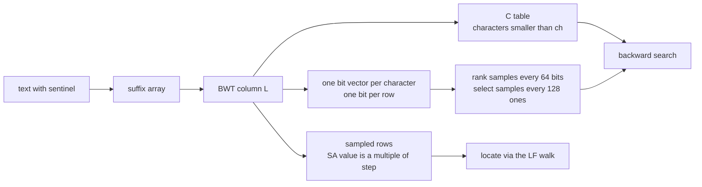
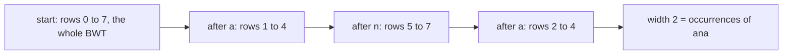
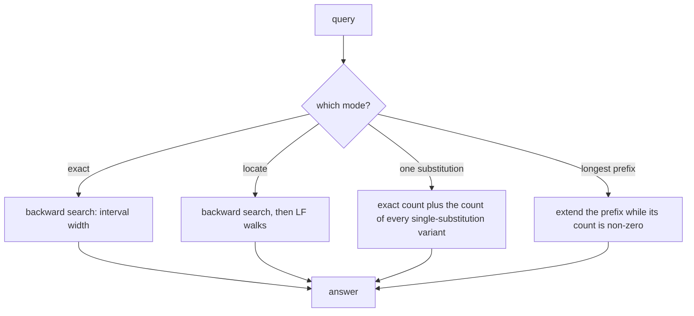
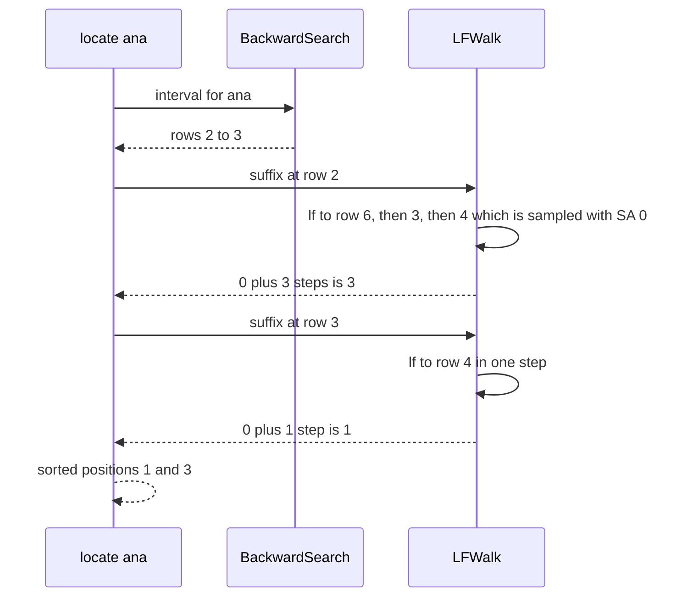

# 605 — Implement FM-index full search with rank/select structures

> **Tier:** Expert · **CTCI chapter:** Beyond — Advanced Data Structures & Algorithms
> **Task spec:** [605-implement-fm-index-full-search-with-rank-select-structures.md](../../../tasks/expert/605-implement-fm-index-full-search-with-rank-select-structures.md)
> **Solutions:** [Python](../../../solutions/python/expert/605-implement-fm-index-full-search-with-rank-select-structures/solution.py) ·
> [Java](../../../solutions/java/expert/605-implement-fm-index-full-search-with-rank-select-structures/Solution.java) ·
> [JavaScript](../../../solutions/javascript/expert/605-implement-fm-index-full-search-with-rank-select-structures/solution.js) ·
> [C#](../../../solutions/csharp/expert/605-implement-fm-index-full-search-with-rank-select-structures/Solution.cs)

## 1. Problem restatement

Build the **FM-index** of a text — the Burrows-Wheeler transform plus the two tables that make it
searchable *without* a suffix array — and implement the three search modes that the task calls the
"full search":

| Query | Answer |
| --- | --- |
| `occ(ch, i)` | occurrences of the character `ch` in the first `i` characters of the BWT (a `rank1`) |
| `lf(row)` | the row of the suffix one position to the left: `C[L[row]] + occ(L[row], row)` |
| `interval(pattern)` / `count(pattern)` | the row interval of the suffixes starting with the pattern, and its width |
| `locate(pattern)` | the sorted text positions, walking `lf` from every row of the interval to a sampled row |
| `count_approximate(pattern)` | exact occurrences plus occurrences with **at most one substitution** |
| `longest_prefix_match(pattern)` | length of the longest prefix of the query that occurs in the text |
| `decode()` | the text recovered from the BWT alone |
| `select(row, k)` | position of the `(k+1)`-th occurrence of the BWT character at `row` (a `select1`) |

Input: a text. The text is stored as `text + SENTINEL`, so the BWT is well defined and the LF mapping
is a single cycle. The empty pattern is deliberately *not* searched (`count` 0, `locate` empty), and the
sentinel is excluded from the substitution alphabet — a variant containing it would match a window
running past the end of the text, which is not an occurrence.

Concrete expected results from the checks:

- `"banana"` → `bwt == "annb\x00aa"`, `c_table == {"\x00": 0, "a": 1, "b": 4, "n": 5}`,
  `decode() == "\x00banana"`, `count("ana") == 2` with `locate("ana") == [1, 3]`,
  `count("na") == 2` with `locate("na") == [2, 4]`, `count("a") == 3` with `locate("a") == [1, 3, 5]`,
  `count("banana") == 1` with `locate("banana") == [0]`.
- `"banana"` → `count("bananas") == 0`, `count("z") == 0`, `count("") == 0`, `locate("") == []`,
  `count_approximate("anana") == 1`, `longest_prefix_match("bananas") == 6`,
  `longest_prefix_match("bananax") == 6`, `longest_prefix_match("x") == 0`.
- The `lf` images of all rows are a permutation, and following `lf` from row 0 visits every row and
  returns to 0 after exactly `n` steps.
- Rank/select agree with direct bit counting for every character, every position and every occurrence,
  and `select1` past the last one answers `-1`.
- Rank sample widths `1, 2, 4, 8` give **identical** answers (only the speed changes), and a
  12000-character LCG text with `step = 13` passes the sampled-window checks for all three search
  modes.

## 2. Intuition

Sorting the suffixes of `text + SENTINEL` gives the suffix array `SA`; the BWT is the character just
before each suffix, `L[row] = s[SA[row] - 1]`, and the first column `F` is `L` sorted. Two facts make
the pair searchable:

1. **`C` and `occ` turn a character into a row range.** `C[ch]` counts the characters smaller than
   `ch`, so the rows starting with `ch` are `[C[ch], C[ch] + count(ch))`, and `occ(ch, i)` counts the
   occurrences of `ch` in `L[0..i)`.
2. **Extending a pattern to the left is one formula.** If `[lo, hi)` are the rows of the suffixes
   starting with `P`, then the rows starting with `cP` are
   `[C[c] + occ(c, lo), C[c] + occ(c, hi))`. Starting from the full range `[0, n)` and consuming the
   pattern right to left counts the occurrences without ever touching the suffix array.

Locating needs actual text positions, and that is where the compression shows: only the rows whose
suffix start is a multiple of `step` are sampled, and a match row is followed by `lf` until a sampled
row is reached. `lf` moves one position to the left, so the walk is bounded by `step`, and the answer
is `(sampled_value + steps) mod n`.





## 3. Algorithm

1. Append the sentinel, build the suffix array of `s`, and derive `L[row] = s[SA[row] - 1]`
   (wrapping to the sentinel for the first row) and `F = sorted(L)`.
2. Build `C[ch] = #{characters of s smaller than ch}`.
3. Build one bit vector per alphabet character with a 1 at every row whose BWT character it is; the
   vector carries **rank samples** (a cumulative count per sampled block, plus a partial-word
   popcount) and **select samples** (the position of every 128th one, plus a short scan).
4. Mark the rows whose `SA` value is a multiple of `step` and store those values in row order.
5. `count(pattern)`: start from `[0, n)` and apply the backward-search formula right to left; the width
   is the answer and an empty interval means "no match".
6. `locate(pattern)`: for every row of the interval walk `lf` (asserting at most `step` steps) to a
   sampled row and add the step count; drop the sentinel's own position and sort.
7. `count_approximate(pattern)`: the exact count plus, for every position and every other character,
   the exact count of the substituted pattern. Every approximate occurrence has its single mismatch in
   exactly one position, so nothing is counted twice.
8. `longest_prefix_match(pattern)`: extend the prefix while its `count` is non-zero.
9. `decode()`: start at the sentinel's row, walk `lf` `n` times, collect `F[row]` and reverse.

```text
procedure build(text, step)
    s ← text + SENTINEL
    sa ← suffix array of s
    bwt(row) ← s[sa(row) - 1] with wraparound
    first ← sorted characters of bwt
    for ch in alphabet of s do
        C(ch) ← number of characters of s smaller than ch
        vector(ch) ← bit vector of (bwt(row) = ch) over all rows, with rank and select samples
    marked(row) ← sa(row) mod step = 0
    sampledValues ← sa(row) for every marked row, in row order

function occ(ch, i)
    return rank1(vector(ch), i)

function lf(row)
    ch ← bwt(row)
    return C(ch) + occ(ch, row)

function interval(pattern)
    lo ← 0
    hi ← n
    for ch in pattern read right to left do
        if ch is not in C then return an empty interval
        lo ← C(ch) + occ(ch, lo)
        hi ← C(ch) + occ(ch, hi)
        if lo >= hi then return an empty interval
    return (lo, hi)

function suffix_at(row)
    steps ← 0
    while row is not marked do
        row ← lf(row)
        steps ← steps + 1
        if steps > step then fail, the sampling bound is broken
    return (sampledValue(row) + steps) mod n

function count(pattern)
    if pattern is empty then return 0
    (lo, hi) ← interval(pattern)
    return hi - lo

function locate(pattern)
    (lo, hi) ← interval(pattern)
    positions ← (suffix_at(row) for row in lo .. hi - 1)
    return sorted(position for position in positions if position < n - 1)

function count_approximate(pattern)
    total ← count(pattern)
    for index from 0 to length(pattern) - 1 do
        for ch in substitution alphabet, ch different from pattern(index) do
            total ← total + count(pattern[0 .. index - 1] + ch + pattern[index + 1 ..])
    return total

function decode
    row ← 0
    output ← empty
    repeat n times do
        row ← lf(row)
        output ← output + first(row)
    return reverse(output)
```



## 4. Worked example

`text = "banana"`, `s = "banana$"` with `n = 7`. The rows of the BWT (`L`), the first column (`F`) and
the suffix of each row:

| row | suffix | `L` (BWT) | `F` |
| --- | --- | --- | --- |
| 0 | `$` | `a` | `$` |
| 1 | `a$` | `n` | `a` |
| 2 | `ana$` | `n` | `a` |
| 3 | `anana$` | `b` | `a` |
| 4 | `banana$` | `$` | `b` |
| 5 | `na$` | `a` | `n` |
| 6 | `nana$` | `a` | `n` |

So `L = "annb$aa"` and `C = {$: 0, a: 1, b: 4, n: 5}`, and the per-character bit vectors are
`$: 0000100`, `a: 1000011`, `b: 0001000`, `n: 0110000` (row 0 first).

Backward search for `ana` (`occ(ch, i)` counts ones before row `i`):

| Step | character consumed | `lo` | `hi` | interval | reasoning |
| --- | --- | --- | --- | --- | --- |
| start | — | 0 | 7 | `[0, 7)` | the whole BWT |
| 1 | `a` (last) | `1 + occ(a, 0) = 1` | `1 + occ(a, 7) = 4` | `[1, 4)` | rows of suffixes starting with `a` |
| 2 | `n` | `5 + occ(n, 1) = 5` | `5 + occ(n, 4) = 7` | `[5, 7)` | `L[0..4)` holds two `n` |
| 3 | `a` | `1 + occ(a, 5) = 2` | `1 + occ(a, 7) = 4` | `[2, 4)` | width 2 = occurrences |

`locate("ana")` then walks `lf` from rows 2 and 3 (with `step = 8`, the only sampled row is row 4,
whose `SA` value is 0):

| Start row | Walk | Steps | `suffix_at` |
| --- | --- | --- | --- |
| 2 | `lf(2) = 5 + occ(n, 2) = 6` → `lf(6) = 1 + occ(a, 6) = 3` → `lf(3) = 4 + occ(b, 3) = 4` (sampled) | 3 | `(0 + 3) mod 7 = 3` |
| 3 | `lf(3) = 4` (sampled) | 1 | `(0 + 1) mod 7 = 1` |

Sorted: `[1, 3]`, matching `locate("ana") == [1, 3]`. For `"na"` the interval is `[5, 7)` and the walks
need 4 and 2 steps, still below `step = 8`.

`decode()` — walking `lf` from row 0 and reading `F`, then reversing:

| iteration | row after `lf` | `F[row]` |
| --- | --- | --- |
| 1 | 1 | `a` |
| 2 | 5 | `n` |
| 3 | 2 | `a` |
| 4 | 6 | `n` |
| 5 | 3 | `a` |
| 6 | 4 | `b` |
| 7 | 0 | `$` |

The collected string is `ananab$`; reversed it is `$banana`, so the BWT alone reconstructs the text
with the sentinel in front — which is what the check `decode() == "\x00banana"` verifies.



## 5. Complexity

Let `n` be the text length plus sentinel, `m` a pattern length, `sigma` the alphabet size, `occ` the
number of occurrences and `step` the sampling factor.

| Operation | Best | Average | Worst | Why the bound holds |
| --- | --- | --- | --- | --- |
| Build | O(n log² n) | O(n log² n) | O(n log² n) | one suffix-array construction (prefix doubling here, documented as orthogonal to the index), then one pass per character to build its bit vector |
| `occ(ch, i)` / `rank1` | O(1) | O(1) | O(words between samples) | one rank sample plus a bounded partial-word popcount (the sample width is a build parameter) |
| `select1(k)` | O(1) | O(128) | O(index between samples) | the sampled position plus a short scan to the `k`-th one |
| `count(pattern)` | O(m) | O(m) | O(m · (log n + step)) | one `occ` per character; an `occ` is a rank query, and the sample width trades memory for popcount work |
| `locate(pattern)` | O(occ) | O(occ · step) | O(occ · step + occ log occ) | one LF walk per row, each bounded by `step` because `lf` decrements the text position |
| `count_approximate(pattern)` | O(m · sigma) | O(m · sigma · m) | O(m²· sigma) `occ` queries | one exact count plus `m · (sigma - 1)` substituted patterns, each counted by a backward search |
| `longest_prefix_match(pattern)` | O(1) | O(m²) | O(m²) | prefix lengths are tested with `count` until the first failure |
| `decode()` | O(n) | O(n) | O(n) | n LF steps, one character read each |
| Space | O(n · sigma / 64) words | same | same | one bit per row per character plus O(n / 64) rank samples and O(n / 128) select samples, and one sampled `SA` value per `step` rows |

| Representation | Count | Locate | Space |
| --- | --- | --- | --- |
| Suffix array + binary search | O(m log n) | O(occ log n) | O(n) words |
| Suffix tree | O(m) | O(occ) | O(n) nodes with pointers |
| FM-index (this task) | O(m) `occ` queries | O(occ · step) LF walks | BWT bytes plus rank/select samples |
| FM-index with a wavelet tree over the BWT | O(m · log sigma) | same LF walks | smaller alphabet-independent rank structure |

## 6. Pitfalls and edge cases

- **The sentinel must be unique and smaller than everything**, otherwise `lf` is not a single cycle and
  `decode` breaks. The checks assert that the `lf` images form a permutation and that row 0 returns to
  itself after exactly `n` steps.
- **`locate` must drop the sentinel's own row.** The sentinel's suffix start is `n - 1`; the
  implementation filters positions `< n - 1`, so the empty and full-text queries stay correct.
- **The empty pattern answers 0 / no positions**, a pattern longer than the text answers 0, and a
  character outside the alphabet answers 0 without an exception.
- **The substitution alphabet excludes the sentinel.** A variant of the pattern containing the
  sentinel would match a window running past the end of the text, so it is not an occurrence; the
  approximate count would be too large if it were included.
- **`select1` out of range returns `-1`**, and the checks exercise both `total` ones and `-1` as `k`.
- **Different rank sample widths must not change any answer** — `1, 2, 4, 8` are compared for every
  pattern and every `occ` position on `mississippi`.
- **Degenerate texts.** `""`, `"a"`, `"aaaa"`, `"ababababab"` (highly periodic) and a unary text are in
  the checks; the walk bound and the backward search both behave there.
- **Documented simplifications.** The suffix array behind the BWT comes from prefix doubling; the Java
  and JavaScript ranks are a checkpoint directory (512-bit superblocks / 128-bit checkpoints) plus word
  popcounts while the C# rank is cumulative per-symbol counts over 64-symbol blocks plus a bounded
  inner scan; the C# select keeps explicit per-symbol position lists (linear memory, O(1) lookup)
  instead of a sampled bitmap, and its locate walks **psi** (forward, one position to the right)
  instead of `lf`. All four keep the real FM-index query interface.

## 7. Variants and follow-ups

- The BWT alone, built as its own task →
  [409 — Burrows-Wheeler transform and inverse](../../../tasks/advanced/409-implement-burrows-wheeler-transform-and-inverse.md).
- A locate strategy with more samples and fewer walks, described end to end →
  [608 — BWT-based full-text index with fast locate](../../../tasks/expert/608-implement-bwt-based-full-text-index-with-fast-locate.md).
- The psi-based sibling of this index, which is the same navigation seen from the other side →
  [604 — compressed suffix array (CSA)](../../../tasks/expert/604-implement-compressed-suffix-array-csa-advanced.md).
- Rank/select as a research subject of its own (RRR bit vectors) →
  [609 — advanced compressed bitvectors (RRR) and rank/select](../../../tasks/expert/609-implement-advanced-compressed-bitvectors-rrr-and-rank-select.md).
- Rank/select over an integer alphabet instead of bits →
  [606 — wavelet matrix for a large alphabet](../../../tasks/expert/606-implement-wavelet-matrix-for-large-alphabet-rank-select.md).

## 8. Check yourself

<details><summary>Show answer</summary>
**Why is the backward-search interval always contiguous?** Because the rows of the BWT are the suffixes
in sorted order. The suffixes starting with `cP` are exactly those suffixes starting with `P` whose
preceding character is `c`, and prepending a fixed character preserves the lexicographic order, so the
surviving rows form one interval.
</details>

<details><summary>Show answer</summary>
**Why does `lf` recover a text position?** `LF(row) = C[L[row]] + occ(L[row], row)` maps the row of a
suffix to the row of the suffix that starts one position earlier, because the row of `cP` is the
`occ`-th row starting with `c`. So each step decrements the suffix start, and after `steps` steps the
answer is `(sampled_value + steps) mod n`.
</details>

<details><summary>Show answer</summary>
**Why is `count_approximate` not double counting?** Every occurrence that differs from the pattern in
at most one position differs in exactly one *specific* position `i` (or in none). The exact count
covers "none", and the count of the pattern with position `i` replaced by `ch` covers exactly the
occurrences whose single mismatch is at `i`. The sets are disjoint by construction.
</details>

<details><summary>Show answer</summary>
**What does `decode` prove?** That the BWT carries the whole text: starting at the sentinel's row,
`n` applications of `lf` visit the rows of the suffixes in decreasing text position, so reading the
first column and reversing spells the text with its sentinel — checked as
`decode() == SENTINEL + text`.
</details>

<details><summary>Show answer</summary>
**Why do the rank sample widths not change the answers?** The samples only shorten the *work* of
`rank1`; the count itself is still "ones in `[0, i)`". For `mississippi` the checks compare the
answers of widths `1, 2, 4, 8` for every pattern, every `locate` and every `occ` position.
</details>
