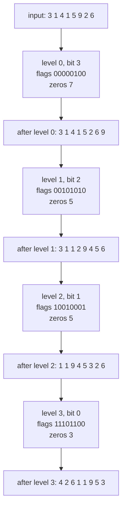
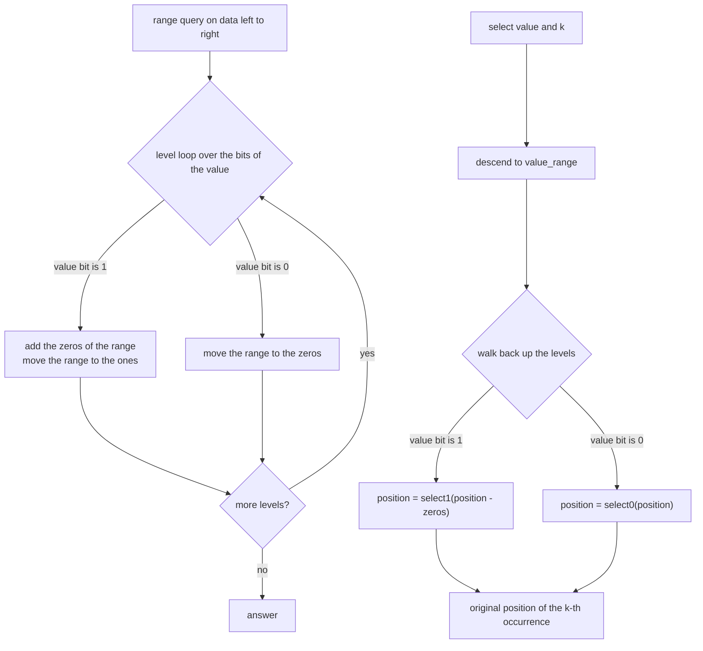
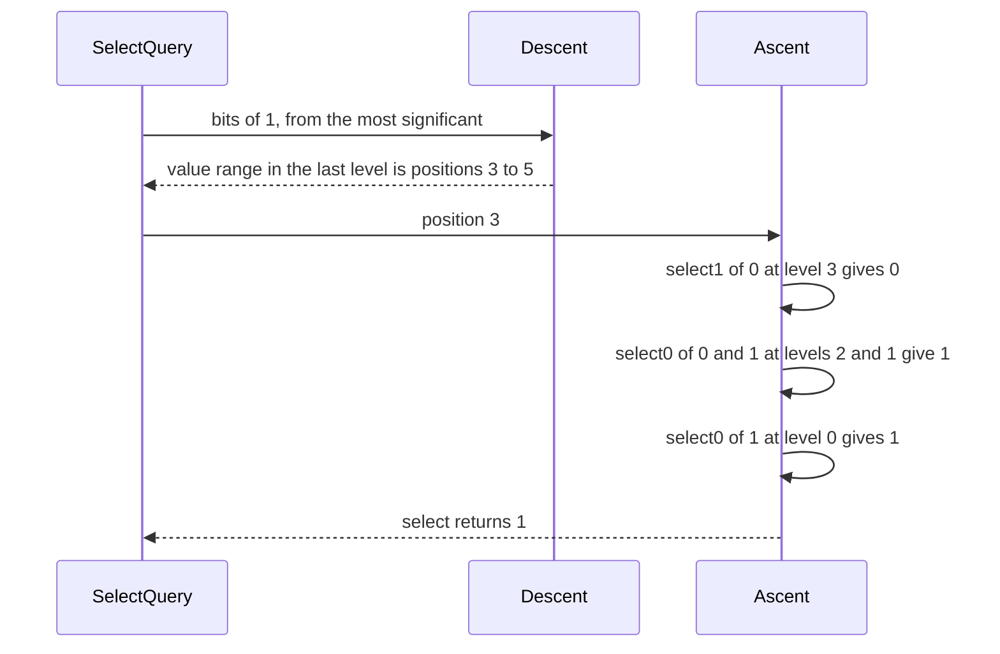

# 606 — Implement wavelet matrix for large alphabet rank/select

> **Tier:** Expert · **CTCI chapter:** Beyond — Advanced Data Structures & Algorithms
> **Task spec:** [606-implement-wavelet-matrix-for-large-alphabet-rank-select.md](../../../tasks/expert/606-implement-wavelet-matrix-for-large-alphabet-rank-select.md)
> **Solutions:** [Python](../../../solutions/python/expert/606-implement-wavelet-matrix-for-large-alphabet-rank-select/solution.py) ·
> [Java](../../../solutions/java/expert/606-implement-wavelet-matrix-for-large-alphabet-rank-select/Solution.java) ·
> [JavaScript](../../../solutions/javascript/expert/606-implement-wavelet-matrix-for-large-alphabet-rank-select/solution.js) ·
> [C#](../../../solutions/csharp/expert/606-implement-wavelet-matrix-for-large-alphabet-rank-select/Solution.cs)

## 1. Problem restatement

Store an array of non-negative integers in a **wavelet matrix** — one bit vector per bit of the value
range, most significant bit first — and answer rank/select queries on it:

| Query | Answer |
| --- | --- |
| `access(i)` | the value stored at position `i` |
| `rank(value, i)` | occurrences of `value` in `data[0..i)` |
| `count_less_than(l, r, x)` | positions in `[l, r)` holding a value smaller than `x` |
| `range_count(l, r, low, high)` | positions in `[l, r)` holding a value in `[low, high)` |
| `quantile(l, r, k)` | the `k`-th smallest value of `data[l..r)` (0-based, out of range raises) |
| `select(value, k)` | position of the `k`-th occurrence of `value`, `-1` if there is none |
| `value_range(value)` | the contiguous position range of `value` in the last level |
| `stored_bits()` | the measured size: `bits` levels of `n` bits plus the rank samples |

Input: an array of non-negative integers and a bit width (derived from the maximum when omitted).
Output: the structure above. Nothing in the layout depends on the number of *distinct* symbols — `2^20`
values cost 20 levels — which is what makes it usable with a large alphabet.

Concrete expected results from the checks (`data = [3, 1, 4, 1, 5, 9, 2, 6]`, `bits = 4`):

- `access(i)` reproduces the array for every `i`; `rank(1, 8) == 2`, `rank(1, 2) == 1`,
  `rank(0, 8) == 0`, `rank(4, 8) == 1`, `rank(9, 8) == 1`.
- `range_count(0, 8, 2, 6) == 4`, `range_count(0, 8, 0, 100) == 8`, `range_count(0, 8, 4, 4) == 0`.
- `quantile(0, 8, 0) == 1`, `quantile(0, 8, 7) == 9`, and all eight quantiles sorted equal the sorted
  array; `quantile(0, 3, 3)` raises `IndexError`.
- `select(1, 0) == 1`, `select(1, 1) == 3`, `select(9, 0) == 5`, `select(9, 1) == -1`,
  `select(7, 0) == -1` (absent value), `select(3, -1) == -1`.
- `rank(value, select(value, k) + 1) == k + 1` and `access(select(value, k)) == value` for every
  occurrence; `value_range(value)` has width `data.count(value)` and `value_range(0) == (0, 0)`.
- 4096 values of 20 bits: `bits == 20`, `stored_bits() ≤ 64 · 4096`; the code points of a
  2000-character string (ASCII plus `é`, `€`, `中` and an emoji) use `bits == max(codes).bit_length()`.

## 2. Intuition

A wavelet tree splits the value range in half and recurses, so a query walks down one path of
`log sigma` nodes with a bit vector per node — but the *nodes* are the problem: with a large alphabet
the tree has many nodes even for a small input. The **wavelet matrix** removes the tree: it keeps one
bit vector per *bit* of the alphabet and stores the elements level by level, each level **stably
partitioned** into the elements whose bit is 0 (front) and whose bit is 1 (back).



Only the bit vectors, one integer per level (`zeros[level]`, where the one-block starts) and the
rank/select samples are stored; the position mapping is a single subtraction (bit 0 → `rank0`, bit 1 →
`zeros[level] + rank1`). Every operation is a descent, except `select`, which is a descent followed by
an ascent:

- **`access`** follows the bits of its position down all levels.
- **`count_less_than`** walks down and, at every level where the query value has a 1, adds all zeros of
  the current range (they are all smaller) before moving to the ones. `rank` and `range_count` are
  differences of two such walks, and `quantile` is the same descent with a rank `k` instead of a value.
- **`select`** descends to the range that holds the value in the *last* level, then walks **back up**
  with `select0`/`select1`, undoing the stable partitions level by level until the position in the
  original array is reached.

The last level's order is not accidental: the elements end up ordered by the **bit-reversed** code,
which the checks confirm (for the worked example the final order is `4 2 6 1 1 9 5 3`, i.e. the
4-bit codes in the order `0010, 0100, 0110, 1000, 1000, 1001, 1010, 1100`).

## 3. Algorithm

1. Determine `bits` (the given width, or the bit length of the maximum value, at least 1).
2. For `level` from the most significant bit down: record the bit of every current element in a bit
   vector, count the zeros, and rebuild the sequence as `zeros followed by ones` (stable).
3. Store only the bit vectors, the per-level zero counts and the rank/select samples.
4. `access(i)`: start at `position = i`, `value = 0`; for each level read the bit, append it to the
   value, and move the position to the zeros side (subtract `rank1`) or the ones side (add
   `zeros + rank1`).
5. `count_less_than(l, r, x)`: for each level, if the level's bit of `x` is 1, add the zeros of the
   current range and move to the ones side; otherwise move to the zeros side.
6. `rank(value, i) = count_less_than(0, i, value + 1) - count_less_than(0, i, value)` and
   `range_count(l, r, low, high) = count_less_than(l, r, high) - count_less_than(l, r, low)`.
7. `quantile(l, r, k)`: compare `k` with the zeros of the range at each level; take the zeros side if
   `k` is smaller, otherwise subtract them, set the level's bit and take the ones side.
8. `select(value, k)`: descend with the value's bits to get `value_range(value)`, take
   `position = left + k`, then walk the levels upwards applying `select1(position - zeros)` for a 1 bit
   and `select0(position)` for a 0 bit.

```text
procedure build(data, bits)
    n ← length(data)
    if bits is unspecified then bits ← max(1, bit length of the maximum of data)
    current ← data
    for level from bits - 1 down to 0 do
        flags(position) ← bit `level` of current(position) for every position
        levels ← levels + bit vector of flags with rank and select samples
        zeros ← zeros + (n - number of ones in flags)
        current ← (values of current whose bit is 0, in order)
                + (values of current whose bit is 1, in order)

function access(i)
    position ← i
    value ← 0
    for level from 0 to bits - 1 do
        bit ← levels(level) bit at position
        value ← (value shifted left by one) or bit
        if bit = 1 then
            position ← zeros(level) + rank1(levels(level), position)
        else
            position ← position - rank1(levels(level), position)
    return value

function count_less_than(left, right, value)
    if value <= 0 or left >= right then return 0
    if value >= 2 to the power bits then return right - left
    count ← 0
    for level from 0 to bits - 1 do
        onesLeft ← rank1(levels(level), left)
        onesRight ← rank1(levels(level), right)
        zerosLeft ← left - onesLeft
        zerosRight ← right - onesRight
        if bit (bits - 1 - level) of value is 1 then
            count ← count + zerosRight - zerosLeft
            left ← zeros(level) + onesLeft
            right ← zeros(level) + onesRight
        else
            left ← zerosLeft
            right ← zerosRight
    return count

function quantile(left, right, k)
    if k < 0 or k >= right - left then raise an error
    value ← 0
    for level from 0 to bits - 1 do
        onesLeft ← rank1(levels(level), left)
        onesRight ← rank1(levels(level), right)
        zerosLeft ← left - onesLeft
        zerosRight ← right - onesRight
        if k < zerosRight - zerosLeft then
            value ← value shifted left by one
            left ← zerosLeft
            right ← zerosRight
        else
            k ← k - (zerosRight - zerosLeft)
            value ← (value shifted left by one) or 1
            left ← zeros(level) + onesLeft
            right ← zeros(level) + onesRight
    return value

function select(value, k)
    if k < 0 or value outside [0, 2 to the power bits) then return -1
    (left, right) ← value_range(value)
    if k >= right - left then return -1
    position ← left + k
    for level from bits - 1 down to 0 do
        if bit (bits - 1 - level) of value is 1 then
            position ← select1(levels(level), position - zeros(level))
        else
            position ← select0(levels(level), position)
    return position
```



## 4. Worked example

`data = [3, 1, 4, 1, 5, 9, 2, 6]`, `bits = 4`. The four levels the build produces, with the flags in
the order of each level's input and the sequence that level leaves behind:

| Level | bit | flags | zeros | sequence after the level |
| --- | --- | --- | --- | --- |
| 0 | 3 | `00000100` | 7 | `3 1 4 1 5 2 6 9` |
| 1 | 2 | `00101010` | 5 | `3 1 1 2 9 4 5 6` |
| 2 | 1 | `10010001` | 5 | `1 1 9 4 5 3 2 6` |
| 3 | 0 | `11101100` | 3 | `4 2 6 1 1 9 5 3` |

`access(6)`, which must return `6` (`0110`):

| Level | bit at the position | position mapping | value so far |
| --- | --- | --- | --- |
| 0 | `flags[6] = 0` | `6 - rank1(6) = 6 - 0 = 6` | `0` |
| 1 | `flags[6] = 1` | `5 + rank1(6) = 5 + 2 = 7` | `1` |
| 2 | `flags[7] = 1` | `5 + rank1(7) = 5 + 2 = 7` | `3` |
| 3 | `flags[7] = 0` | `7 - rank1(7) = 7 - 5 = 2` | `6` |

`select(1, 0) == 1` is the ascent. The descent with the bits of `1` (`0001`) gives
`value_range(1) = (3, 5)` — the value `1` occupies positions 3 and 4 of the last level, and
`data.count(1) == 2` — so `position = 3 + 0 = 3`, and then:

| Level | value bit | operation | position |
| --- | --- | --- | --- |
| 3 | 1 | `select1(3 - zeros[3]) = select1(0)` on `11101100` → 0 | 0 |
| 2 | 0 | `select0(0)` on `10010001` → 1 | 1 |
| 1 | 0 | `select0(1)` on `00101010` → 1 | 1 |
| 0 | 0 | `select0(1)` on `00000100` → 1 | 1 |

So `select(1, 0) = 1`, the first `1` in `data`; the check `rank(value, select(value, k) + 1) == k + 1`
confirms the same round trip for every occurrence.

Other queries on the same levels:

| Query | Trace | Answer |
| --- | --- | --- |
| `rank(1, 8)` | `count_less_than(0, 8, 2) - count_less_than(0, 8, 1) = 2 - 0` | `2` |
| `range_count(0, 8, 2, 6)` | `count_less_than(0, 8, 6) - count_less_than(0, 8, 2) = 6 - 2` | `4` (values `3, 4, 5, 2`) |
| `quantile(0, 8, 0)` | zeros survive at every level until the last, where `k = 0` goes to the ones side | `1` |
| `quantile(0, 8, 7)` | seven zeros consumed before the last level pushes into the ones | `9` |
| `select(9, 1)` | `value_range(9) = (5, 6)` has width 1, so `k = 1` is out of range | `-1` |



Storage for the 4096-value 20-bit array: `stored_bits() = 20 · (4096 + 32 · 64) = 122880` bits, i.e. 30
bits per value, and the check bounds the structure by `64 · n` bits — the whole point of using a
matrix instead of a pointer-based tree when the alphabet is wide.

## 5. Complexity

Let `n` be the array length, `bits` the bit width of the alphabet and `sigma = 2^bits`.

| Operation | Best | Average | Worst | Why the bound holds |
| --- | --- | --- | --- | --- |
| Build | O(n · bits) | O(n · bits) | O(n · bits) | one stable partition of `n` elements per level |
| `access(i)` | O(bits) | O(bits) | O(bits) | one rank1 and one position update per level |
| `rank(value, i)` | O(bits) | O(bits) | O(bits) | two `count_less_than` descents, a constant number of rank1 calls per level |
| `count_less_than(l, r, x)` | O(bits) | O(bits) | O(bits) | one rank1 pair and one branch per level; an `x` outside the value range is O(1) |
| `range_count(l, r, low, high)` | O(bits) | O(bits) | O(bits) | the difference of two descents |
| `quantile(l, r, k)` | O(bits) | O(bits) | O(bits) | one descent that takes the zeros side or subtracts the zero count |
| `value_range(value)` | O(bits) | O(bits) | O(bits) | one descent with the value's bits |
| `select(value, k)` | O(bits) | O(bits · 64) | O(bits · 128) | the descent plus one `select1`/`select0` per level upwards; `select1` is a sample plus a scan of at most 128 ones, `select0` a binary search over `rank1` |
| Space | `bits · n` bits + samples | same | same | one bit per element per level, plus one rank sample per 64-bit word of every level and one select sample per 128 ones |

| Structure | `rank` | `select` | Space for `sigma = 2^20` |
| --- | --- | --- | --- |
| Pointer wavelet tree | O(bits) node jumps | O(bits) | one node per value; pointers and per-node arrays dominate |
| Wavelet matrix (this task) | O(bits) rank1 | O(bits) `select0`/`select1` | `bits · n` bits plus rank samples |

## 6. Pitfalls and edge cases

- **`bits` must be at least 1** even for an all-zero array, otherwise there is no level to descend and
  `access` returns a wrong answer.
- **A value outside `[0, 2^bits)`** is rejected: `select` answers `-1`, `count_less_than` clamps
  (`0` for a non-positive `x`, `right - left` above the range), and the JavaScript constructor throws
  when a value does not fit the requested width.
- **Empty ranges.** `l = r`, `low >= high` and `a = b` answer `0`, and `quantile` with `k` outside
  `[0, r - l)` raises (`IndexError` in Python); the checks include
  `WaveletMatrix([]).range_count(0, 0, 0, 5) == 0` and `quantile(0, 3, 3)` on the hand array.
- **`select` on an absent value** gives an empty `value_range`, hence `-1`; a negative `k` also gives
  `-1`. Both are checked, together with `select(value, count)` one past the last occurrence.
- **Zeros counts belong to the level, not to the array.** `zeros[level]` counts the zeros of that
  level's input; using the array-wide zero count produces positions that only work for level 0.
- **The last level's order is bit-reversed, not sorted.** Do not read answers off it; use `quantile`.
- **Degenerate shapes** in the checks: the empty array, a single element, a constant array (`[7] * 5`),
  a strictly increasing array, values at `0` and at `2^bits - 1`, `l = r`, the whole range, and
  `bits = 20` for 4096 random values.
- **Unicode code points** work through the same width rule: for a 2000-character string mixing ASCII
  with `é`, `€`, `中` and an emoji, `bits` is the bit length of the largest code point, and the checks
  compare `quantile(0, 2000, 1000)` with the sorted codes.
- **Documented simplifications.** Python implements `select0` as a binary search over `rank1` (zeros
  are not sampled); Java, JS and C# document the same choice as a "binary search over the monotone
  prefix rank" instead of the classic packed select samplers, with `long`/32-bit words and per-word
  checkpoints (JS every 256 bits, C# every word), and JS also exposes `rangeMin`/`rangeMax`.

## 7. Variants and follow-ups

- Compressed bit vectors with the same rank/select interface but a smaller footprint →
  [609 — advanced compressed bitvectors (RRR) and rank/select](../../../tasks/expert/609-implement-advanced-compressed-bitvectors-rrr-and-rank-select.md).
- Rank/select over a BWT instead of an integer array, i.e. the FM-index core →
  [605 — FM-index with rank/select](../../../tasks/expert/605-implement-fm-index-full-search-with-rank-select-structures.md)
  and [608 — BWT-based full-text index with fast locate](../../../tasks/expert/608-implement-bwt-based-full-text-index-with-fast-locate.md).
- Rank/select over balanced parentheses, where the same descent idea counts subtree sizes →
  [610 — succinct tree representations (DFUDS)](../../../tasks/expert/610-implement-succinct-tree-representations-dfuds-and-navigation-ops.md).
- Swapping the packable rank structure under a compressed suffix array →
  [604 — compressed suffix array (CSA)](../../../tasks/expert/604-implement-compressed-suffix-array-csa-advanced.md).

## 8. Check yourself

<details><summary>Show answer</summary>
**Why is a wavelet matrix smaller than a pointer wavelet tree for a large alphabet?** The matrix stores
exactly one bit vector per *bit* of the alphabet, so the alphabet size only decides the number of
levels (`bits`), never the number of nodes. A pointer wavelet tree needs a node per distinct value or
per range, with pointers and per-node arrays on top of the bits.
</details>

<details><summary>Show answer</summary>
**Why does `count_less_than` add the zeros when the query value has a 1 at a level?** At that level the
elements on the zeros side have bit 0 where the query value has bit 1, so every one of them is smaller
regardless of the remaining bits; the elements on the ones side still have to be compared on the lower
levels, so the range continues there.
</details>

<details><summary>Show answer</summary>
**Why does `select` walk *up* the levels instead of down?** `value_range` gives the positions of the
value in the last level, where all bits have been consumed. To undo one stable partition you need
`select1`/`select0` of the corresponding bit vector, and because the value's bits are known, applying
them from the last level back to the first lands on the position in the original array.
</details>

<details><summary>Show answer</summary>
**How do you get `range_count` from `count_less_than`?** Count the values below `high` and subtract the
values below `low`: the difference is exactly the number of values in `[low, high)`. The checks use
this for the hand array (`4`), for the whole range with an oversized bound (`8`) and for an empty
interval (`0`).
</details>

<details><summary>Show answer</summary>
**Why are zeros not sampled for `select0`?** Sampled select positions cost space per one; the
implementation instead binary searches the monotone function `rank0(i) = i - rank1(i)` using the rank
samples it already keeps. That trades a small logarithmic factor for a much smaller index, which is
the documented simplification of the Java/JS/C# files as well.
</details>
