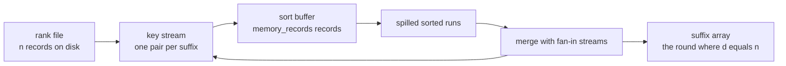
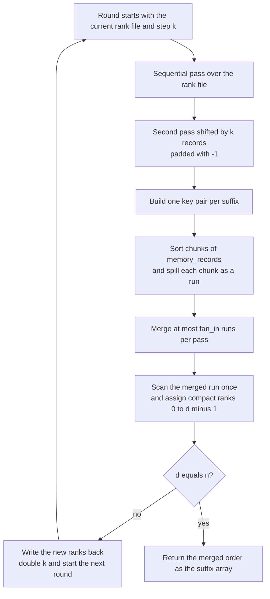
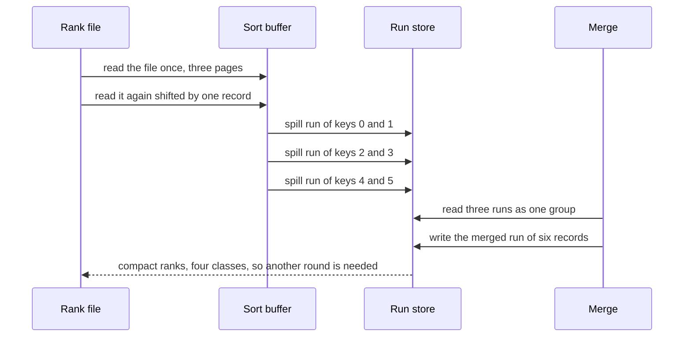

# 607 — Implement external-memory suffix array construction (disk-based)

> **Tier:** Expert · **CTCI chapter:** Beyond — Advanced Data Structures & Algorithms
> **Task spec:** [607-implement-external-memory-suffix-array-construction-disk-based.md](../../../tasks/expert/607-implement-external-memory-suffix-array-construction-disk-based.md)
> **Solutions:** [Python](../../../solutions/python/expert/607-implement-external-memory-suffix-array-construction-disk-based/solution.py) ·
> [Java](../../../solutions/java/expert/607-implement-external-memory-suffix-array-construction-disk-based/Solution.java) ·
> [JavaScript](../../../solutions/javascript/expert/607-implement-external-memory-suffix-array-construction-disk-based/solution.js) ·
> [C#](../../../solutions/csharp/expert/607-implement-external-memory-suffix-array-construction-disk-based/Solution.cs)

## 1. Problem restatement

Build the **suffix array** of a text that does not fit in memory, using sequential passes over
page-counted files instead of random access to the whole text. The four solutions expose

```text
external_suffix_array(text, memory_records, fan_in, page_size) -> (suffix_array, stats)
```

| Parameter | Meaning | Values used by the checks |
| --- | --- | --- |
| `text` | the input string | `""` … 4096 characters |
| `memory_records` | key records that fit in the in-RAM sort buffer | 16, 24, 32, 64, 128, 256 |
| `fan_in` | spilled runs merged per merge pass | 4 |
| `page_size` | records per page, the transfer unit | 16, 32, 128, 256 |

`stats` reports `rounds`, `merge_passes`, `page_reads`, `page_writes`, `initial_runs` and
`distinct` (the number of distinct ranks in the last round).

Concrete results every solution asserts:

| Input | Suffix array | Work with `memory_records = 2`, `fan_in = 4`, `page_size = 2` |
| --- | --- | --- |
| `"abab"` | `[2, 0, 3, 1]` | 2 rounds, 2 spills per round, 2 merge passes |
| `"banana"` | `[5, 3, 1, 0, 4, 2]` | 2 rounds, 3 spills per round, 2 merge passes |
| `"mississippi"` | `[10, 7, 4, 1, 0, 9, 8, 6, 3, 5, 2]` | 3 rounds, 6 spills per round |
| `"aaaa"` | `[3, 2, 1, 0]` | 2 rounds |
| `"abracadabra"` | `[10, 7, 0, 3, 5, 8, 1, 4, 6, 9, 2]` | 3 rounds |
| `""` | `[]` | 0 rounds — texts shorter than 2 characters short-circuit |

The 4096-character LCG text over `abcd` (seed 20260707) with `memory_records = 256`, `fan_in = 4`
and 128-record pages needs **4 doubling rounds, 16 spills per round, 8 merge passes, 640 page reads
and 512 page writes**; the identical text with 256-record pages produces the same suffix array with
**320 page reads**.

Documented simplification: there are no real files. The text, the ranks and every spilled run live in
memory, but they are reached only through `PageStore` / `RunStore`, which count one read per page read
and one write per page written. The *streaming* inside a merge (a real implementation holds one record
per stream) and real seek latency are deliberately not modelled; what is modelled and measured is the
block-by-block access pattern, the bounded sort buffer and the bounded fan-in.

## 2. Intuition

The naive construction is to compare suffixes directly: `O(n)` per comparison and `O(n log n)`
comparisons, on a text that is by assumption larger than RAM — so even reading it once per comparison
is impossible. Prefix doubling replaces the comparison with a *sort*: rank `i` by its first
`2k` characters, then a suffix is identified by the pair `(rank[i], rank[i + k])`, so one sort per
round increases the rank horizon from `k` to `2k` and `O(log n)` rounds suffice. In memory that is
`n` records of two integers plus the text — still `O(n)` RAM for the keys and the text, which is
exactly what the external version must remove.

The key insight is that doubling needs nothing but **sequential scans and sorts**:

1. every round reads the rank file twice — once straight, once shifted by `k` records — which yields
   all keys in a single pass each;
2. the keys are sorted with an **external merge sort**: sort chunks that fit in the buffer, spill each
   sorted chunk as a run, then merge at most `fan_in` runs per pass until one run remains;
3. the merged run is scanned once to assign compact ranks `0..d-1`, and `d == n` means every suffix is
   already distinguished, so the merged run *is* the suffix array.

Nothing is ever random-accessed, and the only memory that grows with the input is the sorted run now
living on the page store.



The feedback edge `MERGE -> KEY` is the doubling loop: the compacted ranks become the next round's
rank file until every rank is unique.

## 3. Algorithm

One round, given the current rank file and the step `k` (starting at `k = 1`):

1. **Sequential pass**: read the rank file front to back (one page read per page).
2. **Shifted pass**: read the rank file again shifted by `k` records, padding with `-1` past the end
   (another page read per page). `-1` is smaller than any real rank, so a suffix that ends early sorts
   first, exactly as the sentinel does in a suffix tree.
3. **Build keys**: `keys[i] = (ranks[i], shifted[i])`.
4. **Spill runs**: sort the keys in RAM in chunks of `memory_records` records and write each sorted
   chunk out as its own run.
5. **Merge**: while more than one run remains, read at most `fan_in` runs, merge them, and write the
   result as one run. The number of passes is `ceil(log_fan_in(number of runs))`.
6. **Compact ranks**: scan the single merged run once; equal keys get equal ranks, and the number of
   distinct keys `d` is reported.
7. If `d == n`, the merged run's index order is the suffix array. Otherwise write the new ranks back
   to the rank file, double `k` and repeat.

```text
procedure external_suffix_array(text, memory_records, fan_in, page_size)
    n ← length(text)
    if n < 2 then
        return list(range(n)), stats with zero rounds        // "" and "a" are already sorted
    rank_file ← page store loaded with the character codes of text
    k ← 1
    loop
        ranks ← sequential pass over rank_file               // n records, one page read per page
        shifted ← pass over rank_file shifted by k records, padded with -1
        keys ← [ (ranks[i], shifted[i]) for i ← 0 to n - 1 ]
        runs ← empty list
        for start ← 0 to n - 1 step memory_records do
            chunk ← sort keys[start .. start + memory_records)
            runs.append(run_store.write(chunk))              // one sorted run per buffer load
        while length(runs) > 1 do                            // bounded fan-in merge
            merged ← empty list
            for group ← consecutive slices of runs of size fan_in do
                if length(group) = 1 then
                    merged.append(group[0])                  // nothing to merge, it just moves on
                else
                    buffers ← [ run_store.read(index) for index in group ]
                    merged.append(run_store.write(merge_sorted(buffers)))
            runs ← merged
        sorted_records ← run_store.read(runs[0])
        new_ranks, d ← compact_ranks(sorted_records)          // scan once, equal keys share a rank
        if d = n then
            return [ index of each record in sorted_records ], stats
        rank_file ← page store loaded with new_ranks
        k ← 2 * k

procedure compact_ranks(sorted_records)
    ranks ← array of n zeros
    previous ← none
    d ← 1
    for position ← 0 to n - 1 do
        key, index ← sorted_records[position]
        if position > 0 and key ≠ previous then
            d ← d + 1
        ranks[index] ← d - 1
        previous ← key
    return ranks, d
```



## 4. Worked example

Text `banana`, `n = 6`, `memory_records = 2`, `fan_in = 4`, `page_size = 2`, so the rank file is
three pages and every round spills three runs.

**Round 1, `k = 1`.** The rank file holds the character codes `[98, 97, 110, 97, 110, 97]` (`b a n a
n a`); the shifted pass returns `[97, 110, 97, 110, 97, -1]`.

| `i` | 0 | 1 | 2 | 3 | 4 | 5 |
| --- | --- | --- | --- | --- | --- | --- |
| `ranks[i]` | 98 | 97 | 110 | 97 | 110 | 97 |
| `shifted[i]` | 97 | 110 | 97 | 110 | 97 | -1 |
| `key` | (98,97) | (97,110) | (110,97) | (97,110) | (110,97) | (97,-1) |

The buffer holds two keys at a time, so the three spilled runs are the sorted chunks `{0,1}` =
`[(97,110),1], [(98,97),0]`, `{2,3}` = `[(97,110),3], [(110,97),2]` and `{4,5}` =
`[(97,-1),5], [(110,97),4]`. Merging the three runs with fan-in 4 is a single pass (one group of three)
and produces the merged run

```text
[(97,-1),5]  [(97,110),1]  [(97,110),3]  [(98,97),0]  [(110,97),2]  [(110,97),4]
```

Compacting it: positions 1 and 3 have the same key `(97,110)`, positions 2 and 4 share `(110,97)`, so
`d = 4 < 6` and the new ranks are `[2, 1, 3, 1, 3, 0]` — suffix 5 gets rank 0, suffix 1 rank 1,
suffix 3 rank 1, suffix 0 rank 2, suffix 2 rank 3, suffix 4 rank 3.

**Round 2, `k = 2`.** The rank file now holds `[2, 1, 3, 1, 3, 0]` and the shifted pass returns
`ranks[i + 2]` = `[3, 1, 3, 0, -1, -1]`.

| `i` | 0 | 1 | 2 | 3 | 4 | 5 |
| --- | --- | --- | --- | --- | --- | --- |
| `key` | (2,3) | (1,1) | (3,3) | (1,0) | (3,-1) | (0,-1) |

The merged run is `[(0,-1),5] [(1,0),3] [(1,1),1] [(2,3),0] [(3,-1),4] [(3,3),2]`, all six keys are
distinct, so `d = 6 = n` and the round's order `[5, 3, 1, 0, 4, 2]` is the suffix array: `a`, `ana`,
`anana`, `banana`, `na`, `nana`.



The pass arithmetic the checks assert directly: `expected_merge_passes(8, 4) = 2`,
`expected_merge_passes(1, 4) = 0` and `expected_merge_passes(17, 4) = 3`, because every pass collapses
`fan_in` runs into one. For the 4096-character text at `memory_records = 256` the round starts with
16 runs, so each of the 4 rounds costs 2 passes — the 8 merge passes reported in the statistics.

The page model is checked with a bare store: 160 records in 16-record pages cost exactly **10 page
reads** for one sequential pass and **20** after two passes, while 32-record pages cover the same file
with **5 reads** — doubling the page size halves the page count without changing the sequence.

## 5. Complexity

Let `n` be the text length, `M = memory_records`, `F = fan_in` and `B = page_size`.

| Operation | Best | Average | Worst | Why the bound holds |
| --- | --- | --- | --- | --- |
| One round's key building | O(n/M) reads | O(n/M) reads | O(n/M) reads | the straight pass and the shifted pass are each one page read per page, so `2n/B` reads |
| One round's sorting | O((n/M) · M log M) | same | same | every buffer load sorts `M` records in RAM and writes one run |
| Merge passes per round | O(1) | `ceil(log_F(ceil(n/M)))` | `ceil(log_F(ceil(n/M)))` | each pass replaces `F` runs by one, and a lone run in a group is passed through unchanged |
| Rounds | O(1) | O(log n) | O(log n) | `k` doubles each round and the loop stops at the latest when `k >= n` |
| Total page transfers | O((n/B) log n) | O((n/B) log n · log_F(n/M)) | same | each round's merge moves every record once per pass |
| RAM | O(M + F) records | O(M + F) | O(M + F) records | one sort buffer of `M` records, one page per merge stream, one output page |
| Final output | O(n) | O(n) | O(n) | the last merged run is read once and its index column is the answer |

The 4096-character measurement is consistent with this: 32 pages of 128 records, 4 rounds, 640 reads
and 512 writes; at 256 records per page the same construction reads 320 pages.

Alternatives for comparison:

| Approach | Time | RAM | Notes |
| --- | --- | --- | --- |
| In-memory prefix doubling (the oracle here) | O(n log² n) with a comparison sort | O(n) records + text | needs the text and two rank arrays resident |
| External prefix doubling (this task) | O((n/B) log n log_F(n/M)) page transfers | O(M + F) records | never random-accesses the text |
| Comparison-based external suffix sort | O(n log n) comparisons of long keys | O(M + F) | each comparison may re-read a long prefix |
| SA-IS / DC3 | O(n) | O(n) | linear, but streaming them externally needs careful bucketing |

## 6. Pitfalls and edge cases

- **`-1` past the end, not `0`.** `shifted` pads with `-1`, which is smaller than every rank including
  rank `0`; padding with `0` would tie a short suffix with a long one and stall the loop.
- **Ranks must be compacted, and the stop condition is `d == n`.** Comparing raw character codes never
  terminates; the loop stops exactly when every suffix has its own rank. The checks assert
  `distinct == n` for every text of length ≥ 2 and `rounds == 0` for `""` and `"a"`.
- **Ties inside a round are broken by the index**, because the record is `(key, index)` and tuples sort
  lexicographically. That is what lets `equal keys keep equal ranks` stay stable between rounds.
- **A smaller buffer is slower, never different.** `memory_records` 16, 24, 32, 64, 128 and 256 all
  return the same suffix array, and the smaller budget needs at least as many merge passes
  (`small_budget <= large_budget` in passes is asserted as `small >= large`).
- **Page size changes I/O only.** 128-record and 256-record pages give the identical array; the
  coarser page is asserted to read fewer pages.
- **A group of one run is passed through**, not re-read and re-written, so a round with exactly
  `fan_in + 1` runs still finishes in two passes.
- **I/O lower bounds.** The checks assert `page_reads >= rounds * 2 * pages` and
  `page_writes >= rounds * pages`, i.e. the two sequential passes and one rank write-back per round
  really happen.
- **Empty and unary texts.** `""` returns `[]`; `"aaaa"` needs 2 rounds because all four keys are equal
  in round one; `"abababab"` and LCG texts over `ab`/`abc` are in the fixed corpus.
- **Validity is judged by an independent oracle.** `compare_suffixes` re-compares suffixes character by
  character and `valid_suffix_array` also checks that the result is a permutation of `0..n-1`; success
  is not defined as "equal to the in-memory doubling".

## 7. Variants and follow-ups

- Keeping the whole text in memory but not the ranks leads back to the classic in-memory structures →
  [601 — full suffix tree with Ukkonen](../../../tasks/expert/601-implement-full-suffix-tree-ukkonen-and-test-with-large-text.md)
  and [604 — compressed suffix array](../../../tasks/expert/604-implement-compressed-suffix-array-csa-advanced.md).
- The classic reason to build a suffix array on disk is to compress it afterwards into an index →
  [605 — FM-index with rank/select](../../../tasks/expert/605-implement-fm-index-full-search-with-rank-select-structures.md)
  and [608 — BWT-based full-text index with fast locate](../../../tasks/expert/608-implement-bwt-based-full-text-index-with-fast-locate.md).
- Larger alphabets make the character ranks wider but do not change the doubling loop →
  [606 — wavelet matrix for large-alphabet rank/select](../../../tasks/expert/606-implement-wavelet-matrix-for-large-alphabet-rank-select.md).

## 8. Check yourself

<details><summary>Show answer</summary>
**Why does one round need exactly two sequential passes over the rank file and not one?** Because a key
needs both `rank[i]` and `rank[i + k]`. The straight pass supplies the first component for every `i`
and the pass shifted by `k` supplies `rank[i + k]` (with `-1` past the end), so two passes cover all
`n` keys without a random access.
</details>

<details><summary>Show answer</summary>
**Why does merging 16 runs with fan-in 4 take 2 passes and not 4?** Each pass replaces every group of
up to 4 runs by a single merged run: 16 runs become 4, then 4 become 1. The count is
`ceil(log_4 16) = 2`, which is exactly what `expected_merge_passes(16, 4)` returns.
</details>

<details><summary>Show answer</summary>
**For `banana`, why does round 1 report `d = 4` although there are 6 suffixes?** Because ranking by
the first two characters cannot separate `an` from `an` (suffixes 1 and 3) or `na` from `na`
(suffixes 2 and 4). Equal keys must receive equal ranks — 4 distinct keys, so `d = 4 < 6` and a second
round with `k = 2` is required.
</details>

<details><summary>Show answer</summary>
**Does shrinking `memory_records` change the answer?** No. It only changes how many runs each round
spills, hence how many merge passes and page transfers are spent; 16, 24, 32, 64, 128 and 256 records
per buffer all return the same array as the in-memory doubling oracle, and the checks require the
smaller budget to need at least as many merge passes as the larger one.
</details>
