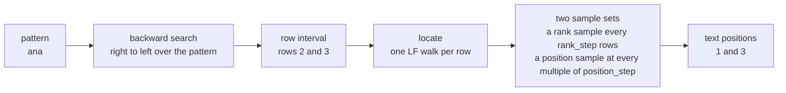
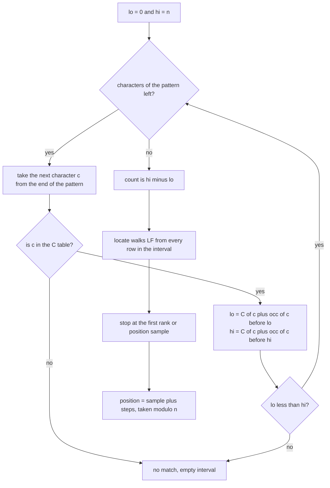
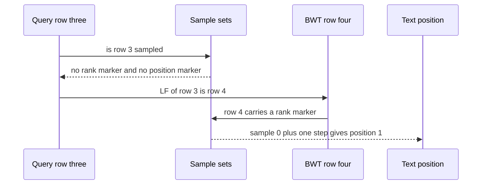

# 608 — Implement BWT-based full-text index with fast locate

> **Tier:** Expert · **CTCI chapter:** Beyond — Advanced Data Structures & Algorithms
> **Task spec:** [608-implement-bwt-based-full-text-index-with-fast-locate.md](../../../tasks/expert/608-implement-bwt-based-full-text-index-with-fast-locate.md)
> **Solutions:** [Python](../../../solutions/python/expert/608-implement-bwt-based-full-text-index-with-fast-locate/solution.py) ·
> [Java](../../../solutions/java/expert/608-implement-bwt-based-full-text-index-with-fast-locate/Solution.java) ·
> [JavaScript](../../../solutions/javascript/expert/608-implement-bwt-based-full-text-index-with-fast-locate/solution.js) ·
> [C#](../../../solutions/csharp/expert/608-implement-bwt-based-full-text-index-with-fast-locate/Solution.cs)

## 1. Problem restatement

Build a **full-text index** that stores the Burrows-Wheeler transform of `text + sentinel` instead of
the text, and answer four questions from it:

| Operation | Answer |
| --- | --- |
| `count(pattern)` | how many times the pattern occurs |
| `locate(pattern, scheme)` | the sorted text positions where it occurs |
| `extract(start, stop)` / `document()` | a text window, recovered from the index alone |
| `snippets(pattern, context, limit)` | context windows with the matches bracketed |

`count` is *backward search* on the BWT plus the `C` table: `O(m)` steps for a pattern of length `m`.
`locate` turns a row back into a text position by walking the **LF mapping**, which moves one position
to the left per step, and stopping at a **sampled row**. The point of the task is the sampling: the
index keeps *two* independent sample sets and stops at whichever is hit first.

`BWTIndex(text, position_step = 64, rank_step = 16)` is the interface in the solutions:
`occ(ch, i)`, `lf(row)`, `interval(pattern)`, `count`, `locate`, `position_at(row, scheme)` where
`scheme` is `"two-level"`, `"rank"` or `"position"`, `walk_steps`, `decode`, `document`, `extract`,
`snippets` and `stored_bits`.

Concrete results the checks assert for `"banana"` (`s = "banana\x00"`, `n = 7`):

- `bwt == "annb\x00aa"`, first column `"\x00aaabnn"`, `C == {\x00: 0, a: 1, b: 4, n: 5}`;
- `decode() == "\x00banana"` and `document() == "banana"`, so the text is recoverable from the BWT;
- `extract(1, 4) == "ana"`; `snippets("ana") == ["b[ana]na", "ban[ana]"]`;
- `count("ana") == 2` with `locate("ana") == [1, 3]`; `locate("na") == [2, 4]`;
  `locate("a") == [1, 3, 5]`; `count("banana") == 1` with `locate("banana") == [0]`;
- `count("bananas") == count("z") == count("") == 0`, and all three locate to `[]`.

For the 12000-character LCG text over `abcde` (seed 20260808, `position_step = 64`,
`rank_step = 16`) the index needs **138150 bits**, holds **188 position samples** and **751 rank
samples**, and locating the 94 rows of the three-character pattern at offset 5000 takes **939 LF steps
at two levels, 3201 with position samples only and 1204 with rank samples only**.

Documented simplification: the index does not store the text at all — `document()` re-derives it from
the BWT, which is what makes `extract` a statement about the index and not about a copy of the input.
The JavaScript solution additionally run-length encodes the BWT and answers `rank` run-wise, with
checkpoints every 32 runs, and implements the *reverse* direction (`psi`) as well.

## 2. Intuition

The naive way to locate matches is to scan the text: `O(n · m)`. A suffix array fixes the counting (a
pattern is an interval of rows) but costs `n` integers of storage. The BWT keeps only `n` characters
plus `o(n)` bits of rank/select directory, and the row interval can still be maintained — but you pay
with the **locate** step, which is the interesting part of this task.

Backward search extends the pattern to the left: if `[lo, hi)` holds the rows whose suffixes start with
`P`, then for `cP` it is `[C[c] + occ(c, lo), C[c] + occ(c, hi))`. That interval is *exactly* the
answers, but it gives suffixes in lexicographic order, not text positions.

Locate then walks the LF mapping. `LF(row)` is the row of the suffix that starts one position earlier,
because `LF(row) = C[BWT[row]] + occ(BWT[row], row)` counts how many characters are smaller. So every
LF step decreases the text position by exactly one, and if a row is *sampled* — its position is known —
the answer is `sample + steps`.



Two sampling schemes have opposite weaknesses: rank samples (every `rank_step`-th row) are hit after
about `rank_step / 2` steps on average but give no worst-case bound, while position samples (rows whose
text position is a multiple of `position_step`) bound the walk by `position_step` steps but are hit late
on average. Checking **both at every step** and returning at whichever comes first can therefore never
walk further than either scheme alone, and the checks measure exactly that inequality per row.

## 3. Algorithm

**Build** (before any query):

1. `s = text + sentinel`; compute `SA` of `s`; `BWT[row] = s[SA[row] - 1]`, with the last character for
   row 0.
2. `first = sorted(BWT)` is the first column; `C[c]` = how many characters of `s` are smaller than `c`.
3. One rank/select bit vector per character of the alphabet, over the BWT.
4. `rank_marker` marks every `rank_step`-th row; `rank_values` stores `SA` of those rows.
5. `position_marker` marks rows whose `SA` value is a multiple of `position_step`;
   `position_values` stores those `SA` values.

**Backward search** for a pattern:

```text
procedure count(pattern)
    if pattern is empty then
        return 0                                   // documented: the empty pattern is not searched
    lo ← 0
    hi ← n                                         // n = length(s) = length(text) + 1
    for index ← length(pattern) - 1 down to 0 do
        c ← pattern[index]
        if c is not in C then
            return 0
        lo ← C[c] + occ(c, lo)
        hi ← C[c] + occ(c, hi)
        if lo >= hi then
            return 0
    return hi - lo
```

```text
procedure position_at(row, scheme)
    steps ← 0
    loop
        if scheme ≠ "position" and rank_marker bit at row = 1 then
            return (rank_values[rank1 of row] + steps) mod n, steps
        if scheme ≠ "rank" and position_marker bit at row = 1 then
            return (position_values[rank1 of row] + steps) mod n, steps
        row ← lf(row)                              // one position to the left
        steps ← steps + 1
        if steps > position_step then
            error "the LF walk exceeded the sampling bound"
```

```text
procedure locate(pattern, scheme)
    lo, hi ← interval(pattern)
    found ← empty list
    for row ← lo to hi - 1 do
        position, steps ← position_at(row, scheme)
        if position < n - 1 then                    // drop the sentinel row itself
            found.append(position)
    return sorted(found)
```

```text
procedure lf(row)
    c ← bwt[row]
    return C[c] + occ(c, row)                       // the row whose suffix starts one earlier
```



## 4. Worked example

`text = "banana"`, `s = "banana\x00"`, `n = 7`, `SA = [6, 5, 3, 1, 0, 4, 2]`, `BWT = "annb\x00aa"`,
`C = {\x00: 0, a: 1, b: 4, n: 5}`, `first = "\x00aaabnn"`.

**Backward search for `ana`** — the characters are consumed from the right:

| Step | Character | `lo` before | `hi` before | `occ` values used | `lo` after | `hi` after |
| --- | --- | --- | --- | --- | --- | --- |
| 0 | — | 0 | 7 | — | 0 | 7 |
| 1 | `a` | 0 | 7 | `occ(a, 0) = 0`, `occ(a, 7) = 3` | 1 | 4 |
| 2 | `n` | 1 | 4 | `occ(n, 1) = 0`, `occ(n, 4) = 2` | 5 | 7 |
| 3 | `a` | 5 | 7 | `occ(a, 5) = 1`, `occ(a, 7) = 3` | 2 | 4 |

`count("ana") = 4 - 2 = 2`, and the two matching rows are 2 and 3. The same table for the full text
continues to `(4, 5)` for `banana`, i.e. exactly one row.

**Locate** with `position_step = 4` and `rank_step = 2`. The rank samples are on rows 0, 2, 4, 6 with
values `SA = [6, 3, 0, 2]`; the position samples are on rows 4 and 5, whose `SA` values are `0` and `4`.

| Query row | rank sample? | position sample? | LF walk | Steps | Position |
| --- | --- | --- | --- | --- | --- |
| 2 | yes, `rank_values[1] = SA[2] = 3` | no | none needed | 0 | `(3 + 0) mod 7 = 3` |
| 3 | no | no | `3 → LF(3) = C[b] + occ(b, 3) = 4 + 0 = 4` | 1 | row 4 is a rank sample, `rank_values[2] = SA[4] = 0`, so `(0 + 1) mod 7 = 1` |

Both positions survive the `position < n - 1` filter, the result is sorted, and `locate("ana") = [1, 3]`
— the two `ana` occurrences. With the position-only scheme row 2 must walk 3 steps
(`2 → 6 → 3 → 4`) before it reaches the position sample on row 4, which is the inequality the file
measures: two levels 0 and 1 steps versus position-only 3 and 1 steps.



The large-text measurement has the same shape: 94 rows of the pattern at offset 5000 take 939 steps at
two levels, against 3201 with position samples only and 1204 with rank samples only, so the two-level
scheme is bounded by both and strictly better than either.

The index is also self-contained: `decode()` walks LF from the sentinel row and prepends `first[row]`
each time, yielding `"\x00banana"`; `document()` drops the sentinel, so `extract(1, 4) == "ana"` and
`snippets("ana") == ["b[ana]na", "ban[ana]"]` are computed without the original text.

## 5. Complexity

Let `n = len(text) + 1`, `m` the pattern length, `k` the number of occurrences, `p = position_step` and
`r = rank_step`.

| Operation | Best | Average | Worst | Why the bound holds |
| --- | --- | --- | --- | --- |
| Build | O(n) | O(n) | O(n log n) | the BWT needs a suffix array (prefix doubling here); the vectors, `C` and both sample sets are one linear scan each |
| `occ(c, i)` | O(1) | O(1) | O(1) | a word-level popcount prefix plus one masked popcount inside the word |
| `interval` / `count` | O(1) | O(m) | O(m) | one interval update per pattern character, each in constant time |
| `lf(row)` | O(1) | O(1) | O(1) | one `occ` plus one table lookup |
| `locate` | O(k) | O(k · min(r, p) / 2) | O(k · p) | the walk stops at a sample; a multiple of `p` is always on the way, so `p` steps is a hard bound |
| `position_at` at two levels | O(1) | ≤ either scheme | ≤ min(rank-only, position-only) | both markers are tested at every step, so it cannot walk further than either alone |
| `decode` / `document` | O(n) | O(n) | O(n) | one LF walk of `n` steps; the result is cached for later `extract` calls |
| `snippets` | O(k) | O(k log k) | O(k log k) | locate plus sorting plus slicing |
| Space | — | — | O(n log σ + 32 · (n / r + n / p)) bits | `stored_bits` counts the BWT bits, the rank/select directories and both sample sets |

Measured storage for `banana` with `position_step = 4`, `rank_step = 2`: **348 bits** for 7 characters
and 4 character vectors. For the 12000-character text with 64/16 sampling: **138150 bits**, 188 position
samples and 751 rank samples — a finer stride stores more and walks less, which is why the checks assert
`fine_steps < coarse_steps` **and** `coarse.stored_bits() < fine.stored_bits()`.

Alternatives:

| Approach | Count | Locate | Space |
| --- | --- | --- | --- |
| Scan the text | O(n · m) | O(n + k) | O(n) |
| Suffix array | O(m log n) | O(k log n) | O(n) words |
| FM-index with one sample set | O(m) | O(k · sample stride) | O(n) + one set |
| This index with two sample sets | O(m) | O(k · min of the two walks) | O(n) + both sets |

## 6. Pitfalls and edge cases

- **The sentinel must not occur in the text.** It is `"\x00"` in the Python solution; with two sentinels
  the rotation argument that makes LF exact no longer holds.
- **The empty pattern is deliberately not searched.** `count("") == 0` and `locate("") == []` even
  though every position matches; the convention is documented in the solution files and asserted for
  every text in the corpus.
- **A pattern with an unseen character must not crash**, it must fail cleanly: `"z"` is not in `C`, so
  `interval` returns an empty range and `count("z") == locate("z") == []`. The same happens for
  `"bananas"` on `"banana"`, where the interval collapses mid-search.
- **Positions come back modulo `n`.** A sample plus the number of steps can exceed `n - 1`, and the walk
  from row 4 (whose suffix is the whole text) wraps to row 0; `locate` therefore filters out
  `position >= n - 1`, which is the sentinel suffix and not a real match.
- **Results must be sorted.** Rows are in lexicographic order of the suffixes, not text order; row 2
  yields position 3 and row 3 yields position 1, so `locate("ana") == [1, 3]` and not `[3, 1]`.
- **`occ` is exclusive on the right.** `occ(c, i)` counts the first `i` BWT characters, which is what
  makes `hi = C[c] + occ(c, hi)` an exclusive upper bound and `hi - lo` the occurrence count. Off by one
  here silently shifts every position.
- **Sampling strides trade storage for steps.** `position_step ∈ {2, 4, 8, 16}` with
  `rank_step = step / 2` all return identical counts and positions for the eight probe patterns, so a
  wrong answer is never a sampling artefact; only the step counts and `stored_bits` change.
- **Duplicates and degenerate texts.** `"aaaa"` produces one long LF chain per row, `"a"` is a
  two-character `s`, and `""` leaves just the sentinel: all are checked, including
  `count(text) == 1` and `locate(text) == [0]` for a non-empty text.
- **Unicode.** Python indexes code points while Java, JavaScript and C# index UTF-16 units, so a
  non-BMP character counts as two positions in three of the four solutions.
- **The step bound is measured, not assumed.** `position_at` raises if a two-level walk exceeds
  `position_step` steps, and the checks separately assert `min(rank-only, position-only) >= two-level`
  for every row of every probe pattern.

## 7. Variants and follow-ups

- The same index without the locate machinery, driven by rank/select structures studied on their own →
  [605 — FM-index full search with rank/select](../../../tasks/expert/605-implement-fm-index-full-search-with-rank-select-structures.md).
- Alphabet-independent rank/select for a large `σ`, where `occ` stops being a table lookup →
  [606 — wavelet matrix for large-alphabet rank/select](../../../tasks/expert/606-implement-wavelet-matrix-for-large-alphabet-rank-select.md).
- Building the suffix array itself when the text does not fit in memory →
  [607 — external-memory suffix array construction](../../../tasks/expert/607-implement-external-memory-suffix-array-construction-disk-based.md).
- Compressing the bit vectors that back `rank` and `select` →
  [609 — advanced compressed bitvectors RRR and rank/select](../../../tasks/expert/609-implement-advanced-compressed-bitvectors-rrr-and-rank-select.md).

## 8. Check yourself

<details><summary>Show answer</summary>
**Why is `C[c] + occ(c, lo)` the new `lo` for the extended pattern?** Rows are sorted by suffix, so the
rows of `cP` are exactly the rows that start with `c` and whose following suffix is one of the `P` rows.
All rows starting with `c` occupy the contiguous range `[C[c], C[c] + count(c))`, and within it the
relative order of the `c` characters is the BWT order — so the `occ` offsets of the old `lo` and `hi`
select the sub-range.
</details>

<details><summary>Show answer</summary>
**Why does one LF step move the text position one to the left?** `LF(row) = C[BWT[row]] + occ(BWT[row],
row)` returns the index of the row whose suffix is the suffix of `row` preceded by `BWT[row]`, which is
the character just before it in the text. Hence `SA[LF(row)] = SA[row] - 1` for every row except the
sentinel row, where the walk wraps to the end of the text — that is why positions are taken modulo `n`.
</details>

<details><summary>Show answer</summary>
**Why can two-level locate never walk further than position samples alone?** Both markers are tested at
every step of the walk, and the two-level scheme returns at the first hit, so its step count is the
minimum of the two hit times. Since a multiple of `position_step` is always somewhere on the way, the
two-level walk is bounded by `position_step` steps, and it is at most the position-only walk for the
same row.
</details>

<details><summary>Show answer</summary>
**Row 2 of `banana` is a rank sample but not a position sample — what does that buy?** The walk stops
immediately (0 steps) and returns `SA[2] = 3`, while the position-only scheme would have to walk
`2 → 6 → 3 → 4` — three steps — before reaching the position sample on row 4. That 0-versus-3 gap is
exactly the inequality the file asserts for every row of every probe pattern.
</details>

<details><summary>Show answer</summary>
**Where does the stored text go?** Nowhere: `document()` decodes the text from the BWT by walking LF
from the sentinel row and reading the first column each time, and caches the result, so `extract` and
`snippets` operate on that reconstruction. The BWT is a permutation of `text + sentinel`, which is why
one `n`-character array plus `C`, the rank directories and the two sample sets carry the whole document.
</details>
