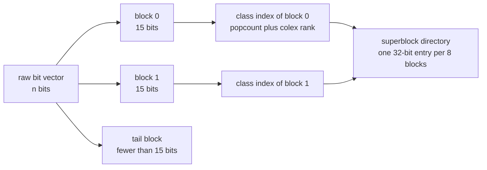
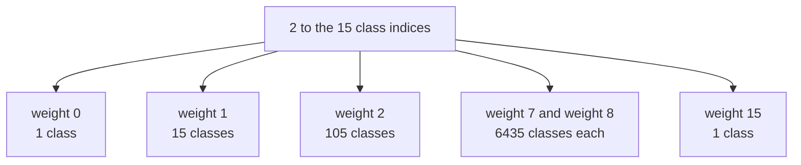
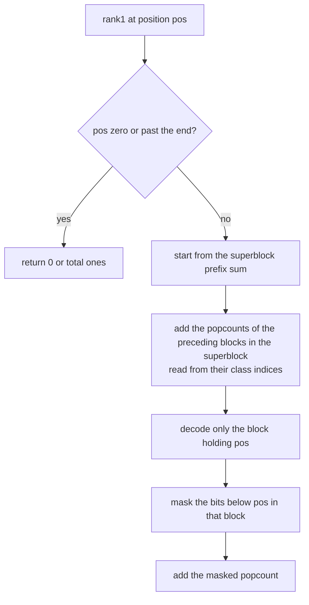
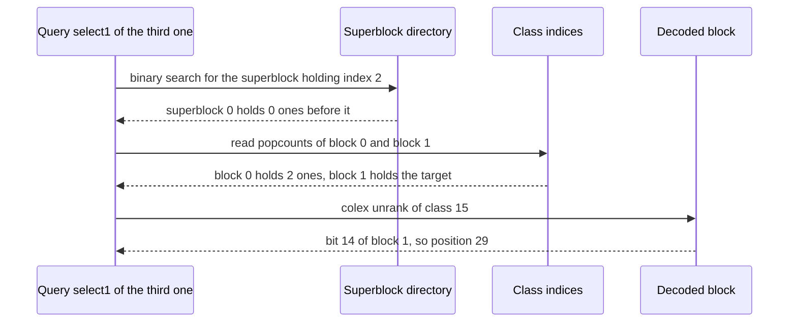

# 609 — Implement advanced compressed bitvectors (RRR) and rank/select

> **Tier:** Expert · **CTCI chapter:** Beyond — Advanced Data Structures & Algorithms
> **Task spec:** [609-implement-advanced-compressed-bitvectors-rrr-and-rank-select.md](../../../tasks/expert/609-implement-advanced-compressed-bitvectors-rrr-and-rank-select.md)
> **Solutions:** [Python](../../../solutions/python/expert/609-implement-advanced-compressed-bitvectors-rrr-and-rank-select/solution.py) ·
> [Java](../../../solutions/java/expert/609-implement-advanced-compressed-bitvectors-rrr-and-rank-select/Solution.java) ·
> [JavaScript](../../../solutions/javascript/expert/609-implement-advanced-compressed-bitvectors-rrr-and-rank-select/solution.js) ·
> [C#](../../../solutions/csharp/expert/609-implement-advanced-compressed-bitvectors-rrr-and-rank-select/Solution.cs)

## 1. Problem restatement

Store a bit vector of `n` bits in **fewer than `n` bits** when it is skewed, while still answering
`access`, `rank1`, `rank0`, `select1` and `select0` without decompressing everything. The RRR
(Raman-Raman-Rao) scheme cuts the vector into blocks of `B = 15` bits and, per block, stores only its
*combinatorial class*: the popcount `k` together with the colexicographic rank of the block's `k` set
bits among the `C(B, k)` blocks of that weight.

| Element | Content |
| --- | --- |
| class index | `base[k] + colex_rank`, where `base[k] = sum over j less than k of C(B, j)` |
| class bit vector (`B_1`) | the popcount of every block, `4` bits each for `B = 15` |
| offset bit vector (`B_2`) | every block's combinadic rank, `ceil(log2 C(B, k))` bits each |
| superblock directory | the number of ones before every 8th block (so every 120 bits) |

Because the class index itself encodes the popcount, `rank1` needs no separate popcount array: it reads
the weight off the class, and only the *one* block touched by the query is decoded.

Concrete results the checks assert for `n = 4000` bits:

| Vector | Payload bits | Plain cost | `n · H0` | Directory |
| --- | --- | --- | --- | --- |
| `p ≈ 0.095` (100 ones per 1000) | 2360 = 1292 offsets + 1068 classes | 4000 | 1808 | 1088 |
| `p = 0.5` (500 ones per 1000, 4000 bits) | 4413 | 4000 | — | — |

So a skewed vector compresses to well under half of `1` bit per bit, while at `p ≈ 0.5` RRR *stops
paying* and even costs a little more than the plain array.

The `"banana"`-sized hand values are structural, not statistical: with `B = 15`,
`sum over k of C(15, k) = 2^15 = 32768` classes, `C(15, 2) = 105`, `C(15, 7) = C(15, 8) = 6435`, and
the check verifies *exhaustively* for all `2^15` patterns that the class index encodes exactly the
popcount and that `colex_unrank(k, rank)` inverts `colex_rank`.

Documented simplification: a production RRR adds an `O(sqrt(n))` lookup table to find the position of a
1 inside a decoded block in `O(1)`; here `select1` scans the 15 decoded bits instead. The JavaScript
solution keeps the class bit vector plainly rather than compressing it recursively, and the Java
solution stores each class as a `(popcount, offset)` pair instead of a pointer into a precomputed class
table — the same information, so the reported sizes are upper bounds.

## 2. Intuition

The naive "compressed" bit vector is a plain array of `n` bits: `access` and `rank1` are `O(1)` with a
directory, `select1` is a binary search, and no compression happens at all. The naive *compressible*
idea is to store the positions of the ones as a sorted list — that is smaller only when the vector is
very sparse, and `rank1` becomes a binary search.

RRR is the observation that a block of `B` bits is not arbitrary: with `k` ones there are only
`C(B, k)` possibilities, so it can be replaced by an index in `[0, C(B, k))`. Summed over all weights,
the `2^B` patterns are enumerated exactly once, so the class index of a block is a *bijection* — no
information is lost, and `C(B, k)` peaks at `k = B/2`, where a block costs the full `log2 C(B, B/2)`
bits. For skewed vectors the saving is large; at `p = 0.5` it is zero, which is why RRR is described as
entropy-compression with `n · H0(p) + o(n)` bits at best.



The class index is a single integer that carries two things at once — how many ones the block has and
which of the patterns of that weight it is — so the popcount array disappears from the list of stored
structures.



The layout is *colexicographic*: a block with set bits `p_1 < ... < p_k` gets the rank
`sum over i of C(p_i, i)`, which is the standard combinadic enumeration. Weight `0` and weight `B`
cost zero offset bits — there is nothing to choose.

## 3. Algorithm

**Build:**

1. Validate that the vector is binary (otherwise raise).
2. For every block of `B = 15` bits: record `k` (population count), the set-bit positions, the colex
   rank, and store `class = base[k] + rank` together with the offset `rank`.
3. Derive the per-block popcounts from the class indices, and store a superblock entry every
   `BLOCKS_PER_SUPER = 8` blocks.

**Queries:**

```text
procedure colex_rank(positions)                    // positions ascending, weight k
    return sum over i from 0 to k - 1 of binomial(positions[i], i + 1)

procedure colex_unrank(k, rank)
    if k = 0 then
        return nothing
    positions ← empty
    p ← B - 1
    for i ← k down to 1 do
        while binomial(p, i) > rank do
            p ← p - 1
        positions.append(p)
        rank ← rank - binomial(p, i)
        p ← p - 1
    return reverse(positions)
```

```text
procedure rank1(pos)
    if pos <= 0 then return 0
    if pos >= n then return total_ones
    block ← pos div B
    count ← super_ones[block div BLOCKS_PER_SUPER]
    for b ← (block div BLOCKS_PER_SUPER) * BLOCKS_PER_SUPER to block - 1 do
        count ← count + block_popcount[b]            // read off the class, no storage
    mask ← decode_block(block) and ((1 shifted left by (pos mod B)) - 1)
    return count + popcount(mask)

procedure rank0(pos)
    return pos - rank1(pos)

procedure select1(index)
    lo, hi ← binary search over super_ones for the superblock containing index
    count ← super_ones[lo]
    block ← lo * BLOCKS_PER_SUPER
    while count + block_popcount[block] <= index do
        count ← count + block_popcount[block]
        block ← block + 1
    mask ← decode_block(block)                       // colex_unrank then rebuild the 15 bits
    remaining ← index - count
    for bit ← 0 to B - 1 do
        if mask has a one at bit then
            if remaining = 0 then return block * B + bit
            remaining ← remaining - 1

procedure select0(index)
    binary search on the monotone function rank0             // rank0 is non-decreasing in pos
```

```text
procedure decode_block(block)                        // for a tail block, shorter than B
    cls ← class[block]
    mask ← 0
    for p in colex_unrank(popcount_of(cls), offset[block]) do
        mask ← mask or (1 shifted left by p)
    return mask
```



## 4. Worked example

`B = 15`. Take the 30-bit vector built as `1`, then thirteen `0`s, then `1`, then fourteen `0`s, then
`1` — ones at positions `0`, `14` and `29`:

| Block | Bits | Set positions | `k` | Colex rank | Class index |
| --- | --- | --- | --- | --- | --- |
| 0 | `100000000000001` | 0, 14 | 2 | `C(0,1) + C(14,2) = 0 + 91 = 91` | `base[2] + 91 = 16 + 91 = 107` |
| 1 | `000000000000001` | 14 | 1 | `C(14,1) = 14` | `base[1] + 14 = 1 + 14 = 15` |

`base[1] = C(15,0) = 1` and `base[2] = C(15,0) + C(15,1) = 1 + 15 = 16`. So
`block_popcount = [2, 1]`, `super_ones = [0]` and `total_ones = 3`.

**Query trace:**

| Query | Work | Result |
| --- | --- | --- |
| `access(14)` | block `14 / 15 = 0`, offset `14`; `decode_block(0)` rebuilds bit 14 | `1` |
| `rank1(16)` | superblock 0 prefix `0`, plus `block_popcount[0] = 2`; the masked low bit of block 1 is `0` | `2` |
| `rank0(16)` | `16 - rank1(16)` | `14` |
| `select1(2)` | superblock search lands on `[0]`; block 0 has 2 ones, so the target is in block 1; `decode_block(1)` has its one at bit 14 | `15 + 14 = 29` |
| `decode_block(1)` | `colex_unrank(1, 14)` returns `[14]` | bitmask `0b100000000000000` |

Storage for this vector: `offset_bits = ceil(log2 C(15, 2)) + ceil(log2 C(15, 1)) = 7 + 4 = 11` bits
(`C(15, 2) = 105`, so `(105 - 1).bit_length() = 7`), `class_bits = 4 bits × 2 blocks = 8`, hence a
**19-bit payload against 30 plain bits** and a 32-bit directory entry.



The two statistical data points reuse the same machinery at scale: 4000 bits at `p ≈ 0.095` cost 2360
payload bits (1292 offset bits plus 1068 class bits) against 4000 plain bits and an entropy bound of
1808 bits, with a 1088-bit directory; 4000 bits at `p ≈ 0.5` cost 4413 payload bits, slightly *more*
than plain, which is exactly the point where the block combinatorics stop helping.

## 5. Complexity

Let `n` be the length of the vector, `B = 15` the block size and `m = n / B` the number of blocks.
`B` is a constant, so every bound below that mentions `B` is `O(1)` in practice.

| Operation | Best | Average | Worst | Why the bound holds |
| --- | --- | --- | --- | --- |
| Build | O(n) | O(n) | O(n) | one pass computing block popcounts, colex ranks and the directory |
| `access(pos)` | O(1) | O(B) | O(B) | the block is decoded with `colex_unrank`, which emits exactly `k` positions |
| `rank1(pos)` | O(1) | O(BLOCKS_PER_SUPER + B / word) | O(BLOCKS_PER_SUPER + B) | superblock prefix plus at most 7 block popcounts read from the class indices, plus one masked popcount |
| `rank0(pos)` | O(1) | O(1) | O(1) | `rank0(pos) = pos - rank1(pos)` |
| `select1(index)` | O(log m) | O(log m + BLOCKS_PER_SUPER + B) | same | binary search over the superblock directory, then at most 7 blocks, then a scan of the decoded bits (the documented replacement for RRR's lookup table) |
| `select0(index)` | O(log n) | O(log n · B) | O(log n · B) | binary search on the monotone `rank0`; the search is `log n` evaluations of `rank1` |
| Space | — | — | `m · ceil(log2 C(B, B/2)) + 4m + directory` bits | offsets dominate and track entropy; the class sequence costs 4 bits per block; the directory is 32 bits per 8 blocks, i.e. `o(n)` |

Measured envelope: at `p ≈ 0.095` the payload satisfies `0.9 · n · H0 <= payload < 1.35 · n · H0` and is
also `< 0.7 · n`, while the directory stays below the payload; at `p ≈ 0.5` the payload stays within
`1.15 · n` — RRR's guarantee is the `n · H0(p) + o(n)` upper bound, not a gain at every density.

Alternatives:

| Structure | Point access | Rank | Select | Space |
| --- | --- | --- | --- | --- |
| Plain bit array plus directory | O(1) | O(1) | O(log n) | n + o(n) bits |
| Sorted list of one positions | O(log n) | O(log n) | O(1) | k · log n bits |
| RRR (this task) | O(1) | O(1) | O(log m) | `n · H0(p) + o(n)` bits |
| Wavelet matrix over a large alphabet | O(log σ) | O(log σ) | O(log σ) | one RRR or plain vector per level |

## 6. Pitfalls and edge cases

- **The tail block.** `n` is generally not a multiple of `B`: 149-, 150- and 151-bit vectors are all in
  the checks, and `block_length` reports the true length of the last block so that `access` never
  invents bits past the end.
- **Weight `0` and weight `B` cost zero offset bits.** `ceil(log2 C(B, k))` is `0` for `k = 0` and
  `k = B`, which is why `"0" * 40` and `"1" * 40` compress to the class sequence alone.
- **`select1` must scan the decoded block, not the raw bits.** The raw bits are not stored; the scan is
  over `mask` after `colex_unrank`, and it is the one place where the production RRR is known to differ
  (it adds an `O(sqrt n)` in-block lookup table).
- **`select0` cannot be symmetric with `select1`.** There is no `0`-class structure; the check uses the
  monotonicity of `rank0` with a binary search and asserts `rank0(select0(i) + 1) = i + 1`.
- **Rank/select must be inverses.** For every index the checks assert `select1(i) = pos`,
  `rank1(pos) = i` and `access(pos) = 1`, and the analogous relation for zeros.
- **Dense vectors are not the win case.** At `p ≈ 0.5` the measured payload is 4413 bits against 4000
  plain bits, so a caller that wants compression must know its density; the file asserts only
  `payload <= 1.15 · n` there.
- **The entropy bound is a sanity check, not a target.** `payload >= 0.9 · n · H0` guards against
  "compression" that discards information; `payload < 1.35 · n · H0` guards against pointless overhead.
- **Invalid input must be rejected.** `RRRBitvector("0102")` raises `ValueError`; `access(-1)`,
  `access(n)` and `access(99)` raise `IndexError`; `select1` past the last one raises `IndexError`.
- **Non-multiple densities and generator honesty.** The densest checks use 30, 100, 500, 700 and 900
  ones per 1000; the file verifies that the generator really produced `0.08 < p < 0.12` for the skewed
  4000-bit vector, so a compression claim cannot come from accidentally uniform data.
- **The class index is a bijection.** The `2^15` classes are enumerated exhaustively: every pattern maps
  to a class, every class maps back to a pattern, and per weight the ranks form exactly
  `0 .. C(B, k) - 1`.
- **Documented simplifications.** The class bit vector is stored plainly in the JavaScript solution
  instead of being RRR-compressed recursively, the Java solution stores `(popcount, offset)` pairs
  rather than a precomputed class table, and the directory holds 32-bit integers rather than bit-packed
  sums — all of which make the reported sizes upper bounds, never lower ones.

## 7. Variants and follow-ups

- Applying RRR-per-level rank/select to a large alphabet →
  [606 — wavelet matrix for large-alphabet rank/select](../../../tasks/expert/606-implement-wavelet-matrix-for-large-alphabet-rank-select.md).
- Using these rank/select primitives to answer LF and `occ` inside a text index →
  [608 — BWT-based full-text index with fast locate](../../../tasks/expert/608-implement-bwt-based-full-text-index-with-fast-locate.md)
  and [605 — FM-index full search with rank/select](../../../tasks/expert/605-implement-fm-index-full-search-with-rank-select-structures.md).
- Feeding the same primitives into a succinct tree encoding, where balanced parentheses are the bit
  vector →
  [610 — succinct tree representations DFUDS and navigation ops](../../../tasks/expert/610-implement-succinct-tree-representations-dfuds-and-navigation-ops.md).

## 8. Check yourself

<details><summary>Show answer</summary>
**Why does the class index store the popcount for free?** Because the classes are laid out consecutively
per weight: `base[k]` is the first class of weight `k`, so any index in `[base[k], base[k] +
C(B, k))` has weight `k` and the popcount is recoverable from the index itself. That removes the
per-block popcount array a plain bit vector needs.
</details>

<details><summary>Show answer</summary>
**What is the colex rank of a block with ones at positions 0 and 14, and which class does it get?**
`C(0, 1) + C(14, 2) = 0 + 91 = 91`; with `base[2] = 1 + 15 = 16` the class index is `107`. The
inverse, `colex_unrank(2, 91) = [0, 14]`, reproduces the block exactly.
</details>

<details><summary>Show answer</summary>
**Why is `rank1` still `O(1)` without a stored popcount array?** The superblock directory supplies the
count before the current group of 8 blocks, the popcounts of at most 7 preceding blocks come from their
class indices, and the bit prefix inside the one touched block comes from a masked popcount of its
decoded 15-bit mask. All three terms are bounded by constants.
</details>

<details><summary>Show answer</summary>
**Why does RRR not help at `p = 0.5`?** `C(B, k)` is maximal at `k = B / 2`, so a block with about half
ones needs almost `log2 C(B, B/2) = log2 6435 ≈ 12.65` bits just for its offset, plus 4 class bits, on
top of the directory — which is why the measured payload is 4413 bits for 4000 bits of data.
</details>

<details><summary>Show answer</summary>
**Which assumption would break if the vector were not binary?** Every part of the encoding: the classes
enumerate 15-bit binary patterns, `block = pos / B` assumes one bit per position, and `rank0 = pos -
rank1` assumes the complement of a bit is a bit. The solutions reject any other alphabet up front.
</details>
