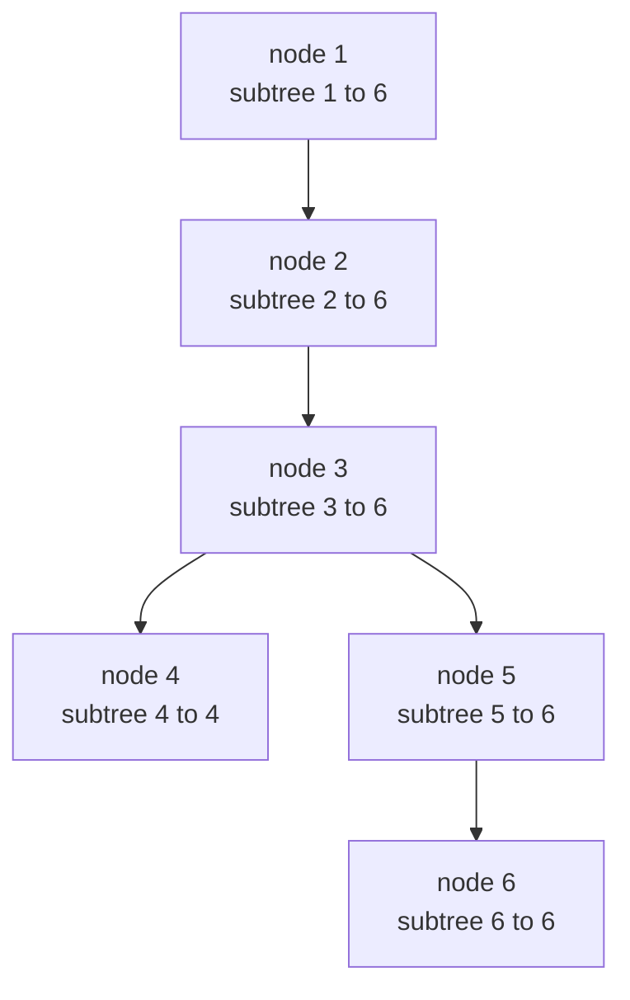
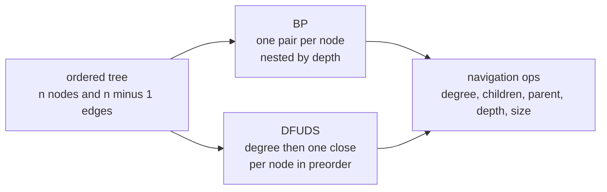
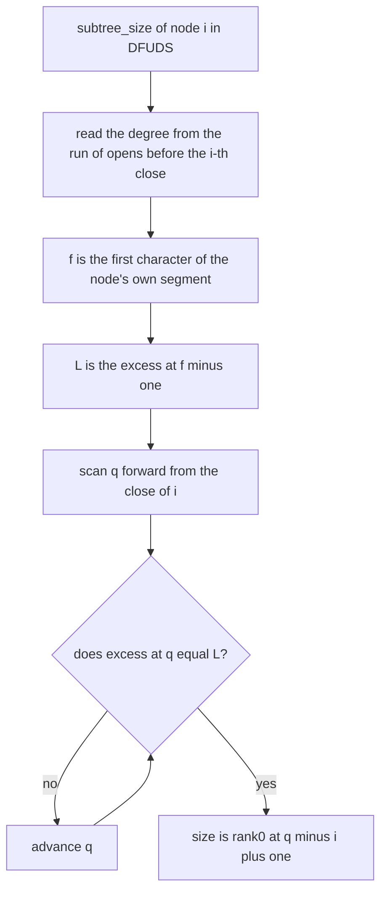
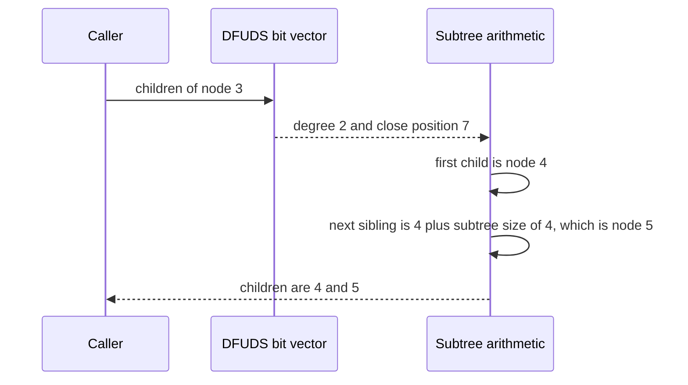

# 610 — Implement succinct tree representations (DFUDS) and navigation ops

> **Tier:** Expert · **CTCI chapter:** Beyond — Advanced Data Structures & Algorithms
> **Task spec:** [610-implement-succinct-tree-representations-dfuds-and-navigation-ops.md](../../../tasks/expert/610-implement-succinct-tree-representations-dfuds-and-navigation-ops.md)
> **Solutions:** [Python](../../../solutions/python/expert/610-implement-succinct-tree-representations-dfuds-and-navigation-ops/solution.py) ·
> [Java](../../../solutions/java/expert/610-implement-succinct-tree-representations-dfuds-and-navigation-ops/Solution.java) ·
> [JavaScript](../../../solutions/javascript/expert/610-implement-succinct-tree-representations-dfuds-and-navigation-ops/solution.js) ·
> [C#](../../../solutions/csharp/expert/610-implement-succinct-tree-representations-dfuds-and-navigation-ops/Solution.cs)

## 1. Problem restatement

Represent an ordered tree with `n` nodes in **2n bits** — no per-node pointers, no labels, no parent
array — and answer every navigation query from those bits alone. Two encodings are implemented, both
numbered by **preorder**: node `i` is the `i`-th node visited by a depth-first traversal.

| Encoding | Bit pattern | Node `i` owns |
| --- | --- | --- |
| BP (balanced parentheses) | one `(` on entry, one `)` on exit | the `i`-th `(` |
| DFUDS (depth-first unary degree sequence) | a leading sentinel `(` and then, per node in preorder, `deg(v)` copies of `(` followed by one `)` | the `i`-th `)` |

Both structures expose `degree(i)`, `children_of(i)`, `first_child`, `next_sibling`, `parent(i)`,
`depth(i)`, `subtree_size(i)` and `level_ancestor(i, k)`, plus `excess`, `rank1`, `rank0`, `select1`,
`select0` and `access` on the underlying bit vector.

Concrete values the checks assert:

| Tree | Encoding | Value |
| --- | --- | --- |
| chain of 10 nodes | BP and DFUDS | 20 bits each, `depth(10) = 9` |
| star with root degree 7 | DFUDS | `degree(1) = 7`, `subtree_size(1) = 8`, `depth(8) = 1`, `parent(8) = 1` |
| single node | both | 2 bits, `parent(1)` is `None` |
| caterpillar | both | 12 bits each, `subtree_size(1) = 6` |
| random trees of 2, 7, 17, 40 and 90 nodes | both | every op matches the explicit oracle for every node, and a DFS driven only by `children_of` rebuilds preorder |

Every shape is checked for both encodings against an explicit oracle (`tree_facts`), the two encodings
are checked against *each other*, and the bit patterns satisfy their invariants: BP is balanced with
`n` pairs and never goes negative; DFUDS starts with the sentinel, has exactly `n` `(` and `n` `)` and
keeps `excess >= 1` everywhere except the final `0`.

Documented simplification: a production succinct tree answers every operation in `O(1)` from
rank/select and excess directories; here the bit vector is a simple chunked rank/select structure and
`parent` / `depth` scan preorder ranges, so they are linear. The Java solution replaces the constant-time
forward search with a forward scan and walks candidate close positions backwards; the JavaScript
solution re-parses the encoding in `subtreeEnd`. What is *not* simplified: the encodings are real 2n-bit
sequences, and every navigation result is compared against the explicit tree.

## 2. Intuition

The naive tree is an object per node with a parent pointer, a child list and a depth — `O(n)` words,
which is `64n` bits or more. A succinct representation asks whether the *shape* alone can be stored in
the information-theoretic `2n` bits, and it can: a depth-first traversal of an `n`-node tree emits
exactly `n` entries and `n` exits, so the parenthesis string is a bijection between trees and balanced
strings.

BP is the direct encoding. Node `i` owns the `i`-th `(` at position `open(i)`, so

- `depth(i) = excess(open(i))` — how many parentheses are open when the node is entered;
- `findclose(open(i))` bounds the subtree, hence `subtree_size(i) = (close - open + 1) / 2`;
- children are the pairs immediately after the node's `(`, and the parent is the enclosing pair.

DFUDS stores the same information differently: instead of nesting, each node spells its *degree* —
`deg(v)` opens followed by one close. It is uglier to read and easier to navigate, because one node's
children are exactly the nodes whose closes follow its open run, and preorder numbering makes sibling
arithmetic pure addition.





Both diagrams describe the worked example of section 4: a chain `1 → 2 → 3` whose last node has two
children, one of which has a child. Its BP is `(((()(()))))` and its DFUDS is `(()()(())())`, both 12
bits — the same 2n bits, spent in completely different ways.

## 3. Algorithm

**Build BP**: one `(` on entry and one `)` on exit, children in order, with an explicit stack (no
recursion).

**Build DFUDS**: emit the sentinel `(`, then for each node in preorder emit `deg(v)` copies of `(` and
one `)`.

**Navigation, DFUDS** (each formula derived and then checked against the explicit tree):

1. `degree(i)` — count the run of `(` immediately before the `i`-th `)`; the root's run contains the
   sentinel, so subtract one for the root.
2. `subtree_size(i)` — let `f = close_pos(i) - degree(i)` be the first character of the node's own
   segment and `L = excess(f) - 1` the level *above* it. A node's own segment has one more `)` than
   `(`, so the first position `q >= close_pos(i) + 1` with `excess(q) = L` is exactly one past the
   subtree, and `size = rank0(q) - i + 1`.
3. `children_of(i)` — the first child is node `i + 1` and the next sibling of a child `c` is
   `c + subtree_size(c)`, both direct consequences of preorder.
4. `parent(i)` — the last `j < i` whose range `[j, j + size(j) - 1]` contains `i`.
5. `depth(i)` — the number of nodes whose subtree range contains `i`.
6. `level_ancestor(i, k)` — `k`-fold `parent`, raising when it climbs above the root.

**Navigation, BP**:

7. `open_pos(i) = select1(i - 1)`, `close_pos(i) = match[open_pos(i)]` from one stack pass,
   `depth(i) = excess(open_pos(i))`, `subtree_size(i) = (close_pos(i) - open_pos(i) + 1) / 2`.
8. `children_of(i)` walks the pairs right after `open_pos(i)`: while the next character is `(`, its owner
   is `rank1(position) + 1`, and the walk jumps past its match.

```text
procedure subtree_size_dfuds(i)
    degree ← degree_of(i)
    f ← close_pos(i) - degree                    // first character of this node's own segment
    level ← excess(f) - 1                        // one level above the node
    q ← close_pos(i) + 1
    while excess(q) ≠ level do
        q ← q + 1                                // the first return to that level ends the subtree
    return rank0(q) - i + 1

procedure children_dfuds(i)
    out ← empty list
    child ← i + 1
    for count ← 1 to degree_of(i) do
        out.append(child)
        child ← child + subtree_size_dfuds(child)
    return out

procedure parent_dfuds(i)
    if i = 1 then
        return none
    j ← i - 1
    while j + subtree_size_dfuds(j) - 1 < i do
        j ← j - 1                                // subtree ranges in preorder are nested or disjoint
    return j

procedure depth_dfuds(i)
    return the number of j from 1 to i - 1 with j + subtree_size_dfuds(j) - 1 >= i
```



The loop terminates because the sequence always returns to level `L`, and the `rank0` at that position
counts the closes inside the subtree — one per node of the subtree, including the node itself.

## 4. Worked example

The caterpillar `[[1], [2], [3, 4], [], [5], []]` in preorder: node 1 has child 2, node 2 has child 3,
node 3 has children 4 and 5, node 5 has child 6.

**BP** (12 bits, printed as `1` for `(` and `0` for `)`): `111101100000` — enter 1, 2, 3, 4, leave 4,
enter 5, 6, leave 6, 5, 3, 2, 1. In parentheses: `(((()(()))))`.

**DFUDS** (12 bits): `110101100100` — sentinel `(` then `()`, `()`, `(()`, `)`, `()`, `)`. In
parentheses: `(()()(())())`. Its excesses are `1, 2, 1, 2, 1, 2, 3, 2, 1, 2, 1, 0`, positive until the
final character as required.

Positions in the DFUDS string (0-based): the closes are at `2, 4, 7, 8, 10, 11`, so node `i` owns the
close at `close_pos(i)`.

| Node `i` | `close_pos(i)` | `degree(i)` | `subtree_size(i)` | `depth(i)` | `parent(i)` | `children_of(i)` |
| --- | --- | --- | --- | --- | --- | --- |
| 1 | 2 | 1 | 6 | 0 | `None` | `[2]` |
| 2 | 4 | 1 | 5 | 1 | 1 | `[3]` |
| 3 | 7 | 2 | 4 | 2 | 2 | `[4, 5]` |
| 4 | 8 | 0 | 1 | 3 | 3 | `[]` |
| 5 | 10 | 1 | 2 | 3 | 3 | `[6]` |
| 6 | 11 | 0 | 1 | 4 | 5 | `[]` |

Three traced derivations:

- `degree(3)`: node 3 owns the close at position 7; the characters before it are `(` at 6 and `(` at 5,
  then a `)` at 4, so the run has length 2 and, since `i != 1`, `degree(3) = 2`.
- `subtree_size(3)`: `f = 7 - 2 = 5`, `excess(5) = 1`, so `L = 0`; the first position after 7 with
  excess 0 is `q = 12`, and `rank0(12) = 6`, hence `size = 6 - 3 + 1 = 4` — nodes 3, 4, 5, 6.
- `depth(6)`: the ranges are `1..6`, `2..6`, `3..6`, `4..4`, `5..6`, `6..6`; those containing 6 are
  nodes 1, 2, 3 and 5, so `depth(6) = 4`.

On the BP side the same node 3 owns the third `(`, at position 2, its matching `)` is at position 9, and
`subtree_size(3) = (9 - 2 + 1) / 2 = 4` — the same answer, computed from `findclose` instead of an
excess level. `depth(3) = excess(2) = 2` as well.



The checks repeat this for every node of the fixed shapes (single node, chain of 5, star of 6,
caterpillar of 6) and of random trees of 2, 7, 17, 40 and 90 nodes, comparing `degree`, `children_of`,
`first_child`, `next_sibling`, `parent`, `depth`, `subtree_size` and `level_ancestor` against the
explicit oracle and against the other encoding, and finally rebuilding preorder with a DFS that only
calls `children_of`.

## 5. Complexity

Let `n` be the number of nodes, `d` a degree and `h` the height. `rank`, `select`, `access` and
`excess` are `O(1)` in the chunked directory (`CHUNK = 8` gives a binary search over the chunk
prefixes plus an at most 8-bit scan).

| Operation | BP here | DFUDS here | Production succinct tree | Why the bound holds |
| --- | --- | --- | --- | --- |
| `degree(i)` | O(1) | O(d) | O(1) | DFUDS reads a run of at most `d` opens before the close |
| `subtree_size(i)` | O(1) | O(size of subtree) | O(1) | the excess scan walks the subtree once; BP reads the precomputed match |
| `first_child` / `next_sibling` | O(1) | O(1) / O(size) | O(1) | preorder arithmetic plus one subtree size |
| `children_of(i)` | O(d) | O(sum of sibling subtree sizes) | O(d) | one step per child, each with a subtree size |
| `parent(i)` | O(h) | O(i) | O(1) | both scan candidates instead of using an excess directory |
| `depth(i)` | O(1) | O(n) | O(1) | BP reads `excess(open(i))`; DFUDS counts enclosing ranges |
| `level_ancestor(i, k)` | O(k · h) | O(k · i) | O(1) | `k` repetitions of `parent` |
| Space | 2n bits | 2n bits | 2n + o(n) bits | one bit per entry and per exit; the directory is `o(n)` |

Both encodings are checked to use exactly `2n` bits (`bits.n == 2 * n`), and BP is checked to contain
exactly `n` parentheses of each kind.

Alternatives:

| Representation | Space | `parent` | `depth` | `children` |
| --- | --- | --- | --- | --- |
| Object per node | `O(n)` words | O(1) | O(1) | O(d) |
| Parent + depth arrays | `2n` words | O(1) | O(1) | O(n) scan |
| BP (this task) | 2n bits | O(h) here, O(1) in production | O(1) | O(d) |
| DFUDS (this task) | 2n bits | O(i) here, O(1) in production | O(n) here, O(1) in production | O(d) |

## 6. Pitfalls and edge cases

- **Preorder numbering is the whole contract.** Everything assumes node `i` is the `i`-th node of a DFS
  and that subtree ranges are contiguous. The check `visited == list(range(1, n + 1))` re-derives
  preorder from the encoding alone precisely to catch a mis-numbered tree.
- **The DFUDS sentinel is not decoration.** Without it the first `)` would eat the first character of the
  root's open run and `degree(1)` would be wrong by one; the code subtracts exactly one for `i == 1`,
  and a separate check asserts that the sequence starts with the sentinel.
- **The excess invariant is `>= 1` until the last character.** A DFUDS string has `n` opens and `n`
  closes and returns to level 0 only at the end, which is what makes the level argument in
  `subtree_size` terminate at a well-defined position.
- **Range boundaries: `[j, j + size(j) - 1]` is inclusive.** `parent(6)` in the worked example is 5, not
  4, because node 4's range is the single position 4 and does not contain 6.
- **Degenerate shapes.** A single node is 2 bits with `parent(1) == None`; a chain of 10 has depths
  `0..9` and DFUDS `()()()()()...`; a star of 8 has `degree(1) = 7` and `subtree_size(1) = 8`. All three
  are asserted, and the star's leaves are checked to hang directly off the root.
- **`subtree_size(i) < n` for every non-root node** is asserted on random trees, which catches an
  off-by-one in the level computation that would otherwise make a proper subtree look like the whole
  tree.
- **No recursion.** Both builders use an explicit stack, and the checks raise the recursion limit, so a
  90-node chain cannot overflow a call stack.
- **Rejected inputs.** A bit vector containing anything but `0/1` (or the parentheses spellings) raises
  `ValueError`; `level_ancestor(i, k)` with `k` beyond the root raises `ValueError` — the root has no
  parent and there is no level `-1`.
- **Documented linear scans.** `parent` (DFUDS) and `depth` (DFUDS) scan preorder ranges and are
  therefore linear here; the Java solution's `forwardSearch` is a forward scan and its `parent` walks
  close candidates backwards; the JavaScript solution re-parses in `subtreeEnd`. A production version
  replaces all of these with `O(1)` excess/min-excess jumps — but the *answers* are unchanged, which is
  why every one of them is compared against the explicit oracle.

## 7. Variants and follow-ups

- The rank/select machinery that makes these encodings `O(1)` instead of `O(n)` →
  [609 — advanced compressed bitvectors RRR and rank/select](../../../tasks/expert/609-implement-advanced-compressed-bitvectors-rrr-and-rank-select.md).
- Making the same 2n-bit sequence support insert and delete, so the tree can grow →
  [611 — dynamic succinct trees](../../../tasks/expert/611-implement-dynamic-succinct-trees-conceptual.md).
- Rank/select on a large alphabet, where the bit vector becomes one vector per level →
  [606 — wavelet matrix for large-alphabet rank/select](../../../tasks/expert/606-implement-wavelet-matrix-for-large-alphabet-rank-select.md).

## 8. Check yourself

<details><summary>Show answer</summary>
**Why does `node i` own the `i`-th `(` in BP but the `i`-th `)` in DFUDS?** In BP each node contributes
its opening parenthesis when it is entered, so preorder numbering visits the `(` characters in order —
the `i`-th node is the `i`-th `(`. In DFUDS the `)` characters are emitted one per node in preorder
(each preceded by that node's open run), so the `i`-th node owns the `i`-th `)`.
</details>

<details><summary>Show answer</summary>
**Why is `subtree_size(i)` computed with `excess(q) = excess(f) - 1` and not with `excess(q) =
excess(f)`?** Because the node's own segment carries `deg(i)` opens and exactly one close, so inside the
subtree the level is one above the node's own level; the first return to that outer level is the first
position after the subtree ends. Using `excess(f)` itself would stop one position too late.
</details>

<details><summary>Show answer</summary>
**Why do the checks compare BP against the explicit tree and not only DFUDS against the explicit tree?**
Because the two encodings are independent derivations of the same navigation values; a bug in the
preorder numbering or in the oracle would have to corrupt both identically to slip through. The checks
assert `bp.children_of(i) == df.children_of(i) == [c + 1 for c in children[i - 1]]` for every node.
</details>

<details><summary>Show answer</summary>
**In the caterpillar, why is `subtree_size(5) = 2` although node 5 has one child?** The size counts the
node itself: node 5 owns the close at position 10, its open run starts at position 9, the outer level is
1, and the next return to that level is `q = 11`, so `rank0(11) - 5 + 1 = 7 - 5 + 1 = 2` — nodes 5 and
6. Sizes are node counts, never child counts.
</details>

<details><summary>Show answer</summary>
**What is the point of the `depth` scan being linear here?** It shows the encoding is complete: even a
brute-force derivation that only knows subtree ranges reproduces the true depth, so the structure is
sufficient without extra depth data. The production-bound `O(1)` version uses an excess directory, and
the file documents that difference explicitly rather than pretending to have it.
</details>
