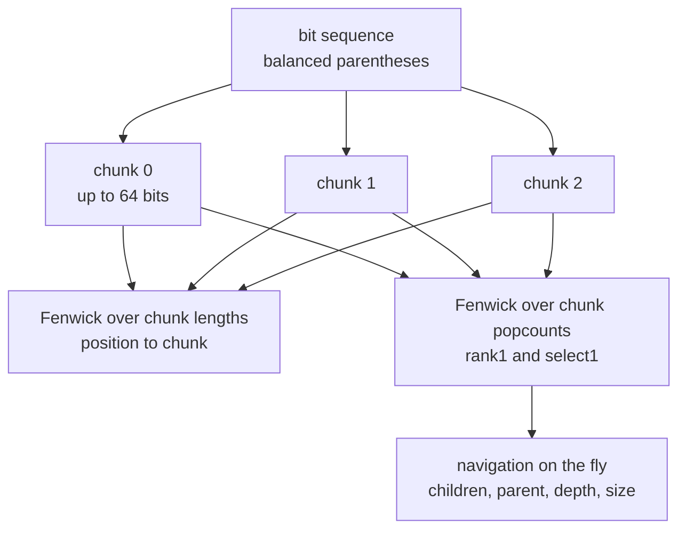
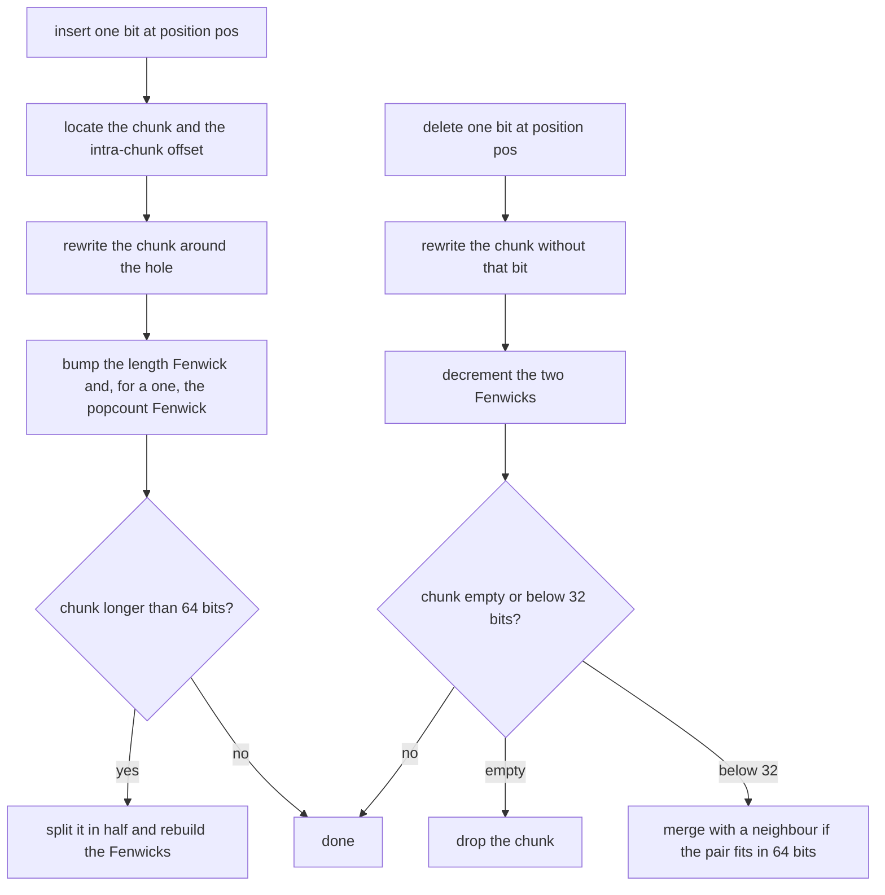
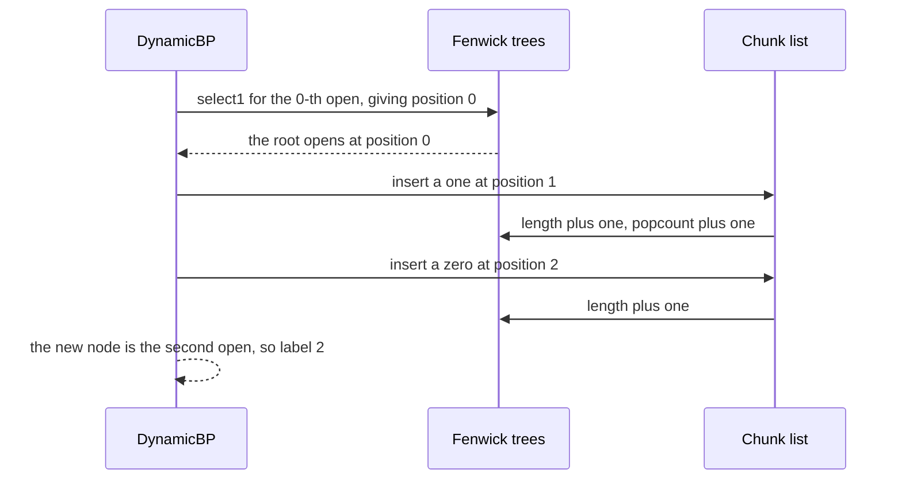

# 611 — Implement dynamic succinct trees (conceptual)

> **Tier:** Expert · **CTCI chapter:** Beyond — Advanced Data Structures & Algorithms
> **Task spec:** [611-implement-dynamic-succinct-trees-conceptual.md](../../../tasks/expert/611-implement-dynamic-succinct-trees-conceptual.md)
> **Solutions:** [Python](../../../solutions/python/expert/611-implement-dynamic-succinct-trees-conceptual/solution.py) ·
> [Java](../../../solutions/java/expert/611-implement-dynamic-succinct-trees-conceptual/Solution.java) ·
> [JavaScript](../../../solutions/javascript/expert/611-implement-dynamic-succinct-trees-conceptual/solution.js) ·
> [C#](../../../solutions/csharp/expert/611-implement-dynamic-succinct-trees-conceptual/Solution.cs)

## 1. Problem restatement

A **dynamic** succinct tree keeps the balanced-parenthesis word of the tree in a bit sequence that
supports insertion and deletion, and derives *all* navigation from that sequence — no parent array, no
child lists, no labels. Two layers:

| Layer | Structure | Operations |
| --- | --- | --- |
| `DynamicBitvector` | 64-bit chunks plus a parallel list of chunk *lengths*, with two Fenwick trees (lengths and popcounts) over the chunk list | `access`, `rank1`, `select1`, `insert`, `delete`, `to_string`, `__len__` |
| `DynamicBP` | the balanced-parenthesis word, node `i` owns the `i`-th `(` | `node_count`, `open_pos`, `excess`, `close_pos`, `depth`, `subtree_size`, `first_child`, `next_sibling`, `children_of`, `parent`, `add_leaf`, `remove_leaf` |

The chunk lengths are stored explicitly because leading zeros inside a chunk carry information that a
`bit_length()` call would destroy. A chunk that grows past 64 bits is split in half, a chunk that empties
is dropped, and a chunk under 32 bits is merged with a neighbour when the pair still fits in one word —
the classic dynamic-bits rebalancing. `add_leaf(parent, position)` inserts the two bits `()` at the
right slot; `remove_leaf(i)` deletes a leaf's pair. The tree therefore allocates nothing per edit.

Concrete results the checks assert:

| Check | Value |
| --- | --- |
| 250 random `insert` / `delete` operations on a bit vector | after every edit the contents equal a plain list, and the final vector has length **130 over 3 chunks** |
| 170 inserts crossing the word boundary twice (150 ones then 20 zeros) | at least 3 chunks, each of size `1..64`, `rank1(149) = 149`, `rank1(170) = 150` |
| deleting those 150 ones | `"0" * 20`, a single chunk, `rank1(len) = 0` |
| `DynamicBitvector("0000").delete(1)` | `"000"` — an all-zero chunk keeps its length |
| 150 random tree edits, each followed by a full verification | the sequence stays balanced, `len == 2 · node_count`, and every navigation op matches the explicit witness tree |
| final printed state | dynamic bit vector 250 edits long, tree of 3 nodes and 6 bits with root degree 2 |

Documented simplification: a production dynamic succinct tree keeps the bits in a balanced binary tree
of blocks with `O(log n)` rank/select and `O(1)`-amortized `findclose` from a BP-matching/pioneer
directory. Here the directory is two Fenwick trees over a list of chunks, and `close_pos` / `parent` are
documented `O(n)` excess scans. The JavaScript solution is more linear still (rank/select is a scan and
the backwards excess search does not skip blocks); the Java solution stores the sequence in a treap of
chunks carrying size, popcount and minimum prefix excess, so its operations are `O(log n)` *expected* —
the priorities come from a deterministic PRNG and the tree is not rebalanced. In all four solutions only
**leaves** can be added and removed, because inserting an internal node needs the heavier split/join of
whole subtrees.

## 2. Intuition

The static encoding is only half the story. A static BP word cannot grow: inserting one node in the
middle shifts every bit after it, and a bit array with a flat prefix-sum directory costs `O(n)` per
edit. Two ideas fix that:

1. **Chunk the bits.** Store the sequence as a list of machine words of up to 64 bits, each with its
   own length. An edit only rewrites one chunk, and rebalancing keeps every chunk between 64 and 32 bits
   on the way down and up.
2. **Index the chunks, not the bits.** Two Fenwick trees over the chunk list answer "how many bits
   before chunk `b`" and "how many ones before chunk `b`" in `O(log #chunks)`, so `rank1` is a Fenwick
   prefix plus one masked popcount, and `select1` is a Fenwick search plus one intra-chunk scan.

Then the tree falls out of the sequence exactly as in the static case, with node `i` owning the `i`-th
`(`:

- `depth(i)` is the excess at that open;
- the matching close is the first position whose excess returns to the same level;
- the first child is the `(` right after the open, the next sibling is the `(` right after the close,
  and the parent is the previous `(` sitting one level higher.

So a tree edit becomes two bit edits.



Navigation is derived from the sequence, never stored, so a tree edit is just two bit edits that have
to keep the word well formed.

## 3. Algorithm

**Bit level, `insert(pos, bit)`:**

1. Find the chunk and the intra-chunk offset from the length Fenwick (`search` + `prefix`), or the last
   chunk when `pos` is the end.
2. Split the chunk's bit pattern into the bits below the offset and the bits above it, shift the upper
   part left by one, put the new bit in the hole, and bump both Fenwicks (length always, popcount only
   for a `1`).
3. If the chunk now exceeds 64 bits, split it in half and rebuild the Fenwicks.

**Bit level, `delete(pos)`:**

4. Remove the bit the same way in reverse and decrement the Fenwicks.
5. If the chunk became empty and it is not the only chunk, drop it; if it fell below 32 bits, merge it
   with a neighbour when their combined length is at most 64.

**Tree level:**

6. `open_pos(i) = select1(i - 1)`; `excess(pos) = 2 · rank1(pos) - pos`.
7. `close_pos(i)`: scan forward from `open_pos(i) + 1` for the first position whose excess equals
   `excess(open_pos(i))`; then `subtree_size(i) = (close_pos(i) - open_pos(i) + 1) / 2`.
8. `first_child(i)`: if the bit right after the open is a `(`, its owner is `rank1(of that position) + 1`,
   otherwise the node is a leaf. `next_sibling(i)`: the same test right after the close.
9. `parent(i)`: scan backwards for a `(` whose excess is one less than the node's level.
10. `add_leaf(parent, position)`: compute the insertion slot, then insert `1` followed by `0`; the new
    node is `rank1(slot) + 1`. `remove_leaf(i)`: delete the `)` first and then the `(`, so the open keeps
    its index while the two deletions happen.

```text
procedure rank1(pos)                                // ones in [0, pos)
    if pos <= 0 then return 0
    if pos >= length then return popcount Fenwick total
    block ← length Fenwick search for pos
    offset ← pos - length Fenwick prefix of block
    return popcount Fenwick prefix of block + popcount(chunk[block] and ((1 shifted left by offset) - 1))

procedure insert(pos, bit)
    total ← length
    if pos = total then
        block ← last chunk, offset ← size of that chunk
    else
        block ← length Fenwick search for pos
        offset ← pos - length Fenwick prefix of block
    low ← chunk[block] and ((1 shifted left by offset) - 1)
    chunk[block] ← low or ((chunk[block] shifted right by offset) shifted left by (offset + 1))
                   or (bit shifted left by offset)
    size[block] ← size[block] + 1
    length Fenwick add 1 at block
    if bit = 1 then popcount Fenwick add 1 at block
    if size[block] > 64 then split(block)           // half the bits each way, rebuild the Fenwicks

procedure delete(pos)
    block ← length Fenwick search for pos
    offset ← pos - length Fenwick prefix of block
    was_one ← (chunk[block] shifted right by offset) and 1
    chunk[block] ← (chunk[block] and ((1 shifted left by offset) - 1))
                   or ((chunk[block] shifted right by (offset + 1)) shifted left by offset)
    size[block] ← size[block] - 1
    length Fenwick add -1 at block
    if was_one = 1 then popcount Fenwick add -1 at block
    if size[block] = 0 and there is more than one chunk then remove the chunk, rebuild the Fenwicks
    else if size[block] < 32 then merge with a neighbour when the two fit into 64 bits
```

```text
procedure add_leaf(parent, position)
    if position = 0 then
        at ← open_pos(parent) + 1
    else
        pos ← open_pos(parent) + 1
        child ← rank1(pos) + 1
        for step ← 1 to position - 1 do
            pos ← close_pos(child) + 1
            child ← rank1(pos) + 1
        at ← close_pos(child) + 1
    insert(at, 1)                                   // the new leaf's open ...
    insert(at + 1, 0)                               // ... directly followed by its close
    return rank1(at) + 1

procedure remove_leaf(i)
    if node i has children then
        raise error: only leaves can be removed
    opening ← open_pos(i)
    delete(opening + 1)                             // the close first, so the open keeps its index
    delete(opening)
```



## 4. Worked example

Start from the two-node tree `[[1], []]` — the root with one leaf child. Its balanced-parenthesis word is
`1100` (4 bits = `2 * 2` nodes), stored as one chunk of length 4 holding the pattern `1100`.

**`add_leaf(1, 0)` — insert a fresh leaf as the *first* child of the root.**

| Step | Action | Word | Chunks (length) | `node_count` |
| --- | --- | --- | --- | --- |
| 0 | start | `1100` | `[4]` | 2 |
| 1 | `at = open_pos(1) + 1 = 0 + 1 = 1` | `1100` | `[4]` | 2 |
| 2 | `insert(1, 1)` | `11100` | `[5]` | 2 |
| 3 | `insert(2, 0)` | `110100` | `[6]` | 3 |
| 4 | new node is `rank1(1) + 1 = 2` | `110100` | `[6]` | 3 |

The resulting word `110100` is exactly the canonical word of `[[1, 2], [], []]`, which the checks assert
by rebuilding it from the explicit tree and mapping `(` to `1` and `)` to `0`. Navigation on the new
word: `children_of(1) = [2, 3]`, `depth(3) = 1`, `subtree_size(1) = 3`, `next_sibling(2) = 3`.

**`add_leaf(1, 1)`** then inserts the new leaf *after* node 2: the slot is `close_pos(2) + 1 = 4`, giving
`11010100` (8 bits, 4 nodes) with `children_of(1) = [2, 3, 4]`. Both words are the ones the checks expect,
and each of the two tree edits cost exactly two bit insertions.



The word-level stress tests exercise the same machinery at scale: 250 random insert/delete operations
keep the vector equal to a plain list after *every* edit and end at length 130 spread over 3 chunks;
inserting 170 bits one at a time (150 ones then 20 zeros) forces splits at 65 and 129 bits, so
`len(chunks) >= 3` with every chunk between 1 and 64 bits, and deleting those 150 ones merges everything
back into a single all-zero chunk with `rank1(170) = 0`. Leading zeros are checked separately:
`DynamicBitvector("0000")` keeps all four bits, and deleting one leaves `"000"`.

The tree-level stress test is the one that matters: 150 deterministic random edit sequences each apply
an `add_leaf` or a `remove_leaf` to the dynamic tree *and* to an explicit witness model, then verify the
whole tree — the word is balanced, has exactly `2 · node_count` bits, and `children_of`, `first_child`,
`next_sibling`, `parent`, `depth` and `subtree_size` agree with the model for every node.

## 5. Complexity

Let `n` be the number of nodes, `b = #chunks ≈ n / 48` and `d` a degree.

| Operation | Best | Average | Worst | Why the bound holds |
| --- | --- | --- | --- | --- |
| `access(pos)` | O(1) | O(log b) | O(log b) | one Fenwick search plus a shift and a mask |
| `rank1(pos)` | O(1) | O(log b) | O(log b) | Fenwick prefix plus one masked popcount |
| `select1(k)` | O(1) | O(log b) | O(log b) + 64 | Fenwick search plus one intra-chunk scan |
| `insert` / `delete` | O(log b) | O(log b) | O(log b + b) | the chunk rewrite is constant; a split, a drop or a merge rebuilds both Fenwicks in `O(b)` |
| `depth(i)` | O(1) | O(log b) | O(log b) | `2 · rank1(open) - open` |
| `close_pos(i)` | O(1) | O(n) | O(n) | forward excess scan (documented: production uses a pioneer directory) |
| `subtree_size(i)` | O(1) | O(log b) | O(log b) | one close plus one open |
| `first_child` / `next_sibling` | O(1) | O(log b) | O(log b) | one `access` plus one `rank1` |
| `parent(i)` | O(1) | O(n) | O(n) | backwards excess scan (documented) |
| `add_leaf` / `remove_leaf` | O(log b) | O(degree + log b) | O(degree · n + log b) | one slot computation then exactly two bit edits; only leaves are allowed |
| Space | — | — | 2n bits + O(n / 64) chunk metadata | the sequence is the only per-node data, plus one length and one popcount per chunk |

Amortized over a long edit sequence each edit performs `O(log b)` Fenwick work and, on average, a
constant number of rebalancing rebuilds, because a split at 65 bits is followed by 32 bits of headroom
before the next split; the 250-edit run ends with 130 bits in 3 chunks, i.e. chunks kept near the
32..64-bit band.

Alternatives:

| Structure | Rank/select | Insert/delete | Space |
| --- | --- | --- | --- |
| Static BP word | O(1) | O(n) | 2n + o(n) bits |
| Bit array with prefix sums | O(1) | O(n) | 2n + o(n · words) bits |
| Chunked word plus Fenwicks (this task) | O(log b) | O(log b) | 2n + O(n / 64) bits |
| Balanced tree of blocks (production) | O(log n) | O(log n) | 2n + o(n) bits |

## 6. Pitfalls and edge cases

- **Leading zeros inside a chunk are data.** `bit_length()` cannot represent them, which is why the
  solution keeps a parallel `sizes` list; `DynamicBitvector("0000")` deleting one bit must give `"000"`
  and not `""`. The JavaScript solution's linear scans and the Java treap's per-chunk `size` field store
  the same information differently.
- **Insert at the very end** is the case where a Fenwick `search` for `pos == length` would land outside
  the chunk list: the code special-cases `pos == total` and appends into the last chunk.
- **Rebalancing both ways.** A chunk over 64 bits splits; a chunk under 32 bits merges with a neighbour
  only if the pair fits; a chunk that empties is dropped, but never the last one. Skipping the merge
  step makes the chunk count grow without bound; merging unconditionally can overflow a chunk.
- **Only leaves can be removed.** `remove_leaf(i)` raises `ValueError` for a node with children, because
  removing an internal node would need to relink its children's pairs. `add_leaf` raises for an unknown
  parent and for a child position beyond the current degree.
- **Delete the close before the open.** `remove_leaf` deletes `opening + 1` first and then `opening`, so
  the open's index is still valid for the second deletion; doing it the other way round deletes the wrong
  bit.
- **The word must stay balanced after every single edit**, not just at the end. The verifier checks
  `is_balanced(word)` and `len(word) == 2 · node_count` after each of the 150 random operations.
- **Out-of-range and invalid values raise.** `access(len)`, `insert(len + 1, 1)`, `delete(-1)`,
  `select1(past the last one)` raise `IndexError`; `insert(pos, 2)` raises `ValueError`.
- **Parent and close are the documented linear scans.** In this conceptual variant `close_pos` scans
  forward, `parent` scans backward, and the Java solution instead descends a treap carrying minimum
  prefix excess per subtree, which is the real `O(log n)` mechanism — the tutorial quotes both because
  the four solutions differ here, and each documents which one it implements.
- **The Java variant is not rebalanced.** Its treap priorities come from the deterministic PRNG, so the
  bounds are expected, not worst case; that trade-off is written into its header rather than hidden.
- **Empty starting state.** `DynamicBitvector()` is length 0 and its string is empty; `DynamicBP()`
  starts from no sequence at all, and every query on an empty word is refused by the range checks rather
  than silently answered.

## 7. Variants and follow-ups

- The static version of the same encoding, with the derivation of every navigation formula →
  [610 — succinct tree representations DFUDS and navigation ops](../../../tasks/expert/610-implement-succinct-tree-representations-dfuds-and-navigation-ops.md).
- The rank/select primitives that make the chunk index constant-time in production →
  [609 — advanced compressed bitvectors RRR and rank/select](../../../tasks/expert/609-implement-advanced-compressed-bitvectors-rrr-and-rank-select.md).
- Keeping old versions of the word instead of editing it in place →
  [612 — persistent data structures with path copying](../../../tasks/expert/612-implement-advanced-persistent-data-structures-with-path-copying.md).

## 8. Check yourself

<details><summary>Show answer</summary>
**Why does the chunk list need explicit lengths?** Because a chunk stores its bits little-endian in an
integer, so an all-zero chunk and a one-bit chunk containing `0` are indistinguishable from the integer
alone. The length list keeps `"0000"` at four bits after a deletion, and `rank1` / `select1` need the
true length to place a query.
</details>

<details><summary>Show answer</summary>
**What exactly does a tree edit cost at bit level?** Two bit insertions (`1` then `0`) or two bit
deletions. All navigation is derived from the word by rank/select and excess, so adding a leaf never
touches any other node's stored data — which is why the structure stays 2n bits plus `O(n / 64)`
metadata instead of growing with the number of edits.
</details>

<details><summary>Show answer</summary>
**Why is `first_child(i)` the `(` right after the open?** In a balanced-parenthesis word the characters
between a node's `(` and its matching `)` are exactly its children's subtrees, in order. If the node is a
leaf that character is the node's own `)`, otherwise every subsequent `(` starts a child — and the owner
of the `j`-th `(` is node `j` by definition of the numbering.
</details>

<details><summary>Show answer</summary>
**Why can the chunk count be trusted to stay small?** Because of the rebalancing rule: a chunk splits
only above 64 bits, so both halves end near 32 bits and need 32 more insertions before splitting again;
a chunk merges upward only below 32 bits and only when the pair fits. The measured run confirms it —
250 random edits leave 130 bits in 3 chunks.
</details>
