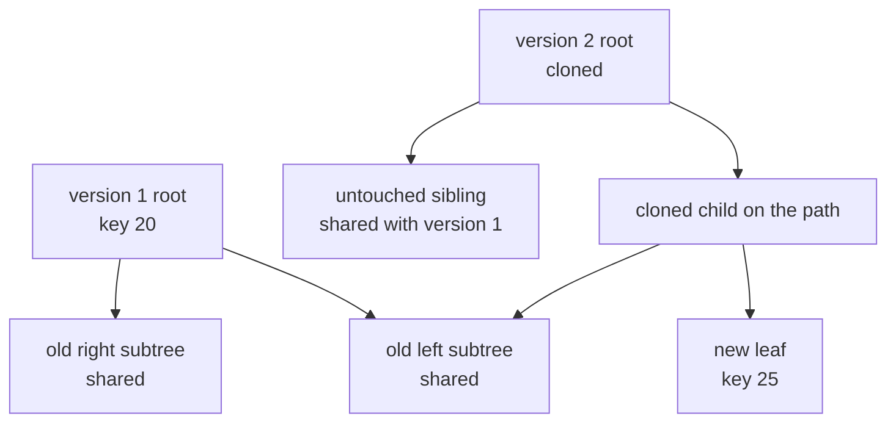
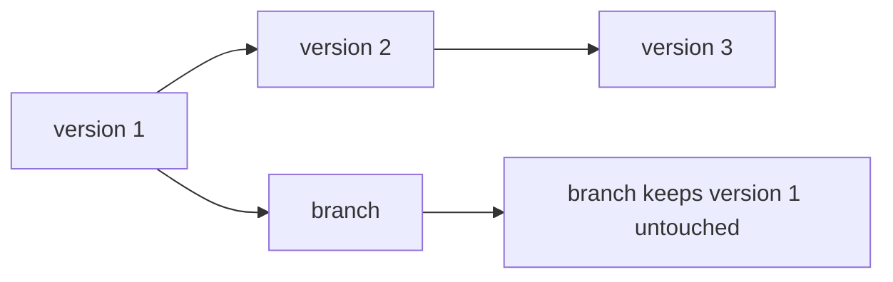
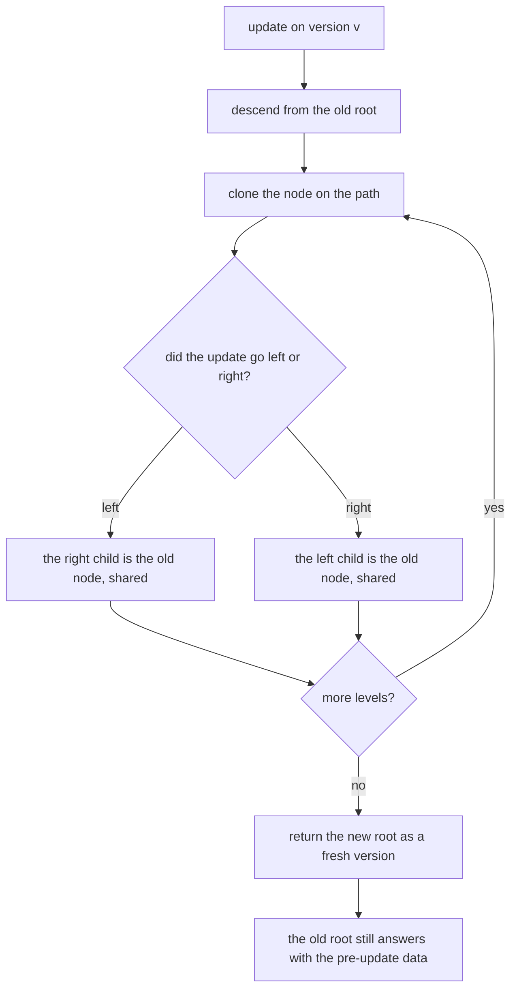
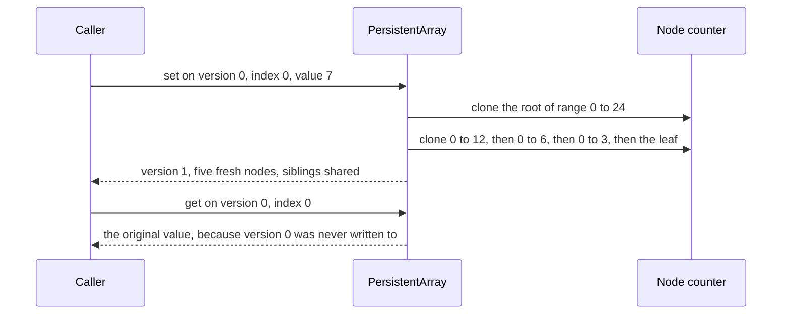

# 612 — Implement advanced persistent data structures with path copying

> **Tier:** Expert · **CTCI chapter:** Beyond — Advanced Data Structures & Algorithms
> **Task spec:** [612-implement-advanced-persistent-data-structures-with-path-copying.md](../../../tasks/expert/612-implement-advanced-persistent-data-structures-with-path-copying.md)
> **Solutions:** [Python](../../../solutions/python/expert/612-implement-advanced-persistent-data-structures-with-path-copying/solution.py) ·
> [Java](../../../solutions/java/expert/612-implement-advanced-persistent-data-structures-with-path-copying/Solution.java) ·
> [JavaScript](../../../solutions/javascript/expert/612-implement-advanced-persistent-data-structures-with-path-copying/solution.js) ·
> [C#](../../../solutions/csharp/expert/612-implement-advanced-persistent-data-structures-with-path-copying/Solution.cs)

## 1. Problem restatement

Build three **fully persistent** containers: an update returns a *new* version and never mutates a node
that an older version still points at, so every historical version keeps answering its own queries
forever. The optimisations under test are **path copying** and the allocation counters that make it
measurable.

| Structure | Update | Version handle | Sharing |
| --- | --- | --- | --- |
| `PersistentTreap` | `insert(root, key)`, `delete(root, key)` via `split` / `merge` | the root node (`None` is the empty version) | split and merge clone only the nodes they recurse through |
| `PersistentArray` | `set(version, index, value)` appends a version | index into an append-only `roots` list | a segment tree; `set` clones one root-to-leaf path |
| `PersistentStack` | `push(version, value)` | index into `versions` | a cons list: one new cell per push, everything else shared |

Reads that must keep working on *old* versions: `contains`, `to_list`, `size`, `height`, `nodes` for the
treap; `get`, `range_sum`, `snapshot` for the array; `to_list` for the stack.

Concrete results the checks assert:

| Measurement | Value |
| --- | --- |
| 60-edit random treap history | 61 versions, each equal to an independent `set`-based oracle, 4501 nodes allocated in total |
| 200 sequential inserts into a growing treap | every update allocates at most `4 · height + 8` nodes, maximum observed **43**, and always fewer than the whole tree |
| one insert into a 200-node treap of height 15 | `nodes(child) == nodes(parent) + 1` with only **15** fresh nodes, i.e. `copied < nodes(child) / 4` |
| 24-element array, 40 random `set`s | 42 versions, 282 nodes; a single `set` clones **5 or 6** nodes, and the file bounds it by `2 · ceil(log2 24) + 2 = 12` |
| every array version | `snapshot(version)` equals a plain Python list and every `range_sum` equals `sum(list[lo:hi])` |
| 12 pushes on the stack | 13 nodes for 13 pushes, `to_list(top) == [11, 10, ..., 0]`, version 4 still `[3, 2, 1, 0]` |

Documented simplification: keys are integers (the double split that drops an overwritten key relies on
`key + 1` being a valid bound), priorities come from a fixed `splitmix64` hash instead of a random source
so that every allocation count in the output is reproducible, and the JavaScript vector uses
power-of-two slots. `insert` first drops any copy of the key already present, so the treap behaves like a
set.

## 2. Intuition

A mutable balanced tree cannot be persistent: an update rewrites nodes in place, and a version held by a
caller sees the change. The naive fix is to copy the entire structure on every update — `O(n)` nodes per
edit, which for `m` versions is `O(m · n)` storage and useless for a snapshot-heavy workload.

Path copying is the observation that an update in a balanced tree touches only the nodes on one
root-to-leaf path: `O(log n)` of them. Clone exactly those, point the clones at the *untouched
subtrees*, and hand back a new root. Every old root still sees the old structure, because none of its
nodes were written to; the new root sees the update, because its path was rebuilt.

Two consequences make this practical:

1. **A version is just a root pointer** — no copying of the version, no tombstone, no reference counts.
2. **Consecutive versions share almost everything** — a version and its parent differ in `O(log n)`
   nodes and share the other `n - O(log n)`.



The two roots coexist: an insert that descends left clones the left spine and re-uses the entire right
subtree, so the old version's right subtree *is* the new version's right subtree.



Versions form a tree, not a list: two updates applied to the same version produce two independent
children, and neither can observe the other.

## 3. Algorithm

**Persistent treap** — a randomised BST made persistent through `split` / `merge`, which clone precisely
the nodes they recurse through:

```text
procedure split(root, key)                          // returns (keys below key, keys at or above key)
    if root is none then
        return none, none
    if root.key < key then
        low, high ← split(root.right, key)
        return make_node(root.key, root.left, low), high
    low, high ← split(root.left, key)
    return low, make_node(root.key, high, root.right)

procedure merge(left, right)                        // every key of left is below every key of right
    if left is none then return right
    if right is none then return left
    if left.priority < right.priority then          // min-heap on the deterministic priority
        return make_node(left.key, left.left, merge(left.right, right))
    return make_node(right.key, merge(left, right.left), right.right)

procedure insert(root, key)
    low, high ← split(root, key)
    discarded, duplicate ← split(high, key + 1)     // drop an existing copy of the key
    return merge(merge(low, make_node(key)), duplicate)

procedure delete(root, key)
    low, high ← split(root, key)
    discarded, remaining ← split(high, key + 1)
    return merge(low, remaining)
```

Every `make_node` bumps the allocation counter, so the path-copying cost of an update is a measured
number rather than an assertion: `nodes_after - nodes_before`.

**Persistent array** — a segment tree whose internal node carries the range sum:

```text
procedure set_version(version, index, value)
    check that the version and the index are in range
    append clone_path(roots[version], 0, n, index, value) to roots
    return the new version number

procedure clone_path(node, lo, hi, index, value)
    if hi - lo = 1 then
        return new leaf node with (value, value)
    mid ← (lo + hi) div 2
    if index < mid then
        left ← clone_path(node.left, lo, mid, index, value)
        right ← node.right                          // shared, not copied
    else
        left ← node.left                            // shared, not copied
        right ← clone_path(node.right, mid, hi, index, value)
    return new internal node with total = left.total + right.total
```

```text
procedure push(version, value)
    node ← pair of (value, versions[version])       // one new cell, the tail is shared
    append node to versions
    return the new version number
```



## 4. Worked example

**Treap.** Inserting `50, 20, 70, 10, 30, 60, 90, 5` into an initially empty treap, with priorities
`splitmix64(key)`:

| Insert | Fresh nodes copied | Nodes in the version | Height | Keys in order |
| --- | --- | --- | --- | --- |
| 50 | 1 | 1 | 1 | `[50]` |
| 20 | 4 | 2 | 2 | `[20, 50]` |
| 70 | 5 | 3 | 3 | `[20, 50, 70]` |
| 10 | 4 | 4 | 4 | `[10, 20, 50, 70]` |
| 30 | 13 | 5 | 5 | `[10, 20, 30, 50, 70]` |
| 60 | 14 | 6 | 6 | `[10, 20, 30, 50, 60, 70]` |
| 90 | 7 | 7 | 6 | `[10, 20, 30, 50, 60, 70, 90]` |
| 5 | 4 | 8 | 6 | `[5, 10, 20, 30, 50, 60, 70, 90]` |

Every row is a full path copy: the insert does two `split`s and one `merge`, and each of them clones the
nodes it walks over, which is why an insert into a five-level tree can cost 13 nodes. The old roots are
never touched — `to_list` of the previous root is re-read after every later insert and still returns the
previous content.

**Array.** `values = [(i * 37) % 101 - 50 for i in range(24)]`, so `n = 24` and the tree over `[0, 24)`
splits at 12, then 6, then 3, then 1. Building the 24 leaves plus their 23 internal nodes costs **47**
nodes. `set(0, 0, 7)` then clones
`[0, 24) → [0, 12) → [0, 6) → [0, 3) → [0, 1)` — **5 nodes**, every sibling along the way being shared
with version 0. A later `set` on index 5 takes a one-level-deeper path (`[0, 24) → [0, 12) → [0, 6) →
[3, 6) → [4, 6) → [4, 5)`) and therefore clones **6 nodes**. Version 0 still returns the original array
and `range_sum(0, 0, 24)` still sums to `-78`.



**Stack.** Twelve pushes allocate exactly twelve cells and version 4 still holds `[3, 2, 1, 0]` while the
top version holds `[11, 10, ..., 0]` — the trivial end of the path-copying spectrum, where the path has
length one.

Scale: the 200-insert build ends with a 200-node treap of height 15, and the worst single update copies
**43** nodes — the bound the checks assert is `4 · height + 8 = 68`. Adding one more key to that tree
copies 15 nodes and leaves `nodes(child) = nodes(parent) + 1`, so the update shares 186 of the 201 nodes.

## 5. Complexity

Let `n` be the number of keys, `m` the number of versions and `h` the height (expected `O(log n)` for
the treap, exact `ceil(log2 n)` for the array tree).

| Operation | Best | Average | Worst | Why the bound holds |
| --- | --- | --- | --- | --- |
| Treap `insert` / `delete` | O(1) nodes | O(h) nodes | O(h) nodes, O(n) if the treap degenerates | two splits and one merge, each cloning one node per level |
| Treap read on any version | O(1) | O(h) | O(n) | a plain BST descent, no allocation |
| Array `set` | O(log n) nodes | O(log n) | O(log n) | one clone per level of the segment tree (measured 5 or 6 for `n = 24`) |
| Array `get` | O(1) | O(log n) | O(log n) | descent by index, no allocation |
| Array `range_sum` | O(1) | O(log n + covered nodes) | O(n) | the stored `total` prunes fully covered ranges |
| Stack `push` | 1 node | 1 node | 1 node | a cons cell plus a shared tail; measured 13 nodes for 13 pushes |
| Space over `m` versions | — | O(m log n) nodes | O(m · n) if nothing is shared | each version adds only its copied path; 61 treap versions cost 4501 nodes in total |
| Sharing per update | — | `n - O(log n)` nodes reused | — | measured: 15 fresh nodes on a 201-node tree |

Alternatives:

| Approach | Update cost | Space for `m` versions | Notes |
| --- | --- | --- | --- |
| Copy the whole structure | O(n) | O(m · n) | correct but prohibitive |
| Path copying (this task) | O(log n) | O(m · log n) | needs immutable nodes and no parent pointers |
| Fat nodes | O(1) per field write | O(m) extra per modified field | reads must search version history |
| Node copying with bounded in-place slots | O(1) amortized | O(m) | the classical Driscoll-Sarnak-Sleator-Tarjan result |

## 6. Pitfalls and edge cases

- **No in-place writes, not even for speed.** Every mutating helper returns a *new* node; the checks
  re-read an old version after later updates (`treap.to_list(roots[1]) == before`,
  `array.snapshot(0) == values`) specifically to catch a shortcut that rewrites a shared node.
- **A version is a handle, and handles must stay canonical.** `insert` on an existing key returns a
  structurally new root only because the double split removes the old copy first; without that, a
  duplicate key would be inserted and the "set" contract would break.
- **`split` and `merge` boundaries.** `split(root, key)` returns keys `< key` and keys `>= key`; `insert`
  relies on the second split at `key + 1` to isolate copies of `key`. This is exactly why the JavaScript
  header documents integer keys as a simplification.
- **Empty version.** `PersistentTreap().insert(None, 5).key == 5` and `size(None) == 0`; an empty array
  has `roots == [None]`; the empty stack version is `[]` and pushing onto it works. All are checked.
- **Invalid handles raise.** `array.get(10 ** 6, 0)` and `array.set(0, 24, 1)` raise `IndexError`, and the
  treap's recursion terminates on `None` rather than dereferencing it.
- **Deterministic priorities mean a deterministic shape — not a balanced one.** Because
  `priority = splitmix64(key)`, the hand list `50, 20, 70, 10, 30, 60, 90, 5` builds a *chain* of height 6
  for 8 keys. The file therefore bounds each update by `4 · height + 8` instead of by `c · log n`, which
  is the honest bound for a treap whose randomness is a hash of the key.
- **Allocation counts are the deliverable.** `Counter.tick()` counts every `make_node`, and the checks
  compare `nodes(version)` before and after each update; a version that reports the same node count as
  its parent while claiming a change would fail immediately.
- **Structural sharing is asserted, not assumed.** `nodes(child) == nodes(parent) + 1` plus
  `copied < nodes(child) / 4` on a 201-node tree proves the update re-used the untouched subtrees.
- **Recursion depth.** `height`, `nodes` and the builders recurse; the checks keep `n` at 24 for the
  array and 200 for the treap, and the treap's reads (`to_list`) are iterative so a degenerate chain does
  not overflow the Python stack.
- **The array's bound is a bound.** The printed "12 nodes per set" is
  `2 · ceil(log2 n) + 2`; the measured values are 5 and 6, and the checks assert `<= 12`.

## 7. Variants and follow-ups

- Persisting a union-find on top of the same persistent array, where path compression is forbidden →
  [613 — fully persistent union-find](../../../tasks/expert/613-implement-fully-persistent-union-find-complex.md).
- Path copying on a B-tree, which is the versioned-index use case →
  [614 — persistent B-tree for a versioned DB index](../../../tasks/expert/614-implement-persistent-b-tree-for-versioned-db-index.md).
- A mutable-but-versioned sequence where the structure is edited in place instead of copied →
  [611 — dynamic succinct trees](../../../tasks/expert/611-implement-dynamic-succinct-trees-conceptual.md).

## 8. Check yourself

<details><summary>Show answer</summary>
**Why does path copying cost `O(log n)` nodes and not `O(n)`?** An update only changes the nodes on one
root-to-leaf path, so cloning exactly those and re-pointing them at the untouched sibling subtrees
produces a correct new tree. All the nodes off the path are shared, which is why a 201-node tree is only
extended by 15 fresh nodes.
</details>

<details><summary>Show answer</summary>
**Why is a version just a root pointer, while a fat-node version needs history?** Because nothing in the
old structure is modified: the old root still points at the old nodes, so the version *is* its root.
Fat-node persistence instead overwrites fields and stores a version-stamped list of values per field, so
a read must search that history — more space per modified field and slower reads.
</details>

<details><summary>Show answer</summary>
**Why does `insert` split twice?** The first split separates keys below the new key; the second, at
`key + 1`, separates copies of `key` itself, which are then discarded. Without it the treap would hold
duplicates and `size` would no longer match an oracle built from a `set`.
</details>

<details><summary>Show answer</summary>
**The hand list `50, 20, 70, 10, 30, 60, 90, 5` ends as a chain of height 6 — is the implementation
broken?** No: priorities are `splitmix64(key)`, a fixed function of the key, so the shape is deterministic
rather than random. Those eight keys happen to receive monotone priorities. The checks therefore bound
each update by `4 · height + 8`, and separately assert `copied < nodes / 4`, both of which hold on the
200-key build where the max copy is 43 nodes at height 15.
</details>
