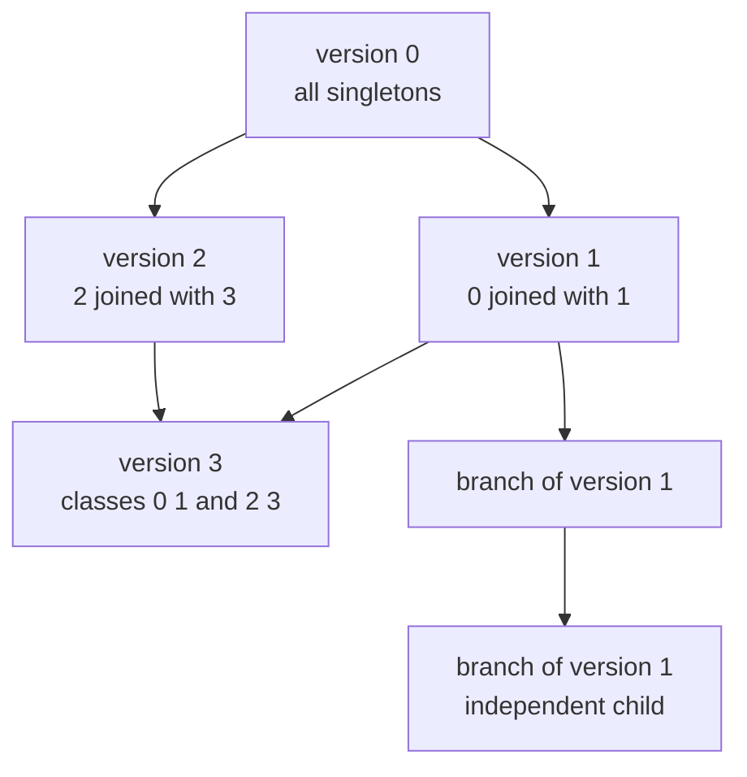
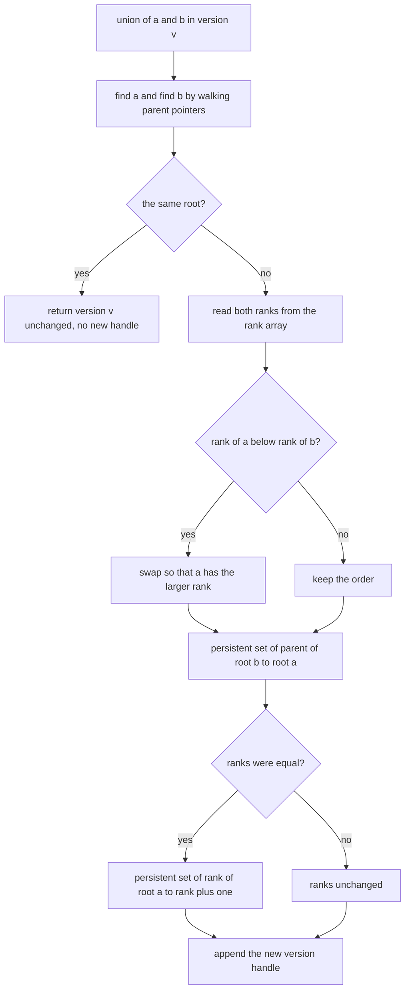
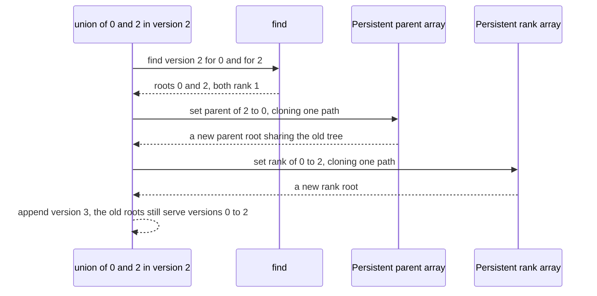

# 613 — Implement fully persistent union-find (complex)

> **Tier:** Expert · **CTCI chapter:** Beyond — Advanced Data Structures & Algorithms
> **Task spec:** [613-implement-fully-persistent-union-find-complex.md](../../../tasks/expert/613-implement-fully-persistent-union-find-complex.md)
> **Solutions:** [Python](../../../solutions/python/expert/613-implement-fully-persistent-union-find-complex/solution.py) ·
> [Java](../../../solutions/java/expert/613-implement-fully-persistent-union-find-complex/Solution.java) ·
> [JavaScript](../../../solutions/javascript/expert/613-implement-fully-persistent-union-find-complex/solution.js) ·
> [C#](../../../solutions/csharp/expert/613-implement-fully-persistent-union-find-complex/Solution.cs)

## 1. Problem restatement

`find` and `connected` must answer for **any historical version**, and new versions may branch off old
ones — two children of the same version stay independent. Versions are therefore a *tree*, not a list.

| Element | Content |
| --- | --- |
| version handle | an index into an append-only list of `(parentRoot, rankRoot, parentVersion)` triples |
| `parentRoot`, `rankRoot` | roots of a **persistent array** (segment tree) holding the parent and rank columns |
| `find(version, x)` | walk parent pointers *inside that version*; also reports the number of pointer steps |
| `union(version, a, b)` | link the smaller rank under the larger, append a new version, return its handle |
| `connected`, `classes` | diagnostics built on `find` |
| `branch(version)` | an explicit copy of a version so the two can diverge independently |

The core design decision: **no path compression**. Compression rewrites the parent pointers of nodes that
older versions also point at, so it would silently rewrite history. Union by rank without compression is
the classic fully persistent answer, and the rank array bounds every pointer chain.

Concrete results the checks assert:

| Check | Value |
| --- | --- |
| base version of 12 elements | `[[0], [1], ..., [11]]` (all singletons) |
| `union(0, 3, 3)` | returns version `0` — a no-op must stay canonical |
| 60-step deterministic history over a *version tree* | 73 versions; every version's classes equal an oracle that rebuilds a fresh union-find along that version's ancestry |
| the same history | 8 unions folded into an existing version because the pair was already connected |
| branching | a union in the left child is invisible in the right child and in the base |
| immutability | a historical version's parent snapshot is byte-identical after 20 later unions |
| union by rank | measured chain depth 1, rank bound `bit_length(12) - 1 = 3`, 3592 pointer steps in total |
| space | 306 array nodes allocated versus 1752 cells for full copies of every version |
| counter-example | an in-place path-compressing structure *does* mutate the array a previous version points at |

Documented simplification: there is no path compression, and that is deliberate rather than an oversight
(the JavaScript header spells out why). Arrays are sized to a fixed element count; the version list is
append-only so no version is ever reclaimed, which is what "fully persistent" costs.

## 2. Intuition

The mutable union-find is nearly optimal: union by rank gives height `O(log n)`, and path compression
gives amortised inverse-Ackermann time. Both tricks rely on **writing to shared state** — compression
rewrites the parent of every node on the path it walks, and even a plain union overwrites one parent
cell. In a persistent setting those cells are shared with older versions, so any write changes history.

The way out is to give up compression and buy persistence instead:

1. keep the parent and rank columns in a **persistent array** (a segment tree that clones one path per
   write, exactly as in task 612), so a union that writes two cells clones `O(log n)` nodes twice;
2. keep every version as a pair of roots plus a pointer to the version it was derived from, so a version
   is `O(1)` metadata and versions form a tree;
3. rely on union by rank alone for the height bound: the rank is a property of the *tree*, not of the
   access history, so it stays valid for every future version.

What you pay is a factor `log n`: a parent pointer step is now a persistent-array read, so `find` is
`O(log n)` steps × `O(log n)` per read = `O(log² n)`.



Every node of that diagram is a `(parentRoot, rankRoot)` pair; the edges record which version a new one
was derived from, which is what lets the oracle rebuild a version by replaying its ancestry.

## 3. Algorithm

**Persistent array** (shared with the path-copying task): `set(root, index, value)` returns a new root,
cloning the `O(log n)` nodes on the root-to-leaf path and sharing everything else; `get(root, index)`
descends the same way without allocating.

**Union-find over two such arrays:**

```text
procedure find(version, x)
    check that the version and x are in range
    parent_root ← versions[version].parentRoot
    steps ← 0
    node ← get(parent_root, x)
    while node ≠ x do
        x ← node
        node ← get(parent_root, x)
        steps ← steps + 1
    return x, steps

procedure union(version, a, b)
    root_a, ignored ← find(version, a)
    root_b, ignored ← find(version, b)
    if root_a = root_b then
        return version                              // already connected: the very same handle
    parent_root ← versions[version].parentRoot
    rank_root ← versions[version].rankRoot
    rank_a ← get(rank_root, root_a)
    rank_b ← get(rank_root, root_b)
    if rank_a < rank_b then
        swap root_a and root_b, swap rank_a and rank_b
    parent_root ← set(parent_root, root_b, root_a)  // the new array shares the untouched path
    if rank_a = rank_b then
        rank_root ← set(rank_root, root_a, rank_a + 1)
    versions.append((parent_root, rank_root, version))
    return length(versions) - 1

procedure branch(version)
    check that the version is in range
    parent_root, rank_root ← versions[version].parentRoot, versions[version].rankRoot
    versions.append((parent_root, rank_root, version))       // same roots, a new independent handle
    return length(versions) - 1
```

```text
procedure classes(version)                          // the canonical partition at that version
    groups ← empty map
    for x ← 0 to size - 1 do
        groups[find(version, x)].append(x)
    return sorted(sorted(group) for group in groups.values())
```



## 4. Worked example

Take `SIZE = 6` so the rank bound is `bit_length(6) - 1 = 2`, and start from version 0 (all singletons,
`parent = [0, 1, 2, 3, 4, 5]`, `rank = [0, 0, 0, 0, 0, 0]`).

| Call | `find` results | Ranks | Array writes | New version `v` | Classes |
| --- | --- | --- | --- | --- | --- |
| `union(0, 0, 1)` | 0 and 1 | 0 = 0, so after the swap `rank[0]` becomes 1 | parents: `1 → 0`; `rank[0] = 1` | 1 | `[[0,1],[2],[3],[4],[5]]` |
| `union(1, 2, 3)` | 2 and 3 | equal, `rank[2]` becomes 1 | parents: `3 → 2`; `rank[2] = 1` | 2 | `[[0,1],[2,3],[4],[5]]` |
| `union(2, 0, 2)` | 0 and 2 | equal, `rank[0]` becomes 2 | parents: `2 → 0`; `rank[0] = 2` | 3 | `[[0,1,2,3],[4],[5]]` |
| `union(3, 4, 5)` | 4 and 5 | equal, `rank[4]` becomes 1 | parents: `5 → 4`; `rank[4] = 1` | 4 | `[[0,1,2,3],[4,5]]` |

Reading `find(3, 3)` — element 3 in version 3: `3 → 2` (one step), `2 → 0` (two steps), and `parent[0] =
0` stops the walk, so the root is 0 after **2 pointer steps**, within the rank bound. Each of those steps
is a `get` on a persistent segment tree, i.e. `O(log n)` node visits, which is the `log` factor the
persistence costs.

The base version is untouched: `classes(0) == [[0], [1], [2], [3], [4], [5]]` after all four unions,
because versions 1 to 4 write only into *new* array nodes. Every version's parent column is a distinct
root, so version 1's `parent = [0, 0, 2, 3, 4, 5]` is still readable while version 3's is
`[0, 0, 0, 2, 4, 5]`.



The counter-example in the file is the mirror image of every one of those steps: a mutable union-find
that shares one parent array takes `parent = [0, 1, 2, 3, 4, 5]` with the chain `4 → 3 → 2`, calls
`find(4)`, and rewrites it to `parent[4] = 2`, `parent[3] = 2`. The true root is still reported, but the
snapshot taken before the call (`snapshot[4] == 3`, `snapshot[3] == 2`) no longer matches the shared
array — which is precisely the corruption a persistent structure must avoid, and the file asserts that
the persistent version's fingerprint does *not* change.

## 5. Complexity

Let `n` be the element count, `m` the number of versions and `h` the maximum pointer-chain length, which
union by rank bounds by `floor(log2 n)`.

| Operation | Best | Average | Worst | Why the bound holds |
| --- | --- | --- | --- | --- |
| `find(version, x)` | O(log n) | O(log n · h) | O(log² n) | `h` pointer steps, each a persistent-array `get` of `O(log n)` |
| `union(version, a, b)` | O(log n) | O(log² n) | O(log² n) | two finds plus at most two persistent `set`s |
| `union` on an already joined pair | O(log n) | O(log² n) | O(log² n), **0** new nodes | the early return hands back the same version handle |
| `branch(version)` | O(1) | O(1) | O(1) | one appended triple referring to existing roots |
| `classes(version)` | O(n log n) | O(n log² n) | O(n log² n) | a `find` per element (diagnostic only) |
| Space per union | O(log n) nodes | O(log n) | O(log² n) nodes | one cloned path per array write, and a no-op writes nothing |
| Total space for `m` versions | — | O(m log n) nodes | O(m log² n) | measured 306 nodes for the 12-element history, against 1752 cells for full copies |

Rank bound measurement: for `n = 12`, `bit_length(12) - 1 = 3`, the observed chain depth is **1**, and
3592 pointer steps are counted across the whole 73-version history.

Alternatives:

| Approach | `find` | Persistence | Space |
| --- | --- | --- | --- |
| Union by rank plus path compression | near O(1) amortised | impossible in place | O(n) |
| Union by rank, no compression (this task) | O(log² n) | full, branching | O(m log n) nodes |
| Replay the union log per query | O(queries · log n) | full | O(n + queries) |
| Rollback-only (partially persistent) structure | O(log n) amortised | linear history only | O(n + rollbacks) |

## 6. Pitfalls and edge cases

- **Path compression is not "missing", it is forbidden.** Compressing rewrites cells older versions still
  point at; the file demonstrates the corruption explicitly with a shared mutable array. The rank rule
  alone is what keeps the chain length bounded.
- **A no-op union must return the *same* handle.** `union(0, 3, 3) == 0`, and the 60-step history records
  8 such folds. If a no-op appended a fresh version, `connected` would still work but handles would stop
  being canonical and comparisons for equality would silently fail.
- **Versions branch, so ancestry is a tree.** `branch` exists to make that explicit, and the oracle
  therefore rebuilds a version by walking `parentVersion` pointers to the base rather than replaying a
  single global log.
- **Branching independence is asserted three ways.** A union in the left child must be invisible in its
  sibling *and* in the base: `connected(left, 0, 1)`, `not connected(left, 2, 3)`,
  `not connected(right, 0, 1)`, `not connected(base, 0, 1)`.
- **Immutability is checked with a fingerprint.** `parent_fingerprint(version)` snapshots the whole
  parent column; the same value must come back after 20 later unions, and again after the mutable
  counter-example has run.
- **Invalid handles raise.** `find(len(versions), 0)`, `find(0, SIZE)`, `branch(len(versions))` and
  `array.get(root, SIZE)` all raise `IndexError`.
- **Rank is a height bound, not a size.** Ranks only grow when two equal-rank roots are joined, which is
  what bounds the chain by `floor(log2 n)`; a size-based rule would need one more array and gives no better
  bound here.
- **`union(a, b)` with `a = b`** is the degenerate case of the same rule and must go through `find` twice
  without writing anything.
- **Two arrays, not one.** Parent and rank live in separate persistent arrays, so a union can write the
  parent column without touching the rank column; sharing a single array would force a write to the rank
  slot of every node and destroy the `O(log n)` node budget.
- **`deep_copy_size` is the honest baseline.** It reports `versions · size · 2` cells — the cost of a
  naive full copy per version — and the checks require the persistent structure to stay below a quarter of
  it (306 nodes versus 1752 cells on the 12-element history).

## 7. Variants and follow-ups

- The persistent array that makes the version handles work, and its allocation counters →
  [612 — persistent data structures with path copying](../../../tasks/expert/612-implement-advanced-persistent-data-structures-with-path-copying.md).
- Persisting a whole ordered index instead of a disjoint-set structure →
  [614 — persistent B-tree for a versioned DB index](../../../tasks/expert/614-implement-persistent-b-tree-for-versioned-db-index.md).
- A model of causal order that a branching version tree must respect →
  [619 — formal model for happens-before](../../../tasks/expert/619-implement-formal-model-for-happens-before-and-verify.md).

## 8. Check yourself

<details><summary>Show answer</summary>
**Why can the fully persistent union-find not use path compression?** Because compression writes to the
parent pointers of every node on the path it walks, and those same nodes are reachable from older
versions. Rewriting them changes answers that were already given — the file shows a shared mutable array
whose snapshot stops matching after a single compressed `find`. Union by rank gives the height bound
without any such write.
</details>

<details><summary>Show answer</summary>
**Why is a version a pair of roots rather than a copy of the arrays?** Because persistence lives in the
arrays: each array write returns a new root that clones `O(log n)` nodes and shares the rest. So a
version only has to remember which two roots it uses, which makes a handle `O(1)` metadata and lets two
versions diverge by writing into different clones.
</details>

<details><summary>Show answer</summary>
**What does a no-op union cost?** Two `find`s and nothing else: the early return hands back the same
version handle, so no array node is allocated and the version count does not grow. The checks count 8 of
those folds in the 60-step history and assert `union(0, 3, 3) == 0`.
</details>

<details><summary>Show answer</summary>
**What exactly bounds the pointer chain, and to what value here?** Union by rank: a root's rank only
increases when two equal-rank trees are joined, so a chain of length `h` needs at least `2^h` elements
and therefore `h <= floor(log2 n)`. For `n = 12` that is `bit_length(12) - 1 = 3`, and the measured
maximum is 1.
</details>

<details><summary>Show answer</summary>
**How does the oracle avoid trusting the implementation?** For a version it walks the `parentVersion`
chain back to the base and replays the recorded unions into a *fresh* plain union-find with its own rank
array. Equality of `classes` between the two is then a statement about the version tree, not about the
persistent arrays doing the work.
</details>
