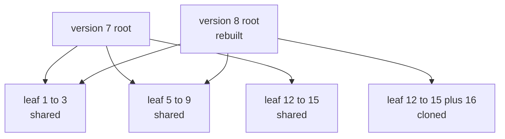
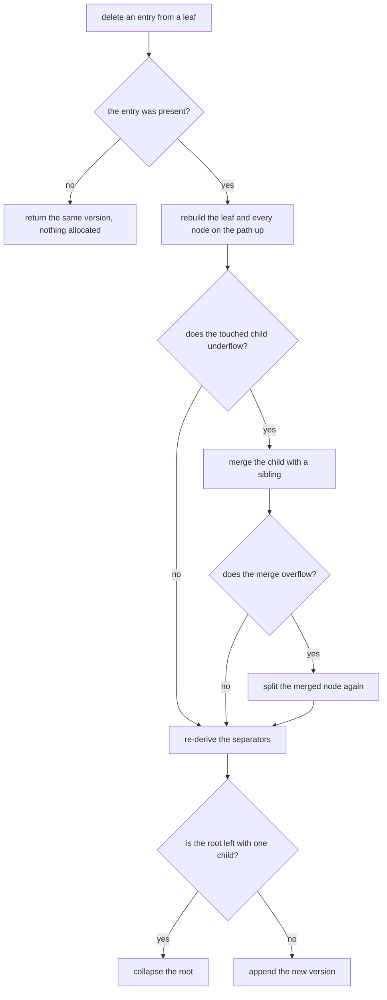
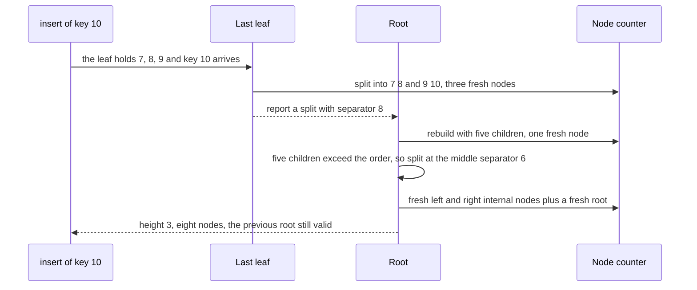

# 614 — Implement persistent B-tree for versioned DB index

> **Tier:** Expert · **CTCI chapter:** Ch 14 — Databases
> **Task spec:** [614-implement-persistent-b-tree-for-versioned-db-index.md](../../../tasks/expert/614-implement-persistent-b-tree-for-versioned-db-index.md)
> **Solutions:** [Python](../../../solutions/python/expert/614-implement-persistent-b-tree-for-versioned-db-index/solution.py) ·
> [Java](../../../solutions/java/expert/614-implement-persistent-b-tree-for-versioned-db-index/Solution.java) ·
> [JavaScript](../../../solutions/javascript/expert/614-implement-persistent-b-tree-for-versioned-db-index/solution.js) ·
> [C#](../../../solutions/csharp/expert/614-implement-persistent-b-tree-for-versioned-db-index/Solution.cs)

## 1. Problem restatement

A versioned database index hands a **version** to each reader and never lets a later write invalidate an
earlier reader's view. The structure here is a copy-on-write B-tree: every node is immutable, and an
update rebuilds only the nodes on the touched root-to-leaf path, sharing every untouched sibling with the
previous version. A version is just a root pointer.

| Element | Content |
| --- | --- |
| `Leaf` | a tuple of sorted `(key, value)` entries, at most `ORDER - 1 = 3` |
| `Internal` | a tuple of children plus `len(children) - 1` separators, at most `ORDER = 4` children |
| separator convention | `separator[i]` is the **maximum key of `children[i]`**; a search descends into `children[i]` while `key > separator[i]` |
| `PersistentBTree` | `insert`, `delete`, `get`, `items`, `keys`, `range_scan`, `height`, `nodes`, `validate` |
| `PersistentIndex` | `put`, `remove`, `get`, `keys`, `scan`, version handles, `last_put_nodes` |

Invariants verified after mutations and at many intermediate versions:

1. a node has at most `ORDER` children (a leaf at most `ORDER - 1` entries);
2. separators increase and each equals the maximum of the child to its left;
3. every non-root internal node keeps at least `MIN_CHILDREN = (ORDER + 1) / 2 = 2` children and every
   non-root leaf at least one entry;
4. all leaves sit at the same depth.

Concrete results the checks assert:

| Check | Value |
| --- | --- |
| 120-version insert history | 208 versions in total, every version's `keys` equals the sorted keys of an independent dict oracle |
| invariants | `validate(root) is True` after inserts, after bulk inserts, after 70 deletions and on every rebuilt tree |
| copy-on-write cost | `last_put_nodes <= 3 · height + 1`, and the measured maximum is **7 nodes per update on an index of 32 nodes** |
| from-scratch rebuild | re-inserting a version's live entries gives the same keys *and the same height* |
| final printed state | 208 versions, 599 nodes allocated, height 4, 32 live entries, order 4 with at least 2 children per internal node |
| immutability | a frozen version's `keys` are unchanged after a later `put` on it, and the old version does not see the late write |
| deletion of a missing key | returns the **very same** version object |

Documented simplification: a production B-tree first *borrows* an entry from a richer sibling and merges
only as a last resort; here an underflowing node is merged immediately and the merge is undone by a split
when it overflows. Both keep the invariants that matter (order, occupancy, uniform depth, ordered
separators); the merge variant simply performs more node rewrites, so the checks bound node allocation
instead of pinning exact counts. The JavaScript solution additionally caches each node's subtree count,
keys are integers (comparison is numeric only), and every version is verified against an independent map
snapshot.

## 2. Intuition

The naive way to give readers a stable view is to copy the whole index per version — `O(n)` pages per
write, which is exactly what a versioned database cannot afford. The copy-on-write idea is that an update
touches one path from the root to a leaf, so rebuilding that path and sharing everything else produces a
correct tree that differs from its parent in `O(log_b n)` nodes.

Two properties of B-trees make this especially clean:

- **the tree is shallow** — order 4 over 32 entries is height 4 — so the rebuilt path is short;
- **nodes carry their own fan-out**, so a rebuilt parent can re-derive its separators from its children,
  and an insert can push a median separator upward without any parent pointers.

Deletion is the harder half. Removing an entry can leave a leaf below its minimum occupancy, and the
B-tree must repair the tree on the way back up — here by merging the underflowing child with a sibling and
splitting the result again if the merge overflows.



The two roots coexist: only the rightmost leaf and the root were rebuilt, and versions 7 and 8 share the
other two leaves *physically*, not by copying.


## 3. Algorithm

**Insert** (copy-on-write, bottom-up repair):

1. Descend to the leaf that owns the key, following the separator convention.
2. Build the new entry list with the key replaced or appended, then re-sorted. If the list is identical to
   the old one, **return the same leaf** — an update that changes nothing allocates nothing.
3. If the list fits in `ORDER - 1` entries, return the new leaf. Otherwise split it at `len / 2` and return
   `(leaf with the lower half, (median separator, leaf with the upper half))`.
4. An internal node replaces the child and, if the child split, inserts the new sibling next to it. It then
   re-derives `keys[i] = max_key(children[i])` for all but the last child.
5. If the rebuilt node still has at most `ORDER` children, return it. Otherwise split it at
   `len(keys) / 2` and return the two halves plus the middle separator.
6. The root split is the only way the tree grows: the caller wraps `(new_root, split)` in a fresh internal
   node with one separator.

**Delete:**

7. Descend to the owning leaf; if the key is not there, return `(node, False)` so the caller can hand back
   the *same* version.
8. After a successful removal, an internal node checks its child's occupancy (one entry for a leaf,
   `MIN_CHILDREN` children for an internal node). If the child underflows, merge it with a neighbour; if the
   merge overflows, split the merged node again.
9. Re-derive the separators, and collapse the root while it has a single child.

```text
procedure insert(root, key, value)
    new_root, split ← insert_rec(root, key, value)
    if split is none then
        return new_root
    return new internal node with keys = [split.separator] and children = [new_root, split.right]

procedure insert_rec(node, key, value)
    if node is a leaf then
        entries ← sorted entries of node with any entry for key removed, plus (key, value)
        if entries equal the entries of node then
            return node, none                        // identical content: share the leaf
        if length(entries) <= ORDER - 1 then
            return new leaf with entries, none
        cut ← length(entries) div 2
        return new leaf with entries before cut,
               (entries[cut - 1].key, new leaf with entries from cut on)
    index ← 0
    while index < length(node.keys) and key > node.keys[index] do
        index ← index + 1
    child, split ← insert_rec(node.children[index], key, value)
    if split is none and child is node.children[index] then
        return node, none                            // nothing changed: share this subtree
    children ← children of node with child at index
    if split exists then
        insert split.right after index
    keys ← [ max_key(child) for child in children except the last ]
    if length(children) <= ORDER then
        return new internal node with keys and children, none
    middle ← length(keys) div 2
    return new internal node with keys before middle and children up to middle + 1,
           (keys[middle], new internal node with the rest)
```

```text
procedure delete(root, key)
    new_root, removed ← delete_rec(root, key)
    if not removed then
        return root                                  // missing key: the same version back
    while new_root is an internal node with one child do
        new_root ← its only child                     // root collapse
    return new_root

procedure delete_rec(node, key)
    if node is a leaf then
        entries ← entries of node without key
        if nothing was removed then return node, false
        return new leaf with entries, true
    descend to the child owning key
    child, removed ← delete_rec(child, key)
    if not removed then return node, false
    replace the child
    minimum ← 1 for a leaf, MIN_CHILDREN for an internal node
    if the size of child is below minimum then
        merge the child with a neighbour; if the merged node overflows then split it again
    return new internal node with re-derived separators, true
```



## 4. Worked example

Inserting keys `1 … 10` into an empty index with `ORDER = 4` (leaves hold at most 3 entries).

| Insert | Action | Height | Nodes | Fresh nodes |
| --- | --- | --- | --- | --- |
| 1, 2, 3 | the root leaf fills up | 1 | 1 | 2, 1, 1 |
| 4 | the leaf holds 4 entries, so it splits at `4 / 2 = 2`: left `[1, 2]`, right `[3, 4]`, median `2` becomes the separator | 2 | 3 | 3 |
| 5 | appended to the right leaf, separators re-derived to `[2]` | 2 | 3 | 2 |
| 6 | the right leaf holds 4 entries: `[3, 4]` and `[5, 6]`, separator `4`; the root now has 3 children with keys `[2, 4]` | 2 | 4 | 3 |
| 7, 8 | 7 fits; 8 splits `[5, 6]` into `[5, 6]` and `[7, 8]`, so the root has 4 children and keys `[2, 4, 6]` | 2 | 5 | 2, 3 |
| 9 | appended to the last leaf, keys unchanged | 2 | 5 | 2 |
| 10 | the last leaf splits into `[7, 8]` and `[9, 10]`, giving the root **5** children — one too many | 3 | 8 | 5 |

The insert of 10 is the interesting one. The root's separator list is `[2, 4, 6, 8]`, its middle index is
`4 / 2 = 2`, so it splits into a left internal node with keys `[2, 4]` and children
`[1,2] [3,4] [5,6]`, a separator `6`, and a right internal node with key `[8]` and children
`[7,8] [9,10]`. The tree grows a level, and the old root is untouched — it is still the root of the
previous version.



Deletion is the mirror image. On the 32-entry index the checks delete 70 keys in a row, validating after
each of them, and then replay the same operations from scratch: inserting the live entries plus the 15
re-inserted victims and deleting the victims again must reproduce the live key set and a valid tree.
A delete of a key that is not present returns the *very same* version object, so a reader holding that
version is not disturbed — the same shortcut that a put with identical content takes.

Write amplification is the headline measurement: the final index holds 32 live entries in 599 allocated
nodes across 208 versions, and the largest single update allocates **7 nodes**, against a bound of
`3 · height = 12` for height 4 and less than a quarter of a 32-entry index.

## 5. Complexity

Let `n` be the number of live entries, `b = ORDER = 4`, `h = O(log_b n)` the height, and `m` the number of
versions.

| Operation | Best | Average | Worst | Why the bound holds |
| --- | --- | --- | --- | --- |
| `get(root, key)` | O(1) | O(h · b) | O(h · b) | one linear scan of at most `b - 1` separators per level |
| `insert` | 0 fresh nodes (identical content) | O(h · b) nodes | O(h · b) nodes | one rebuilt node per level plus splits, measured at most `3 · h + 1` and 7 in practice |
| `delete` | 0 fresh nodes (missing key) | O(h · b) nodes | O(h · b) nodes | one merge and possibly one split per level on the way up |
| `keys` / `items` | O(n) | O(n) | O(n) | an iterative traversal of the shared tree |
| `range_scan(low, high)` | O(1) | O(n) | O(n) | `items` filtered by the range (leaves are not chained) |
| `height` | O(1) | O(h) | O(h) | follow the first child down |
| `nodes(root)` | O(1) | O(size of the version) | O(n) | recursive count of the version's own nodes |
| `validate(root)` | O(n) | O(n) | O(n) | one recursive pass checking occupancy, order, separator maxima and uniform depth |
| Space per version | — | O(h · b) nodes | O(h · b) | only the copied path is new; all siblings are shared (599 nodes for 208 versions) |

The measured write amplification — 7 fresh nodes for one update on a 32-entry index of height 4 — sits
between the theoretical `O(log_b n)` and the check's slack bound `3 · h = 12`.

Alternatives:

| Approach | Update cost | Reader stability | Space |
| --- | --- | --- | --- |
| Copy the whole tree per version | O(n) pages | perfect | O(m · n) |
| Copy-on-write B-tree (this task) | O(log_b n) pages | perfect | O(m log_b n) |
| B-tree with undo/rollback logs | O(1) writes amortised | needs a lock per reader | O(n + log) |
| MVCC with version-stamped tuples in place | O(1) page writes | perfect | O(n · versions per key) |

## 6. Pitfalls and edge cases

- **The separator convention is the whole contract.** `separator[i]` is the *maximum key of the child to
  its left*, and a search descends while `key > node.keys[index]`. `validate` asserts
  `root.keys[index] == max_key(children[index])` for every child but the last; changing the convention
  silently breaks lookups near the boundaries.
- **A no-op must return the identical object.** Inserting identical content returns the same leaf, and
  deleting a missing key returns the same root; the checks compare `delete(root, 10 ** 6) is root` and
  `index.tree.delete(unchanged, 10 ** 6) is unchanged`, so a "helpful" rebuild is a bug.
- **Order and occupancy.** At most `ORDER = 4` children, at most 3 entries per leaf, at least
  `MIN_CHILDREN = 2` children per non-root internal node and at least one entry per non-root leaf. The
  file reports the first broken invariant with a message naming the offending child, so a violation is
  diagnosable rather than a bare `False`.
- **Uniform leaf depth.** A merge that removes a level, or a split that adds one on only one side, is
  caught by the depth check on every child — not only on the leftmost path.
- **Root collapse is not optional.** Deleting down to a single-child root leaves a height that no longer
  matches the rebuilt tree; the `while` loop that unwraps it runs *after* the recursive delete.
- **Empty tree.** `validate(empty.root) is True`, `get` returns `None`, `items` is `[]`, and
  `delete(empty.root, 5) is empty.root` — deleting from an empty tree is explicitly a no-op.
- **Single-entry tree.** One entry is a leaf with one entry, height 1, and it is checked separately.
- **Unknown versions raise.** `get(len + 5, 1)`, `put(-1, 1, 2)` and `remove(len, 1)` all raise
  `IndexError` from the version manager.
- **Immutability across branches.** A version's key list is captured, a later `put` is applied *to that
  version*, and the old handle must still return the old list and must not see the new key, while the new
  branch must see it. Both are asserted.
- **Documented simplification: merge-first deletion.** A production B-tree borrows from a richer sibling
  before merging, which writes fewer nodes; this implementation merges immediately and re-splits if the
  merge overflows. That is why the checks bound node allocation (`max(amplification) <= 3 · height`) and
  compare key sets and heights against independent rebuilds, instead of pinning exact node counts.
- **Merged keys are not free.** The merge concatenates two children and re-derives separators from the
  children, so a merge that overflows the order must be undone by a split — otherwise `validate` would
  report `internal node with 5 children`.
- **Keys come from a deterministic PRNG.** `splitmix64` supplies the keys of the 120-insert history, so
  the reported node counts are reproducible without depending on a random seed.

## 7. Variants and follow-ups

- The general path-copying machinery that this tree specialises, with the allocation counters →
  [612 — persistent data structures with path copying](../../../tasks/expert/612-implement-advanced-persistent-data-structures-with-path-copying.md).
- A persistent structure where the *union* operation itself must be versioned →
  [613 — fully persistent union-find](../../../tasks/expert/613-implement-fully-persistent-union-find-complex.md).
- Snapshots taken across independent nodes rather than versions of one index →
  [617 — consistent snapshot across shards simulation](../../../tasks/expert/617-implement-consistent-snapshot-across-shards-simulation.md).

## 8. Check yourself

<details><summary>Show answer</summary>
**Why is a version just a root pointer here?** Because no node is ever written to: an insert or delete
returns freshly built nodes for the touched path and re-uses every other node. The old root still points
at the old path, so holding it is holding the complete old index.
</details>

<details><summary>Show answer</summary>
**What does a search do when `key` equals a separator?** It stays in the left child, because the descent
condition is `key > separator[i]` and `separator[i]` is the *maximum* of child `i`. Equality therefore
belongs to the left child, which is exactly the invariant `validate` enforces for every separator.
</details>

<details><summary>Show answer</summary>
**How does the tree grow, and can it grow anywhere else?** Only by splitting the root: when the root's
rebuilt child list exceeds `ORDER`, the root splits at its middle separator and the caller wraps the two
halves in a fresh internal node. Ordinary splits push a separator into an existing parent that is being
rebuilt anyway, so they never change the height.
</details>

<details><summary>Show answer</summary>
**What happens when a delete makes a leaf empty?** The parent merges that leaf with a sibling. If the
merged node overflows the order it is split again immediately, so the occupancy invariants hold; and if
the root is left with a single child it is collapsed, which is the only way the tree shrinks.
</details>

<details><summary>Show answer</summary>
**Why do the checks bound node allocation instead of comparing node counts per operation?** Because the
documented simplification — merge first, split again only if needed — makes the exact number of rewritten
nodes depend on the sibling's occupancy, not on a fixed formula. Comparing key sets, heights and
invariants against independent rebuilds tests the same behaviour without pinning an implementation detail.
</details>
