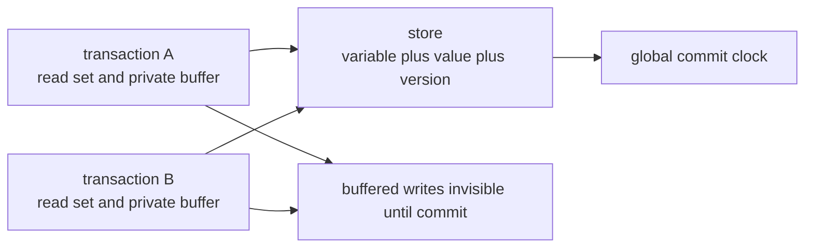
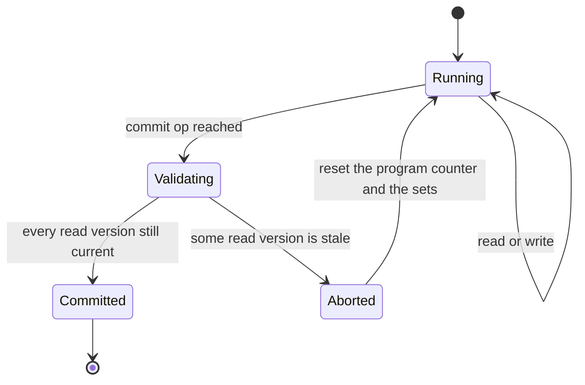
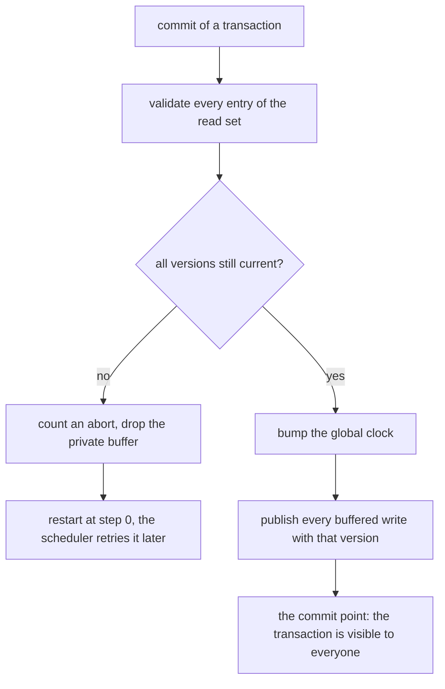
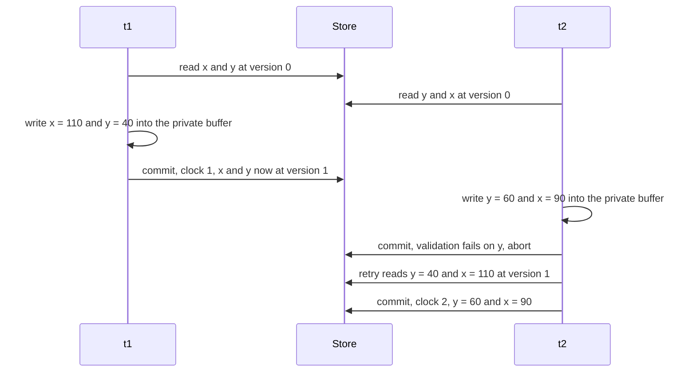

# 615 — Implement transactional memory simulator basics

> **Tier:** Expert · **CTCI chapter:** Ch 15 — Threads and Locks
> **Task spec:** [615-implement-transactional-memory-simulator-basics.md](../../../tasks/expert/615-implement-transactional-memory-simulator-basics.md)
> **Solutions:** [Python](../../../solutions/python/expert/615-implement-transactional-memory-simulator-basics/solution.py) ·
> [Java](../../../solutions/java/expert/615-implement-transactional-memory-simulator-basics/Solution.java) ·
> [JavaScript](../../../solutions/javascript/expert/615-implement-transactional-memory-simulator-basics/solution.js) ·
> [C#](../../../solutions/csharp/expert/615-implement-transactional-memory-simulator-basics/Solution.cs)

## 1. Problem restatement

Implement the memory semantics of a **software transactional memory** (TL2 style) driven by an explicit
schedule instead of real threads: a schedule is a list of transaction names, and each entry lets that
transaction execute exactly one step of its program. No threads, no sockets, no sleeping, no clock — the
whole interleaving is plain data, so every run is reproducible.

| Element | Content |
| --- | --- |
| store | `variable -> (value, version)` plus a **global commit clock** |
| transaction program | a list of ops: `("read", var)`, `("write", var, value)`, `("commit",)` |
| read set | `variable -> version seen`, validated at commit |
| write set | a **private buffer**, invisible to every other transaction |
| commit | validate the read set, then publish the buffer with a fresh version |
| abort | drop the buffer, count the abort, restart at step 0 |
| scheduler | explicit schedule, `round_robin`, or a `splitmix64`-seeded schedule; `settle` finishes everyone |

Concrete results the checks assert:

| Scenario | Result |
| --- | --- |
| serial schedule on `{x: 100, y: 50}` | log `[commit, commit]`, final `{x: 200, y: 160}`, versions `{x: 2, y: 1}`, 0 aborts |
| hand-made conflicting interleaving | exactly **1 abort** (belonging to `t2`) followed by a commit on the retry; final `{x: 90, y: 60}`, so `x + y = 150` still holds |
| stale-reader scenario on `{a: 1}` | the reader aborts once, then re-reads `("a", 99)` and publishes `5` |
| buffered-write scenario on `{v: 0}` | `b` observes `("v", 0)` — never the uncommitted `7` — and `a` observes `("v", 7)` from its own buffer; final `v = 7`, 0 aborts |
| read-your-writes | `observed == [("k", 11), ("k", 12)]`, and only the last buffered value is published |
| commit-order replay | for seeds 1, 7, 99, 1234 and 20250 the replayed commits reproduce the final store exactly |
| 40 seeded transfer schedules on `{left: 500, right: 500}` | `left + right = 1000` every time, every transaction settles, at least one commit per schedule |

Documented simplification: no low-level reads of the versioned metadata are modelled (a real TL2 also
validates a global-version snapshot and locks written locations during commit), the retried transaction
restarts from the beginning rather than only from its last read, and the scheduler is an explicit list
rather than a fair thread scheduler. What is still genuinely verified is serializability: replaying the
committed transactions in commit order against a fresh store reproduces the final state, no read ever
observes an uncommitted value, and conservation holds across 40 seeded interleavings.

## 2. Intuition

Locking is pessimistic: a transaction claims the data before touching it, and a deadlock is always
available. Transactional memory is optimistic: run the program against a snapshot of what you read, buffer
your writes where nobody can see them, and only at the end check whether the world moved while you were
running.

Two pieces of bookkeeping make that check cheap:

1. **a per-variable version** — the store stamps every variable with the commit clock of the transaction
   that last wrote it;
2. **a read set** — the transaction records which version it actually saw for each variable it read.

Validation is then a set comparison: if any variable's current version differs from the recorded one, some
other transaction committed a write to it in between, the read set is stale, and the transaction must
abort, throw its private buffer away and start over. If every version still matches, nothing the
transaction depended on changed, so publishing its buffer is safe — that is the "commit point".



Because a read consults its own buffer first (read-your-writes) and the published store otherwise, the
uncommitted values of one transaction are never observable by another — no dirty reads, without a single
lock.

## 3. Algorithm

```text
procedure step(transaction)
    if the transaction is finished then
        return "idle"
    op ← next op of this transaction, advance the program counter
    if op is ("read", name) then
        if name is in the write buffer then
            value ← the buffered value                  // read-your-writes
        else
            value, version ← store.read(name)
            read_set[name] ← version                    // remembered for validation
        observed.append((name, value))
        return "read"
    if op is ("write", name, value) then
        write buffer[name] ← value                      // invisible to everyone else
        return "write"
    if op is ("commit",) then
        attempts ← attempts + 1
        finished ← true
        for name, version in read_set do
            if store.versions[name] ≠ version then
                aborts ← aborts + 1
                reset the transaction                       // clear sets, program counter to 0
                return "abort"
        store.publish(write buffer)                     // clock plus one, stamp every written name
        committed ← true
        commits ← commits + 1
        return "commit"
```

```text
procedure publish(writes)
    clock ← clock + 1
    for name, value in writes do
        values[name] ← value
        versions[name] ← clock                          // every write of one commit shares a version
    return clock
```

```text
procedure run(schedule, max_steps)
    for name in schedule do
        if steps >= max_steps then
            error "the schedule did not settle"
        steps ← steps + 1
        outcome ← step(transactions[name])
        if outcome is "commit" or "abort" then
            log.append((outcome, name))
    settle()                                            // finish everyone in name order, one op at a time
    return log
```





## 4. Worked example

A hand-made conflicting interleaving on `{x: 100, y: 50}`. `t1` is
`read x, read y, write x = 110, write y = 40, commit`; `t2` is
`read y, read x, write y = 60, write x = 90, commit`. The schedule is
`t1, t1, t2, t2, t1, t1, t1, t2, t2, t2`, so both transactions read before either writes.

| Entry | Step | Effect | Read set / buffer |
| --- | --- | --- | --- |
| 1 | `t1` read `x` | sees `100` at version 0 | read set `{x: 0}` |
| 2 | `t1` read `y` | sees `50` at version 0 | read set `{x: 0, y: 0}` |
| 3 | `t2` read `y` | sees `50` at version 0 | read set `{y: 0}` |
| 4 | `t2` read `x` | sees `100` at version 0 | read set `{y: 0, x: 0}` |
| 5 | `t1` write `x = 110` | buffered, invisible | buffer `{x: 110}` |
| 6 | `t1` write `y = 40` | buffered, invisible | buffer `{x: 110, y: 40}` |
| 7 | `t1` commit | read set still valid → **publishes at clock 1** | store `x = 110` (v1), `y = 40` (v1) |
| 8 | `t2` write `y = 60` | buffered | buffer `{y: 60}` |
| 9 | `t2` write `x = 90` | buffered | buffer `{y: 60, x: 90}` |
| 10 | `t2` commit | `y` is at version 1, `t2` read version 0 → **abort** | buffer dropped, abort counter 1, restart |
| settle | `t2` read `y`, read `x` | now sees `40` and `110`, both version 1 | read set `{y: 1, x: 1}` |
| settle | `t2` write, write, commit | versions match → **publishes at clock 2** | store `y = 60`, `x = 90` |

The logged outcomes are `[commit t1, abort t2, commit t2]`: exactly one validation failure, followed by a
successful retry. The final state is `{x: 90, y: 60}`, so `x + y = 150` is preserved, the clock is 2, and
`t2.observed` after the retry is `[("y", 40), ("x", 110)]` — the retry really re-read the values that
`t1` published.



The other three scenarios isolate one rule each:

- **No dirty reads** on `{v: 0}`: `a` buffers `v = 7` and reads its own buffer back (`("v", 7)`), while `b`
  reads the store and observes `("v", 0)` — the buffer was never published at that point. Neither
  transaction aborts, because a buffered write is not a conflict.
- **Read-set validation** on `{a: 1}`: the reader reads `a` at version 0, the writer commits `99` (clock
  1), and the reader's commit fails. Its retry observes exactly `[("a", 99)]` and publishes `5`, which is
  why the store ends at `5`.
- **Read-your-writes**: with no other transaction, `write k = 11, read k, write k = 12, read k` observes
  `[("k", 11), ("k", 12)]` and publishes only `12`; the buffer is a map, not a log.

Scale: 40 seeded transfer schedules over `{left: 500, right: 500}` all settle with the total conserved,
and for each of the seeds 1, 7, 99, 1234 and 20250 the list of committed transactions replayed in commit
order against a fresh store reproduces the scheduler's final state exactly — the serializability witness.

## 5. Complexity

Let `r` be the size of the read set, `w` the write set, `p` the program length and `s` the schedule
length.

| Operation | Best | Average | Worst | Why the bound holds |
| --- | --- | --- | --- | --- |
| one `step` | O(1) | O(1) | O(1) | a read, a buffered write or a counter update |
| commit | O(1) | O(r + w) | O(r + w) | validate every read entry, publish every write |
| abort | O(1) | O(r + w) | O(p) | clear the sets; the program restarts at step 0 |
| one transaction end to end | O(p) | O(p · (1 + aborts)) | unbounded work under a hostile schedule | a retried transaction re-executes its whole program |
| `run(schedule)` | O(s) | O(s + p · t) | O(s + p · t) plus settling | one op per schedule entry, then `settle` finishes the rest |
| `settle` | O(t) | O(p · t) | O(p · t) | at most 400 rounds of one op per unfinished transaction |
| space | — | O(v + r + w · t) | O(v + r + w · t) | one version per variable plus per-transaction buffers and read sets |

The `settle` loop is bounded (`for _ in range(400)`) and returns as soon as no transaction made progress,
so a program without a `commit` simply never finishes instead of spinning — the checks assert
`not transaction.finished` after a capped run.

Alternatives:

| Approach | Progress guarantee | Deadlock | Reads |
| --- | --- | --- | --- |
| Two-phase locking | blocking | possible | always current |
| Global lock per transaction | serial | none | always current |
| STM with read-set validation (this task) | optimistic, aborts on conflict | none | snapshot-consistent |
| STM with explicit global-version validation | optimistic, fewer false aborts | none | snapshot-consistent |

## 6. Pitfalls and edge cases

- **Read your own writes.** A read must consult the buffer before the store; otherwise `write k = 11, read
  k` would observe the old value and the checks (`observed == [("k", 11), ("k", 12)]`) would fail.
- **Never publish early.** Buffered writes are invisible until commit, which is what makes
  `b.observed == [("v", 0)]` true while `a` holds `v = 7` in its buffer.
- **Validation compares versions, not values.** Re-reading the same value written by someone else still
  aborts the transaction, because the *version* changed; comparing values would allow lost updates.
- **The commit clock is shared by all writes of one commit.** `versions == {x: 2, y: 1}` after the serial
  run shows one clock increment per committing transaction, not per variable.
- **A commit with an empty write set still advances the clock**, which the checks assert on a bare
  `("commit",)` program — validation and publication are separate steps.
- **An abort restarts from the beginning.** The program counter, the read set, the buffer and the
  observed list are all reset, so `observed` after a retry contains only the retry's reads; that is why
  the stale-reader scenario ends with `observed == [("a", 99)]` and not with both attempts.
- **A `commit` op is required to finish.** A program without one never sets `finished`, so the transaction
  is left running after `max_steps` and `settle` stops making progress; the check asserts exactly that.
- **Unknown ops are rejected.** `("frobnicate", "z")` raises `AssertionError` from `step`, not a silent
  no-op.
- **A schedule that is too short is not an error, a forgotten one is.** `run` raises only when
  `max_steps` is exhausted; otherwise `settle` finishes everyone in name order afterwards.
- **Conflicts need a read *and* a write.** Two transactions that only write different variables never
  abort each other, because a buffered write is not visible and is not part of any read set.
- **Conservation is the sanity net.** All 40 seeded transfer schedules assert that the transferred total
  is preserved, which is exactly the property a missing or over-eager validation would break — and the
  conflicting example asserts `x + y = 150` for the same reason.
- **Documented simplifications.** No global-version snapshot, no commit locks, no nested transactions, no
  durability, and an explicit-list scheduler rather than a fair thread scheduler; addresses are the
  simulator's whole memory, and a retried transaction re-runs its program from step 0.

## 7. Variants and follow-ups

- Checking histories against a linearizability model instead of validating read sets →
  [618 — linearizability checker for concurrent histories](../../../tasks/expert/618-implement-linearizability-checker-for-concurrent-histories.md).
- A causal-order model that a reader's snapshot must respect →
  [619 — formal model for happens-before](../../../tasks/expert/619-implement-formal-model-for-happens-before-and-verify.md).
- Taking a snapshot of several such stores without stopping them →
  [616 — distributed snapshot algorithm Chandy-Lamport](../../../tasks/expert/616-implement-distributed-snapshot-algorithm-chandy-lamport.md)
  and [617 — consistent snapshot across shards](../../../tasks/expert/617-implement-consistent-snapshot-across-shards-simulation.md).

## 8. Check yourself

<details><summary>Show answer</summary>
**Why does validation compare versions rather than values?** Because a value can be written back to the
same value by another transaction; comparing values would then let a transaction commit as if nothing had
happened, and an update derived from the old value would be lost. A version change means the variable was
written, regardless of the value it now holds.
</details>

<details><summary>Show answer</summary>
**Why does `t2` in the worked example abort exactly once?** Its first commit happens after `t1` committed
at clock 1, and `t2` had read `y` at version 0 while the store now has version 1. The retry re-reads both
variables at version 1, nothing writes in between, and its second commit validates cleanly.
</details>

<details><summary>Show answer</summary>
**What stops a transaction from observing an uncommitted value?** Writes go into a private buffer that no
other transaction can reach; the store only ever changes inside `publish`, which runs after a successful
validation. The buffered-write scenario asserts `b` sees `0` while `a`'s buffer holds `7`.
</details>

<details><summary>Show answer</summary>
**Why is the schedule a plain list rather than real threads?** Determinism: every interleaving the file
tests is data, so a failure is reproducible and the simulator has no timing dependency. The logical
content — read sets, buffered writes, version validation and commit ordering — is exactly the memory
semantics a real STM implements, which is why the commit-order replay check is meaningful.
</details>

<details><summary>Show answer</summary>
**What does the commit-order replay actually prove?** That the interleaved execution is equivalent to some
serial order of the transactions that committed: replaying those transactions in the order they committed,
each one from start to finish against a fresh store, reproduces the scheduler's final state exactly. That
is serializability, and it is checked for five different seeds.
</details>
