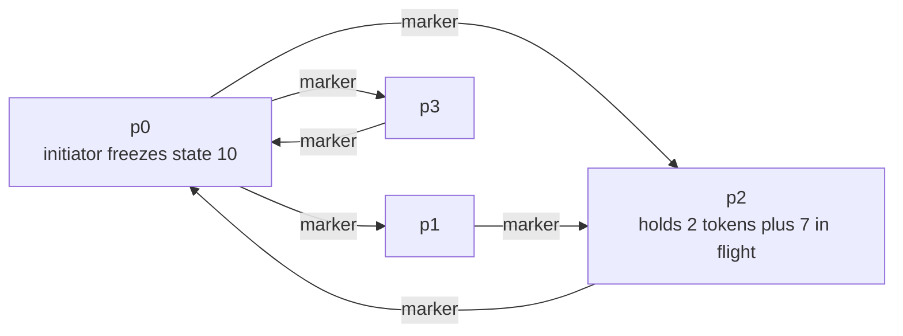
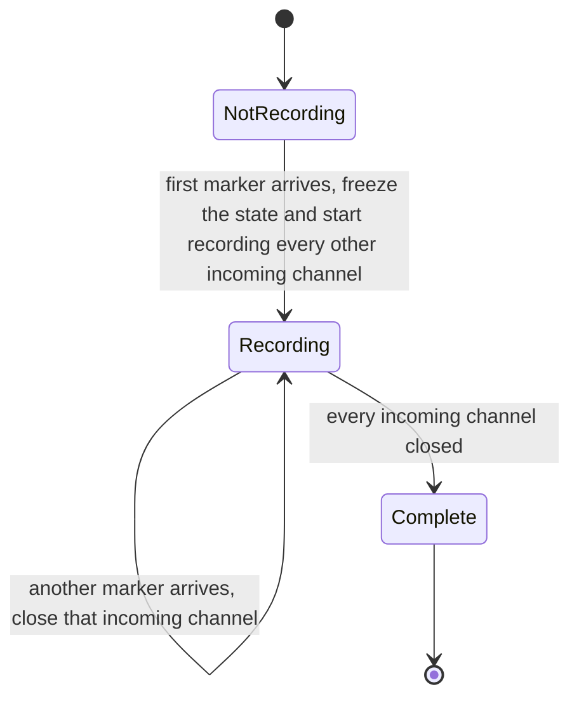
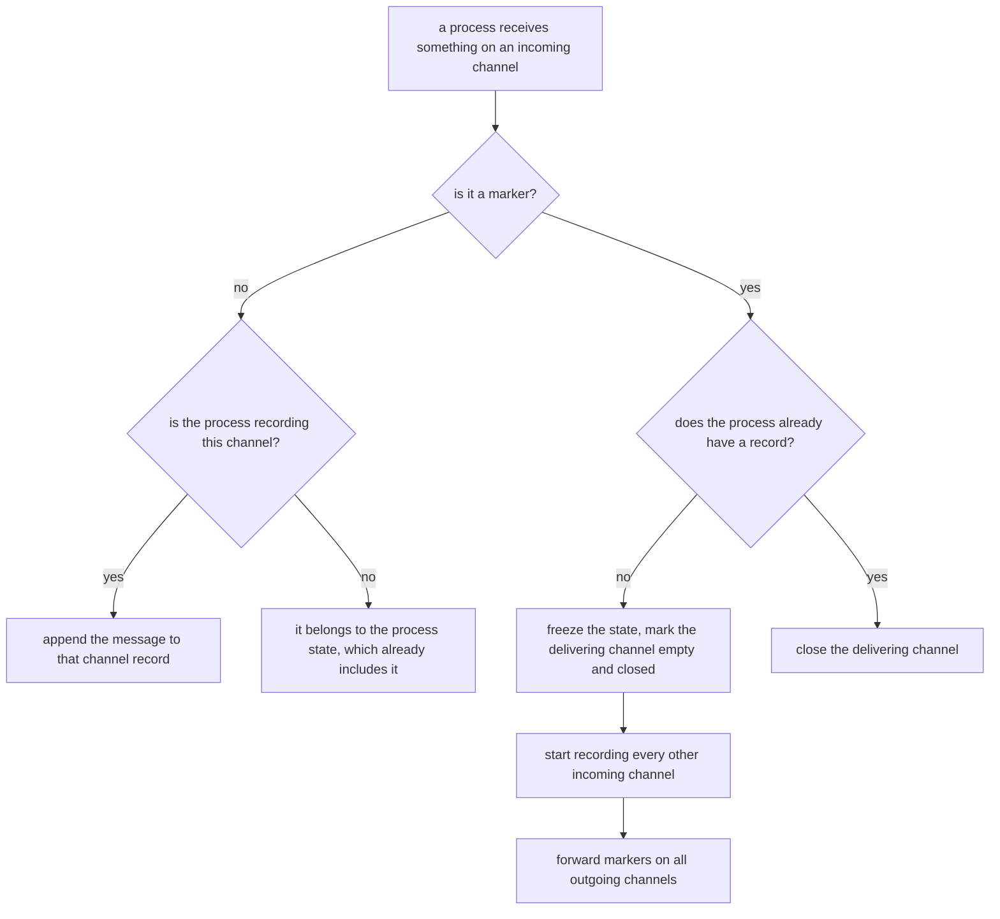
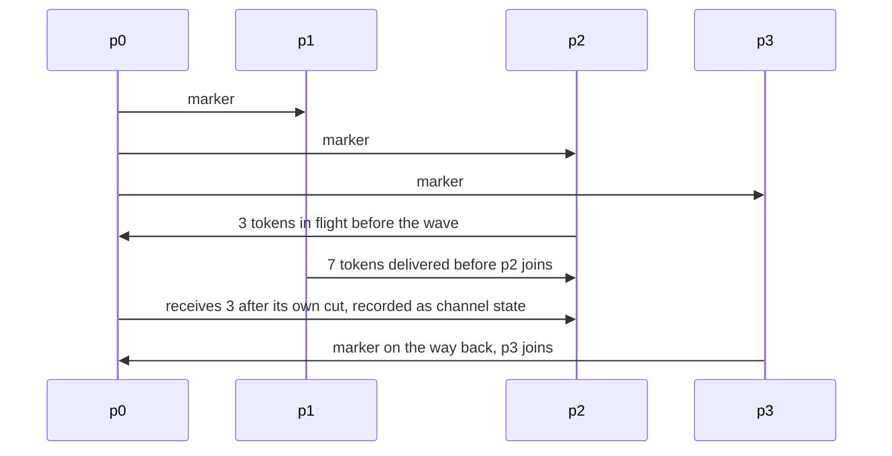

# 616 — Implement distributed snapshot algorithm (Chandy-Lamport)

> **Tier:** Expert · **CTCI chapter:** Ch 9 — System Design and Scalability
> **Task spec:** [616-implement-distributed-snapshot-algorithm-chandy-lamport.md](../../../tasks/expert/616-implement-distributed-snapshot-algorithm-chandy-lamport.md)
> **Solutions:** [Python](../../../solutions/python/expert/616-implement-distributed-snapshot-algorithm-chandy-lamport/solution.py) ·
> [Java](../../../solutions/java/expert/616-implement-distributed-snapshot-algorithm-chandy-lamport/Solution.java) ·
> [JavaScript](../../../solutions/javascript/expert/616-implement-distributed-snapshot-algorithm-chandy-lamport/solution.js) ·
> [C#](../../../solutions/csharp/expert/616-implement-distributed-snapshot-algorithm-chandy-lamport/Solution.cs)

## 1. Problem restatement

Take a **consistent global snapshot** of a set of processes connected by directed FIFO channels, without
stopping them. The classic answer is Chandy-Lamport (1985), implemented here over an explicit event
schedule: processes, channels and messages are plain data structures advanced by a list of
`(process, action)` entries, so there are no threads, sockets, sleeps or timing dependencies.

| Element | Content |
| --- | --- |
| process | a name, a token balance, an event log and — once reached by the wave — a `Snapshot` record |
| channel | a FIFO queue of `(message id, amount)` pairs, with `MARKER` travelling **in band** through it |
| tokens | *move*: a send takes them out of the sender and puts them in the channel, a receive moves them on |
| `Snapshot` | the frozen process state, the cut's log sequence, the recorded incoming channels and the closed ones |
| snapshot | every process state plus the recorded state of every channel |

Because tokens move rather than being copied, the grand total of process states plus in-flight messages is
invariant, and the snapshot must reproduce exactly that number.

Concrete results the checks assert:

| Scenario | Result |
| --- | --- |
| four processes `p0…p3` seeded with 10, 20, 5, 0 | recorded states `{p0: 10, p1: 13, p2: 9, p3: 0}` plus channel `p2 → p0` holding message 2 (3 tokens); **snapshot total 35 = true total 35** |
| the same run | every process joined and closed all three incoming channels, exactly one channel holds a message, and the independently recomputed cut reports no problem |
| snapshot started at **each** of the four processes in turn (24 sends, 4 receives each) | complete, consistent and conserved every time |
| negative control: freeze only the process states while 5 tokens are in flight | reports **5 instead of 10** — not a consistent cut |
| three-process run `a, b, c` with 4 tokens in flight | states `b = 0`, `c = 6`, the in-flight 4 is *channel* state, total 20 conserved |
| unreachable process | a snapshot at `root` never reaches `island` when the only link is `island → root`; only `root` records a state |

Documented simplification: processes, channels and the network are plain data structures advanced by an
explicit event list, and FIFO is modelled by an explicit per-channel queue, so there is no real
concurrency — what remains is the *logical* content of the algorithm. In the Java solution every process
sends its markers once, when it records.

## 2. Intuition

The naive snapshot is "stop the world, read everyone" — impossible in a running distributed system. The
naive *without* stopping is worse: every process reads its own state at its own convenience, giving a cut
that mixes times. A process might appear to have received a message it never sent, or to have sent one that
is not in the snapshot at all.

Chandy-Lamport makes a snapshot consistent by using the **channels themselves** to establish a cut:

1. the initiator freezes its own state and pushes a **marker** into every outgoing channel;
2. any process that receives a marker for the first time freezes its own state at that instant and starts
   recording every other incoming channel, then forwards markers on all its outgoing channels;
3. a marker on channel `c → d` means "everything `c` sends after its own cut arrives after `d`'s cut". So
   when `d` receives it, `d` closes channel `c`: everything still in that channel was sent *before* `c`'s
   cut and *arrived after* `d`'s cut, and exactly those messages belong to the snapshot as channel state.

The FIFO property is what makes step 3 exact: a marker cannot overtake a data message sent before it, so
anything the marker passed is already in the recorded state on one side or the other — never lost, never
double-counted.





The distinction between "just joined" and "already recording" is the whole algorithm: the first marker
freezes a state and opens channels, subsequent markers only close the channel they arrived on.

## 3. Algorithm

```text
procedure start_snapshot(initiator)
    if the initiator already has a record then
        error "a snapshot is already in flight"
    log the initiator event
    record ← new Snapshot(state of initiator, current sequence)
    for every channel ending at the initiator do
        record.channels[source] ← empty list
    the initiator keeps the record
    for every channel starting at the initiator, in sorted order do
        push MARKER into it

procedure deliver_marker(name, source)
    record ← record of name
    if record is none then                                    // joining the snapshot
        log the join event
        record ← new Snapshot(state of name, current sequence)
        record.channels[source] ← empty list                  // the delivering channel is empty
        record.closed.add(source)
        for every incoming channel of name other than source do
            record.channels[that source] ← empty list
        name keeps the record
        for every outgoing channel of name, in sorted order do
            push MARKER into it
    else
        record.closed.add(source)                             // close the channel that carried the marker
```

```text
procedure receive(name, source)
    message ← pop the front of the channel source → name     // FIFO
    if message is MARKER then
        deliver_marker(name, source)
        return
    move the tokens of message into the state of name
    log the receive
    record ← record of name
    if record exists and source is a recorded channel and source is not closed yet then
        record.channels[source].append(message id)            // sent before the sender's cut, arrived after ours

procedure frozen(records)
    states ← the frozen state of every process that recorded
    channels ← every recorded channel of every record
    return states, channels

procedure snapshot_total(records)
    total ← sum of the token counts of the frozen states
    for every recorded channel and message id in it do
        total ← total + the amount of that message, recovered from the sender's log
    return total
```



## 4. Worked example

Four processes `p0, p1, p2, p3`, seeded with 10, 20, 5 and 0 tokens — true total **35**. The program is

```text
send p1 -> p2 7      send p2 -> p0 3      snapshot at p0
send p0 -> p1 4      recv p1 from p0      recv p2 from p1
recv p0 from p2      recv p3 from p0      drain
```

| Step | Action | Tokens after | Channel changes |
| --- | --- | --- | --- |
| 1 | `send p1 → p2 7` | p1 = 13 | channel `p1 → p2` holds message 1 |
| 2 | `send p2 → p0 3` | p2 = 2 | channel `p2 → p0` holds message 2 |
| 3 | **snapshot at p0** | p0 = 10 | p0 records state 10, opens all incoming channels, pushes 3 markers |
| 4 | `send p0 → p1 4` | p0 = 6 | channel `p0 → p1` holds marker, message 3 |
| 5 | `recv p1 from p0` | p1 = 13 | p1 gets the marker, **records 13**, closes `p0 → p1`, forwards markers |
| 6 | `recv p2 from p1` | p2 = 9 | the 7 arrives *before* p2's cut, so it belongs to p2's state |
| 7 | `recv p0 from p2` | p0 = 9 | p0 is recording `p2 → p0`, so message 2 is **channel state** |
| 8 | `recv p3 from p0` | p3 = 0 | p3 gets the marker, **records 0**, closes `p0 → p3`, forwards markers |
| drain | the marker wave finishes | — | every process closes its remaining incoming channels |

The frozen snapshot is

| Part | Value |
| --- | --- |
| `p0` state | 10 (frozen *before* it received the 3) |
| `p1` state | 13 |
| `p2` state | 9 |
| `p3` state | 0 |
| channel `p2 → p0` | message 2, i.e. 3 tokens |
| **total** | **35**, equal to the true total |

Two details make this a *consistent* cut rather than a lucky sum:

- the 3 tokens that `p0` received at step 7 were sent by `p2` **before** `p2`'s cut (step 6) but delivered
  **after** `p0`'s cut (step 3), so they are recorded as channel state and not in `p0`'s frozen state;
- the 4 tokens that `p0` sent at step 4 were sent after `p0`'s cut and received by `p1` after `p1`'s cut,
  so they are outside the snapshot entirely — `p1` had already closed channel `p0 → p1`, and the receive is
  therefore not appended to it. The checks confirm exactly one channel holds a message.



The independent cut check recomputes all of this from the event logs. For channel `p2 → p0` it collects
the messages `p2` sent at or before its own cut (message 2), the messages `p0` received after its cut
(message 2), and requires the recorded channel state to be exactly their intersection in FIFO order — and
separately requires that nothing `p0` received *inside* its cut was sent outside it. Both hold, so
`verify_cut` returns an empty list.

Two negative controls show why the channel records are not optional:

- in a two-process network where `a` sends `b` 5 tokens and 5 are still in flight, freezing only the
  process states reports **5 tokens instead of 10** — the message is simply lost;
- when the only link is `island → root` and the snapshot starts at `root`, no marker can ever reach
  `island`: only `root` records a state, `is_complete` is false, and the partial snapshot covers just the
  reachable part (3 of the 7 tokens).

## 5. Complexity

Let `V` be the number of processes, `E` the number of directed channels, `M` the messages in flight at the
cut and `T` the number of schedule events.

| Quantity | Cost | Why the bound holds |
| --- | --- | --- |
| markers sent | exactly `E`, one per channel | each process forwards one marker per outgoing channel the first time it joins |
| state records | exactly `V` | the first marker freezes a state; later markers only close channels |
| channel closes | exactly `E` | every channel carries exactly one marker, which closes it at its destination |
| snapshot size | `O(V + E + M)` | one state per process, one recorded list per channel, one entry per in-flight message |
| `snapshot_total` | `O(M · log)` | each recorded message id is resolved against the sender's event log |
| `verify_cut` | `O(E · (log length))` | per channel, two linear scans of the sender's and the receiver's logs |
| simulation time | `O(T + message deliveries)` | the explicit schedule plus `drain`, which delivers every message in a fixed channel order |
| space | `O(V + E + M + T)` | the network, the queues and the two event logs used as oracles |

The marker wave therefore costs `O(E)` messages regardless of how much data traffic is in flight, and the
recorded channel state is bounded by the messages in flight at the cut — which is why the algorithm is
cheap for long-running data streams.

Alternatives:

| Approach | Consistency | Stops the system | Cost |
| --- | --- | --- | --- |
| Stop the world | perfect | yes | a global pause |
| Independent local snapshots | none | no | `O(V)` but the cut is not consistent |
| Chandy-Lamport (this task) | consistent | no | `E` markers plus the in-flight state |
| Vector clocks plus logging | consistent with causal order | no | a clock per process on every message |

## 6. Pitfalls and edge cases

- **Markers must travel in band.** A separate control channel would let a marker overtake data, and the
  recorded channel state would no longer be exactly "sent before the sender's cut, delivered after the
  receiver's cut". The marker is pushed into the same FIFO queue as the data.
- **The delivering channel is recorded as *empty*, and closed immediately.** A marker cannot be overtaken
  by anything sent before it, so nothing that belongs to it can still be behind it on that channel.
- **Only the first marker freezes a state.** A second marker must only close its channel; re-recording the
  state would move the cut and destroy the conservation identity.
- **Receive on a channel the process is not yet recording** (or one it already closed) must *not* be
  appended to any channel state — that message belongs to the process state. The checks assert exactly one
  channel holds a message in the four-process run, which is the 4-token receive being excluded.
- **FIFO is not optional.** The verification derives the recorded channel state from the send/receive logs
  and compares it as a *list*, so an out-of-order delivery would be reported as a wrong channel record
  rather than silently passing.
- **Reachability.** A process the initiator cannot reach never joins, and the checks require
  `is_complete` to be false in that case rather than demanding a full snapshot. In the `root`/`island`
  network only `root` records a state and the partial total is 3.
- **Completeness needs a strongly connected graph.** Snapshotting at each of the four processes in turn
  completes every time, and each run is checked for `len(records) == V` and every record having
  `V - 1` closed incoming channels.
- **Two concurrent snapshots are rejected.** `start_snapshot` raises if the initiator already has a record;
  a second wave would interleave markers from two cuts and invalidate every channel record.
- **Invalid channel operations raise.** Receiving from an empty channel and sending on a channel that does
  not exist raise, and a send of more tokens than the sender holds raises too — the simulator refuses to
  invent tokens, which is what keeps conservation meaningful.
- **Tokens move, they are not copied.** A send decrements the sender; a receive increments the receiver.
  Copying at send time would make the snapshot conservation check trivially true and would hide a missing
  channel record.
- **The recorded state is the state at the cut, not the final state.** In the worked example `p0` ends the
  run with 9 tokens but recorded 10, and `p1` ends with 17 but recorded 13; the difference is covered by
  the channel state and by the traffic outside the cut.
- **Negative controls are part of the checks.** A states-only freeze (5 instead of 10 tokens) and an
  unreachable process are asserted to *fail* consistency, so the positive results are not vacuous.

## 7. Variants and follow-ups

- The same consistency argument seen from the transactional-memory side, where read sets play the role of
  channel records →
  [615 — transactional memory simulator basics](../../../tasks/expert/615-implement-transactional-memory-simulator-basics.md).
- Snapshotting storage shards instead of processes, where each shard has a log to cut →
  [617 — consistent snapshot across shards](../../../tasks/expert/617-implement-consistent-snapshot-across-shards-simulation.md).
- The causal order that a distributed snapshot has to respect →
  [619 — formal model for happens-before](../../../tasks/expert/619-implement-formal-model-for-happens-before-and-verify.md).

## 8. Check yourself

<details><summary>Show answer</summary>
**Why must the marker travel through the same FIFO channel as the data?** Because the recorded channel
state is defined as "messages sent before the sender's cut and delivered after the receiver's cut". The
marker is the boundary that separates the two, and only a FIFO channel guarantees the marker cannot pass a
message sent before it. A separate control path would let a marker overtake data and the cut would be
inconsistent.
</details>

<details><summary>Show answer</summary>
**Why is the channel that delivers a marker recorded as empty?** Because everything that channel carried
before the marker comes from the sender's pre-cut period and has already been delivered — that is exactly
what "the marker came after it in the queue" means. Nothing belonging to that channel can still be behind
the marker, so its recorded state is empty and it is closed at once.
</details>

<details><summary>Show answer</summary>
**In the worked example, why is the 3-token message channel state while the 7-token message is process
state?** The 7 was delivered to `p2` *before* `p2` recorded its state, so it is inside `p2`'s frozen state
of 9. The 3 was sent by `p2` before its cut but delivered to `p0` after `p0` had already frozen its state,
so it has to be recorded separately or the total would drop to 32.
</details>

<details><summary>Show answer</summary>
**What does the states-only negative control demonstrate?** That a cut is not automatically consistent: with
5 tokens in flight, summing the process states alone reports 5 against a true total of 10. The algorithm's
channel records exist precisely to capture the difference.
</details>

<details><summary>Show answer</summary>
**Why does the snapshot not reach a process when the only link points towards the initiator?** Markers are
the wave, and the wave only travels along outgoing edges. With the single link `island → root`, the
initiator `root` has no path to `island`, so `island` never sees a marker, never records, and the snapshot
covers only the reachable part — which the checks assert rather than treat as an error.
</details>
