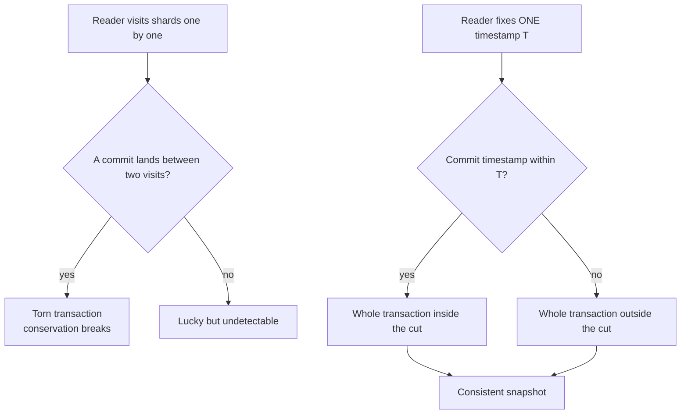
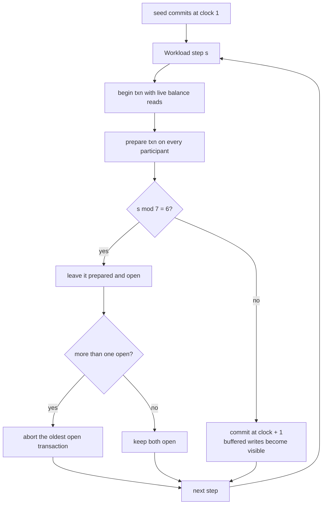
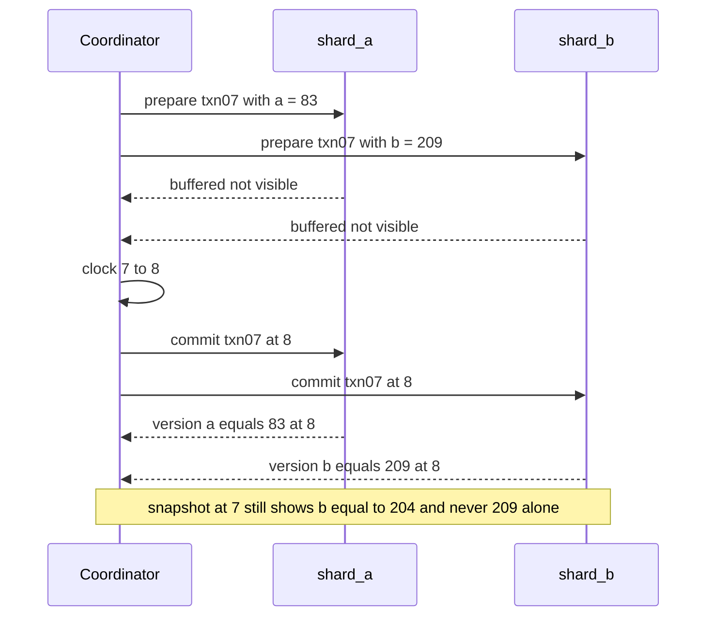

# 617 — Implement consistent snapshot across shards simulation.

> **Tier:** Expert · **CTCI chapter:** Ch 9 — System Design and Scalability
> **Task spec:** [617-implement-consistent-snapshot-across-shards-simulation.md](../../../tasks/expert/617-implement-consistent-snapshot-across-shards-simulation.md)
> **Solutions:** [Python](../../../solutions/python/expert/617-implement-consistent-snapshot-across-shards-simulation/solution.py) ·
> [Java](../../../solutions/java/expert/617-implement-consistent-snapshot-across-shards-simulation/Solution.java) ·
> [JavaScript](../../../solutions/javascript/expert/617-implement-consistent-snapshot-across-shards-simulation/solution.js) ·
> [C#](../../../solutions/csharp/expert/617-implement-consistent-snapshot-across-shards-simulation/Solution.cs)

## 1. Problem restatement

Simulate a key-value store partitioned into **shards** in which a single transaction may write several
shards, and produce a *consistent snapshot across the shards*: one cut that contains **all or none** of
each transaction's writes, as of a single logical point in time.

- **Input:** a cluster of shards (three in every solution), a workload of transactions — each one a map
  `shard → {key: value}` — and a read timestamp `T`.
- **Output:** for every shard, its state as of `T`, plus the two verdicts the protocol exists for: the
  cut never tears a transaction, and it agrees with an independent replay of the committed history.
- **Where time comes from:** a logical clock that only a commit advances. Every shard a transaction
  touches receives the *same* timestamp value in the same commit step.

**Modelling contract.** These are simulations: no real threads, no network, no locks, no wall clock and
no per-shard replication. Each language picks a concrete mechanism, and that mechanism is what the
tutorial describes:

| Language | Snapshot mechanism | What the checks hammer |
| --- | --- | --- |
| Python | multi-versioned shards — versions appended at commit with the global timestamp; a snapshot reads the newest version with `commit ≤ T` | a sweep over every `T`, per-key equality with a from-scratch replay, a per-shard-timestamp negative control |
| Java | one version chain of `(epoch, value)` per key; a transaction's single new epoch is appended to all of its shards at once | epoch chains and one-cut atomicity |
| JavaScript | Chandy–Lamport seal markers — a shard records its store when sealed, then records every incoming channel *except* the one the seal arrived on and forwards the marker; keys may even migrate between shards as in-band channel messages | store records plus channel records hold every key exactly once |
| C# | "safe point" protocol — the coordinator picks `S`, asks each shard whether it has applied every commit below `S`, lowers `S` to a lagging shard's oldest pending commit and retries, then reads the newest version below `S` | a deterministic `(transaction, shard)` schedule that *creates* the lag, and an unsafe read that must tear |

Concrete expected results:

- The seed transaction writes `balance` 100 / 200 / 50 to `shard_a` / `shard_b` / `shard_c` and commits at
  clock 1. A snapshot at `T = 0` is empty everywhere and its total is `0`; at every `T ≥ 1` the total is
  `350`.
- The 30-step transfer workload leaves **27 commits** (`clock = 27`), **2 aborted** transactions and
  **2 prepared-but-open** transactions. Snapshots at every `T` in `0..27` match the replay and
  `torn_transactions` is empty at every `T`.
- Negative control: snapshotting the shards at *staggered* timestamps tears **58** transactions over the
  sweep and produces a total different from 350. The same checker that accepts the safe cut rejects that
  one, which is what makes the acceptance meaningful.

## 2. Intuition

The naive snapshot walks the shards one after another and reads "now" from each. That is wrong. A
transaction that moves 5 units from `shard_a` to `shard_b` may commit at `shard_b` before the reader gets
there and at `shard_a` after it left — the snapshot then shows the credit but not the debit. The
transaction is **torn**, and the conservation invariant (the total is 350) breaks. Making the walk faster
does not help; the window only shrinks.

The key insight is that a snapshot does not have to stop the world; it needs **one logical time** shared
by all shards plus the guarantee that a transaction's writes become visible at that time in *every* shard
it touched. Then "state as of `T`" is a purely local rule — the newest version with `commit ≤ T` — and the
union of the per-shard answers is automatically a consistent cut: a transaction with `commit ≤ T` is
fully inside, one with `commit > T` or uncommitted is fully outside. There is no half state to observe.

The second insight is that atomic multi-shard visibility is exactly what two-phase commit buys. A
participant that has *prepared* holds writes in a buffer; only the coordinator's commit stamps them, with
one global counter value written into every participant. A prepared-but-uncommitted transaction is
invisible everywhere, so it can neither tear the cut nor appear in half of it.



## 3. Algorithm

The Python model, one step per operation:

1. `begin(id, writes)` validates that every target shard exists, stores the transaction and notes the
   current clock as `started`.
2. `prepare(id)` copies each participant's slice of the writes into that participant's `prepared` buffer.
   Nothing becomes visible; the transaction is now "prepared but open".
3. `commit(id)` refuses if no prepare happened, increments the global clock **once**, and appends
   `(clock, value)` to the version chain of every key in every participating shard — the same clock value
   in all of them.
4. `abort(id)` discards the buffers and leaves no version behind.
5. `state_at(T)` per shard: for each key scan its chain for the newest entry with `commit ≤ T`; a key with
   no such entry is simply absent from the snapshot.
6. Verification: (a) replay the committed history in timestamp order into an empty store and compare per
   key at every `T`; (b) assert `torn_transactions` is empty for every `T`; (c) check the conservation
   total; (d) snapshot shards at *staggered* timestamps and require the tear detector to fire.

```text
procedure commit(transaction_id)
    require prepared_at(transaction_id) is not none
    clock ← clock + 1
    for each shard in writes(transaction_id) do
        shard.apply(transaction_id, clock)
    history.append((clock, transaction_id, writes(transaction_id)))

function state_at(shard, T)
    result ← empty map
    for each key in shard.versions do
        best ← none
        for each (commit_timestamp, value, transaction_id) in shard.versions[key] do
            if commit_timestamp <= T then
                if best is none or commit_timestamp > best.timestamp then
                    best ← (commit_timestamp, value)
        if best is not none then result[key] ← best.value
    return result

function torn_transactions(per_shard_timestamps)
    torn ← empty list
    for each (commit_timestamp, transaction_id, writes) in history do
        visible ← [per_shard_timestamps[shard] >= commit_timestamp for shard in writes]
        if any(visible) and not all(visible) then torn.append(transaction_id)
    return torn
```

`state_at` never looks at `prepared` buffers, so an open transaction contributes nothing — that is the
invisibility guarantee, not an accident of the sweep.



## 4. Worked example

The Python workload: the seed commits at clock 1 with `a = 100`, `b = 200`, `c = 50`, then 30 steps pull
from the cycle `a→b 5`, `b→c 3`, `c→a 2`, `a→c 4`, and every step `s` with `s mod 7 = 6` is left
prepared but uncommitted. Each transfer begins by reading the *live* balance, which ignores the buffered
writes of any open transaction.

| Step | Transaction | Writes read from live state | Action | Clock after | `a` / `b` / `c` most recent commit |
| --- | --- | --- | --- | --- | --- |
| — | `seed` | 100 / 200 / 50 | prepare then commit | 1 | 100 / 200 / 50 |
| 0 | `txn00` | `a` 100→95, `b` 200→205 | commit | 2 | 95 / 205 / 50 |
| 1 | `txn01` | `b` 205→202, `c` 50→53 | commit | 3 | 95 / 202 / 53 |
| 2 | `txn02` | `c` 53→51, `a` 95→97 | commit | 4 | 97 / 202 / 51 |
| 3 | `txn03` | `a` 97→93, `c` 51→55 | commit | 5 | 93 / 202 / 55 |
| 4 | `txn04` | `a` 93→88, `b` 202→207 | commit | 6 | 88 / 207 / 55 |
| 5 | `txn05` | `b` 207→204, `c` 55→58 | commit | 7 | 88 / 204 / 58 |
| 6 | `txn06` | `a` 88→83, `b` 204→209 | **prepare only** | 7 | 88 / 204 / 58 |
| 7 | `txn07` | `a` 88→83, `b` 204→209 | commit | 8 | 83 / 209 / 58 |

Reading that trace as snapshots:

| `T` | Visible transactions | `a` / `b` / `c` | Total |
| --- | --- | --- | --- |
| 0 | none | absent / absent / absent | 0 |
| 6 | `seed` … `txn04` | 88 / 207 / 55 | 350 |
| 7 | `seed` … `txn05`, still **not** `txn06` | 88 / 204 / 58 | 350 |
| 27 | all 26 committed workload steps plus the seed | — | 350 |

`txn06` shows up in no snapshot with `T ≤ 27`, because it is never committed: it is aborted at step 20,
when the second open transaction arrives (`txn06` and `txn13` are the two aborts, `txn20` and `txn27`
are still open when the run ends). Runs of 27 commits, 2 aborts and 2 open transactions are exactly what
the checks assert, and the aborts are what makes the "prepared but invisible" rule observable.



## 5. Complexity

With `S` shards, `K` keys per shard, `V` the number of versions a key accumulated and `H` the length of
the committed history.

| Operation | Best | Average | Worst | Why the bound holds |
| --- | --- | --- | --- | --- |
| `begin` / `prepare` | O(w) | O(w) | O(w) | `w` is the number of written keys; the per-shard buffers are plain maps |
| `commit` | O(w) | O(w) | O(w) | one clock increment plus one append per written key, and the same timestamp is handed to every participant |
| `state_at(T)` on one shard | O(K) | O(K · V) | O(K · V) | one linear scan of each key's chain looking for the newest `commit ≤ T` |
| `consistent_snapshot(T)` | O(S · K) | O(S · K · V) | O(S · K · V) | the same local rule, applied to every shard — no coordination inside the read |
| `replay(T)` oracle | O(H · w) | O(H · w) | O(H · w) | the independent model re-applies every committed transaction in timestamp order |
| `torn_transactions` | O(H · w) | O(H · w) | O(H · w) | one visibility test per participating shard of every transaction |
| Sweep of all `T` | O(clock · S · K) | — | O(clock · S · K · V) | the checks sweep `0..27` and re-run the snapshot and the replay at each point |
| Space | O(S · K) | O(S · K · V) | O(S · K · V) | one version per write plus the history of committed transactions; the C# scheduler additionally holds the explicit `(transaction, shard)` schedule |

Alternatives for comparison, exactly as the solutions frame them: reading each shard separately costs the
same `O(K · V)` **but has no correctness guarantee**, which the negative control demonstrates with 58
torn transactions. The C# safe-point protocol trades a bounded number of *retries* (each retry lowers `S`
to a lagging shard's oldest pending commit) for the same `O(K)` per-shard read, and Chandy–Lamport in the
JavaScript solution adds `O(messages)` in-flight channel state to the cut. Version chains scanned
linearly here would be binary-searched by commit timestamp in a production store, turning the read into
`O(log V)`.

## 6. Pitfalls and edge cases

- **`T = 0` is a legal snapshot.** Nothing is visible, keys are absent rather than zero, and the checks
  assert that deliberately (`all(value is None ...)`) — a store that returns 0 for a missing key would
  hide the difference between "not yet written" and "written as 0".
- **Prepared ≠ committed.** The buffered writes of an open transaction are not visible in *any* shard,
  which is what makes the final invariant hold; the checks confirm that the open transactions are
  prepared on every participant and that `committed_at` is still `None`.
- **Abort discards, it does not roll back.** The version is never appended, so nothing has to be undone;
  re-aborting a transaction that has no buffer entry is a no-op in the Python model.
- **Ties in time cannot happen** because the timestamp is one global counter advanced only by commit, and
  a transaction gets a single value for all of its shards. This is the modelling simplification that
  removes the whole tie-breaking question.
- **The snapshot at the current clock must equal the live state.** The Python checks assert it directly,
  which catches an off-by-one such as using `< T` instead of `≤ T`.
- **A tear detector that never fires is worthless.** Both the staggered-timestamp sweep (58 torn
  transactions) and the mixed snapshot (total ≠ 350) are required to fail the safe-cut verdict, so the
  acceptance of the consistent cut is not vacuous.
- **Invalid input raises.** Writing to an unknown shard, committing something never prepared, and
  preparing an unknown transaction must raise, and the checks assert that each of them does.
- **Language variants.** C# makes the lag explicit: a deterministic `(transaction, shard)` schedule
  applies slices out of order, so a shard really can be behind, and the coordinator must lower `S` until
  every shard is ready. JavaScript moves the problem to key *migration*: a key in flight is a message in
  a FIFO channel, so the cut must record channel contents as well, and the check is that every key
  appears exactly once across store records and channel records. Java expresses the same rule with
  per-key `(epoch, value)` chains.
- **Unicode and value equality.** Keys and values are compared by value, not by identity; the shard names
  `shard_a`…`shard_c` are plain strings, so no encoding question arises.
- **This is not real concurrency.** No interleaving of reader and committer is actually raced; the
  single-threaded schedule *chooses* the interleavings, which is what makes every run reproducible.

## 7. Variants and follow-ups

- A full transactional store on top of the same commit rule, with read/write sets and conflict detection
  → [627 — transactional key-value store with two-phase commit simulation](../../../tasks/expert/627-implement-transactional-key-value-store-with-two-phase-commit-si.md).
- Snapshots whose safety depends on a replicated log rather than on a coordinator's clock, including
  network partitions → [628 — distributed consensus simulation with network partitions](../../../tasks/expert/628-implement-distributed-consensus-simulation-with-network-partitio.md)
  and [629 — dynamic reconfiguration in Raft](../../../tasks/expert/629-implement-dynamic-reconfiguration-in-raft-joint-consensus.md).
- Ordering writes by *causality* instead of by a single global timestamp, which gives the same
  "all or none" cut without a coordinator → [630 — causal consistency protocol simulation](../../../tasks/expert/630-implement-causal-consistency-protocol-simulation-vector-clocks.md).
- Repairing divergence between two replicas once the cut is known, by comparing digests top-down instead
  of transferring whole states → [632 — anti-entropy Merkle tree reconciliation demo](../../../tasks/expert/632-implement-anti-entropy-merkle-tree-reconciliation-demo.md).
- Checking that a concurrent history is explainable by *some* sequential order — the single-object,
  real-time variant of the same "one consistent explanation" idea → [618 — linearizability checker](../../../tasks/expert/618-implement-linearizability-checker-for-concurrent-histories.md).

## 8. Check yourself

<details><summary>Show answer</summary>
**Why does reading every shard at the same `T` make the cut consistent, without locking anything?**
Because visibility is decided per shard by a comparison against `T`, and a transaction's writes were
stamped with one shared timestamp. A transaction is therefore either wholly inside (`commit ≤ T`) or
wholly outside (`commit > T` or uncommitted), so no per-shard timing influences the result.
</details>

<details><summary>Show answer</summary>
**`txn06` prepared at step 6 and was aborted at step 20. Does its buffered write appear in the snapshot at `T = 7`?**
No. `state_at` only ever reads committed versions, and `txn06` never committed, so `b` is 204 at `T = 7`,
never 209.
</details>

<details><summary>Show answer</summary>
**What does the negative control prove?** Snapshotting with staggered per-shard timestamps tears 58
transactions over the sweep and gives a total that is not 350. Since the *same* tear detector is silent for
the single-timestamp cut, the acceptance is a real property, not a checker that always says yes.
</details>

<details><summary>Show answer</summary>
**Why can the C# solution not simply read at `clock + 1` and be done?** Its schedule is deterministic but
explicitly out of order, so one shard may not yet have applied every commit below `S`. The coordinator
drops `S` to that shard's oldest pending commit and retries until every shard is ready — otherwise the cut
would miss a commit that has already happened elsewhere.
</details>

<details><summary>Show answer</summary>
**A reader asks for a snapshot of only `shard_b` while a cross-shard transfer is in flight. Is that a tear?**
It is not torn *within* the snapshot: reading one shard at one timestamp is trivially a consistent cut of
that shard. The tear only appears when different shards are read at different times, which is why the
tear detector takes a map of per-shard timestamps.
</details>
