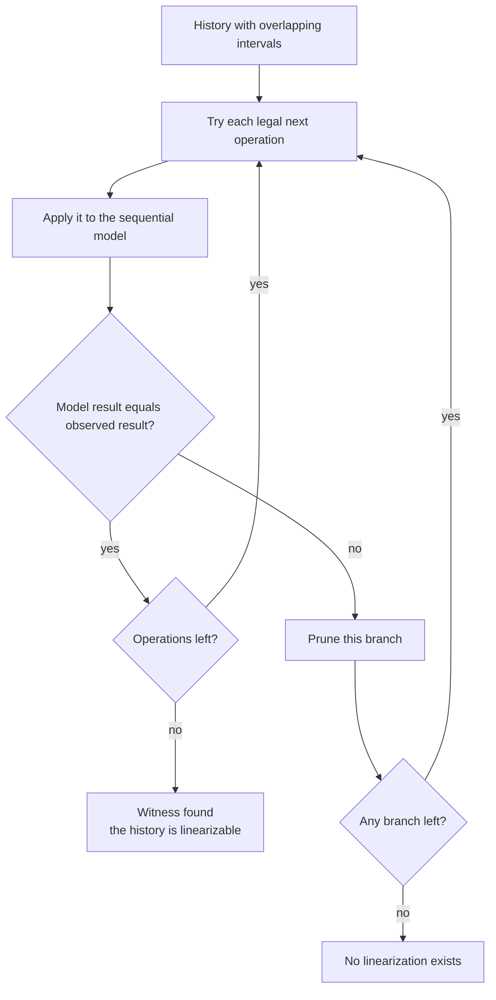
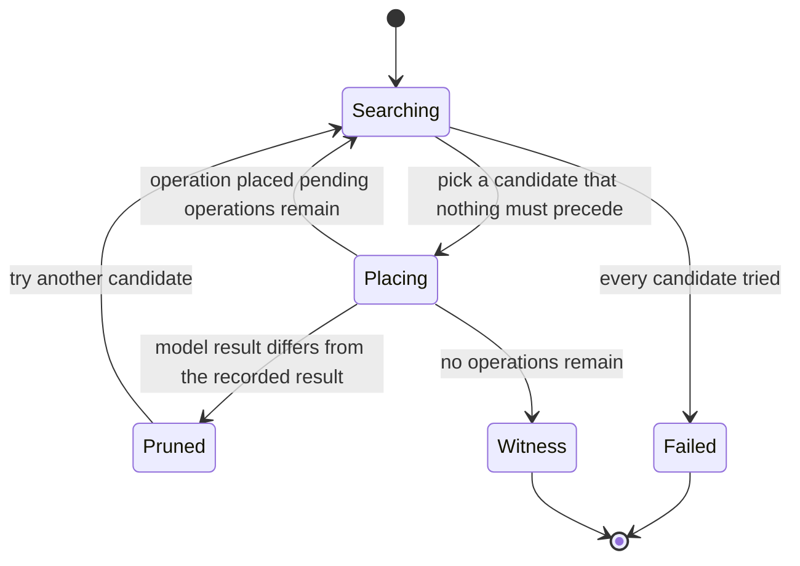
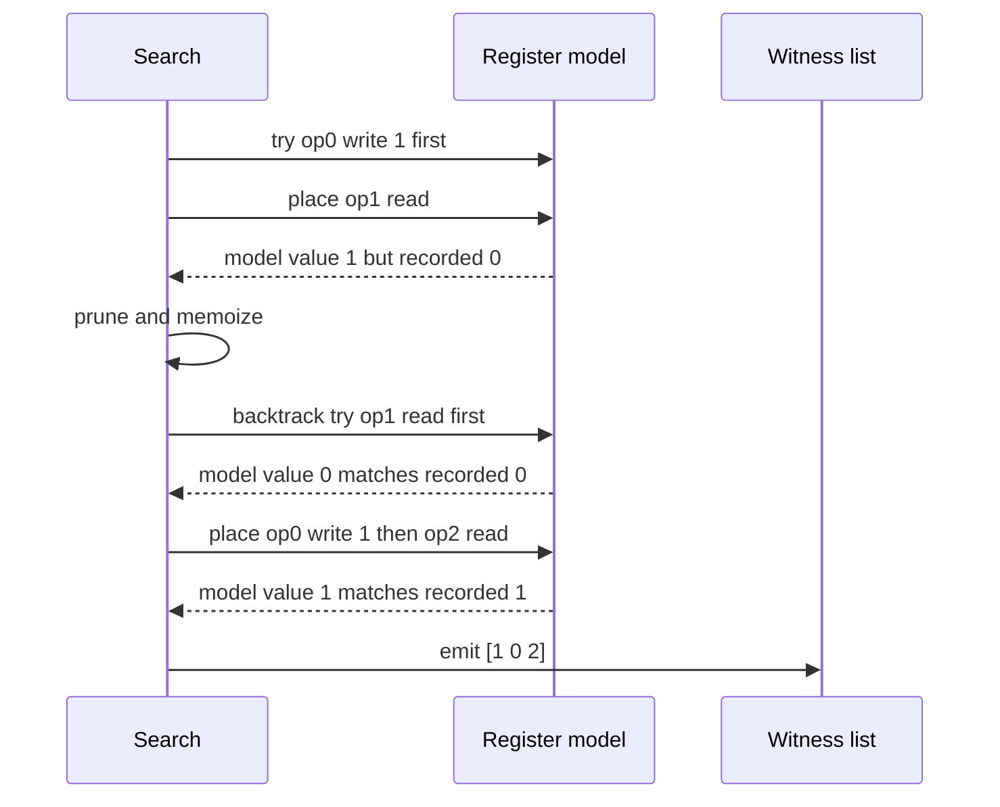

# 618 — Implement linearizability checker for concurrent histories.

> **Tier:** Expert · **CTCI chapter:** Ch 15 — Threads and Locks
> **Task spec:** [618-implement-linearizability-checker-for-concurrent-histories.md](../../../tasks/expert/618-implement-linearizability-checker-for-concurrent-histories.md)
> **Solutions:** [Python](../../../solutions/python/expert/618-implement-linearizability-checker-for-concurrent-histories/solution.py) ·
> [Java](../../../solutions/java/expert/618-implement-linearizability-checker-for-concurrent-histories/Solution.java) ·
> [JavaScript](../../../solutions/javascript/expert/618-implement-linearizability-checker-for-concurrent-histories/solution.js) ·
> [C#](../../../solutions/csharp/expert/618-implement-linearizability-checker-for-concurrent-histories/Solution.cs)

## 1. Problem restatement

Given a **concurrent history** — a list of operations, each with a thread, a kind, a value, a call time, a
return time and an observed result — decide whether *some* sequential order of those operations explains
every observed result while respecting **real time**: if operation `A` returned before operation `B` was
called, then `A` must come first. If such an order exists the checker returns it as a **witness**.

- **Input:** a list of records `(thread, kind, value, call, ret, result)`. `ret = None` marks an operation
  that was still in flight when the history was cut (a *pending* operation).
- **Output:** a verdict (`linearizable` or not), one witness (a permutation of the operation ids) when the
  history is linearizable, and the number of search states explored.
- **Sequential specifications modelled:** a read/write **register** and a FIFO **queue**
  (`enq`/`deq`, where a dequeue of an empty queue returns a sentinel — `None` in Python, the string
  `empty` in JavaScript).

**Modelling contract.** There are no threads: the history is *given*, and the search is deterministic.
Two documented simplifications come from the solutions — Python performs an exhaustive search with a memo
table and no partial-order reduction or P-composition, and JavaScript keeps histories at six operations
because the search is exponential in the number of **concurrent** operations and hashes the object state
with a plain key function instead of a canonical form. Only whole-history decisions are produced, never a
"culprit" operation. C# additionally reads the real-time order off global invoke/response event indices,
so per-process order follows from the event order.

Concrete expected results (all asserted):

- `[(0, write, 1, 0, 3), (1, read, –, 1, 2) → 0, (2, read, –, 4, 5) → 1]` is **linearizable**; in every
  witness the write comes before the second read, because that read started after the write returned.
- `[(0, write, 1, 0, 1), (1, read, –, 2, 3) → 0]` is **rejected**: a completed write cannot be invisible
  to a later read. The search explores 2 states before concluding this.
- Two overlapping writes followed by `read → 1` and `read → 2` are accepted (either write order works);
  two writes that both completed before a `read → 0` are rejected.
- A pending write may be linearized *after* a read that observed the earlier value, and a history of
  pending operations only is trivially linearizable.
- Queue: `enq 1`, `enq 2`, `deq → 1`, `deq → 2` is accepted with `enq 1` before the first dequeue;
  `deq → 2` before `deq → 1` is rejected; a dequeue that reports the *empty sentinel* from an empty queue
  is accepted, one that reports 5 is rejected.
- Degenerate cases: the empty history is linearizable, a single correct read is, a single wrong read is
  not.
- Randomized differential test: 6 interleaved runs are all accepted, their witnesses are revalidated, and
  **18 of 18** mutated reads (result nudged by 7) are rejected.

## 2. Intuition

The naive answer is "replay the operations in call order and see whether the results match". That works
for a history whose operations never overlap, and it is wrong the moment two operations are concurrent:
the real execution may have serialized them in either order, and *both* orders may be consistent with the
observed results. Replaying one arbitrary order rejects histories that are perfectly explainable.

The right question is a search: **is there any permutation that is both legally ordered and
result-preserving?** The canonical formulation (Wing & Gong) has two halves:

1. **Legal order.** At each step you may place any remaining operation that no other remaining operation is
   forced to precede. Forcing comes from real time only: `A` must precede `B` if `A` completed before `B`
   was invoked (`A.ret < B.call`). Pending operations force nothing and are forced by nothing.
2. **Result preservation.** Placing an operation applies it to a *sequential model* of the object — a
   register value or a queue — and the model's answer must equal the recorded result. Otherwise the branch
   is dead immediately, which is what keeps the search small in practice: a stale read prunes its whole
   subtree at the first step.



The decisive extra observation is that the recursion revisits the same situations over and over, so the
solutions memoize failures on the pair **(remaining operation set, model state)**. A long sequential
stretch then collapses into one visit instead of a factorial number of permutations.

## 3. Algorithm

1. Parse the history into operations with ids; an operation with `ret = None` is *pending*.
2. Start from the sequential model's initial state (register value or initial queue contents).
3. In the search, if nothing is left to place, record the current order as a witness and return.
4. Build the memo key `(remaining ids, model state)`; if that key already failed, return immediately.
5. For every remaining operation, skip it when `must_precede(op, remaining)` holds — that is, when some
   other complete remaining operation returned strictly before this one was called.
6. Clone the model. A pending operation is applied with the unchecked variant (it may have any result, but
   it still has an effect); a complete operation is applied and must reproduce its recorded result.
7. Recurse with that operation removed from the remaining set and appended to the order.
8. When every candidate has been tried without success, add the memo key to the failed set.

```text
procedure linearize(history, model_kind, initial)
    ops ← parse(history)
    failed ← empty set
    witnesses ← empty list
    search(model_of(model_kind, initial), tuple(ops), empty order)

procedure search(model, remaining, order)
    if remaining is empty then
        witnesses.append(copy of order)
        return
    key ← (set of ids in remaining, model.state())
    if key in failed then return
    for index ← 0 to length(remaining) - 1 do
        op ← remaining[index]
        if must_precede(op, remaining) then continue
        trial ← clone(model)
        if op is pending then
            trial.apply_unchecked(op)
        else if not trial.apply(op) then
            continue
        search(trial, remaining without index, order + [op.id])
    failed.add(key)

function must_precede(candidate, remaining)
    for each other in remaining do
        if other is not candidate and other is not pending and other.ret < candidate.call then
            return true
    return false
```

Two model-side details matter. `apply` for a **read** compares the recorded result with the model value
and returns false on mismatch; for a **write** it stores the value and returns true. `apply_unchecked` for
a pending write stores the value without validating anything, and for a pending dequeue it still removes
one element if the queue is non-empty, because the effect happened even though the result was never
observed.



## 4. Worked example

Register, initial value 0, history: `op0 = write 1` (call 0, ret 3), `op1 = read` (call 1, ret 2,
result 0), `op2 = read` (call 4, ret 5, result 1).

First the legal candidates. `op2` is forced after `op0` because `op0.ret = 3 < op2.call = 4`. `op1` and
`op0` overlap (ret 3 ≥ call 1), so neither forces the other.

| Step | Order so far | Candidates | Model after applying | Verdict |
| --- | --- | --- | --- | --- |
| 1 | `[]` | `op0`, `op1` (`op2` blocked by `op0`) | — | branch |
| 2 | `[op0]` | `op1`, `op2` | register = 1 | `op1` expects 0 → prune |
| 3 | `[op1]` | `op0` (`op2` blocked by `op0`) | register = 0, read returned 0 ✓ | continue |
| 4 | `[op1, op0]` | `op2` | register = 1 | `op2` expects 1 ✓ |
| 5 | `[op1, op0, op2]` | none | register = 1 | witness `[1, 0, 2]` |

The rejected variant of this history replaces `op2`'s result with 0: after `[op1, op0]` the register holds
1, so no candidate can produce a read of 0 and the failure of `({op2}, register=1)` is memoized. For the
minimal stale-read history (`write 1` returning at 1, `read → 0` invoked at 2) the checker explores just
**2 states**.



The queue model behaves the same way with a different specification. For `enq 1` (0→1), `enq 2` (2→3),
`deq → 1` (1→4), `deq → 2` (5→6) the first dequeue overlaps both enqueues, so the only forced edge is
`enq 1 → deq → 2` (`enq 1` returned at 1, before the second dequeue's call at 5). The search finds
`[enq 1, enq 2, deq, deq]`, and every witness respects FIFO because the model pops from the front. Swapping
the two recorded dequeue results (`2` then `1`) leaves no legal order, since a queue cannot return the
second element before the first.

## 5. Complexity

With `n` operations of which `c` are pairwise concurrent, and `s` the size of the object state.

| Quantity | Best | Average | Worst | Why the bound holds |
| --- | --- | --- | --- | --- |
| Verdict without backtracking | O(n) | O(n) | O(n) | a fully sequential history has exactly one legal order, so the search walks it and never branches |
| Search | O(n) | much less than the bound below in practice | O(n!) | each level tries every remaining legal candidate; pruning on a mismatching result usually kills branches at the first step |
| Search with the memo table | O(n) | O(n · states visited) | O(n · states visited) | each `(remaining set, model state)` pair is expanded once; the number of distinct pairs is what replaces the permutation count |
| `must_precede` per candidate | O(1) | O(n) | O(n) | a scan over the remaining operations comparing `other.ret < candidate.call` |
| Model apply / clone | O(1) | O(1) register, O(q) queue | O(q) | the register is a scalar; queue clone copies the items and a dequeue pops the front |
| Space | O(n) | O(n) | O(n · states) | the memo table dominates: one key per failed `(set, state)` pair |
| Witness revalidation | O(n) | O(n²) | O(n²) | `witness_is_legal` re-checks the permutation and every pair's real-time constraint independently |

Linearizability checking is **NP-complete** in general, and the solutions say so explicitly instead of
pretending otherwise: the exhaustive search plus memoization is the documented approach, and the
randomized differential test deliberately keeps histories at six operations so a brute-force permutation
oracle can confirm the verdict. The alternative the solutions compare against is exactly that oracle —
enumerating every permutation of the partial order and replaying it — which is `O(n! · n)` and therefore
only usable as a differential reference on tiny histories.

## 6. Pitfalls and edge cases

- **Pending operations.** An operation with `ret = None` may be placed anywhere its neighbours allow and
  imposes no constraint of its own; a pending write's value is applied without validating any result.
  The checks assert that when the pending write of a three-operation history is placed, it comes last.
- **Strict inequality in the real-time rule.** `A.ret == B.call` means the two operations are concurrent,
  not ordered, so `must_precede` uses `<`, and a checker that used `≤` would reject legal histories.
- **The witness must be revalidated independently.** The Python solution checks the permutation, the
  real-time order and the replay of every recorded result; a search bug that "finds" an illegal witness
  would otherwise go unnoticed.
- **The memo key must include the remaining *set*, not the order.** Two different prefixes can leave the
  same set and the same state; keying on the order would memoize nothing. JavaScript's documented
  simplification is that this key uses a plain state hash rather than a canonical form, which is safe here
  only because the states are a scalar or a tuple of items.
- **A dequeue from an empty queue is a result, not an error.** In Python the model compares against
  `None`, in JavaScript against the string `empty`; a dequeue that *invents* a value from an empty queue
  must be rejected, and the checks cover both directions.
- **Mutating one result is the sharpest test.** 18 of 18 nudged read results were rejected in the Python
  run; the generated histories also require that *most* mutations are caught, so the checker cannot be
  passing by accident.
- **Degenerate histories.** The empty history is linearizable with the empty witness, a single correct read
  is accepted and a single wrong read is rejected, and a history of writes only has no result to validate.
- **Malformed histories** (a result recorded for an operation with no return time, unknown kinds) are
  rejected by the solutions rather than silently mis-parsed.
- **Unicode and value identity.** Register values are compared by value; operations holding strings work
  the same way, and no locale-dependent comparison is used.
- **Scale honesty.** Exponential blow-up is a property of the problem, not a bug: larger histories need
  partial-order reduction such as P-compositionality, which these solutions deliberately do not implement.

## 7. Variants and follow-ups

- The relation the checker relies on — happens-before derived from program order, messages and locks — is
  modelled and verified directly, including the "race-free implies the read sees the latest preceding
  write" rule → [619 — formal model for happens-before and verify](../../../tasks/expert/619-implement-formal-model-for-happens-before-and-verify.md).
- Weaker consistency criteria that drop the real-time edge: causal consistency from vector clocks
  → [630 — causal consistency protocol simulation](../../../tasks/expert/630-implement-causal-consistency-protocol-simulation-vector-clocks.md).
- The queue specification this checker validates is exactly the object implemented lock-free by
  → [621 — scalable concurrent queue — Michael-Scott queue](../../../tasks/expert/621-implement-scalable-concurrent-queue-michael-scott-queue.md),
  and the progress-guarantee variant → [625 — wait-free queue, Kogan-Petrank style outline](../../../tasks/expert/625-implement-wait-free-queue-algorithm-kogan-petrank-style-outline.md).
- A history whose atomicity spans several objects is what the transaction simulator checks instead
  → [627 — transactional key-value store with two-phase commit simulation](../../../tasks/expert/627-implement-transactional-key-value-store-with-two-phase-commit-si.md),
  and the snapshot-level analogue of "one consistent explanation"
  → [617 — consistent snapshot across shards](../../../tasks/expert/617-implement-consistent-snapshot-across-shards-simulation.md).

## 8. Check yourself

<details><summary>Show answer</summary>
**Why is "replay in call order" not a correct linearizability check?** Because concurrent operations may
have been serialized in any order; the call order is just one of them. A history whose reads are explained
by the *other* order would be wrongly rejected.
</details>

<details><summary>Show answer</summary>
**In the three-operation register example, why is `op2` never a candidate at the start?** `op0` returned at
time 3 and `op2` was called at time 4, so `op0` must precede `op2`. Only `op0` and `op1` can go first.
</details>

<details><summary>Show answer</summary>
**What exactly is memoized, and why does it help?** The key `(remaining operation ids, model state)` is
recorded once every candidate under it has failed. Different prefixes that reach the same remaining set and
state are then cut off immediately, which collapses the long sequential stretches of a history.
</details>

<details><summary>Show answer</summary>
**A history is not linearizable. Does the checker tell you which operation is at fault?** No — the
documented simplification is that only whole-history verdicts are produced. Localizing the culprit needs a
different (usually incremental) algorithm.
</details>

<details><summary>Show answer</summary>
**Why is a dequeue that returns the empty-queue sentinel accepted?** The FIFO model returns that same
sentinel when the queue is empty, so the recorded result is reproduced exactly. Returning a real value
from an empty queue cannot be reproduced and is therefore rejected.
</details>
