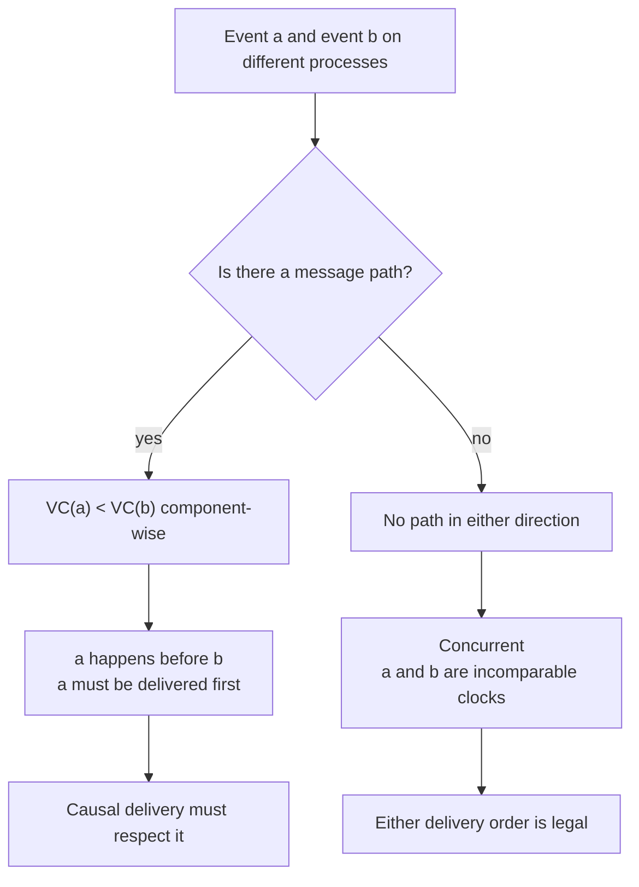
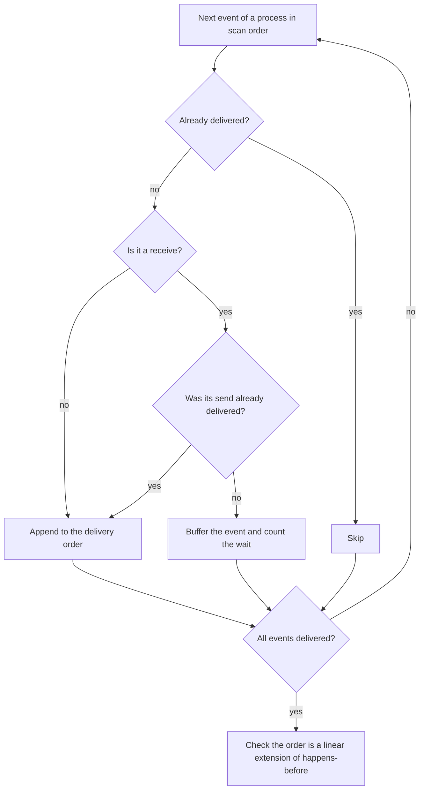
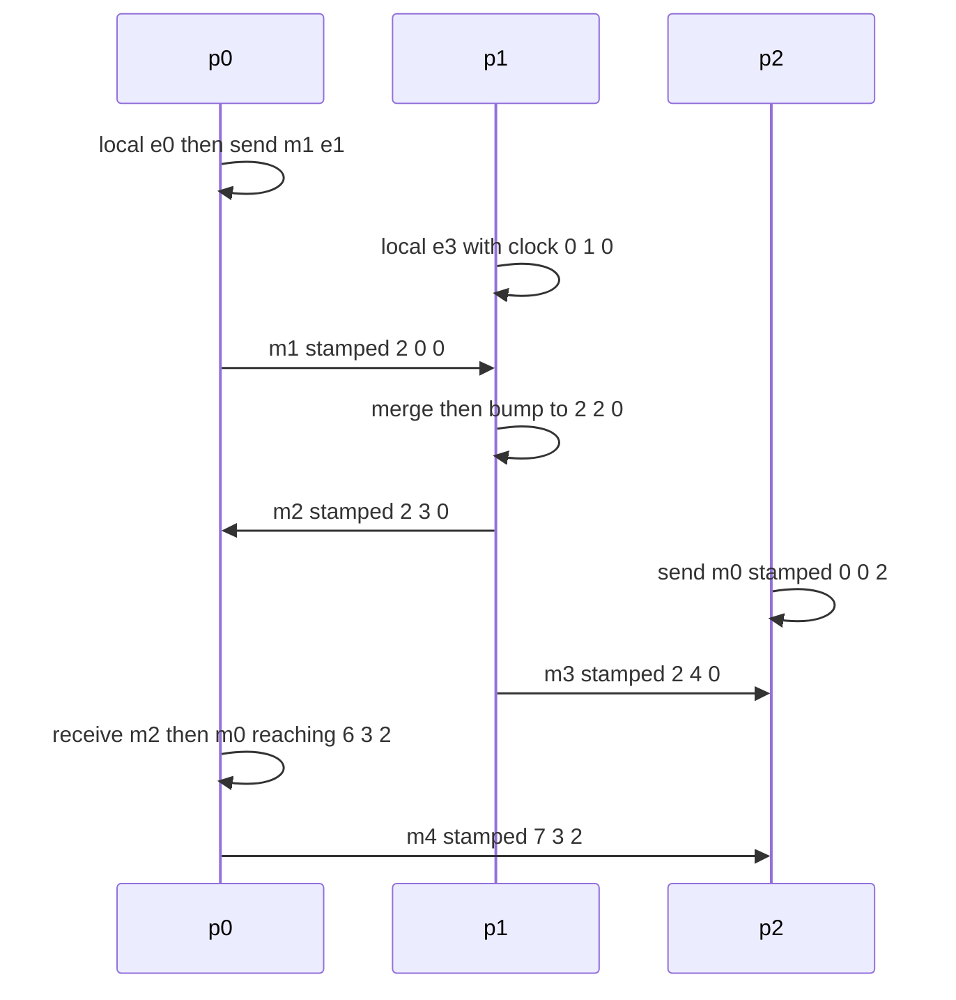

# 619 — Implement formal model for happens-before and verify.

> **Tier:** Expert · **CTCI chapter:** Ch 15 — Threads and Locks
> **Task spec:** [619-implement-formal-model-for-happens-before-and-verify.md](../../../tasks/expert/619-implement-formal-model-for-happens-before-and-verify.md)
> **Solutions:** [Python](../../../solutions/python/expert/619-implement-formal-model-for-happens-before-and-verify/solution.py) ·
> [Java](../../../solutions/java/expert/619-implement-formal-model-for-happens-before-and-verify/Solution.java) ·
> [JavaScript](../../../solutions/javascript/expert/619-implement-formal-model-for-happens-before-and-verify/solution.js) ·
> [C#](../../../solutions/csharp/expert/619-implement-formal-model-for-happens-before-and-verify/Solution.cs)

## 1. Problem restatement

Build Lamport's **happens-before** relation as an explicit partial order over the events of a
deterministic run, then *prove by exhaustive comparison* that a vector clock computes exactly that
relation — and use the relation to check a causal-delivery protocol.

- **Input:** a run — a set of processes and a list of events; every event belongs to one process and has a
  local sequence number, and is either a local step, the send of a numbered message or the receive of that
  message.
- **Output:** the happens-before relation (as reachability), the vector clock stamped on every event, and
  the verdicts: the clock order equals happens-before on **every** ordered pair, the relation is a strict
  partial order, and a causal delivery order is a linear extension of it.
- **Edges defining the relation:** *program order* (consecutive events of one process) and *message order*
  (the send of a message precedes its receive). Everything else is derived by transitive closure.

**Modelling contract.** The execution is *given*: no scheduler generates the interleaving, and no real
threads run. There are no fences and no weak-memory relaxations, so the model is sequentially consistent
by construction; the closure is the plain `O(n³)` transitive closure because traces are measured in tens of
events. The closure is the **definition** used to judge the vector clocks, not the other way round.
JavaScript additionally models monitor lock/unlock, pairwise sends and spawn/join as edge sources, and
Python adds a causal-broadcast buffer policy plus a cycle detector for forged deliveries. A receive of a
message that was never sent raises.

Concrete expected results (all asserted):

- The fixed three-process run has **17 events**, **5 messages** and **85 comparable pairs**; the vector
  clock agrees with the closure on all **272** ordered pairs (`17 × 16`).
- The relation is irreflexive (`happens-before` never relates an event to itself), asymmetric and
  transitive, and a receive's send is always in its past.
- Causal delivery delivers all **17** events in a linear extension of happens-before and had to buffer a
  message **3** times before delivering it.
- A forged delivery (an extra edge that contradicts message order) creates a **cycle** in the same
  four-event run whose honest graph is acyclic, and receiving an unknown message raises.
- A data race is a pair of conflicting accesses by different processes that are *unordered either way* —
  in this model that is exactly "the two vector clocks are incomparable".

## 2. Intuition

The naive way to answer "did `a` happen before `b`?" is to walk the program: keep a single global counter,
or compare wall-clock timestamps. Both fail, and they fail for the same reason — they impose a total order
on events that are simply independent. Two processes running in parallel with no message between them have
no happens-before edge in either direction, and no scalar clock can say that: if `a` has the smaller
timestamp, the scalar comparison reports `a → b` although the two events are concurrent.

The fix is to make the clock a **vector**, one component per process:

- a local step (or a send) bumps the process's own component;
- a send stamps the message with the sender's current vector;
- a receive merges component-wise with the received stamp (a maximum) and *then* bumps its own component.

Then `VC(a) < VC(b)` pointwise — every component `≤` with at least one strict — holds exactly when `a → b`,
and two vectors that are incomparable point in neither direction, which is precisely concurrency.



The second half of the task is to stop *assuming* that equivalence and check it: compute the closure of
the edge set directly, and compare it against the vector order on every one of the ordered pairs. The
checks then go further and confirm the closure really is a strict partial order, that a causal-delivery
schedule is a linear extension of it, and that adding one edge against message order rotates the run into
a cycle — which is what a forged delivery looks like.

## 3. Algorithm

1. Create a run with a process list and one vector clock per process, all zeros.
2. `local(p)` appends an event to `p`: copy the clock, bump the `p` component, store the result as the
   event's vector (this is the sequence-number bump too).
3. `send(p, m)` does the same and records the stamped vector as the message's stamp plus the send event's
   index.
4. `receive(p, m)` looks up the stamp — refusing a message that was never sent — merges it component-wise
   into `p`'s clock, and appends the receive event.
5. `edges()` collects program-order edges from consecutive indices in each process and one message edge
   per send/receive pair.
6. `closure()` runs Floyd–Warshall-style transitive closure over a boolean matrix; `concurrent(a, b)` is
   "neither reaches the other".
7. Verification: compare `vector_less` with the closure on every ordered pair, compare
   `vector_incomparable` with `concurrent`, check transitivity and irreflexivity triple-wise, verify each
   receive's send is in its past, then run causal delivery and require a linear extension.
8. Causal delivery scans the events in a deliberately unhelpful order (reversed process order): an event
   is delivered only when its process has reached it *and*, for a receive, the corresponding send has
   already been delivered; otherwise it is buffered and counted.

```text
procedure local(process)
    vector ← copy of clock[process]
    vector[position(process)] ← vector[position(process)] + 1
    clock[process] ← vector
    append Event(process, kind = local, vector) to events

procedure send(process, message)
    local(process) with kind = send
    messages[message] ← vector of the new event
    sent_from[message] ← index of the new event

procedure receive(process, message)
    stamp ← messages[message]                 // raises when the message was never sent
    clock[process] ← pointwise maximum of clock[process] and stamp
    local(process) with kind = recv and the message

function closure(run)
    reach ← boolean matrix of false
    for each (first, second) in edges(run) do reach[first][second] ← true
    for middle ← 0 to count - 1 do
        for start ← 0 to count - 1 do
            if reach[start][middle] then
                for end ← 0 to count - 1 do
                    if reach[middle][end] then reach[start][end] ← true
    return reach

procedure deliver_all(run)
    pending ← empty set
    repeat until no progress
        for each event whose process has reached it do
            if event is a recv and sent_from[event.message] is not delivered then
                pending.add(event), buffered_ever ← buffered_ever + 1
                continue
            deliver event
```

The `reach[start][middle]` guard is what turns the triple loop into a useful closure: pairs that are
already known to be reachable skip the inner loop entirely.



## 4. Worked example

The fixed run (`p0`, `p1`, `p2`; processes ordered `p0`, `p1`, `p2` in the vectors) and its clocks:

| Index | Process | Kind | Message | Vector after the event |
| --- | --- | --- | --- | --- |
| 0 | `p0` | local | — | `(1, 0, 0)` |
| 1 | `p0` | send | `m1` | `(2, 0, 0)` |
| 2 | `p0` | local | — | `(3, 0, 0)` |
| 3 | `p1` | local | — | `(0, 1, 0)` |
| 4 | `p1` | recv | `m1` | `(2, 2, 0)` |
| 5 | `p1` | send | `m2` | `(2, 3, 0)` |
| 6 | `p1` | send | `m3` | `(2, 4, 0)` |
| 7 | `p2` | local | — | `(0, 0, 1)` |
| 8 | `p2` | send | `m0` | `(0, 0, 2)` |
| 9 | `p1` | local | — | `(2, 5, 0)` |
| 10 | `p0` | recv | `m2` | `(4, 3, 0)` |
| 11 | `p2` | recv | `m3` | `(2, 4, 3)` |
| 12 | `p0` | local | — | `(5, 3, 0)` |
| 13 | `p0` | recv | `m0` | `(6, 3, 2)` |
| 14 | `p0` | send | `m4` | `(7, 3, 2)` |
| 15 | `p2` | recv | `m4` | `(7, 4, 4)` |
| 16 | `p1` | local | — | `(2, 6, 0)` |

The receive at index 4 illustrates the merge: `p1` had `(0, 1, 0)` and the stamp of `m1` is `(2, 0, 0)`;
the maximum is `(2, 1, 0)`, and bumping `p1`'s component gives `(2, 2, 0)`. From there `p1` can see all of
`p0`'s work up to the send, which is exactly what the message edge plus program order imply.

Reading the table as verdicts:

| Pair | Vectors | Relation | Why |
| --- | --- | --- | --- |
| `0 → 4` | `(1, 0, 0) &lt; (2, 2, 0)` | happens-before | `0` is in `p0`'s program order before the `m1` send, and `m1` is delivered at `4` |
| `2 → 10` | `(3, 0, 0) &lt; (4, 3, 0)` | happens-before | program order of `p0`, not a message edge |
| `8` and `9` | `(0, 0, 2)` vs `(2, 5, 0)` | concurrent | no path either way: `m0` is independent of `p1`'s local steps |
| `15` and `16` | `(7, 4, 4)` vs `(2, 6, 0)` | concurrent | the receive of `m4` and `p1`'s last local step are unordered |
| `13` and `15` | `(6, 3, 2) &lt; (7, 4, 4)` | happens-before | the `m4` send at `14` precedes its receive at `15` |

Counting comparable pairs in the closure gives **85** of the 272 ordered pairs; the remaining pairs are
concurrent, and every one of them is exactly a pair of incomparable clocks — that is the equivalence the
tests check pair by pair.



Causal delivery then walks the events in the deliberately unhelpful order (reverse process order:
`p2`, `p1`, `p0`), delivering a receive only once its send is out. `m1` is sent at event 1 but is not
delivered until event 1 itself is delivered, so the receives of `m3` and `m0` wait in the buffer — the run
reports **3 buffered waits** — and the resulting order of all 17 events is a linear extension: for all 85
comparable pairs the earlier event is delivered first. The forged counter-example is a two-process
ping-pong (`p0` sends `x`, `p1` receives it, `p1` sends `y`, `p0` receives it); adding the edge
"`p1`'s send of `y` → `p0`'s send of `x`" closes a cycle, which the cycle detector flags, while the honest
edge set of the same run stays acyclic.

## 5. Complexity

With `n` events, `p` processes and `m` messages.

| Operation | Best | Average | Worst | Why the bound holds |
| --- | --- | --- | --- | --- |
| Appending an event | O(1) | O(p) | O(p) | copying the process's vector is `p` reads; the bump is arithmetic on ints |
| `receive` | O(p) | O(p) | O(p) | a component-wise maximum over `p` components |
| `edges` | O(n) | O(n + m) | O(n²) | program-order edges are consecutive pairs; the Python version finds a message's receivers by scanning the events |
| `closure` | O(n) | O(n²) | O(n³) | Floyd–Warshall-style triple loop guarded by `reach[start][middle]` |
| Exhaustive verification | O(n²) | O(n²) | O(n²) | every ordered pair is compared once; the transitivity sweep adds a third factor (`n³`) |
| Causal delivery | O(n) | O(n²) | O(n²) | each round scans the remaining events; found at least one per round in practice |
| Cycle detection | O(n) | O(n + e) | O(n + e) | depth-first three-colour search over the reachability edges |
| Space | O(n) | O(n²) | O(n²) | the closure matrix dominates: one boolean per ordered pair, plus `p` counters per process |

The solutions state the trade-off explicitly: the closure is `O(n³)` *because traces are tens of events*,
and the point of the exercise is the equivalence, not the throughput. For large runs the standard
alternative is to skip the closure and use vector clocks alone (`O(p)` per comparison, `O(p)` per event),
which is exactly why the equivalence proof is the interesting part. Python's per-event vectors cost
`O(p)` space each, so a run of `n` events uses `O(n · p)` for clocks plus `O(n²)` for the closure.

## 6. Pitfalls and edge cases

- **The receive must bump after merging.** Merging the stamp and forgetting the own-component bump loses
  the program-order edges that start at the receive; the exhaustive comparison would still pass on the
  send edges and only fail on pairs that involve later events of that process.
- **`VC(a) < VC(b)` is not `≤`.** Pointwise `≤` with all components equal means `a == b`, not
  `a → b`; the helper requires the vectors to differ.
- **Incomparable clocks mean concurrency, not "unknown".** That is the definition the race check uses:
  two conflicting accesses are a race exactly when their clocks are incomparable.
- **A receive of a never-sent message must raise** rather than invent a stamp, and the checks assert that
  it does.
- **Irreflexivity has to be checked explicitly.** A closure that seeds the diagonal with true (a common
  slip when implementing transitive closure) still computes the right transitive relation but wrongly
  claims every event happens before itself.
- **Causal delivery needs the buffered counter.** A policy that only delivers when ready but never counts
  waits would look correct while actually being a plain scan; the run must report **3** buffered waits
  here, so the buffering path is genuinely exercised.
- **Ordering a delivery is not ordering the events.** A valid causal order is any linear extension; the
  check is only that every comparable pair keeps its relative order, not that it equals the event index
  order.
- **Forged delivery is detected as a cycle, not as a rule violation.** This is the practical test: if you
  can add the bad edge and still have an acyclic graph, you were not actually enforcing message order.
- **Weak memory is out of scope.** There are no fences, no store buffers and no per-location coherence
  rules, so a "stale read" in a trace is rejected against sequentially consistent semantics only.
- **Unicode is irrelevant here** because ids are process names and integer message ids, but message ids
  must be unique: reusing one silently merges two different causal paths.

## 7. Variants and follow-ups

- The same relation applied to reads and writes of a shared location, where the operational content is
  "a race-free trace must read the latest write that happens before it", and the single-object version of
  the same consistency question
  → [618 — linearizability checker for concurrent histories](../../../tasks/expert/618-implement-linearizability-checker-for-concurrent-histories.md).
- Replacing the single global timestamp of a snapshot with causal order — the same "merge the stamped
  maximum" idea, used to keep replicas consistent
  → [630 — causal consistency protocol simulation with vector clocks](../../../tasks/expert/630-implement-causal-consistency-protocol-simulation-vector-clocks.md).
- Keeping that causal order across a *coordinated* cut of several shards, where the clock is a commit
  counter instead of a vector
  → [617 — consistent snapshot across shards simulation](../../../tasks/expert/617-implement-consistent-snapshot-across-shards-simulation.md).
- Ties that are *decided*, not merely ordered, once the causal graph reaches agreement messages
  → [628 — distributed consensus simulation with network partitions](../../../tasks/expert/628-implement-distributed-consensus-simulation-with-network-partitio.md).
- When the causal relation must survive node failures and restarts, the vector is replaced by a version
  vector exchanged pair by pair
  → [631 — gossip protocol for membership and failure detection](../../../tasks/expert/631-implement-gossip-protocol-for-membership-and-failure-detection.md).

## 8. Check yourself

<details><summary>Show answer</summary>
**Why does a scalar Lamport clock lose information that a vector clock keeps?** On a tie-break the scalar
value says nothing about the direction; a vector whose components are incomparable proves there is no
path either way, so concurrency is representable. The scalar comparison cannot distinguish "concurrent"
from "happened before".
</details>

<details><summary>Show answer</summary>
**Event 4 receives `m1` from `p0`. Why is its vector `(2, 2, 0)` and not `(2, 1, 0)`?** The merge takes the
component-wise maximum of `p1`'s `(0, 1, 0)` and the stamp `(2, 0, 0)`, giving `(2, 1, 0)`; the receive is
also an event of `p1`, so `p1`'s component is then bumped to 2.
</details>

<details><summary>Show answer</summary>
**The run has 85 comparable pairs out of 272. What are the other 187?** Pairs of concurrent events: neither
is reachable from the other, and their vector clocks are incomparable. In this model a race is exactly such
a pair, provided the two accesses conflict.
</details>

<details><summary>Show answer</summary>
**Why is a forged delivery detected by looking for a cycle instead of by comparing clocks?** Because the
forged edge is added to the graph *outside* the clock computation, so the clocks cannot see it. A rule
violation shows up structurally: the extra edge, together with program order and real message edges, closes
a cycle, which can never happen in an honest happens-before graph.
</details>

<details><summary>Show answer</summary>
**Causal delivery reports 3 buffered waits even though the run is acyclic. Is that a bug?** No. The events
are scanned in an intentionally unhelpful order (reversed process order), so receives arrive before their
sends are delivered and must be buffered. The reported order is still a linear extension of
happens-before, which is the property being verified.
</details>
