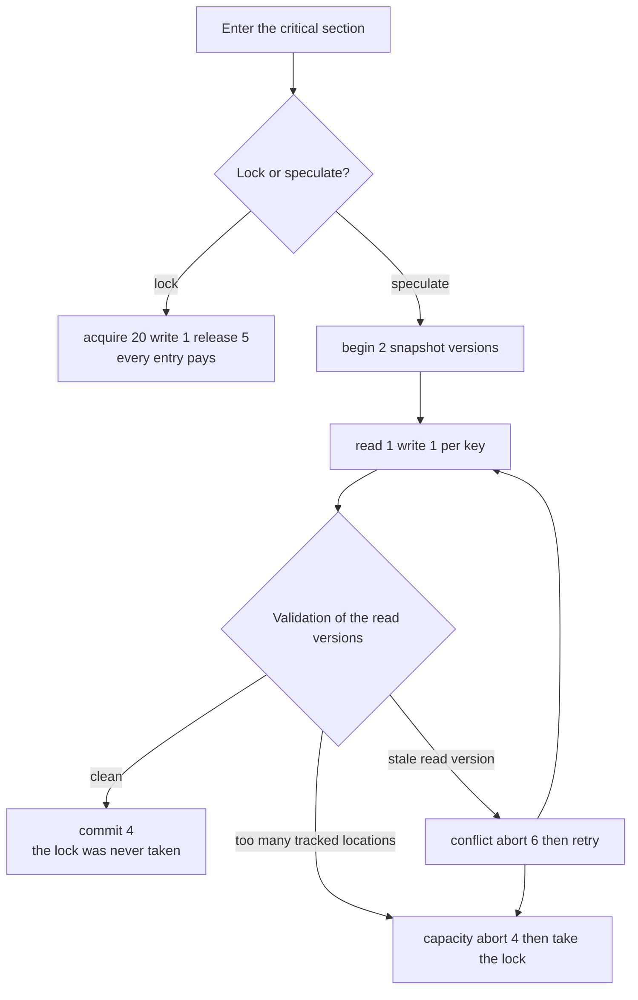
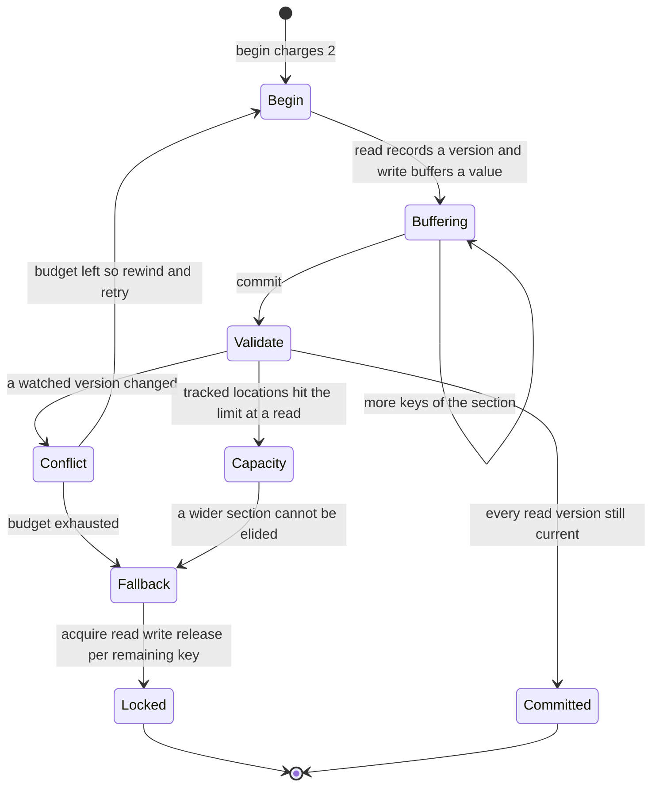
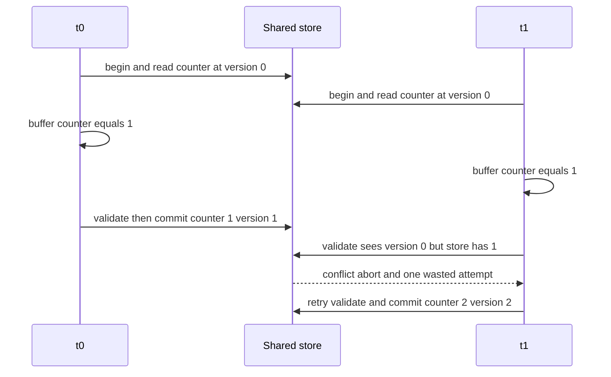
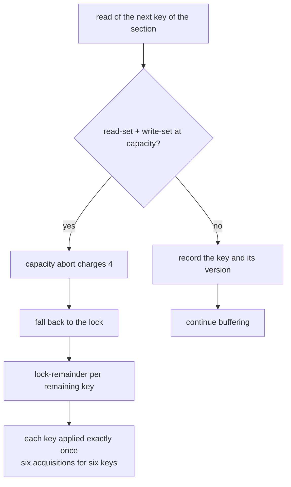

# 620 — Implement lock-elision simulation and contention measurement.

> **Tier:** Expert · **CTCI chapter:** Ch 15 — Threads and Locks
> **Task spec:** [620-implement-lock-elision-simulation-and-contention-measurement.md](../../../tasks/expert/620-implement-lock-elision-simulation-and-contention-measurement.md)
> **Solutions:** [Python](../../../solutions/python/expert/620-implement-lock-elision-simulation-and-contention-measurement/solution.py) ·
> [Java](../../../solutions/java/expert/620-implement-lock-elision-simulation-and-contention-measurement/Solution.java) ·
> [JavaScript](../../../solutions/javascript/expert/620-implement-lock-elision-simulation-and-contention-measurement/solution.js) ·
> [C#](../../../solutions/csharp/expert/620-implement-lock-elision-simulation-and-contention-measurement/Solution.cs)

## 1. Problem restatement

Simulate **lock elision** in the style of hardware transactional memory (Intel TSX): run a critical
section as a *transaction*, commit it without ever taking the lock, and let only a conflict, a capacity
overflow or an exhausted retry budget fall back to the lock. Then **measure the contention** the schedule
exposes instead of assuming that elision is cheaper.

- **Input:** a shared store (one integer per key), a set of threads, the keys of one critical section, and
  an explicit **schedule** — a list of thread ids. The workload is: every thread increments every key of the
  section, once, plus any extra transactions requested.
- **Output:** the final store (which must be identical for both engines), a cycle count from a fixed cost
  model, and the contention counters: lock acquisitions, spins, aborts by reason, commits, fallbacks.
- **Two engines over the same schedule:** a `LockedEngine` running `acquire / read / write / release`
  micro-ops, and an `ElidedEngine` running `begin / read / write / commit` micro-ops with a read set, a
  write set and recorded read versions.

**Modelling contract.** There are no threads, sockets or sleeps: a *scheduler* walks the explicit list of
step owners and each `step(thread)` executes exactly one micro-op, which is what makes every run
reproducible. Documented simplifications: Python tracks a set of locations (not per-word stamps) and uses
the read-set versions for validation, JavaScript uses one shared version stamp instead of per-word stamps
and no real CAS or cache-line ownership, and both use a counter workload rather than a general critical
section. It is a faithful *simulation* of the decisions an elision implementation makes — speculate,
validate, abort, retry, fall back — not a model of timing on real hardware.

Concrete expected results (all asserted):

- Serial schedule `t0 t0 t0 t0 t1 t1 t1 t1`: both engines end at `counter = 2`, contention is `0`, the
  locked engine costs **54** cycles and the elided engine **16** — elision is strictly cheaper.
- Hand-interleaved schedule `t0 t1 t0 t1 t0 t1 t0`: exactly **1 conflict abort**, one retry, no fallback,
  final value 2, versions 2, and a measured cost of
  `2 · (begin + read + write + commit) + (begin + read + write) + conflict-abort = 26` cycles. The locked
  engine on `t0 t1` repeated four times reports **3 spins** and **63** cycles for the same answer.
- A section six keys wide exceeds the tracked capacity of four: exactly **1 capacity abort**, **1
  fallback**, the lock taken **6** times, and every key applied exactly once. A two-key section never
  aborts and never falls back.
- An aborted attempt leaves **no trace**: the store fingerprint after the rollback equals the fingerprint
  taken before the failing commit.
- **40** seeded schedules are swept and the two engines agree on the final state every time, and every one
  of those schedules shows at least one abort.

## 2. Intuition

A lock is a promise that only one thread is inside the section, paid for on *every* entry — and it is
vastly overpriced when nobody actually contends. Optimistically entering the section costs a begin, the
reads, the writes and a validation, and if nothing else touched the read set the validation succeeds and
the lock was never acquired at all.

The interesting part is what happens when somebody *did* touch it. The speculation must be able to say
"this attempt is worthless", undo its buffered writes and either retry or fall back. That gives two distinct
failure modes, and a good simulation must keep them apart:

- **Conflict abort** — a location in the read set has a different version than when it was read. Someone
  committed in between, so the values this attempt computed are stale. Retry (bounded by an attempt budget)
  and then fall back.
- **Capacity abort** — the number of tracked locations exceeded what the hardware can watch. There is no
  point retrying, because the *section* is too wide, not the schedule: fall back to the lock immediately.



The cost model is what turns the simulation into a *measurement*: with a serial schedule the elided engine
needs 16 cycles against 54, and with the interleaving above it needs 26 against 63 even though it paid for
one wasted attempt and one abort. Those numbers are printed by the run, not assumed — and the same code
would print the opposite verdict for a schedule with enough conflicts, which is exactly the honest
conclusion for elision in general.

## 3. Algorithm

1. Build the shared store: values, one version per key (bumped on every write), and an owner slot per key
   standing in for the lock.
2. Give every thread a micro-op program. Locked: per key `(acquire, read, write, release)`, the last
   release counted as a commit. Elided: per transaction `begin`, then `(read, write)` per key, then
   `commit`.
3. Walk the schedule; each step runs the calling thread's next micro-op.
4. Locked micro-ops: acquiring a free lock sets the owner and charges the acquire cost; a busy lock charges
   the spin cost, counts a contention event and leaves the program counter on the same micro-op, so the
   thread spins. Read stores the value, write stores `read + 1` and bumps the version, release clears the
   owner.
5. Elided read: if the tracked locations (`read set + write set`) already reached the capacity, abort for
   capacity, charge the abort, and fall back. Otherwise record the location in the read set *and the
   version it currently has*.
6. Elided write: buffer `value + 1` in the write set (nothing touches the store yet).
7. Elided commit: compare every recorded read version with the current version. Any difference is a
   conflict abort; if the attempt budget is exhausted, fall back, otherwise rewind the program counter to
   the start of this attempt and retry. With a clean read set, write the buffered values back, bump their
   versions, charge the commit and count it.
8. Fallback replaces the thread's remaining program with one `lock-remainder` micro-op per key of the
   remaining transactions, so the rest of the work is done under the real lock.
9. Drain: after the schedule is exhausted, step the threads round-robin until every thread is done, so
   spins and retries that the schedule did not cover still complete.

```text
procedure step(thread)
    if done(thread) then return
    if program-counter(thread) reached the end then done(thread) ← true, return
    op ← micro-ops(thread)[program-counter(thread)]
    program-counter(thread) ← program-counter(thread) + 1
    return execute(thread, op)

procedure execute-elided-read(thread, key)
    tracked ← size(read-set(thread)) + size(write-set(thread))
    if tracked >= capacity then
        note-abort("capacity"), cycles ← cycles + CAPACITY_ABORT_COST
        fallbacks ← fallbacks + 1
        fall-back(thread)
        return
    read-set(thread).append(key)
    read-versions(thread)[key] ← versions(key)
    cycles ← cycles + READ_COST

procedure execute-elided-commit(thread)
    for each (key, version) in read-versions(thread) do
        if versions(key) != version then
            note-abort("conflict"), cycles ← cycles + CONFLICT_ABORT_COST
            if attempts(thread) >= MAX_ATTEMPTS then
                fallbacks ← fallbacks + 1
                fall-back(thread)
            else
                rewind program-counter(thread) to the start of this attempt
            return
    for each (key, value) in write-set(thread) do
        store.values[key] ← value
        store.versions[key] ← store.versions[key] + 1
    reset read-set and write-set of the thread
    cycles ← cycles + COMMIT_COST, commits ← commits + 1
```



## 4. Worked example

Store `{counter: 0}`, threads `t0`/`t1`, one key per section, one transaction each, so every thread's elided
program is `begin, read, write, commit`. The schedule is `t0 t1 t0 t1 t0 t1 t0`:

| Step | Thread | Micro-op | Read set / write set of the thread | Store after | Cycles so far |
| --- | --- | --- | --- | --- | --- |
| 1 | `t0` | `begin` | attempt 1 of `t0` starts | `counter = 0`, version 0 | 2 |
| 2 | `t1` | `begin` | attempt 1 of `t1` starts | unchanged | 4 |
| 3 | `t0` | `read` | `t0` read set `{counter}` at version 0 | unchanged | 5 |
| 4 | `t1` | `read` | `t1` read set `{counter}` at version 0 | unchanged | 6 |
| 5 | `t0` | `write` | `t0` write set `{counter: 0 + 1}` | unchanged | 7 |
| 6 | `t1` | `write` | `t1` write set `{counter: 0 + 1}` | unchanged | 8 |
| 7 | `t0` | `commit` | validation 0 = 0 ✓, buffered value 1 applied | `counter = 1`, version 1 | 12 |
| 8 | `t1` | `commit` | validation fails: watched version 0, current 1 | unchanged | 18 |
| 9 | `t1` | retry `begin` → `read` → `write` | read set at version 1, write set `{counter: 2}` | unchanged | 22 |
| 10 | `t1` | `commit` | validation 1 = 1 ✓ | `counter = 2`, version 2 | 26 |

Step 8 is the conflict abort: `t1`'s attempt is rewound to the start of its transaction and retried,
because its attempt count (1) is still below the budget of 3. The abort is a rollback, not a repair — the
store was never touched by step 6, so there is nothing to undo, and the checks confirm that the store
fingerprint after a rollback equals the one taken before the failing commit. The measured total is
`2 · 8 + 4 + 6 = 26` cycles, matching the asserted formula exactly.

The locked engine on the same two threads and the schedule `t0 t1` repeated four times tells the other
half of the story: `t0` takes the lock, `t1` spins three times at 3 cycles each, and the section still ends
at `counter = 2` — but for **63** cycles instead of 26. With no interference at all (serial schedule) the
elided engine commits both sections for 16 cycles against the locked engine's 54.



Capacity behaves differently: a section six keys wide with a tracked capacity of four aborts on the read
that would exceed the budget. Because the failure is the *width* of the section, the engine does not retry —
it falls back, and the fallback runs one `lock-remainder` micro-op per remaining key, applying all six keys
exactly once with six lock acquisitions. A two-key section in the same store never aborts.



## 5. Complexity

Per micro-op the model is constant time; the interesting quantity is the cycle count, quoted from the
solution's own constants.

| Quantity | Best | Average | Worst | Why the bound holds |
| --- | --- | --- | --- | --- |
| One elided attempt (one key) | 8 cycles | 8 + abort | 8 + repeated aborts | begin 2 + read 1 + write 1 + commit 4; a conflict abort adds 6, a capacity abort 4 |
| One locked section (one key) | 27 cycles | 27 + spins | 27 + unbounded spins | acquire 20 + read 1 + write 1 + release 5, plus 3 per spin |
| Serial two-thread run | 16 cycles elided | — | 54 cycles locked | measured by the run and asserted by the checks |
| Interleaved run above | 26 cycles elided | — | 63 cycles locked | one wasted attempt (4) plus a conflict abort (6) still beats three spins (9) plus a second full lock acquisition |
| Step cost | O(1) | O(1) | O(1) | every micro-op touches one key and a constant number of counters |
| Elided commit validation | O(1) | O(k) | O(k) | one version comparison per location in the read set, where `k` is the section width (capped by the tracked capacity, 4 here) |
| Fallback | O(1) | O(k · r) | O(k · r) | `r` remaining transactions, one lock acquisition and one increment per key |
| Space | O(k) | O(k) | O(k) | read set, write set and read-version map per thread, plus the store's values, versions and owners |
| Whole run | O(s) | O(s + drains) | O(s + 600 · threads) | the schedule is `s` steps and the drain loop is capped at 600 rounds in the Python driver |

Elision wins exactly when the saved lock cost exceeds the expected abort cost: a section with `k` keys
saves roughly `(acquire + release) − (begin + commit)` per attempt, so the crossover is governed by the
conflict rate times the abort cost. Because a conflict also throws away the work already done in the
attempt, the honest trade-off is *measured* by the sweep of seeded schedules rather than predicted — and
the models state clearly that the constants (20 for an acquisition, 5 for a release, 3 for a spin, 2/1/1/4
for begin/read/write/commit, 6 and 4 for the two abort kinds) are the simulation's cost model, not
hardware measurements.

## 6. Pitfalls and edge cases

- **An aborted attempt must leave no trace.** Buffered writes only reach the store at commit, so the
  rollback is trivially clean — but only if the write set is discarded too. The checks verify the store
  fingerprint before the failing commit and after the rollback are equal.
- **Do not retry a capacity abort.** It is a property of the section's width, not of the interleaving, so
  the engine falls back immediately instead of burning the attempt budget.
- **The attempt budget must be enforced.** Without `MAX_ATTEMPTS = 3` a thread under persistent contention
  can livelock; with it, repeated losers fall back to the lock, which is what the checks assert for a
  repeatedly losing thread.
- **A spin is not progress.** In the locked engine the program counter stays on the same micro-op, so a
  spin does not silently skip the acquire; the schedule runs out and the drain loop finishes the work.
- **Contention must count aborts, not only spins.** `contention()` is spins plus every abort, which is why
  the serial schedule reports 0 and the wide-section run reports exactly 1.
- **Both engines must agree on the final state.** Otherwise elision changed a result rather than a cost.
  Both the hand-written schedules and the 40 seeded schedules check this, and the invariant `value ==
  applied` is the two-word analogue of it.
- **The schedule is the whole model of timing.** There is no preemption, no memory bus and no timing
  jitter, so identical schedules replay identically, and a schedule-sensitive verdict is a statement about
  the model, not about silicon.
- **Single-threaded runs never conflict** (one distinct thread cannot invalidate its own read set), so
  elision elides every section — the exact case the C# solution asserts for a lone thread.
- **Degenerate widths.** A section of one key is the smallest interesting case; a section wider than the
  tracked capacity always falls back; an empty section has nothing to commit, so the commit cost without
  writes is the only thing charged.
- **Unicode and negative values** are irrelevant to the model: keys are plain names and values are
  integers, with no overflow check because the counters stay small.

## 7. Variants and follow-ups

- Replacing elision with a genuinely non-blocking algorithm, where the same "validate or lose" idea becomes
  a CAS retry loop → [621 — scalable concurrent queue — Michael-Scott queue](../../../tasks/expert/621-implement-scalable-concurrent-queue-michael-scott-queue.md)
  and [625 — wait-free queue, Kogan-Petrank style outline](../../../tasks/expert/625-implement-wait-free-queue-algorithm-kogan-petrank-style-outline.md).
- The read-set validation problem in its hardest form: a resizable structure whose buckets must be watched
  without locking → [622 — non-blocking hash table with split-ordered lists](../../../tasks/expert/622-implement-non-blocking-hash-table-split-ordered-lists.md).
- Waiting for absent readers *without* a lock, which is how a speculative reader's snapshot is kept alive
  → [623 — hazard pointers memory reclamation](../../../tasks/expert/623-implement-hazard-pointers-memory-reclamation-in-concurrent-struc.md).
- The read-mostly branch of the same trade-off, where readers pay nothing and writers copy instead of
  validate → [624 — RCU-style read-copy-update sketch with tests](../../../tasks/expert/624-implement-rcu-style-read-copy-update-sketch-with-tests.md).
- Where the contention this tutorial measures must never happen at all, because a scheduler that blocks can
  deadlock: owner/stealer deques
  → [626 — work-stealing deque (Chase-Lev) for task scheduler](../../../tasks/expert/626-implement-work-stealing-deque-chase-lev-for-task-scheduler.md).

## 8. Check yourself

<details><summary>Show answer</summary>
**Why is `t1`'s step 8 in the worked trace a conflict abort rather than a lost update?** Because `t1`'s
write never reached the store: it was buffered in the write set. The commit validates the version it read
(0) against the current version (1, bumped by `t0`'s commit), fails, and rewinds the attempt; the store
therefore never held a stale value.
</details>

<details><summary>Show answer</summary>
**The elided engine costs 26 cycles for the interleaved schedule against the locked engine's 63. Does that
prove elision is always better?** No. It is a measurement on that schedule. The crossover depends on how
often the read set is invalidated: each conflict costs the abort (6) plus the work already done in the
attempt, and 40 seeded schedules with aborts show how quickly that adds up.
</details>

<details><summary>Show answer</summary>
**Why does a section six keys wide with a capacity of four not simply retry?** Because the abort reason is a
capacity overflow: the attempt tracks more locations than the hardware can watch, so every retry would
overflow in exactly the same place. The engine falls straight back to the lock.
</details>

<details><summary>Show answer</summary>
**What stops two contending threads from aborting each other forever?** The attempt budget of 3. After the
third failed attempt the thread abandons speculation and runs the remaining transactions under the lock,
which the checks exercise with a repeatedly losing thread.
</details>

<details><summary>Show answer</summary>
**Both engines must end at `counter = 2` in the worked example. Why is that the important check rather than
the cycle count?** Because elision is allowed to change *when* work happens, never *what* the result is. If
the two engines disagreed on the final state the simulation would be modelling a race rather than an
optimization, so the state equality is the correctness check and the cycle count is only the measurement.
</details>
