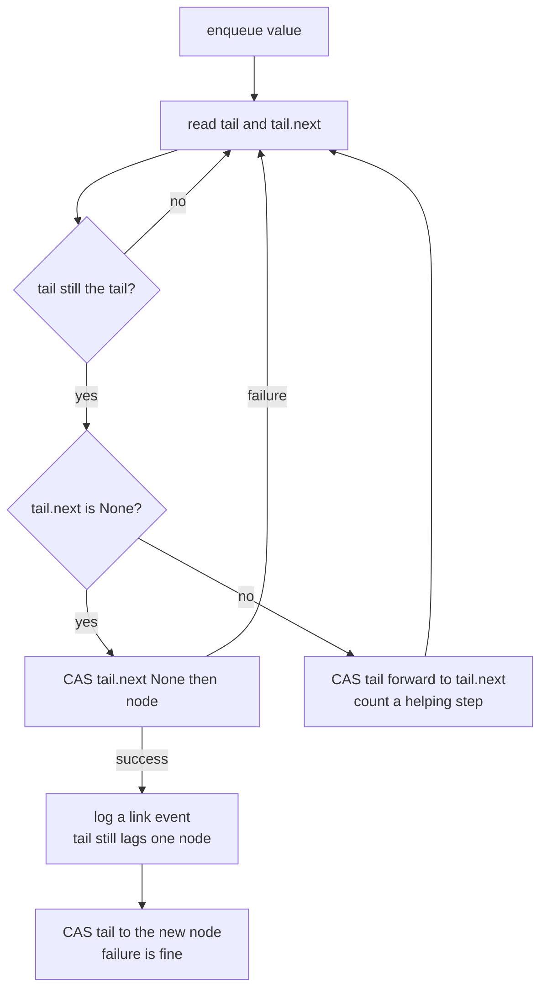
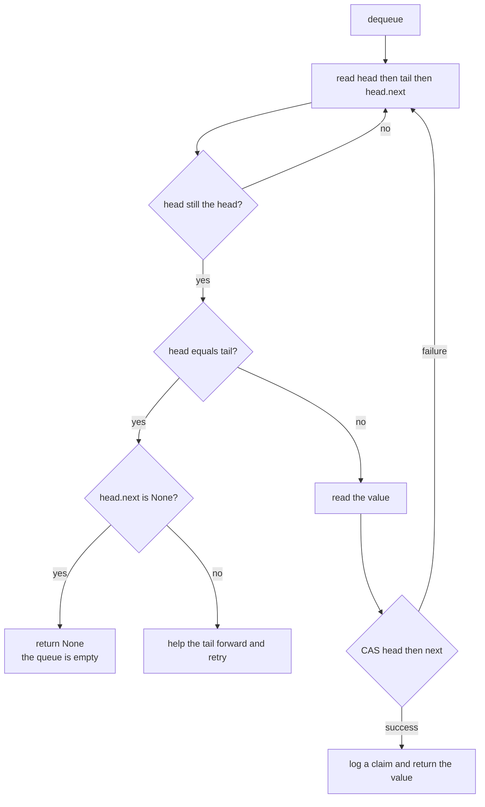
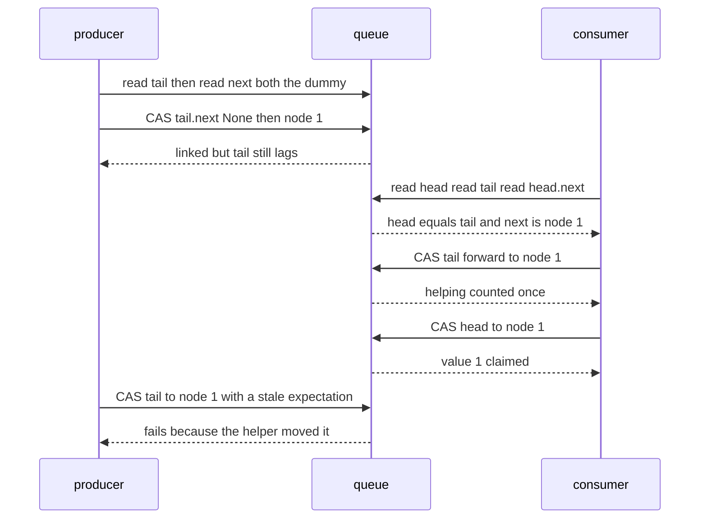

# 621 — Implement scalable concurrent queue (Michael-Scott queue).

> **Tier:** Expert · **CTCI chapter:** Ch 15 — Threads and Locks
> **Task spec:** [621-implement-scalable-concurrent-queue-michael-scott-queue.md](../../../tasks/expert/621-implement-scalable-concurrent-queue-michael-scott-queue.md)
> **Solutions:** [Python](../../../solutions/python/expert/621-implement-scalable-concurrent-queue-michael-scott-queue/solution.py) ·
> [Java](../../../solutions/java/expert/621-implement-scalable-concurrent-queue-michael-scott-queue/Solution.java) ·
> [JavaScript](../../../solutions/javascript/expert/621-implement-scalable-concurrent-queue-michael-scott-queue/solution.js) ·
> [C#](../../../solutions/csharp/expert/621-implement-scalable-concurrent-queue-michael-scott-queue/Solution.cs)

## 1. Problem restatement

Implement the **Michael-Scott (1996) non-blocking queue** — a linked list with a dummy node, a `head` and
a `tail`, advanced only by compare-and-swap — and drive it with an **explicit schedule** so that the
interleavings which make the algorithm subtle are reproducible.

- **Input:** a list of per-thread programs (`enq value` / `deq`) and a schedule — a list of thread ids.
- **Output:** the values dequeued, plus the structural guarantees and counters: CAS attempts and failures,
  volatile reads, helping steps, spurious retries, enqueues, dequeues, and an event log of `link` and
  `claim` records in global step order.
- **One step** is exactly one volatile read or one compare-and-swap. Each operation is a **step machine**:
  an operation that must retry simply keeps yielding, and the scheduler decides who takes the next step.

**Modelling contract.** There are no threads, sleeps or timers: a *schedule* of thread ids decides who
advances, which is the documented simplification — one thread runs at a time, so a CAS is trivially atomic.
That is a faithful *interleaving* simulation of the algorithm rather than a kernel test. Compare-and-swap
is simulated honestly: it succeeds exactly when the field still holds the expected reference at the moment
the step runs, so CAS failures are produced by the interleaving instead of being scripted. Memory
reclamation is deliberately out of scope (hazard pointers and epochs are their own task), and ABA cannot
happen because nodes are created fresh and never reused — the standard reason this queue needs no tagged
pointer.

Concrete expected results (all asserted):

- A sequential schedule enqueues 1…5 and dequeues five times: the results are exactly
  `[None, None, None, None, None, 1, 2, 3, 4, 5]`, with **0** CAS failures and **0** helping steps — a lone
  thread never loses a CAS. Dequeuing an empty queue returns `None` without blocking, and only the
  successful dequeue is counted.
- The crafted schedule plus 40 seeded schedules run two producers and two consumers: every value is
  claimed at most once, claims follow link order, the remaining values are exactly the linked-but-claimed
  leftovers, the list is acyclic and quiescent at the end, and the consumers together observe every value.
  All **41** runs recorded at least one CAS failure, exactly **1** run needed the tail-advance help, and
  **328** dequeue attempts observed a momentarily empty queue.
- Hand-forced interleavings exercise the three interesting states: a **lagging tail** (node linked, `tail`
  still on the dummy, so the consumer helps and the producer's later tail CAS loses), the **helping CAS**
  (`head == tail` with `head.next` non-null, exactly one helping step counted), and a **CAS failure** when
  both threads read `next == None`.

## 2. Intuition

A lock-based queue serializes every operation, and the serialization is paid even when the queue is idle.
A lock-free queue instead makes each mutation a single CAS on a pointer, so a stalled thread cannot block
the others — but two things have to be designed around that.

The first is the **dummy node**. With `head` pointing at a dummy whose `next` is the first element, an
enqueue is "CAS `tail.next` from `None` to my node" and a dequeue is "CAS `head` from the dummy to the next
node". Empty is then a first-class, unambiguous state — one dummy node with `next == None` — instead of a
special case with two null pointers to maintain.

The second is the **lagging tail**, and it is the heart of the algorithm. After an enqueue links its node,
`tail` still points at the previous node. Any thread that notices (its `tail.next` is non-null) must **help**
by CASing `tail` forward before retrying, and the enqueue's own tail-move CAS may then fail — which is fine,
because somebody else already moved it. Similarly, a dequeuer that finds `head == tail` with
`head.next != None` helps the tail forward rather than reporting the queue empty, because a node that is
linked but not yet claimed is not visible through `tail`.



## 3. Algorithm

1. Start with one dummy node; `head` and `tail` both point at it.
2. `enqueue(value)`: read `tail`, read `tail.next`.
   - If `tail` is no longer the tail, count a spurious retry and start over.
   - If `tail.next` is `None`, CAS it to the new node. On success log `link`, count the enqueue, then CAS
     `tail` forward — failure is ignored because a helper may have done it already.
   - Otherwise CAS `tail` to `tail.next` and count a helping step, then retry.
3. `dequeue()`: read `head`, read `tail`, read `head.next` — in that order, so a concurrent enqueue cannot
   be missed.
   - If `head` changed, count a spurious retry and start over.
   - If `head == tail` and `head.next` is `None`, the queue is empty: return `None` without blocking.
   - If `head == tail` but `head.next` is not `None`, help the tail forward and retry.
   - Otherwise read the value and CAS `head` to `head.next`; on success log `claim`, count the dequeue and
     return the value.
4. Verification, after every step in the solutions: `tail` is reachable from `head`, the values along the
   chain are strictly increasing in link order (that *is* FIFO, and claims must follow it), `head` is the
   first node, there is no cycle, and at rest `tail` lags the last node by at most one with the dummy's
   `next` being `None`.
5. Conservation is checked separately: dequeued plus remaining equals linked, and no value is claimed twice.

```text
procedure enqueue(value)
    node ← new Node(value)
    while true do
        tail ← queue.tail
        next ← tail.next
        if tail is not queue.tail then
            spurious ← spurious + 1, continue
        if next is none then
            if cas(tail, "next", none, node) then
                log("link", value), enqueued ← enqueued + 1
                break
        else if cas(queue, "tail", tail, next) then
            helping ← helping + 1
    cas(queue, "tail", tail, node)                 // failure is not an error
    return none

procedure dequeue()
    while true do
        head ← queue.head
        tail ← queue.tail
        next ← head.next
        if head is not queue.head then
            spurious ← spurious + 1, continue
        if head is tail then
            if next is none then return none         // empty, non-blocking
            if cas(queue, "tail", tail, next) then helping ← helping + 1
        else
            value ← next.value
            if cas(queue, "head", head, next) then
                log("claim", value), dequeued ← dequeued + 1
                return value
```

The three reads before the CAS in `dequeue` are load-bearing: reading `head` *first* and re-reading
`tail` and `head.next` before the CAS is what lets a dequeuer detect that a producer linked a node in the
meantime, instead of wrongly reporting an empty queue.



## 4. Worked example

Sequential warm-up with one thread: `enq 1, enq 2, enq 3, enq 4, enq 5` followed by five dequeues. Each
enqueue links a node and then moves the tail; each dequeue reads `head`, `tail`, `head.next` and CASes
`head` forward. The results are `None, None, None, None, None` (the five dequeues before any enqueue) then
`1, 2, 3, 4, 5`, with zero CAS failures and zero helping steps — the arithmetic of a single thread.

The interesting trace is the **forced lagging tail**. One producer enqueues 1 and one consumer dequeues,
but the producer is advanced step by step:

| Step in the trace | Actor | Step outcome | Queue state | Counter |
| --- | --- | --- | --- | --- |
| 1 | producer | `read tail` | dummy, `head == tail` | read 1 |
| 2 | producer | `read next` → `None` | unchanged | read 2 |
| 3 | producer | `linked` (CAS `tail.next` succeeded) | dummy → node(1), `tail` still the dummy | link logged |
| 4 | consumer | `read head`, `read tail`, `read head.next` | `head == tail`, `head.next == node(1)` | — |
| 5 | consumer | `help tail` (CAS `tail` to `node(1)`) | tail now the last node | helping 1 |
| 6 | consumer | `read value`, `claim done` | `head` moved to `node(1)` | dequeued 1 |
| 7 | producer | `CAS tail` (expected the dummy) fails | unchanged | CAS failure 1 |

The value is claimed even though the producer never finished its own tail move — that is helping, and the
producer's failure at step 7 is exactly the expected outcome, not a bug. The forced helping case is
slightly different: the consumer reads `head` and `tail` *before* the producer links its node, so it sees
`head == tail` with `head.next == None` on the first pass of each step, and once the node is linked the
next pass reports `help tail` exactly once and then claims the value.



The crafted schedule `0 0 2 2 0 2 2` starts the trace above: two producer steps, then two consumer steps —
which is exactly the window in which the consumer reads a stale `tail` **before** the producer links its
node. Across the crafted schedule and the 40 seeded ones, the invariants hold at every step: values along
the list strictly increase in link order, claims are a subsequence of links with no duplicates, the
leftovers are precisely the linked-but-unclaimed values, and the queue is quiescent (tail reachable from
head, dummy) once every thread has finished.

## 5. Complexity

With `n` linked nodes and `p` scheduled threads.

| Operation | Best | Average | Worst | Why the bound holds |
| --- | --- | --- | --- | --- |
| `enqueue` | O(1) | O(1) | O(1) amortised, retries possible | one successful CAS on `tail.next` plus one on `tail`; a failed `tail.next` CAS means somebody else linked, so the retry usually succeeds immediately |
| `dequeue` | O(1) | O(1) | O(1) amortised, retries possible | three pointer reads and one successful CAS on `head`; retries are caused by a moved `head` or a lagging `tail` |
| Helping | O(1) | O(1) | O(1) | at most one `tail` CAS per observed lag; a helper's work is charged to the enqueue that lagged |
| Empty dequeue | O(1) | O(1) | O(1) | the dummy node makes "empty" a single pointer comparison, never a wait |
| Whole run | O(s) | O(s + settle) | O(s + settle) | `s` scheduled steps plus the settle loop, capped at 4000 rounds in the Python driver |
| Structural verification | O(n) | O(n) | O(n) | one walk per check, with a cycle guard; the JavaScript version re-validates invariants after *every* step, which is `O(n)` per step and deliberately only affordable because runs are short |
| Space | O(n) | O(n) | O(n) | one node per enqueued value plus the permanent dummy; the event log adds one record per link and claim |

Against a lock-based queue: a single mutex serializes `enqueue` and `dequeue` and makes the critical section
a bottleneck under contention, while the Michael-Scott queue lets an enqueue and a dequeue proceed on
adjacent nodes at once. The cost is exactly the machinery above — the dummy, the lagging tail and the help
path — plus the fact that a thread can be delayed arbitrarily long but never blocks another one. The real
alternative in the literature is a two-lock queue (separate head and tail locks), which is simpler but still
blocks, and the wait-free variant that replaces the helping loop with a fenced operation
→ [625 — wait-free queue, Kogan-Petrank style outline](../../../tasks/expert/625-implement-wait-free-queue-algorithm-kogan-petrank-style-outline.md).

## 6. Pitfalls and edge cases

- **Forgetting the dummy node** turns "empty" into two null pointers and makes the enqueue and dequeue
  CASes interact wrongly; the checks assert that an empty queue is exactly one dummy whose `next` is null.
- **Not helping a lagging tail** can make a dequeuer report an empty queue while a node is linked, or let a
  producer's stale tail CAS silently drop it. The forced lagging-tail trace asserts **one** helping step and
  **one** CAS failure, so both sides of the path are covered.
- **The read order in `dequeue` matters.** Reading `head`, then `tail`, then `head.next` and re-checking
  `head` before the CAS is what prevents a missed concurrent enqueue.
- **An ignored tail-CAS failure is correct.** Treating it as an error would break the helping protocol,
  which is designed so that whoever moves the tail first wins and the loser finishes quietly.
- **`None` is a legitimate dequeue result.** Dequeuing an empty queue returns `None` without blocking, and
  the checks distinguish it from a real value because `None` is never enqueued.
- **ABA is impossible here for a documented reason**: nodes are freshly allocated and never reused, so no
  tagged pointer is needed; reusing nodes would silently reintroduce the problem.
- **Spurious retries must be counted, not hidden.** A thread that finds `tail` or `head` changed has made
  real progress on someone else's behalf; the `spurious` counter is what makes a schedule's behaviour
  visible.
- **A schedule naming an unknown thread raises** rather than being ignored, so a typo cannot silently turn
  a concurrent test into a sequential one.
- **Quiescence is part of the contract.** After the settle loop every thread must be finished, the tail must
  be reachable from the head, and the dummy's `next` must be `None`; the conservation check
  (dequeued + remaining == linked) is what catches a node that leaked out of the list.
- **Memory reclamation is out of scope.** A claimed node is unlinked but never freed, so this is not safe
  for a long-running service until hazard pointers or epoch reclamation are added.
- **Unicode is irrelevant** because the queue stores whatever values the programs enqueue; the checks use
  distinct integers so that a duplicate claim is detectable.

## 7. Variants and follow-ups

- The same queue with a *progress guarantee* instead of "lock-free": a fenced, wait-free dequeue
  → [625 — wait-free queue algorithm, Kogan-Petrank style outline](../../../tasks/expert/625-implement-wait-free-queue-algorithm-kogan-petrank-style-outline.md).
- Freeing the nodes this queue never frees → [623 — hazard pointers memory reclamation in concurrent structures](../../../tasks/expert/623-implement-hazard-pointers-memory-reclamation-in-concurrent-struc.md).
- Verifying histories produced by schedules like these against the object's sequential specification
  → [618 — linearizability checker for concurrent histories](../../../tasks/expert/618-implement-linearizability-checker-for-concurrent-histories.md).
- The same step-machine harness applied to a resizable structure, where pointers must survive a table
  split → [622 — non-blocking hash table with split-ordered lists](../../../tasks/expert/622-implement-non-blocking-hash-table-split-ordered-lists.md).
- Where the queue's victim is a *single* owner and stealing must not lose its tail element, the deque is
  the right shape → [626 — work-stealing deque (Chase-Lev) for task scheduler](../../../tasks/expert/626-implement-work-stealing-deque-chase-lev-for-task-scheduler.md).
- Exchanging the speculative validation of an elided critical section for these CAS loops
  → [620 — lock-elision simulation and contention measurement](../../../tasks/expert/620-implement-lock-elision-simulation-and-contention-measurement.md).

## 8. Check yourself

<details><summary>Show answer</summary>
**Why does the queue always keep a dummy node?** It makes "empty" a single well-defined state — one node
whose `next` is null — so the enqueue CAS on `tail.next` and the dequeue CAS on `head` never have to
special-case a null head, and an empty dequeue is a pointer comparison rather than a wait.
</details>

<details><summary>Show answer</summary>
**An enqueue linked its node but has not moved the tail yet. What must a dequeuer do?** It sees
`head == tail` with `head.next != None`, which is neither "empty" nor "claimable": it CASes the tail forward
(helping) and retries. In the forced trace this costs exactly one helping step, after which the value is
claimed normally.
</details>

<details><summary>Show answer</summary>
**Why is a failed `tail` CAS at the end of an enqueue not an error?** Because helping is a normal part of
the protocol: another thread may already have advanced the tail past the new node. The enqueue's node is
linked either way, so the value is visible and the failure just means somebody else did the tail move.
</details>

<details><summary>Show answer</summary>
**Why is no tagged pointer needed for ABA?** Nodes are freshly allocated and never reused, and the queue
does not free them, so a pointer value cannot come back with different meaning. Reintroducing reclamation
would make a tagged pointer or hazard pointers necessary.
</details>

<details><summary>Show answer</summary>
**After the settle loop the queue holds no values, yet the list still has nodes. Is that a leak?** The dummy
and any claimed nodes remain linked behind `head`; the conservation check is that linked minus claimed
equals the values still in the list, which is empty here. Freeing those nodes is precisely what
reclamation (hazard pointers or epochs) is for.
</details>
