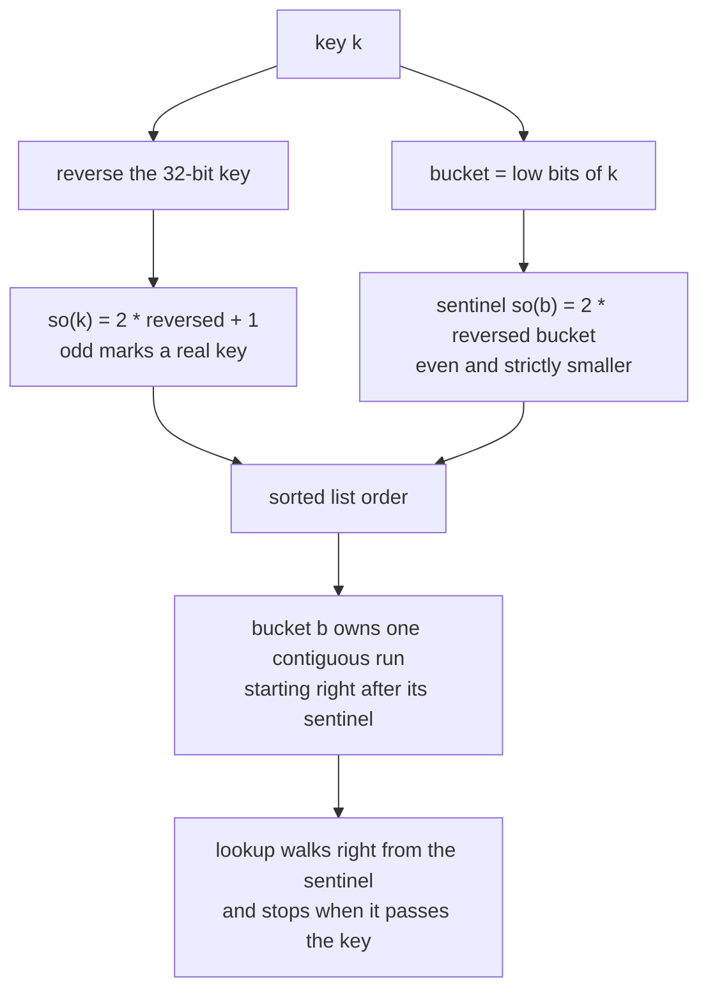
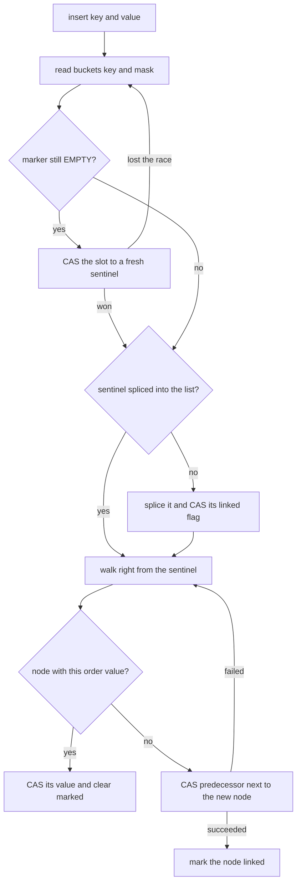
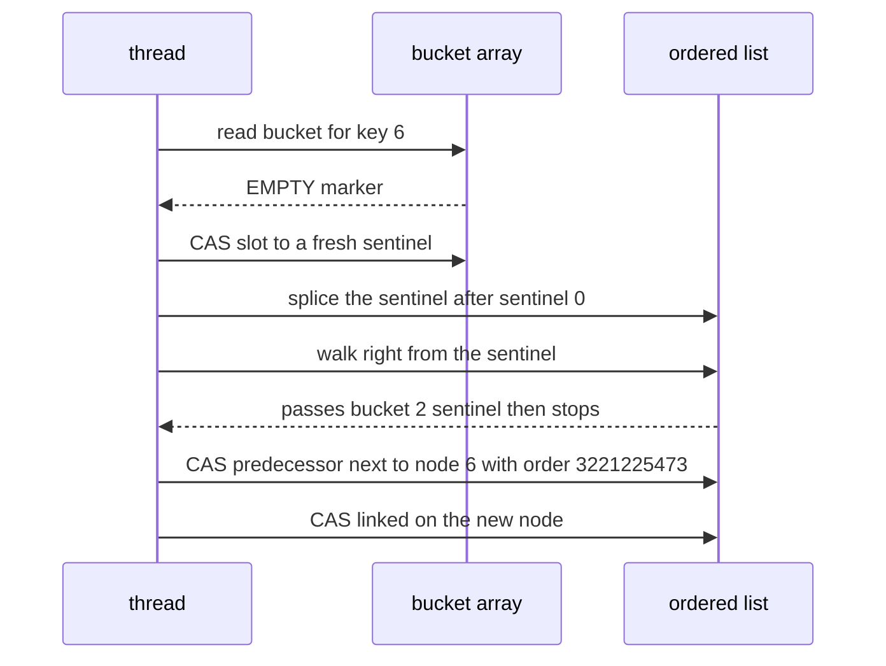

# 622 — Implement non-blocking hash table (split-ordered lists).

> **Tier:** Expert · **CTCI chapter:** Ch 15 — Threads and Locks
> **Task spec:** [622-implement-non-blocking-hash-table-split-ordered-lists.md](../../../tasks/expert/622-implement-non-blocking-hash-table-split-ordered-lists.md)
> **Solutions:** [Python](../../../solutions/python/expert/622-implement-non-blocking-hash-table-split-ordered-lists/solution.py) ·
> [Java](../../../solutions/java/expert/622-implement-non-blocking-hash-table-split-ordered-lists/Solution.java) ·
> [JavaScript](../../../solutions/javascript/expert/622-implement-non-blocking-hash-table-split-ordered-lists/solution.js) ·
> [C#](../../../solutions/csharp/expert/622-implement-non-blocking-hash-table-split-ordered-lists/Solution.cs)

## 1. Problem restatement

Implement the **split-ordered list** of Shalev & Shalev (2007): a non-blocking hash table where *one*
lock-free ordered linked list holds both the real keys and one sentinel per bucket, ordered by a
*recursive split ordering* of the keys so that each bucket's keys form one contiguous run of that list.

- **Input:** an integer key space, a fixed number of buckets `2^bits`, and per-thread programs of
  `put(key, value)`, `get(key)` and `delete(key)`, driven by an explicit schedule of thread ids.
- **Output:** the operation results plus the invariants: the list is strictly increasing in split order,
  every key sits after its own bucket sentinel with no other bucket's sentinel in between, a lookup never
  leaves its bucket, the size matches the live keys, and no operation ever reports a key that was not
  inserted.
- **List key of a node:** `so(key) = 2 · reverse32(key) + 1` for a real key and
  `so(bucket) = 2 · reverse32(bucket)` for a bucket sentinel — the reversal makes equal low bits of the key
  become equal high bits of the order, and the freed lowest bit distinguishes a real key (odd) from a
  sentinel (even).

**Modelling contract.** As in the neighbouring queue task, operations are step machines advanced by a
schedule: one step ends at every atomic access, so a CAS succeeds only while the field still holds the
expected reference and failures come from the interleaving rather than from scripting. No threads, sleeps
or sockets are involved; memory reclamation is out of scope. Two documented points: the Python/Java/C#
solutions keep the **bucket array fixed at construction** (no doubling or rehash pass), while JavaScript
performs the split on resize and verifies that each new odd bucket holds exactly the old bucket's high
half; and a thread that observes a sentinel that is published but not yet spliced starts its walk from the
list head instead of the paper's parent-bucket sentinel — the head is a safe superset of that start point.

Concrete expected results (all asserted):

- 200 sequential operations agree with a plain dictionary oracle, and **31** bucket sentinels were installed
  lazily — the 32nd bucket (bucket 0) is created at construction.
- 30 seeded concurrent schedules run insert/lookup/delete mixes: **13** of them recorded CAS failures, and
  no key was lost and no phantom key appeared; the structure matched the oracle at the end of every run.
- Forced interleavings exercise the sentinel-installation race (two threads racing the CAS that replaces the
  `EMPTY` marker), the splice path, and the delete mark.
- Re-inserting a previously deleted key revives the marked node instead of creating a second node with the
  same order key, so duplicates are impossible.

## 2. Intuition

Hashing spreads keys across buckets, and that is exactly what makes a *lock-free* hash table hard: a bucket
is an unordered collection, so inserting into one means picking a place in a chain, and any restructuring
(especially a resize) has to touch many chains at once.

The split-ordered list turns the problem inside out. Instead of many chains, keep **one** list, ordered by a
value derived from the key:

- the bucket of a key is `key & (2^bits − 1)` — the *low* bits of the key;
- reversing the 32-bit key moves those low bits to the **top** of the order value;
- therefore all keys of one bucket share the top bits of their order value and occupy one contiguous range
  of the list;
- a sentinel per bucket marks the base of that range, and a lookup walks right from that sentinel until it
  passes the position where the key would be.

Now a resize costs nothing: doubling the table splits bucket `i` into `2i` and `2i+1`, and the new bit is the
*next* bit of the order value, so the elements of the two halves are already in the correct relative order —
just install the new sentinel in the right place and no existing node moves. That is the "recursive split
ordering" of the paper.



The parity trick is what makes the sentinel work for *every* key of its bucket, including the key whose
value equals the bucket index: `reverse32(bucket)` ties with `reverse32(key)` for exactly that key, so the
real key uses `2 · rev + 1` and the sentinel `2 · rev`, leaving the sentinel strictly smaller while still
larger than every key of any bucket that precedes it.

## 3. Algorithm

1. `so_key(key)` computes the order value; `split_order_key(bucket, True)` computes a sentinel's value.
2. The bucket array is initialized to an `EMPTY` marker, except bucket 0 whose sentinel is created and
   spliced at construction.
3. `insert(key, value)`:
   - read `buckets[key & mask]`;
   - if it is `EMPTY`, create the sentinel and CAS the array slot from `EMPTY` to it, counting the
     installation; if the CAS fails, retry with the winner's sentinel;
   - if that sentinel is not yet spliced into the list, splice it (walk from the list head, or from the
     parent bucket's sentinel when that is already linked) and CAS its `linked` flag;
   - walk right from the sentinel's walk start: a node with the same order value and not a sentinel means
     the key exists, so CAS its value (and clear a `marked` flag if the key had been deleted) — that is a
     *revival*, never a second node;
   - otherwise set `node.next` to the first larger node and CAS the predecessor's `next` to the new node;
     on failure count a restart and walk again.
4. `lookup(key)` and `delete(key)` walk the same way from the bucket's sentinel: stop when the current node
   is null or has a larger order value, and for an exact match return the value (unless marked) or CAS the
   `marked` flag — a delete *marks*, it does not unlink, which keeps every other operation lock-free.
5. Verification after every step: strict increase along the list, each key inside its own bucket's window,
   no duplicates, size equal to the oracle's, and any resize leaving each new odd bucket with exactly the old
   bucket's high half.

```text
function so_key(key)
    return 2 * reverse32(key) + 1

function sentinel_key(bucket)
    return 2 * reverse32(bucket)

procedure insert(key, value)
    while true do
        bucket ← key & mask
        sentinel ← buckets[bucket]
        if sentinel is EMPTY then
            fresh ← Node(sentinel_key(bucket), bucket, sentinel = true)
            if cas-bucket(bucket, EMPTY, fresh) then
                sentinel ← fresh, sentinel-installs ← sentinel-installs + 1
            else
                continue
        if sentinel.linked is false then
            if splice(walk-start(sentinel), sentinel) then
                cas(sentinel, "linked", false, true)
        node ← Node(so_key(key), key, value)
        previous ← walk-start(sentinel)
        while true do
            current ← previous.next
            if current is none or current.so > node.so then break
            if current.so = node.so and current.sentinel is false then
                cas(current, "value", current.value, value)
                if current.marked then cas(current, "marked", true, false)
                return true
            previous ← current
        node.next ← current
        if cas(previous, "next", current, node) then
            cas(node, "linked", false, true)
            return true
        restarts ← restarts + 1

function walk-start(sentinel)
    return sentinel if sentinel.linked else buckets[0]
```



## 4. Worked example

A toy table with `bits = 2`, so four buckets and `mask = 3`, and keys `0…7`. The order values follow
directly from 32-bit reversal:

| Key | `key & 3` (bucket) | `reverse32(key)` | `so(key) = 2·rev + 1` |
| --- | --- | --- | --- |
| 0 | 0 | 0 | 1 |
| 4 | 0 | 536870912 | 1073741825 |
| 2 | 2 | 1073741824 | 2147483649 |
| 6 | 2 | 1610612736 | 3221225473 |
| 1 | 1 | 2147483648 | 4294967297 |
| 5 | 1 | 2684354560 | 5368709121 |
| 3 | 3 | 3221225472 | 6442450945 |
| 7 | 3 | 3758096384 | 7516192769 |

The sentinels use the even form `2 · reverse32(bucket)`: bucket 0 → `0`, bucket 2 → `2147483648`,
bucket 1 → `4294967296`, bucket 3 → `6442450944`. Sorting all of them gives the list:

| Position | Node | Is it a sentinel? | Order value |
| --- | --- | --- | --- |
| 1 | bucket 0 | yes | 0 |
| 2 | key 0 | no | 1 |
| 3 | key 4 | no | 1073741825 |
| 4 | bucket 2 | yes | 2147483648 |
| 5 | key 2 | no | 2147483649 |
| 6 | key 6 | no | 3221225473 |
| 7 | bucket 1 | yes | 4294967296 |
| 8 | key 1 | no | 4294967297 |
| 9 | key 5 | no | 5368709121 |
| 10 | bucket 3 | yes | 6442450944 |
| 11 | key 3 | no | 6442450945 |
| 12 | key 7 | no | 7516192769 |

Two properties are visible at a glance, and they are exactly the invariants checked after every step:
bucket 0's keys (`0`, `4`) sit between sentinel 0 and sentinel 2 with no other sentinel in between, and the
buckets appear in the order `0, 2, 1, 3` — the *bit-reversed* bucket order, not the numeric one, which is
what "recursive split ordering" means.

Note the sentinel/key pair for a bucket whose index is itself a key: `so(0) = 1` is strictly greater than
`sentinel_key(0) = 0`, so the key never ties with its own sentinel, and `so(2) = 2147483649` is strictly
greater than `sentinel_key(2) = 2147483648`. Without the one-bit shift the two would collide exactly at that
key.



The verified run uses a 32-bucket table: 200 sequential operations agree with the dictionary oracle and
install **31** sentinels lazily on top of the one created at construction, and 30 seeded concurrent
schedules — **13** of which recorded CAS failures — end with exactly the oracle's contents. The forced
interleavings make the three subtle paths observable: the sentinel-installation race (a thread that loses
the `EMPTY` CAS simply adopts the winner's sentinel and continues), the splice path (the losers of the
`previous.next` CAS restart their walk), and the delete mark (a lookup that finds a marked node reports the
key as absent, and a later `put` revives that same node).

## 5. Complexity

With `B = 2^bits` buckets, `n` live keys, `w` keys sharing one bucket (the walk window) and `r` factors of
the hash.

| Operation | Best | Average | Worst | Why the bound holds |
| --- | --- | --- | --- | --- |
| `so_key` / sentinel key | O(1) | O(1) | O(1) | a 32-iteration bit loop with a shift and an OR per bit, then one shift and a parity add |
| Bucket read | O(1) | O(1) | O(1) | one array index and one CAS |
| Sentinel installation | O(1) | O(1) | O(1) once per bucket | a single CAS from `EMPTY`; the loser adopts the winner's node, so at most `B − 1` installations for the whole table |
| `insert` walk | O(1) | O(w) | O(w) | the walk never leaves the bucket's window, whose length is the bucket's key count |
| `lookup` / `delete` | O(1) | O(w) | O(w) | the walk stops as soon as it passes the key's position, so a missing key costs one walk |
| CAS retries | O(0) | few | unbounded, but each retry implies another thread's progress | a failed CAS means the list moved, and progress is system-wide |
| Verification per step | O(n) | O(n) | O(n) | one full walk of the list with a cycle guard; affordable only because runs are short, which is why the solutions do it |
| Space | O(B + n) | O(B + n) | O(B + n) | one array slot per bucket plus one node per key (marked nodes are not reclaimed) |
| Resize (JavaScript variant) | O(1) | O(1) | O(1) | doubling installs new sentinels and moves **no** node, because the new bit is simply the next bit of the order value |

With `w = O(1)` for a hash that spreads keys evenly, the operations are expected-constant; the pathological
case is a hash that funnels many keys into one bucket, which turns the walk into `O(n)` — the same failure
mode as any chained hash table. Against the alternatives: per-bucket locking gives the same expected bounds
but blocks readers during a resize, and a classic chained table with a lock-free list *per bucket* has to
reorder every chain when the table doubles, while the split-ordered list moves nothing.

## 6. Pitfalls and edge cases

- **The parity bit is not cosmetic.** Without it, a key equal to its bucket index collides with that bucket's
  sentinel, and both the ordering and the lookup break exactly at that key.
- **A published sentinel may not be spliced yet.** Using it as a walk start would make a lookup miss keys
  that are present; the documented deviation is to walk from the list head instead, which is a safe superset
  of the paper's parent-sentinel start.
- **Losing the `EMPTY` CAS is not a failure.** The loser adopts the sentinel the winner installed; creating
  a second sentinel for the same bucket would put two nodes with the same order value in the list.
- **`node.next` must be set before the CAS that splices it.** Otherwise a concurrent walk can reach the new
  node through the predecessor while its `next` is still null and lose the rest of the list.
- **Marked, not unlinked.** A delete sets a mark so that no other operation has to wait for a physical
  unlink; every lookup therefore has to test the mark, and a re-insert has to clear it — otherwise the table
  would hold a live and a dead node with the same order key.
- **The walk must stop on `>` and continue on `.so` equality.** Stopping on equality without checking
  `sentinel` would report the bucket sentinel as a live key; continuing past a larger node would leave the
  bucket's window.
- **Restart, do not repair.** A failed `previous.next` CAS means the list moved under the walk, so the
  operation restarts from the sentinel; the Python splice path also bounds its own retries and raises if the
  list never settles.
- **A missing key is a normal result.** `get` returns the "absent" result, `delete` returns false, and the
  checks require that a lookup never reports a key that was never inserted.
- **Capacity is the whole table.** The Python/Java/C# solutions fix the bucket array at construction, so the
  number of buckets must be chosen up front; JavaScript's resize is the documented exception, and its checks
  confirm the split preserves the relative order of the two halves.
- **Duplicates cannot be hidden by a good hash.** `reverse32` is a bijection, so distinct keys always get
  distinct order values; a collision would have to come from reusing a key, which the revival path handles.
- **Unicode and signedness.** Keys are masked to 32 bits before reversal, so negative or large integers map
  into the same uniform space; there is no locale-dependent behaviour anywhere in the ordering.

## 7. Variants and follow-ups

- The same step-machine harness applied to a structure with no ordering: the Michael-Scott queue
  → [621 — scalable concurrent queue](../../../tasks/expert/621-implement-scalable-concurrent-queue-michael-scott-queue.md).
- Freeing the marked nodes this table never reclaims, which is the immediate practical follow-up
  → [623 — hazard pointers memory reclamation in concurrent structures](../../../tasks/expert/623-implement-hazard-pointers-memory-reclamation-in-concurrent-struc.md)
  and the read-mostly alternative → [624 — RCU-style read-copy-update sketch with tests](../../../tasks/expert/624-implement-rcu-style-read-copy-update-sketch-with-tests.md).
- Verifying concurrent insert/lookup/delete histories against the sequential dictionary specification
  → [618 — linearizability checker for concurrent histories](../../../tasks/expert/618-implement-linearizability-checker-for-concurrent-histories.md).
- Using a batch of hashed but *ordered* containers as the shard-local storage of a distributed store
  → [632 — anti-entropy Merkle tree reconciliation demo](../../../tasks/expert/632-implement-anti-entropy-merkle-tree-reconciliation-demo.md)
  and the transactional wrapper → [627 — transactional key-value store with two-phase commit simulation](../../../tasks/expert/627-implement-transactional-key-value-store-with-two-phase-commit-si.md).
- Replacing the CAS retry loop with a single-owner protocol where the owner never contends, only stealers do
  → [626 — work-stealing deque (Chase-Lev) for task scheduler](../../../tasks/expert/626-implement-work-stealing-deque-chase-lev-for-task-scheduler.md).

## 8. Check yourself

<details><summary>Show answer</summary>
**Why does reversing the bits of the key put a bucket's keys in one contiguous run?** Because a bucket is
defined by the key's *low* bits, and reversal turns "equal low bits" into "equal high bits". All keys of the
bucket therefore share the top bits of their order value, hence one interval of the sorted order.
</details>

<details><summary>Show answer</summary>
**Bucket 2's sentinel has order `2147483648` and key 2 has order `2147483649`. What would happen without the
shift?** `reverse32(2)` equals the sentinel's reversal, so the sentinel and the key would tie. With the
parity bit the sentinel uses the even value and is strictly smaller, which keeps the sentinel before every
key of its own bucket — including the key equal to the bucket index.
</details>

<details><summary>Show answer</summary>
**Two threads race on a bucket that is still marked `EMPTY`. What happens to the loser?** Its CAS fails;
it adopts the sentinel the winner installed, splices it if it is not linked yet, and continues with the
insert. Only one sentinel per bucket ever enters the list.
</details>

<details><summary>Show answer</summary>
**Why does `delete` mark a node instead of unlinking it?** Unlinking would require a second CAS and make
concurrent walkers see a temporarily inconsistent chain. Marking is a single CAS that any walker can detect,
and a later `put` for the same key clears the mark, so the node is revived rather than duplicated.
</details>

<details><summary>Show answer</summary>
**Doubling the table moves no nodes. Why is that not a contradiction?** Because the split ordering is built
so that the new bucket bit is the next bit of the order value: keys of bucket `i` split into `2i` and `2i+1`
according to that bit, and the two halves are already in their final relative order. Only the new sentinel
has to be spliced in.
</details>
