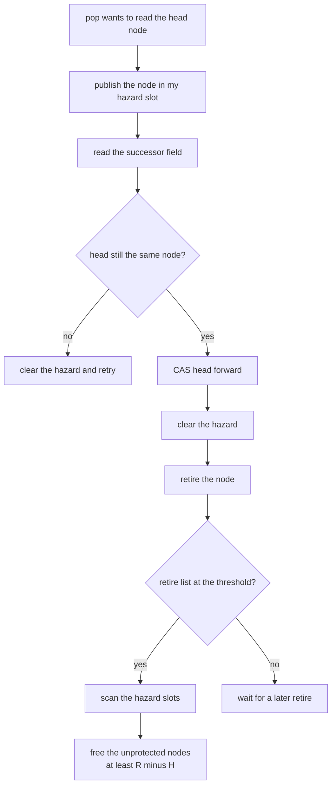
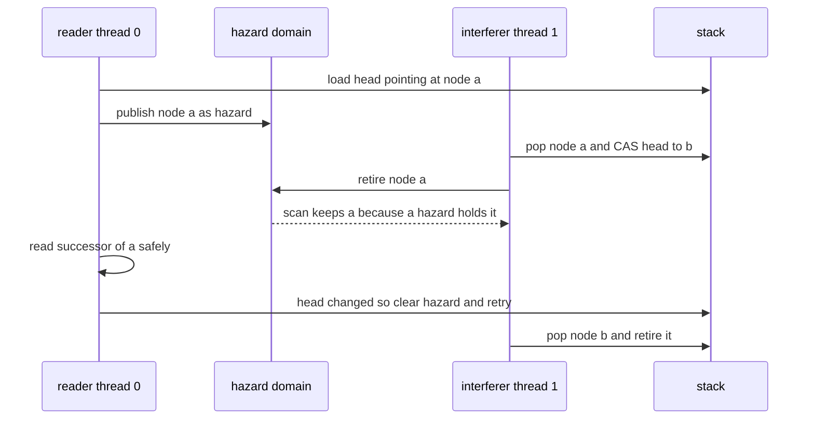
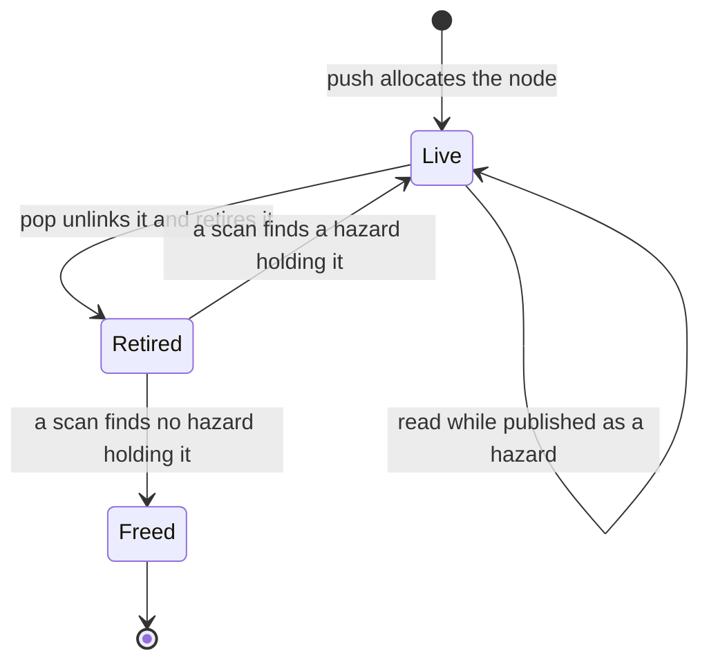

# 623 — Implement hazard pointers memory reclamation in concurrent structures.

> **Tier:** Expert · **CTCI chapter:** Ch 15 — Threads and Locks
> **Task spec:** [623-implement-hazard-pointers-memory-reclamation-in-concurrent-struc.md](../../../tasks/expert/623-implement-hazard-pointers-memory-reclamation-in-concurrent-struc.md)
> **Solutions:** [Python](../../../solutions/python/expert/623-implement-hazard-pointers-memory-reclamation-in-concurrent-struc/solution.py) ·
> [Java](../../../solutions/java/expert/623-implement-hazard-pointers-memory-reclamation-in-concurrent-struc/Solution.java) ·
> [JavaScript](../../../solutions/javascript/expert/623-implement-hazard-pointers-memory-reclamation-in-concurrent-struc/solution.js) ·
> [C#](../../../solutions/csharp/expert/623-implement-hazard-pointers-memory-reclamation-in-concurrent-struc/Solution.cs)

## 1. Problem restatement

Make a lock-free LIFO stack **safe to reclaim memory from** using hazard pointers (Maged Michael, 2004):
before dereferencing a node a thread *publishes* it in its own hazard slot, and a thread that retires a
node may return it to the allocator only if no hazard slot currently holds it.

- **Input:** a set of threads, a scan threshold, and a step schedule. `push` allocates and links a node;
  `pop` loads the head, **publishes it as a hazard**, reads the successor, re-validates the head and only
  then CASes.
- **Output:** the popped keys plus the reclamation bookkeeping: the retire list, the free order, the number
  of scans, and a **use-after-free counter** raised whenever an already-reclaimed node is dereferenced.
- **Progress guarantee modelled:** lock-free — a failed validation just retries; no thread waits.

**Modelling contract.** There are no threads or timers. The schedule is the explicit list of steps the driver
takes, and `pop` is written as a *resumable step machine* so the driver can pause it exactly in the two
windows where another thread could interfere — after the hazard is published and after the successor is
read. Freeing is modelled by a `freed` flag plus a dereference watchdog (`dereference(node, field)` raises
the fault counter), because a language runtime cannot observe a dangling pointer; `protect = False` is the
**naive control policy** that frees a retired node immediately, and it is the same interleaving in both
policies that gives the safety check teeth.

Concrete expected results (all asserted):

- Plain stack behaviour: pushing `0…4` gives the layout `[4, 3, 2, 1, 0]`, popping yields the same order,
  and popping an empty stack returns `None`; five retires do not trip a threshold of 8, while an explicit
  scan drains the retire list and frees each node exactly once.
- A scan over a retire list of five nodes with two of them published as hazards keeps exactly those two,
  frees the other three, and a hazard left published across five subsequent scans still never frees its node.
- The adversarial interleaving — reader publishes the head as a hazard, an interfering thread pops and
  retires that very node, then the reader reads its successor — reports **0** use-after-free faults under
  hazard pointers and **1** under the naive policy.
- The seeded two-thread workload (300 steps, scan threshold 3) conserves nodes:
  **151 created = 151 popped = 151 freed, 0 live**, with **51** scans and **0** use-after-free.

## 2. Intuition

The bug hazard pointers exist to fix is small and lethal. A pop does three things: read `head`, read
`head.next`, then CAS `head` to `head.next`. Suppose thread A reads `head` and is descheduled. Thread B
pops the same node, unlinks it and — in the naive scheme — frees it immediately, because from B's point of
view the node is unreachable. When A wakes up it dereferences `head.next` of a freed block. Every
lock-free structure has this window; the question is only who is allowed to free.

The insight is to make protection a **publication**: A writes the node it is about to read into its own
hazard slot *before* the dereference, and clears the slot only after it is done with the node. Then B's
freeing decision is a *scan*: look at every hazard slot, and return to the allocator only the retired nodes
that nobody published. A will either finish its read safely or discover that the head changed and retry —
but it will never touch freed memory.

Two properties follow, and they are what the checks measure: a protected node is never freed (**0** faults
on the adversarial interleaving, **1** with the protection switched off), and the retire list stays bounded
— a scan over `R` retired nodes with `H` hazard slots frees at least `R − H` of them, because at most `H`
can be protected at once.



## 3. Algorithm

1. Create one hazard slot per thread, all empty; keep a private retire list per domain and a threshold
   (the Python domain shares one retire list and scans when it is at least `scan_threshold` long).
2. `push(key)` allocates a node whose `next` is the current head and makes it the head.
3. `pop(thread)` loops:
   - load `head`; if it is null the stack is empty and the pop returns `None`;
   - **publish** the loaded node in the thread's hazard slot, then yield (the driver may now interleave);
   - read the successor through the dereference watchdog, then yield;
   - if `head` is no longer the node that was published, clear the hazard and retry — someone else already
     took it;
   - otherwise CAS the head forward, clear the hazard, and retire the node.
4. `retire(node)` appends to the retire list; at the threshold it calls `scan`.
5. `scan()` collects the currently published node ids, partitions the retire list into survivors and
   victims, frees the victims in order, and replaces the retire list with the survivors.
6. Under the naive control policy, `protected_ids()` is empty and `retire` frees immediately — the same
   schedule then produces a use-after-free fault.

```text
procedure pop(thread)
    while true do
        head ← stack.head
        if head is none then return none
        domain.set_hazard(thread, head)
        yield "hazard_set"
        next ← domain.dereference(head, "next")
        yield "read_next"
        if stack.head is not head then
            domain.clear_hazard(thread)
            continue
        stack.head ← next
        domain.clear_hazard(thread)
        domain.retire(head)
        yield "retired"
        return head.key

procedure retire(node)
    if protect is false then
        node.freed ← true, freed.append(node.key)
        return
    retired.append(node)
    if length(retired) >= scan_threshold then scan()

procedure scan()
    scans ← scans + 1
    protected ← { identity of node for each hazard slot holding a node }
    survivors ← empty list
    for node in retired do
        if identity of node in protected then survivors.append(node)
        else node.freed ← true, freed.append(node.key)
    retired ← survivors
```

The ordering inside `pop` is the whole algorithm: the hazard is published **before** the first dereference
and cleared **after** the head has been moved, so the window in which another thread may free the node is
exactly the window in which the node is published.



## 4. Worked example

The adversarial run builds the stack `head → a → b → c` and then interleaves two pops step by step.

| Step | Actor | Action | Hazard slot 0 | Retire list | Freed |
| --- | --- | --- | --- | --- | --- |
| 1 | reader | load `head` = `a` | — | `[]` | `[]` |
| 2 | reader | publish `a`, yield `hazard_set` | `a` | `[]` | `[]` |
| 3 | interferer | load `head` = `a`, publish `a` in its own slot | `a` | `[]` | `[]` |
| 4 | interferer | read successor `b`, head still `a` | `a` | `[]` | `[]` |
| 5 | interferer | CAS `head` = `b`, clear hazard, retire `a` | — | `[a]` | `[]` |
| 6 | interferer | retire list hits the threshold 1 → `scan` sees `a` published by thread 0 | `a` | `[a]` | `[]` |
| 7 | reader | read successor of `a` — **safely**, because it is protected | `a` | `[a]` | `[]` |
| 8 | reader | `head` is now `b`, so clear the hazard and retry | — | `[a]` | `[]` |
| 9 | reader (retry) | load `head` = `b`, pop it, retire `b` → scan frees `a` | — | `[b]` | `[a]` |

Step 6 is the deferral the checks count: the scan *performed a deferral* because a hazard slot held the
retired node. Step 7 is what that deferral bought — the reader dereferences a block that the interferer had
already unlinked, and the free order shows `a` being reclaimed only once the reader had let go of it. Under
`protect = False` the identical schedule frees `a` at step 5, and either step 6's scan or step 7's read
raises exactly **1** use-after-free fault.



The seeded workload scales the same protocol: two threads interleaved over 300 steps, unique keys so that a
double pop would be visible, threshold 3. The run reports `nodes created = 151, popped = 151, live = 0`,
`freed = 151` and `scans = 51` with **0** use-after-free faults, and the conservation identity
(created = live + retired + freed) holds at the end after the leftover nodes are drained and the retire list
is scanned empty.

## 5. Complexity

With `H` hazard slots, `R` retired nodes per scan and `T` the scan threshold.

| Operation | Best | Average | Worst | Why the bound holds |
| --- | --- | --- | --- | --- |
| `push` | O(1) | O(1) | O(1) | one allocation and one head store |
| `pop` | O(1) | O(1) | unbounded retries, each meaning someone else's progress | one hazard publication, one successor read, one CAS; a failed validation costs one retry |
| `retire` | O(1) | O(1) | O(1) amortised | an append, plus a scan every `T` retires |
| `scan` | O(H) | O(H + R) | O(H + R) | it reads every hazard slot and partitions the retire list |
| Reclamation guarantee | R − H freed | R − H freed | R − H freed | at most `H` nodes can be protected at once, so a scan always frees at least `R − H` |
| Space | O(H) | O(H + T) | O(H + T) | the hazard slots, the retire list below the threshold, and the live nodes; the measured run ends with 0 live nodes and a drained retire list |
| Whole run | O(steps) | O(steps) | O(steps + retries) | each scheduled step is O(1); the driver also has a bounded settle loop |

Compare with the alternatives: freeing immediately is the fastest possible reclamation and is **unsafe**
(1 fault on the adversarial schedule); never freeing at all is safe but leaks (the stack would grow without
bound); reference counting is safe but pays an atomic on every pointer read and write and cannot reclaim
cycles. Hazard pointers pay one publication per node the thread reads, a `scan` every `T` retires, and
`H` slots of extra memory per thread — which is why `H` is kept small and the threshold is tuned so that
scans are amortised `O(1)` per retire. The measured run performs **51** scans for 151 retires with a
threshold of 1 in the adversarial case and 3 in the seeded case.

## 6. Pitfalls and edge cases

- **Publish before dereferencing, clear after use.** Publishing after the first read, or clearing before the
  CAS, reopens the exact window the algorithm closes; the adversarial trace asserts the hazard is set on the
  loaded head *before* the interrupt.
- **Clear the hazard on the retry path too.** A hazard left published across a failed validation pins a node
  that nobody is reading — a leak that no check would catch as a fault, only as deferred reclamation.
- **A permanently published hazard pins its node forever**, which is the correct, documented behaviour: five
  consecutive scans still refuse to free it. Real implementations therefore use a *bounded* number of
  hazards per thread and clear them promptly.
- **A scan frees at least `R − H`, not all of `R`.** Reading the guarantees as "a scan frees everything"
  would make the deferral bookkeeping unnecessary and hide the whole point.
- **The naive policy is the negative control, not a fallback.** `protect = False` exists so that the same
  schedule produces a fault: a safety check that cannot fail proves nothing.
- **Freeing is emulated.** A `freed` flag plus a dereference watchdog stands in for real deallocation —
  a Python object would still be readable after "being freed", so the counter is what makes the fault
  observable and the simulation is honest about it.
- **Memory ordering is not simulated.** Real hazard pointers need release/acquire ordering (or fences) on
  the publication and the scan; here everything is sequentially ordered by the driver, and the solutions say
  so.
- **Empty stack and empty retire list.** Popping an empty stack returns `None` and publishes nothing; a scan
  with an empty retire list is a no-op that still counts the scan.
- **Deblocking.** With a threshold of 1 the retire list never grows beyond one node; with a threshold of 3 it
  holds at most two, so memory stays bounded even when every node is momentarily protected.
- **Node conservation is the leak test.** The seeded workload asserts `created == live + retired + freed`
  with zero faults — a reclamation bug that frees a live node or drops a retired one breaks the identity
  even when the fault counter stays silent.

## 7. Variants and follow-ups

- Replacing hazards with a *grace period*: readers publish nothing and the writer waits for readers that
  entered before the publish to leave → [624 — RCU-style read-copy-update sketch with tests](../../../tasks/expert/624-implement-rcu-style-read-copy-update-sketch-with-tests.md).
- The structure whose popped nodes need exactly this protection, with the helping protocol on top
  → [621 — scalable concurrent queue (Michael-Scott queue)](../../../tasks/expert/621-implement-scalable-concurrent-queue-michael-scott-queue.md).
- A structure that marks nodes instead of unlinking them, so reclamation is the difference between "removed"
  and "free" → [622 — non-blocking hash table with split-ordered lists](../../../tasks/expert/622-implement-non-blocking-hash-table-split-ordered-lists.md).
- Progress guarantees that make the pause windows predictable rather than merely survivable
  → [625 — wait-free queue algorithm, Kogan-Petrank style outline](../../../tasks/expert/625-implement-wait-free-queue-algorithm-kogan-petrank-style-outline.md).
- Where deferred reclamation decides the throughput of a scheduler rather than the safety of a stack
  → [626 — work-stealing deque (Chase-Lev) for task scheduler](../../../tasks/expert/626-implement-work-stealing-deque-chase-lev-for-task-scheduler.md).

## 8. Check yourself

<details><summary>Show answer</summary>
**Why must the hazard be published before the successor is read, rather than after the CAS succeeds?** The
dangerous window is between loading the head and dereferencing it: another thread may unlink and free that
node in between, and the dereference needs the protection already in place. Publishing after the CAS would
protect nothing.
</details>

<details><summary>Show answer</summary>
**The reader's pop was "starved" in the adversarial run. Why is that not a correctness failure?** The
interferer took the node first, which is perfectly legal in a lock-free structure; the reader detects that
`head` changed, clears its hazard and retries. Lock-freedom only requires that some thread makes progress.
</details>

<details><summary>Show answer</summary>
**What exactly does the deferral prove?** That a scan declined to free a retired node because a hazard slot
still referenced it. The checks require at least one deferral on the crafted schedule, and the free order
shows the node reclaimed only after the reader released it.
</details>

<details><summary>Show answer</summary>
**Why does a scan free at least `R − H` nodes?** There are only `H` hazard slots, so at most `H` of the `R`
retired nodes can be protected at the moment of the scan; everything else is unprotected and can be freed.
That bound is what keeps the retire list from growing without limit.
</details>

<details><summary>Show answer</summary>
**What breaks if `protect` is switched off?** The same schedule that is safe under hazards dereferences a
reclaimed node: the run reports 1 use-after-free fault. That negative control is the evidence that the
hazard protocol, not the schedule, is what makes the code safe.
</details>
