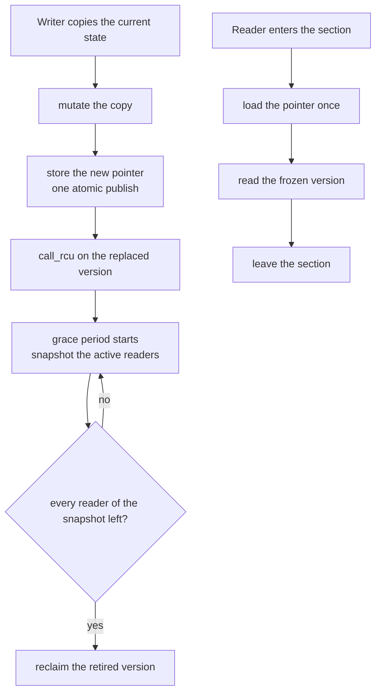
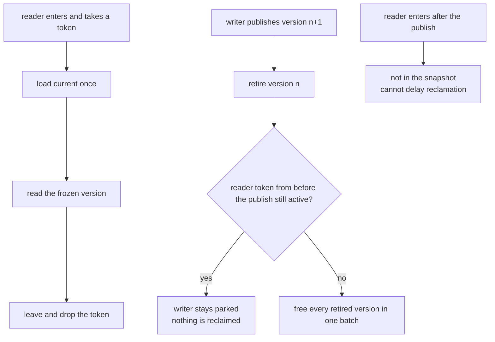
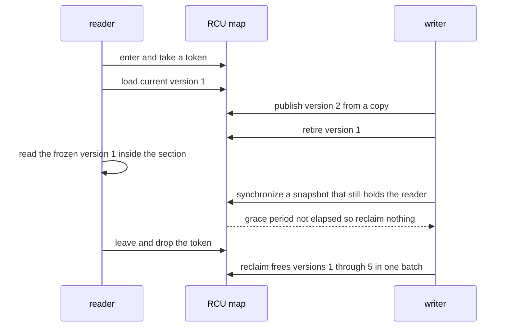

# 624 — Implement RCU-style read-copy-update sketch with tests.

> **Tier:** Expert · **CTCI chapter:** Ch 15 — Threads and Locks
> **Task spec:** [624-implement-rcu-style-read-copy-update-sketch-with-tests.md](../../../tasks/expert/624-implement-rcu-style-read-copy-update-sketch-with-tests.md)
> **Solutions:** [Python](../../../solutions/python/expert/624-implement-rcu-style-read-copy-update-sketch-with-tests/solution.py) ·
> [Java](../../../solutions/java/expert/624-implement-rcu-style-read-copy-update-sketch-with-tests/Solution.java) ·
> [JavaScript](../../../solutions/javascript/expert/624-implement-rcu-style-read-copy-update-sketch-with-tests/solution.js) ·
> [C#](../../../solutions/csharp/expert/624-implement-rcu-style-read-copy-update-sketch-with-tests/Solution.cs)

## 1. Problem restatement

Implement a **read-copy-update sketch**: writers publish new *immutable versions* of a map through a single
atomic pointer, readers load that pointer once and read the frozen version without touching shared mutable
state, and the version a writer replaced is reclaimed only after a **grace period** — once every reader that
entered its critical section before the publish has left it.

- **Input:** an initial mapping, a sequence of reader critical sections and writer publishes (single-key and
  batch), and an explicit interleaving of their resumable steps.
- **Output:** what each reader observed, the epochs of the reclaimed versions, and a **use-after-free
  counter** raised whenever a reader touches a version that was already freed.
- **Interface:** `publish(key, value)` (a `None` value deletes the key), `publish_many(changes)` for an
  atomic batch, `enter`/`leave` for the read side, `sync_snapshot()`/`elapsed()`/`reclaim()` for the grace
  period.

**Modelling contract.** This is a *sketch*, as the task asks: no threads, no timers, no preemption. Readers
and writers are step machines and a deterministic driver interleaves them, so the interleaving under test is
written out explicitly. Grace periods are explicit — `sync_snapshot()` records the readers active at that
moment and reclamation waits for the last of them to leave; readers that enter afterwards are deliberately
*not* in the snapshot, so they cannot delay reclamation. The Python solution's version is a sorted tuple of
key/value pairs, while the JavaScript solution publishes a persistent path-copying treap so versions share
untouched nodes (its own documented simplification for the same idea). A `free_on_publish` flag is the
**negative control**: the same schedule with eager freeing must fault.

Concrete expected results (all asserted):

- Read-your-writes: a reader that enters after a publish sees the new value; a reader paused *inside* its
  section sees a stable published state and that version is never freed while the reader is inside.
- No torn reads: two consecutive single-key publishes and one batch publish are compared against a plain
  dictionary replay, and the reader never observes a mixture of two versions — a batch of changes appears
  atomically because it is one pointer store.
- Old and new reader visibility: readers that entered before the publish keep the old version; readers that
  enter after it see the new one.
- The blocking grace period: a writer parked in `synchronize_rcu()` (reclaim with an unelapsed snapshot)
  reclaims **nothing**; after the last pre-existing reader leaves, everything retired is reclaimed in one
  batch even though newer readers are active.
- The chained run publishes five times after the initial version and reclaims exactly the superseded ones:
  `versions = 6`, `reclaimed = [1, 2, 3, 4, 5]`, and the current version survives.
- The control experiment on the same schedule: **0** use-after-free faults with the grace period and **1**
  with eager freeing.

## 2. Intuition

Update-in-place forces every reader to synchronize with every writer, which is exactly the cost RCU removes.
RCU splits the problem in two:

1. **Publish.** A writer never mutates shared state. It copies the current state, changes the copy, and
   stores the new pointer — one atomic store. Readers therefore load the pointer once and are guaranteed to
   read a *consistent* version: they cannot see a half-applied update, and a multi-key batch becomes atomic
   for free.
2. **Reclaim.** The replaced version must not be freed while any reader could still be holding it. The
   writer therefore waits for a **grace period**: every reader that entered its critical section *before*
   the publish must have left it. Readers that enter after the publish can only see the new version, so they
   are irrelevant — that asymmetry is what makes the wait finite and the read side free.



The insight is asymmetric: the wait is on the *writer* side and is amortised over many publishes, while the
read side performs no atomic operation at all beyond the single load. The cost is memory held for one grace
period, and the constraint that versions must be immutable — which is precisely why a *persistent* structure
(one that shares untouched nodes between versions, as the JavaScript solution's path-copying treap does) is
the natural companion.

## 3. Algorithm

1. Initialize by publishing an empty version; every version carries an epoch and is immutable.
2. `publish(key, value)`: copy the current version's mapping, apply the change (a `None` value removes the
   key), then `_publish` it.
3. `publish_many(changes)`: copy once, apply all changes, publish once — that is the atomic batch.
4. `_publish(mapping)` increments the epoch, builds the new version, stores it as `current` (the single
   atomic pointer store), and appends the *old* version either to the retire list or, under the control flag,
   straight to the reclaimed list.
5. `enter(rid)` records a token for the reader in the active set; `leave(rid, token)` removes it, and a
   stale token cannot remove a newer section.
6. `sync_snapshot()` returns the set of readers active at that instant; `elapsed(snapshot)` is true only
   when none of those tokens is still active; `reclaim(snapshot)` frees the whole retire list when the grace
   period has elapsed, and otherwise returns `None` — the writer is *parked* and reclaims nothing.
7. A reader's critical section is a step machine: `enter`, then load `current` **once**, then read, then
   `leave`. Every read of a freed version increments the fault counter, which is how the control experiment
   is caught.

```text
procedure publish(changes)
    state ← copy of current.data
    for each (key, value) in changes do
        if value is none then remove key from state else state[key] ← value
    epoch ← epoch + 1
    new ← Version(epoch, state)
    old ← current
    current ← new                      // the single atomic pointer store
    versions.append(new), publishes ← publishes + 1
    if free_on_publish then
        old.freed ← true, reclaimed.append(old.epoch)
    else
        retired.append(old)
    return new

function elapsed(snapshot)
    for each (reader, token) in snapshot do
        if active[reader] equals token then return false
    return true

procedure reclaim(snapshot)
    if elapsed(snapshot) is false then return none      // still parked in synchronize_rcu()
    for version in retired do
        version.freed ← true, reclaimed.append(version.epoch)
    retired ← empty list
    return the freed epochs

procedure reader(rid, key)
    token ← enter(rid)
    version ← current                  // one pointer load, outside any lock
    observed ← version.read(key)
    leave(rid, token)
    return (version.epoch, observed)
```



## 4. Worked example

A five-write chain with one long-lived reader. The constructor publishes version 1 (the initial state), then
five `publish` calls each copy the current mapping, change it and store a new version.

| Epoch | Event | `current` after | Retire list | Reclaimed |
| --- | --- | --- | --- | --- |
| 1 | initial publish | version 1 | `[]` | `[]` |
| 1 | reader enters and loads the pointer, then stays inside its section | version 1 | `[]` | `[]` |
| 2 | writer publishes `a = 1` | version 2 | `[1]` | `[]` |
| 3 | writer publishes `b = 2` | version 3 | `[1, 2]` | `[]` |
| 4 | writer publishes `a = 3` | version 4 | `[1, 2, 3]` | `[]` |
| 5 | writer publishes `c = 4` | version 5 | `[1, 2, 3, 4]` | `[]` |
| 6 | writer publishes `b = 5` | version 6 | `[1, 2, 3, 4, 5]` | `[]` |
| — | writer calls `sync_snapshot()` and `reclaim()` | unchanged | unchanged | `[]` — parked |
| — | reader leaves, having read version 1 the whole time | unchanged | `[]` | `[1, 2, 3, 4, 5]` |

The measured run reports `versions = 6`, `reclaimed = [1, 2, 3, 4, 5]` and leaves epoch 6 — the published
version — alive, which is exactly the "every replaced version reclaimed exactly once, current version
survives" property. The writer's `reclaim` returning `None` while the reader was inside is the blocking
grace period the checks assert; a later reader that entered *after* the snapshot never appears in it, so
reclamation proceeds even though that reader is still active.



A reader reading a *batch* publish is the other half: `publish_many` copies the state once, applies every
change and stores the pointer once, so a reader that loads the pointer either sees all of the batch or none
of it. The checks compare every observation against a plain dictionary replay of the same change sequence —
across two single-key publishes and one batch — which is what rules out a torn read. Under
`free_on_publish` the same schedule frees version 1 at the moment version 2 is published, and the paused
reader's next read raises exactly **1** use-after-free fault.

## 5. Complexity

With `n` keys in the map, `k` concurrent readers, `v` versions alive and `r` retired versions awaiting a
grace period.

| Operation | Best | Average | Worst | Why the bound holds |
| --- | --- | --- | --- | --- |
| Read side (`enter` + load + `leave`) | O(1) | O(1) | O(1) plus the cost of the read itself | a token store, one pointer load and a token delete; no atomic operation on the shared pointer |
| A read of one key | O(log n) | O(log n) | O(n) | logarithmic in the JavaScript path-copying treap; the Python sketch scans a sorted tuple, which is `O(n)` |
| Key-ordered scan of a version | O(log n) | O(n) | O(n) | the version is immutable, so a scan needs no synchronization |
| `publish` | O(n) copy | O(n) copy | O(log n) with a persistent structure | copying the mapping is `O(n)`; the treap copies only the nodes along one root-to-leaf path |
| `publish_many` | O(n + m) | O(n + m) | O(log n + m) persistent | one copy per batch, `m` changes applied before the single store |
| `reclaim` | O(1) when nothing is retired | O(r) | O(r) | one pass over the retire list, and only when the grace period has elapsed |
| Grace-period wait | O(1) | — | unbounded | it waits for readers that entered before the publish; a reader that never leaves pins the memory (a documented case) |
| Space | O(1) version | O(k) versions alive | O(k) versions alive plus the copy | one version per reader in flight plus the current one, and every version carries a full copy of the state in the sketched map |

The comparison with the alternatives the solutions contrast against: a lock-per-read pays an atomic acquire
on the hot path, and reference counting pays an atomic on every pointer *read and write* and cannot reclaim
cycles; RCU pays **nothing** on the read path and moves the whole cost to the writer's copy plus one grace
period of memory retention. That is why RCU is the read-mostly structure of choice, and why the immutable
version is the price: a structure that cannot be copied cheaply (or shared between versions, as the treap's
path copying does) is a poor fit.

## 6. Pitfalls and edge cases

- **Enter before the pointer load.** The grace period covers exactly the readers that took a token before
  the publish; a reader that loads the pointer and *then* enters can be missed, and its version may be freed
  under it.
- **Freeing on publish is wrong, and the control proves it.** `free_on_publish` gives 1 use-after-free fault
  on the same schedule, which is why the flag exists.
- **Readers that arrive later must not block reclamation.** `elapsed` compares *tokens*, not "is anyone
  active"; comparing set emptiness would park the writer behind every new reader forever.
- **A stale token must not remove a newer section.** `leave(rid, token)` checks the token so that a reader
  that re-entered cannot be dropped by an old `leave` call.
- **A reader that never leaves pins its versions.** The checks include that case explicitly: it is the
  documented liveness limit of the scheme, not a bug in the implementation.
- **Deletes are publishes too.** A `None` value removes the key from the copied state, so a delete is a new
  version rather than an in-place removal — a reader holding the old version still sees the key, which is
  correct for RCU semantics.
- **The batch must be a single store.** Applying the changes one by one and publishing between them turns an
  atomic batch into several separately observable states, and the torn-read check against the dictionary
  oracle would catch it.
- **Only one writer at a time.** The sketch serializes writers; concurrent writers would each copy the same
  base state and the last store would win, silently dropping the other's changes.
- **Empty map and first publish.** Publishing into an empty map, and reading a key that was never present,
  both return the "absent" result rather than failing.
- **Versions are immutable.** Any in-place mutation of a version that a reader may still hold breaks the
  guarantee; this is why the JavaScript version is a persistent treap and the Python one a frozen tuple.
- **Unicode and key equality** are plain value comparisons; keys are used as map keys, so the ordering of the
  sketched tuple representation is deterministic and there is no locale dependence.

## 7. Variants and follow-ups

- The per-node alternative: keep mutating a structure but publish *pointer-sized* hazards before each
  dereference → [623 — hazard pointers memory reclamation](../../../tasks/expert/623-implement-hazard-pointers-memory-reclamation-in-concurrent-struc.md).
- Replacing the single-publish-pointer pattern with a replicated log whose commit point is agreed by a
  quorum → [628 — distributed consensus simulation with network partitions](../../../tasks/expert/628-implement-distributed-consensus-simulation-with-network-partitio.md)
  and the transactional store that needs the same atomic multi-key visibility
  → [627 — transactional key-value store with two-phase commit simulation](../../../tasks/expert/627-implement-transactional-key-value-store-with-two-phase-commit-si.md).
- The snapshot a long-lived reader implicitly holds is the same object a consistent cross-shard cut needs
  → [617 — consistent snapshot across shards simulation](../../../tasks/expert/617-implement-consistent-snapshot-across-shards-simulation.md).
- Merging two diverged versions instead of replacing one wholesale, by comparing digests top-down
  → [632 — anti-entropy Merkle tree reconciliation demo](../../../tasks/expert/632-implement-anti-entropy-merkle-tree-reconciliation-demo.md).
- Single-owner data where the reader is the owner and only a corner case needs synchronization
  → [626 — work-stealing deque (Chase-Lev) for task scheduler](../../../tasks/expert/626-implement-work-stealing-deque-chase-lev-for-task-scheduler.md).

## 8. Check yourself

<details><summary>Show answer</summary>
**Why can a reader in RCU read without any atomic operation?** Because it reads an *immutable* version that
no writer ever mutates in place. The only shared state the reader touches is the pointer, which it loads
once before entering the version, so no synchronization is needed inside the section.
</details>

<details><summary>Show answer</summary>
**A writer publishes version 2 while a reader is in a section that started before the publish. Which version
does the reader see, and when may version 1 be freed?** The reader sees version 1 — it loaded the pointer
before the publish. Version 1 may be freed only after that reader leaves, which is exactly what
`elapsed(snapshot)` checks.
</details>

<details><summary>Show answer</summary>
**Why do readers that enter after the publish not delay reclamation?** They cannot possibly hold the replaced
version, because they load the pointer after the new one was stored. `sync_snapshot()` therefore records only
the readers active at the moment of the call, and a later reader's token is not in the snapshot.
</details>

<details><summary>Show answer</summary>
**What makes the batch publish atomic for readers?** The whole batch is applied to a copy and published with
a single pointer store, so a reader loads either the old version or the new one. The checks confirm this by
comparing every observation against a plain dictionary replay of the same sequence.
</details>

<details><summary>Show answer</summary>
**The chained run reclaims versions 1 to 5 but never 6. Why?** Version 6 is the current published version;
it is reclaimed only when a later publish replaces it and the following grace period elapses. Reclaiming the
live version would be a use-after-free the moment any reader loaded it.
</details>
