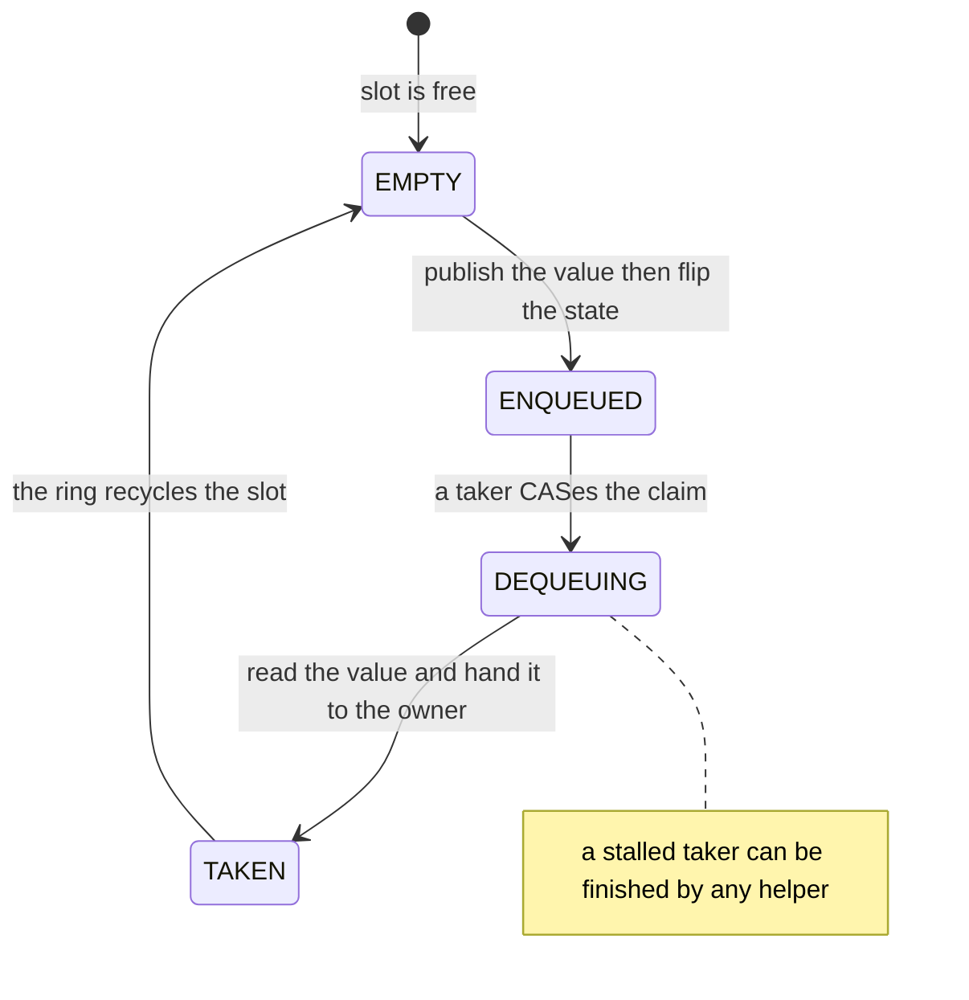
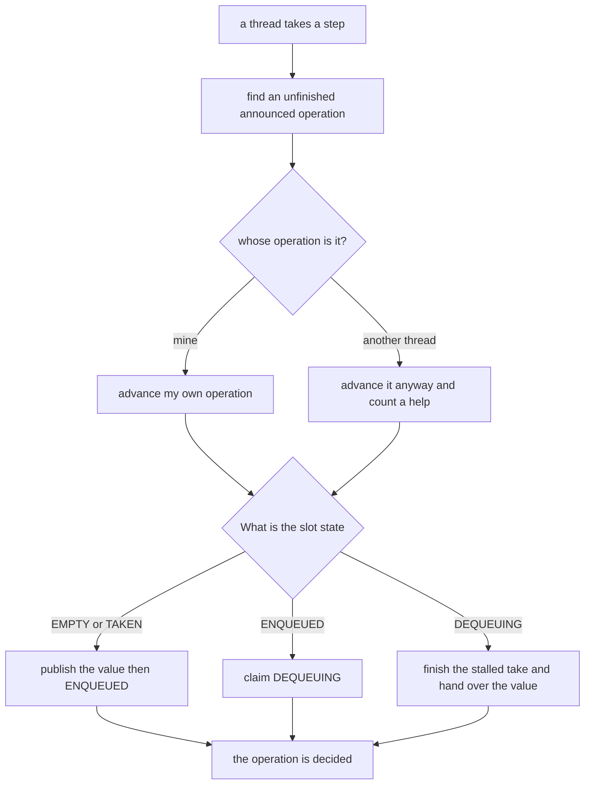
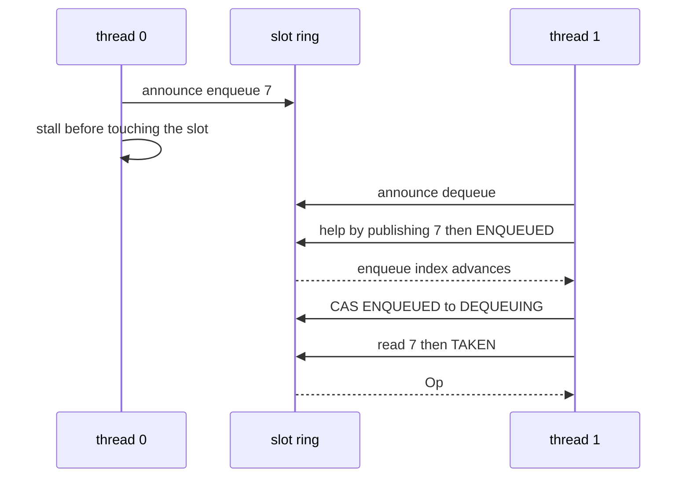

# 625 — Implement wait-free queue algorithm (Kogan-Petrank style outline).

> **Tier:** Expert · **CTCI chapter:** Ch 15 — Threads and Locks
> **Task spec:** [625-implement-wait-free-queue-algorithm-kogan-petrank-style-outline.md](../../../tasks/expert/625-implement-wait-free-queue-algorithm-kogan-petrank-style-outline.md)
> **Solutions:** [Python](../../../solutions/python/expert/625-implement-wait-free-queue-algorithm-kogan-petrank-style-outline/solution.py) ·
> [Java](../../../solutions/java/expert/625-implement-wait-free-queue-algorithm-kogan-petrank-style-outline/Solution.java) ·
> [JavaScript](../../../solutions/javascript/expert/625-implement-wait-free-queue-algorithm-kogan-petrank-style-outline/solution.js) ·
> [C#](../../../solutions/csharp/expert/625-implement-wait-free-queue-algorithm-kogan-petrank-style-outline/Solution.cs)

## 1. Problem restatement

Outline the **Kogan-Petrank wait-free queue**: a thread *announces* its operation in a shared record, then
performs a bounded number of steps in which it both advances its own operation and **helps** any other
announced operation it finds. Because any thread can finish any announced operation, a thread that stalls —
or is descheduled forever — cannot stop the others from completing theirs.

- **Input:** a ring of slots, a set of threads, and an explicit schedule of steps.
- **Output:** the values dequeued, plus the wait-freedom bookkeeping: the number of slot operations per
  operation, how many completions were performed for *another* thread's announced operation, how many takes
  had to be finished by a helper, and the linearization order recovered from the slot states.
- **Slot state machine:** `EMPTY → ENQUEUED → DEQUEUING → TAKEN`. The enqueuer publishes the *value first*
  and only then flips `EMPTY → ENQUEUED`; a dequeuer claims with a CAS from `ENQUEUED → DEQUEUING`.

**Modelling contract.** This is an *outline*, as the task asks: no threads, no atomics, no timers. The
paper's CAS loops are replaced by an explicit deterministic step schedule, so the interleaving under test is
written out. The Python solution documents each simplification: a single global enqueue index instead of the
per-operation index computation of the paper, a slot ring recycled through the `TAKEN` state instead of the
paper's phase counters, and an announced-operation list scanned in announcement order instead of the paper's
pair of announced pointers. Two things are *not* simplified away: the CAS *checks* (a slot must never end up
holding a foreign operation) and the helping protocol itself, including that a helper re-reads the record's
state so helping is idempotent. A `helping = False` switch is the negative control.

Concrete expected results (all asserted):

- FIFO order: the dequeued values are a prefix of the slot-claim order, no value is lost or duplicated, and
  every announced operation reaches a decision.
- A stalled enqueuer is completed by another thread (`helps = 1` in the stalled scenario), and a stalled
  *dequeuer* whose take is finished by another thread returns that value when it is resumed
  (`finished-takes = 1`).
- Bounded work: the mixed run performs `ops = 126`, `slot_ops = 189`, and the number of in-flight items never
  exceeded **6**, well below the ring capacity of 16. The JavaScript solution states the corresponding bound
  as `2 · threads + 4` scheduling steps per operation.
- With helping disabled, the same schedule starves: the stalled enqueue is never completed and a dequeue
  wrongly reports the queue empty — which is exactly the waiting deadline the real algorithm exists to avoid.

## 2. Intuition

A lock-free queue like Michael-Scott makes *system* progress: some operation always completes, but any
individual operation may retry indefinitely because a concurrent CAS keeps invalidating its snapshot. A
**wait-free** queue promises more: each operation completes in a bounded number of *its own* steps, no matter
what the other threads do — including a thread that stops running in the middle of an operation.

Kogan-Petrank gets there with **announcement and helping**. Before touching the queue, a thread publishes
what it intends to do. Any thread that later walks the announcement list can complete a foreign operation
before doing its own work, so a stalled thread's operation is finished by a helper and the stalled thread's
own record eventually holds the result. The waiting deadline disappears because nobody ever waits for a
specific thread.

The second mechanism is the **per-slot state machine**, which is what makes helping well defined:

| State | Meaning | Reached by |
| --- | --- | --- |
| `EMPTY` | the slot is free for the next enqueue | initially, and after a take recycles the ring |
| `ENQUEUED` | a value is published and available | the enqueuer's flip, after storing the value |
| `DEQUEUING` | a taker has *claimed* the item but has not finished reading it | CAS from `ENQUEUED` |
| `TAKEN` | the item has been handed to its operation | the taker or any helper that finished a stalled take |

Because `DEQUEUING` records *who* claimed the slot, a thread that finds a slot in that state knows a take is
in progress; if its owner never resumes, the value is still readable and the take can be completed on its
behalf. That is the "any thread can finish any operation" property made concrete.



## 3. Algorithm

1. `announce(thread, kind, value)` creates an operation record and appends it to the announced list; nothing
   about the queue has changed yet.
2. A step loop looks for an announced operation that is not finished. If the operation belongs to another
   thread, the step counts as a **help**.
3. Completing an **enqueue**: read the slot at the global enqueue index.
   - If the slot is `DEQUEUING`, a take is stalled there, so finish that take first and retry.
   - If the slot is neither `EMPTY` nor `TAKEN` (the previous round is still live), do nothing this step.
   - Otherwise store the value, flip the state to `ENQUEUED`, advance the enqueue index, record the value in
     the link order and mark the operation finished.
4. Completing a **dequeue**: look at the oldest position that has not been taken.
   - If the slot is `ENQUEUED`, claim it by moving the state to `DEQUEUING` and record the claiming operation
     as the slot's owner.
   - Then read the value, move the state to `TAKEN`, advance the flush index, and hand the value to whichever
     operation owns the claim — which may be a *different* operation than the one currently stepping.
5. `_finish(op, value, by)` is idempotent: if the operation is already done it returns false without
   double-counting a result, so two helpers racing on the same take cannot both win.
6. Verification: FIFO recovery from the slot order, exactly-once take, no value observed before it is
   published, every announced operation eventually decided even if its own thread never steps again, the
   in-flight count never reaching the ring capacity, and the bounded slot-operations-per-operation witness.

```text
procedure step_complete_enqueue(op, by)
    slot ← slots[enqueue_index mod capacity]
    if slot.state = DEQUEUING then
        finish_stalled_take(slot, by)          // help the abandoned taker first
        return
    if slot.state is not EMPTY and slot.state is not TAKEN then
        return                                 // the previous round is still live
    op.index ← enqueue_index
    slot.value ← op.value                      // publish the value ...
    slot.state ← ENQUEUED                      // ... then flip the state: linearization point
    enqueue_index ← enqueue_index + 1
    link_order.append(op.value)
    finish(op, op.value, by)

procedure step_complete_dequeue(op, by)
    position ← flush_index
    slot ← slots[position mod capacity]
    if slot.state = ENQUEUED then
        slot.state ← DEQUEUING
        slot.owner ← op                        // the claim records who is entitled to the value
    if slot.state = DEQUEUING then
        value ← slot.value
        slot.state ← TAKEN
        flush_index ← flush_index + 1
        take_order.append(value)
        finish(slot.owner, value, by)          // may complete a *foreign* operation

procedure finish(op, value, by)
    if op.done then return false
    op.done ← true, op.result ← value, op.completed_by ← by
    if by is not op.thread then helps ← helps + 1
    return true
```



## 4. Worked example

Two threads, one ring of slots. Thread 0 announces an enqueue of `7` and then stops stepping; thread 1
announces a dequeue and keeps running.

| Step | Actor | Announced ops | Slot state | Action | Counter |
| --- | --- | --- | --- | --- | --- |
| 1 | t0 | `Op#1(t0, enq 7)` | `EMPTY` | announce only — no slot touched | — |
| 2 | t0 | — | `EMPTY` | *stops stepping forever* | — |
| 3 | t1 | `Op#2(t1, deq)` | `EMPTY` | announce the dequeue | — |
| 4 | t1 | `Op#1` unfinished | `EMPTY` | help: store `7`, flip `EMPTY → ENQUEUED`, `enqueue_index` 0 → 1 | helps 1 |
| 5 | t1 | `Op#2` | `ENQUEUED` | claim: `ENQUEUED → DEQUEUING`, owner `Op#2` | — |
| 6 | t1 | `Op#2` | `DEQUEUING` | read `7`, flip to `TAKEN`, `flush_index` 0 → 1, finish `Op#2` with 7 | take 1 |

Thread 0's operation is finished at step 4 even though thread 0 never runs again: that is the wait-free
property in action, and the run reports `helps = 1` for it. The mirror case is a stalled *dequeuer*: t0
claims a slot (`ENQUEUED → DEQUEUING`) and stops before reading the value. A helper sees the `DEQUEUING`
state, finishes the take, and hands the value to t0's record; when t0 resumes, its own step finds the record
already done and returns that value — the run counts it as `finished-takes = 1`. Crucially, an enqueuer that
arrives at that slot in the meantime must finish the stalled take *before* reusing the slot, which is the
`DEQUEUING` branch of the enqueue path.



The mixed workload scales the same protocol: 126 announced operations perform 189 slot operations — well
under two per operation on average — and the number of in-flight items peaks at 6 against a ring capacity of
16, so the ring never has to reject work. With `helping = False` the identical schedule starves: thread 0's
announced enqueue is never completed and thread 1's dequeue finds nothing to take and reports the queue
empty, which is precisely the failure the helping rule removes.

## 5. Complexity

With `k` threads, `c` slots in the ring and `o` announced operations.

| Quantity | Best | Average | Worst | Why the bound holds |
| --- | --- | --- | --- | --- |
| One *step* of an operation | O(1) | O(1) | O(1) | one slot read, one state flip and one index increment |
| Steps per operation (wait-freedom witness) | O(1) | about 1.5 slot ops | bounded by a small constant per thread | each round either advances the stepping operation, completes a foreign one, or finds nothing to do; the number of foreign operations is bounded by `k` |
| Whole mixed run | O(o) | O(o) | O(o + k) | 126 operations needed 189 slot operations in the measured run |
| In-flight items | O(1) | O(k) | bounded by the ring capacity `c` | the run peaks at 6 in-flight items against `c = 16`; the real algorithm dimensionizes the ring for the number of threads |
| Space | O(c) | O(c) | O(c) | the slot ring plus one record per announced operation; slots are recycled through `TAKEN` |
| Recovery of the linearization order | O(o) | O(o) | O(o) | one pass over the slot states and their recorded owners |

The point of the exercise is the contrast with the alternatives. A single-lock queue is *blocking*: a stalled
lock holder stops everyone. The Michael-Scott queue is lock-free: the system makes progress, but an
individual operation may retry without bound
→ [621 — scalable concurrent queue](../../../tasks/expert/621-implement-scalable-concurrent-queue-michael-scott-queue.md).
Kogan-Petrank is wait-free: each operation completes in a bounded number of its own steps, at the price of a
shared announcement array, per-slot states, and the helping protocol that makes a foreign operation
completable by anyone. In this outline the price is visible in the bookkeeping — `helps`, `stalled_takes`,
and the slot-operation counter — and the benefit is that the stalled-thread scenarios still terminate.

## 6. Pitfalls and edge cases

- **Publish the value before flipping the state.** A reader that observes `ENQUEUED` must find the value
  already there; the other order exposes a half-written slot, and the check "no value is observed before it
  is published" exists for exactly that.
- **A claimed slot is not a taken slot.** `DEQUEUING` means somebody owes a read; reusing the slot in that
  state loses the value, which is why the enqueue path finishes a stalled take first.
- **Helping must be idempotent.** `finish` refuses to complete an operation twice, so two helpers that both
  find the same abandoned take cannot both hand back a value.
- **The claim's owner is not the helper.** The value goes to the operation that claimed the slot, which may
  be a thread that never runs again; that is the whole reason the slot stores `owner`.
- **A helper must re-read state rather than trust the announcement.** The records are hints about what other
  threads intend; the slot states are the truth. Trusting a stale record is how a helper duplicates work.
- **The ring can still be full.** The outline refuses to publish when the slot is neither `EMPTY` nor
  `TAKEN`; the measured run keeps the in-flight count at 6 against a capacity of 16, but a smaller ring
  would need the real algorithm's index wrapping and phase counters.
- **FIFO is recovered from the slot order, not from an arrival timestamp.** Dequeued values must be a prefix
  of the link order, and the checks assert it by reconstructing the linearization order from the states.
- **Empty queue behaviour.** A dequeue of an empty queue returns the empty result without blocking; with
  helping enabled it is a legitimate outcome, with helping disabled it is the wrong answer the control
  expects to see.
- **Schedule steps are not atomic in real hardware.** The Python solution documents that its fetch-and-
  increment claims are sequential because no two threads claim in the same instruction; a real
  implementation needs the atomic fetch-and-add and the CAS loops the paper prescribes.
- **No memory reclamation story.** Slots and records are recycled but never freed; a long-running service
  would need the same hazard-pointer or epoch discipline as any other non-blocking structure
  → [623 — hazard pointers memory reclamation](../../../tasks/expert/623-implement-hazard-pointers-memory-reclamation-in-concurrent-struc.md).
- **Unicode is irrelevant**: values are plain scalars compared by value, and duplicate keys are avoided so a
  duplicated take is detectable.

## 7. Variants and follow-ups

- The lock-free predecessor whose retries the wait-free design removes
  → [621 — scalable concurrent queue (Michael-Scott queue)](../../../tasks/expert/621-implement-scalable-concurrent-queue-michael-scott-queue.md).
- Making the *linearizability* of a schedule like this machine-checkable, rather than argued by hand
  → [618 — linearizability checker for concurrent histories](../../../tasks/expert/618-implement-linearizability-checker-for-concurrent-histories.md)
  and the underlying happens-before model → [619 — formal model for happens-before and verify](../../../tasks/expert/619-implement-formal-model-for-happens-before-and-verify.md).
- Announcing and helping as a load-balancing primitive instead: one owner, many thieves
  → [626 — work-stealing deque (Chase-Lev) for task scheduler](../../../tasks/expert/626-implement-work-stealing-deque-chase-lev-for-task-scheduler.md).
- Reclaiming the slots and records this outline only recycles
  → [623 — hazard pointers memory reclamation in concurrent structures](../../../tasks/expert/623-implement-hazard-pointers-memory-reclamation-in-concurrent-struc.md)
  and the read-mostly alternative → [624 — RCU-style read-copy-update sketch with tests](../../../tasks/expert/624-implement-rcu-style-read-copy-update-sketch-with-tests.md).
- Using a queue like this as the transport between replicas, where the guarantee becomes delivery order
  instead of FIFO of a single queue
  → [630 — causal consistency protocol simulation](../../../tasks/expert/630-implement-causal-consistency-protocol-simulation-vector-clocks.md).

## 8. Check yourself

<details><summary>Show answer</summary>
**Why is a queue that announces operations by name wait-free while a CAS-retry queue is only lock-free?** In
the retry design an operation's success depends on no other thread interfering with its snapshot; here the
operation is published first and can be completed by *any* thread, so each operation finishes within a
bounded number of its own steps regardless of what others do — including a thread that never runs again.
</details>

<details><summary>Show answer</summary>
**What exactly does the `DEQUEUING` state buy?** It records that a take has been claimed but not completed,
and by whom. Any thread that meets such a slot can finish the read and hand the value to the claiming
operation, so a stalled dequeuer does not hold up the queue and does not lose its value.
</details>

<details><summary>Show answer</summary>
**Why must the enqueue path finish a stalled take before publishing into that slot?** Because the slot still
holds the only copy of a value that has been claimed but not read. Overwriting it would lose that value and
break exactly-once semantics.
</details>

<details><summary>Show answer</summary>
**The measured run performs 189 slot operations for 126 announced operations. What does that ratio tell
you?** Each operation completes in a small, bounded number of slot operations (with a little extra work spent
completing others' operations), which is the practical shape of the wait-freedom guarantee. The JavaScript
solution states the per-operation bound as `2 · threads + 4` scheduling steps.
</details>

<details><summary>Show answer</summary>
**With helping disabled, a dequeue reports the queue empty although an enqueue was announced. Why is that the
expected outcome?** The announced enqueue was never performed by its own thread, and no other thread is
allowed to perform it, so the queue genuinely contains nothing. That is the negative control which
demonstrates that the helping rule, not the schedule, is what makes the results correct.
</details>
