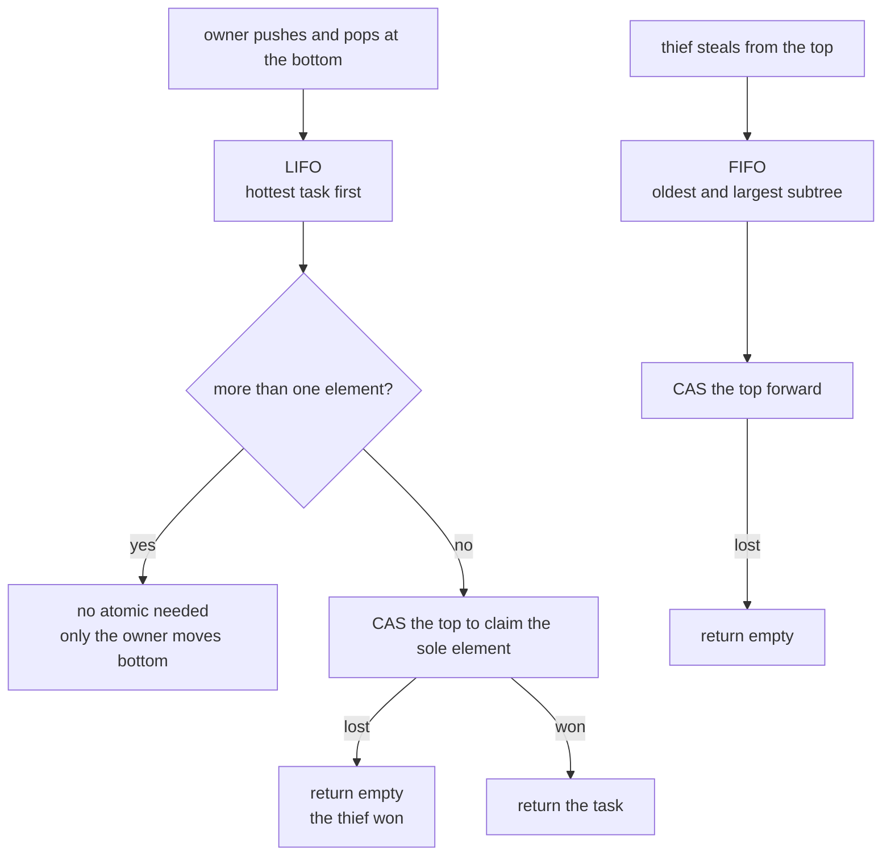
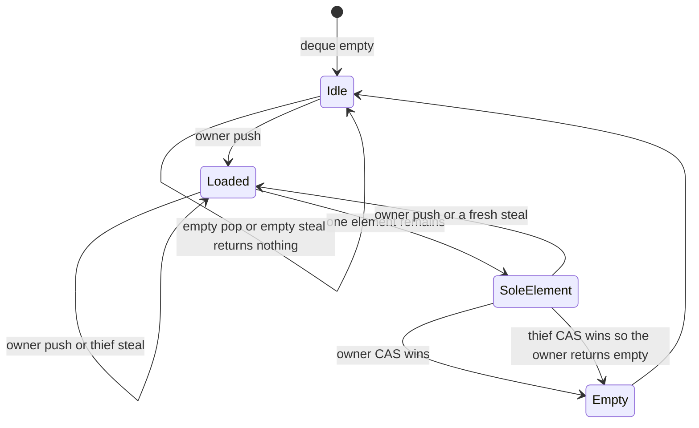
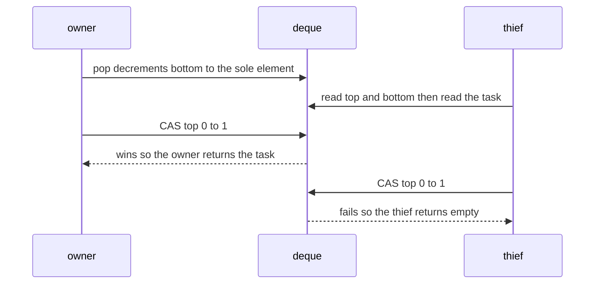

# 626 — Implement work-stealing deque (Chase-Lev) for task scheduler.

> **Tier:** Expert · **CTCI chapter:** Ch 15 — Threads and Locks
> **Task spec:** [626-implement-work-stealing-deque-chase-lev-for-task-scheduler.md](../../../tasks/expert/626-implement-work-stealing-deque-chase-lev-for-task-scheduler.md)
> **Solutions:** [Python](../../../solutions/python/expert/626-implement-work-stealing-deque-chase-lev-for-task-scheduler/solution.py) ·
> [Java](../../../solutions/java/expert/626-implement-work-stealing-deque-chase-lev-for-task-scheduler/Solution.java) ·
> [JavaScript](../../../solutions/javascript/expert/626-implement-work-stealing-deque-chase-lev-for-task-scheduler/solution.js) ·
> [C#](../../../solutions/csharp/expert/626-implement-work-stealing-deque-chase-lev-for-task-scheduler/Solution.cs)

## 1. Problem restatement

Implement the **Chase-Lev work-stealing deque** behind Cilk-style task schedulers: the *owner* thread pushes
and pops at the bottom (LIFO — the hottest task runs first, which is what makes stealing cache friendly),
while *thieves* take from the top (FIFO — the oldest, hence largest, subtree).

- **Input:** per-worker deques (a circular array with absolute `top`/`bottom` counters), a set of tasks with
  optional dependencies, and a schedule of owner and thief steps.
- **Output:** which worker executed which task, plus the counters: resizes, owner pops, steals, empty pops and
  lost races (`cas_failures`), together with the deque-length invariant.
- **Owner side:** `push(task)` writes at `bottom` and increments it; `pop()` decrements `bottom`, reads the
  task, and — only in the *sole element* case — CASes `top` forward.
- **Thief side:** `steal()` reads `top`/`bottom`, reads the task at `top`, and CASes `top` forward; a failed
  CAS means somebody else took it.

**Modelling contract.** No threads and no timers. The interleaving is explicit: the driver can pause the
owner's pop between reading `top` and its last-element CAS, and pause a thief between reading the bounds and
its CAS, so the single race that makes this structure subtle is schedulable and reproducible. Every CAS
compares the current value, so a lost race shows up as a `cas_failures` increment instead of being scripted.
Two documented sketch limitations: growth doubles a plain list rather than Chase-Lev's reference-counted
cyclic arrays (so a resize is *not* interleaved with a steal here), and the owner is assumed to be the only
thread that pushes, pops and grows the array.

Concrete expected results (all asserted):

- Owner pops observe **LIFO** and thieves observe **FIFO**, cross-checked against an array model that pops at
  the back and shifts at the front; a task is handed out **at most once** under any interleaving, and the
  loser of the sole-element race gets an empty result rather than a duplicate.
- Growth preserves the logical contents: the growth test performs **5** resizes up to a capacity of **128**,
  and `queued + executed == total` holds after every single operation.
- Balanced run: four workers and 64 tasks end with loads `[16, 16, 16, 16]` after 64 steps and **48** steals —
  work stealing actually balances the run.
- Dependency chain: 248 steps with only **4** steals and 182 requeues leave the work mostly on one worker
  (`loads = [62, 1, 0, 1]`), which is the locality the LIFO owner end exists to provide; fewer than 64 lost
  sole-element races are recorded across the whole scheduler run.

## 2. Intuition

A single shared task queue makes every worker contend on the same pointer; a scheduler wants the opposite —
each worker should be able to grab its *own* next task without any synchronization at all. That is the owner
end of the deque: `push` and `pop` touch `bottom`, which only the owner writes, so the common path needs no
atomic operation.

The subtlety is that thieves also want tasks, and they take from the other end:

- **LIFO for the owner** keeps the working set hot: the task just spawned is the one the owner runs next, so
  its operands are still in cache.
- **FIFO for thieves** takes the *oldest* task, which is the one furthest up the recursion tree — by far the
  largest chunk of pending work, which is why stealing pays off at all.

The problem is the moment when only one element remains. The owner decrements `bottom`, reads the task, and
must decide whether it still owns it — but a thief may already have taken it. A single CAS on `top` settles
it: whoever wins the CAS gets the element, and the loser must return *empty*, not a duplicate. Precisely for
that reason the owner's pop is the only owner operation that needs an atomic, and it needs it only in the
one-element case.



## 3. Algorithm

1. Keep a circular array of size `1 << log_size` with absolute, monotonically increasing counters `top` and
   `bottom`; an index is `counter & mask`.
2. `push(task)`: grow if `bottom - top` has reached the capacity, then store at `bottom & mask` and increment
   `bottom`.
3. `pop()` (owner): decrement `bottom` first and read `top`.
   - If `top > bottom`, the deque is empty: restore `bottom` to `top`, count an empty pop and return the empty
     result.
   - Read the task at `bottom & mask`. If `top == bottom` this is the sole element, so CAS `top` from `top` to
     `top + 1`: on success the owner wins, on failure the thief won and the owner returns empty (and moves
     `bottom` past the element so the invariants hold).
   - Otherwise return the task directly — no atomic is required, because only the owner moves `bottom`.
4. `steal()` (thief): read `top` and `bottom`; if `top >= bottom` the deque looks empty, so return empty.
   Read the task at `top & mask`, then CAS `top` forward; a failed CAS means another thief or the owner's
   sole-element pop got there first, so the thief returns empty.
5. `_grow()` doubles the array and re-indexes the live elements into the new mask — the owner's job, done
   before the new `bottom` is published.
6. Scheduler harness: a deterministic thief policy steals from the longest other deque; every step re-checks
   the invariant `queued + executed == total`, so a lost or duplicated task is caught immediately.

```text
procedure push(task)
    if bottom - top >= capacity then grow()
    array[bottom & mask] ← task
    bottom ← bottom + 1

procedure pop()
    bottom ← bottom - 1
    top_now ← top
    if top_now > bottom then
        bottom ← top_now                        // top overtook bottom: empty
        empty_pops ← empty_pops + 1
        return empty
    task ← array[bottom & mask]
    if top_now = bottom then                    // the sole element: the only owner CAS
        if cas(top, top_now, top_now + 1) is false then
            bottom ← top_now + 1                // lost the race; the thief owns the task
            cas_failures ← cas_failures + 1
            return empty
        bottom ← top_now + 1
        pops ← pops + 1
        return task
    pops ← pops + 1
    return task

procedure steal()
    top_now ← top
    bottom_now ← bottom
    if top_now >= bottom_now then return empty
    task ← array[top_now & mask]
    if cas(top, top_now, top_now + 1) is false then
        cas_failures ← cas_failures + 1
        return empty                            // another thief or the owner won
    steals ← steals + 1
    return task

procedure grow()
    new_log ← log_size + 1
    new ← array of size 1 << new_log
    for i ← top to bottom - 1 do
        new[i & ((1 << new_log) - 1)] ← array[i & mask]
    array ← new, log_size ← new_log, resizes ← resizes + 1
```



## 4. Worked example

The sole-element race, in both interleavings, with a deque holding exactly one task `t`.

| Step | Actor | `top` / `bottom` | Action | Outcome |
| --- | --- | --- | --- | --- |
| 1 | owner | `0 / 1` | `pop` decrements `bottom` to 0, reads `top` = 0 | `top == bottom`: sole element |
| 2 | thief | `0 / 0` | reads `top` = 0, `bottom` = 0, reads the task at index 0 | parks (`read_bounds`) |
| 3 | owner | `0 / 0` | CAS `top` 0 → 1 **succeeds** | owner returns `t`, `pops = 1` |
| 4 | thief | `1 / 0` | CAS `top` 0 → 1 **fails** (top is already 1) | thief returns empty, `cas_failures += 1` |

Reversing steps 2 and 3 gives the other outcome: the thief's CAS runs first, so the thief returns `t` and the
owner's own CAS fails and must report empty. Exactly one of the two ever returns the task, which is the "no
element is handed out twice" invariant, and the loser's empty result is what keeps the scheduler from
duplicating work.



Growth is the other mechanical part: pushing into a full array doubles it — the growth test reports **5**
resizes to a capacity of **128** — and the live elements are re-indexed under the new mask, so the logical
contents are unchanged. The scheduler runs then show what the two ends are for:

| Run | Workers / tasks | Steps | Steals | Final loads |
| --- | --- | --- | --- | --- |
| Balanced spawn | 4 / 64 | 64 | 48 | `[16, 16, 16, 16]` |
| Dependency chain | 4 / 64 with requeues | 248 | 4 | `[62, 1, 0, 1]` |

In the balanced run, 48 steals move tasks from whoever is ahead to whoever is idle, and the loads end
perfectly even. In the dependency chain, most tasks depend on their predecessor, so a task that is requeued
stays with its owner: only **4** steals happen in 248 steps and worker 0 keeps 62 of the 64 tasks. That is not
a failure of stealing — it is the locality the LIFO owner end was designed to produce, and it is why the
scheduler asserts `queued + executed == total` after *every* operation rather than only at the end.

## 5. Complexity

With `c` the array capacity, `n` live tasks and `s` steps of the schedule.

| Operation | Best | Average | Worst | Why the bound holds |
| --- | --- | --- | --- | --- |
| `push` (owner) | O(1) | O(1) | O(1) amortised | one store and one increment of `bottom`, which only the owner writes; a growth doubles the array and is amortised |
| `pop` (owner) | O(1) | O(1) | O(1) plus one CAS in the sole-element case | decrement, read, and only for the last element a CAS on `top` |
| `steal` (thief) | O(1) | O(1) | O(1) plus a possible failed CAS | two counter reads plus one CAS; failure costs nothing but a retry by the caller |
| Empty checks | O(1) | O(1) | O(1) | a counter comparison on either end |
| `grow` | O(c) | O(c) | O(c) | it copies the live elements under the new mask; the measured test resized 5 times to capacity 128 |
| Scheduler run | O(n) | O(n + requeues) | O(s) | the balanced run needs 64 steps for 64 tasks; the dependency chain needs 248 steps because of 182 requeues |
| Memory | O(c) | O(c) | O(c) | the circular array; reference-counted arrays would add a per-thief pin, which this sketch omits |
| Contention | none on the owner path | one CAS per sole-element pop or steal | — | `bottom` is owner-only, so the only shared pointer is `top` |

The comparison that motivates the whole design is with a *shared* queue: every push and pop then contends on
the same pointer, so all `k` workers serialize on it, and a stalled thread can hold up the others. With one
deque per worker, the owner path is contention-free and steals are the only shared operation — 48 steals for
64 tasks in the balanced run, 4 in the sequential one. The cost is memory proportional to the total number of
queued tasks and the fact that a thief's CAS can fail (which is why the reported lost races stay below 64
across the run). The real Chase-Lev algorithm additionally uses reference-counted cyclic arrays so that a
resize can overlap a steal, and deferred reclamation of the retired array is the general solution
→ [623 — hazard pointers memory reclamation in concurrent structures](../../../tasks/expert/623-implement-hazard-pointers-memory-reclamation-in-concurrent-struc.md);
the read-mostly variant of the same problem → [624 — RCU-style read-copy-update sketch with tests](../../../tasks/expert/624-implement-rcu-style-read-copy-update-sketch-with-tests.md).

## 6. Pitfalls and edge cases

- **The owner decrements `bottom` before reading anything.** That is what makes the last element racy; if the
  CAS fails, `bottom` has to be moved past the element so the counters stay consistent.
- **`top > bottom` means empty, not "one element".** The owner's pop must restore `bottom` to `top` in that
  case; forgetting it corrupts every later operation.
- **Only the sole-element pop needs a CAS.** Adding atomics to the common path costs cache locality for no
  safety gain — `bottom` is written by the owner alone.
- **A failed CAS must return empty, not a retry with the stale task.** The thief's read of the array slot can
  be stale by the time the CAS runs, so returning the value it read would hand out a duplicate.
- **Growth belongs to the owner, before the new `bottom` is published.** A thief must never observe a `bottom`
  that points into an array the owner has not finished copying; the sketch documents that it does not
  interleave a resize with a steal, which is exactly the case the reference-counted arrays of the real
  algorithm exist to handle.
- **Absolute counters, masked indices.** `top` and `bottom` only ever increase, so the mask has to be applied
  at every array access; comparing counters instead of indices is what makes full-versus-empty unambiguous
  (they are equal when empty, and `bottom - top` is the length).
- **LIFO and FIFO are both required, and both are asserted.** A model that pops at the back *and* steals at
  the back would pass a naive length check while destroying the scheduler's locality assumptions.
- **Empty steal and empty pop are normal.** Both return the empty result, and the counters (`empty_pops`,
  `steals`) keep them distinguishable in the reports.
- **The invariant is checked after every operation**, not at the end: `queued + executed == total` catches a
  task that was lost between a stack and a deque or executed twice.
- **A dependency chain legitimately resists balancing.** 182 requeues with only 4 steals is the measured
  behaviour of a mostly sequential workload; treating it as a failure of the thief policy would be a
  misreading of the result.
- **No memory reclamation story.** The sketch grows arrays and drops the old ones; in a real scheduler the
  retired array must survive until every thief that might still read it is done.
- **Unicode is irrelevant**: tasks are opaque values identified by their keys, compared by value.

## 7. Variants and follow-ups

- One global task queue instead of per-worker deques — the contention this design avoids
  → [621 — scalable concurrent queue (Michael-Scott queue)](../../../tasks/expert/621-implement-scalable-concurrent-queue-michael-scott-queue.md)
  and its wait-free successor → [625 — wait-free queue algorithm, Kogan-Petrank style outline](../../../tasks/expert/625-implement-wait-free-queue-algorithm-kogan-petrank-style-outline.md).
- Making a resize safe while thieves are active, by deferring the reclamation of the old array
  → [623 — hazard pointers memory reclamation in concurrent structures](../../../tasks/expert/623-implement-hazard-pointers-memory-reclamation-in-concurrent-struc.md).
- A scheduler that hands each task a *snapshot* of the work graph instead of a deque entry, so readers need no
  synchronization at all → [624 — RCU-style read-copy-update sketch with tests](../../../tasks/expert/624-implement-rcu-style-read-copy-update-sketch-with-tests.md).
- Checking that a stealing schedule's per-worker history is linearizable against the task list
  → [618 — linearizability checker for concurrent histories](../../../tasks/expert/618-implement-linearizability-checker-for-concurrent-histories.md).
- Replacing the speculative validation of a critical section with exactly this pattern of owner-only fast
  paths plus a rare CAS → [620 — lock-elision simulation and contention measurement](../../../tasks/expert/620-implement-lock-elision-simulation-and-contention-measurement.md).

## 8. Check yourself

<details><summary>Show answer</summary>
**Why does the owner's pop need a CAS only for the last element?** Because `bottom` is written only by the
owner, so while at least two elements remain no thief can be reading the element the owner pops. At one
element, the owner and a thief can both claim the same slot, and `top` is the shared pointer that decides who
wins.
</details>

<details><summary>Show answer</summary>
**A thief's CAS fails after it already read the task. What must it return?** Empty. Its read of the array slot
is stale by then — the other winner may have taken the element — and returning the value would execute the
same task twice.
</details>

<details><summary>Show answer</summary>
**Why LIFO for the owner but FIFO for thieves?** The owner runs the task it just spawned, which keeps its
operands hot in cache; a thief takes the oldest pending task, which is the largest remaining subtree and
therefore the best use of a steal. The two ends are different by design.
</details>

<details><summary>Show answer</summary>
**The dependency chain produced 62 of 64 tasks on one worker. Is the thief policy broken?** No — the tasks
depend on their predecessors and are requeued to their owner, leaving almost nothing to steal. The balanced
spawn run shows the same policy reaching `[16, 16, 16, 16]`, so the policy balances what is actually
stealable.
</details>

<details><summary>Show answer</summary>
**Why is `queued + executed == total` checked after every operation?** Because a lost or double-executed task
would be invisible at the end if the counts happened to cancel out; checking continuously localizes the
failure to the operation that caused it.
</details>
