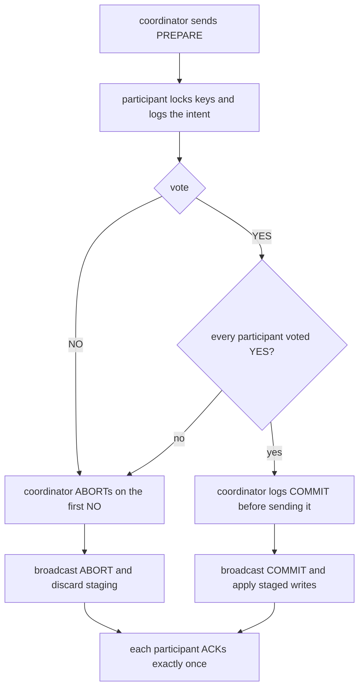
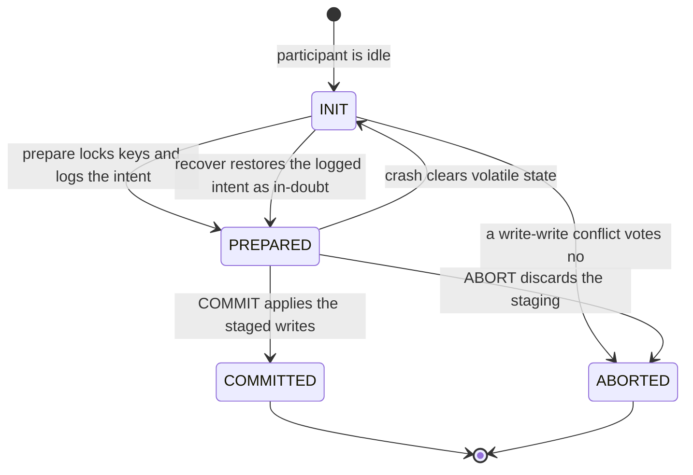
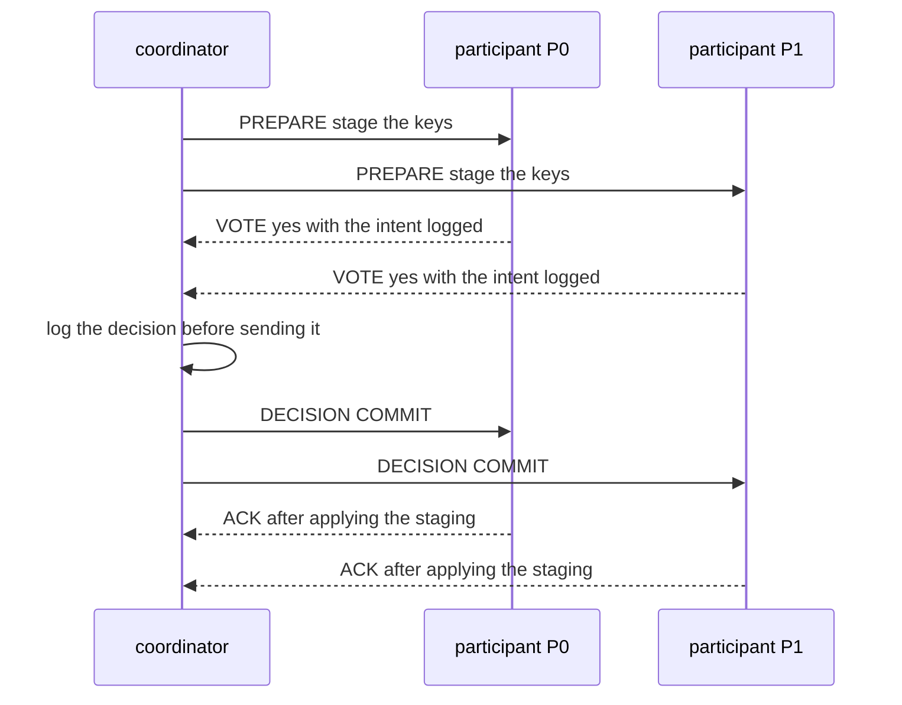

# 627 — Implement transactional key-value store with two-phase commit simulation.

> **Tier:** Expert · **CTCI chapter:** Ch 9 — System Design and Scalability
> **Task spec:** [627-implement-transactional-key-value-store-with-two-phase-commit-si.md](../../../tasks/expert/627-implement-transactional-key-value-store-with-two-phase-commit-si.md)
> **Solutions:** [Python](../../../solutions/python/expert/627-implement-transactional-key-value-store-with-two-phase-commit-si/solution.py) ·
> [Java](../../../solutions/java/expert/627-implement-transactional-key-value-store-with-two-phase-commit-si/Solution.java) ·
> [JavaScript](../../../solutions/javascript/expert/627-implement-transactional-key-value-store-with-two-phase-commit-si/solution.js) ·
> [C#](../../../solutions/csharp/expert/627-implement-transactional-key-value-store-with-two-phase-commit-si/Solution.cs)

## 1. Problem restatement

Simulate **two-phase commit (2PC)**: a write set that spans several participants becomes atomic — either
every participant applies it or none does — using a coordinator that collects votes and then broadcasts a
single decision.

- **Phase one:** the coordinator sends `PREPARE`; each participant locks the keys it will write, appends the
  *intent* to its write-ahead log and answers `YES` or `NO`.
- **Phase two:** the coordinator writes its decision to its own log **first** and then broadcasts `COMMIT`
  (apply the staged writes) or `ABORT` (discard them), each participant acknowledging it.
- **Recovery:** the coordinator's decision log is the single source of truth, so a phase-two message that
  never arrived is retried until every participant has applied the decision exactly once.

**Modelling contract.** No real processes, sockets, disks or clocks: messages travel through an in-memory
FIFO queue, delivery is driven step by step by the harness, and a crash is modelled by clearing *volatile*
state — staging area, locks, phase — while the WAL and the committed data survive. The checks therefore
verify the **protocol logic** (atomicity, vote rules, idempotent recovery, snapshot reads), not real
durability. One property is modelled, deliberately not solved: 2PC is *blocking*, so a participant that voted
`YES` and then hears nothing stays prepared — it cannot decide alone, which is exactly why real systems bolt
on a termination protocol or three-phase commit.

Concrete expected results (all asserted):

- Happy path with two participants: **8** messages (2 `PREPARE`, 2 `VOTE`, 2 `DECISION`, 2 `ACK`), none
  dropped, **4** WAL records (coordinator `begin` + `decision`, one `prepared` intent per participant), and
  both participants' decisions equal `COMMIT`.
- Staged writes are invisible: a reader sees the old value until the decision message is applied, and locks
  are held until then.
- A write-write conflict produces a `NO` vote (with the conflicting keys named), and **one `NO` is enough**
  for the coordinator to decide `ABORT`; the voter may abort alone because it never prepared.
- A participant that crashes before voting plus a coordinator timeout ends in `ABORT` with no partial write;
  a coordinator that crashes after prepare leaves participants **in-doubt**, and recovery either re-broadcasts
  the logged decision or restores the durable intent (locks and staging) so the run can be re-driven.
- Recovery is idempotent: redelivering a decision to a participant that already applied it only re-acknowledges
  and never applies it twice.
- The deliberately buggy coordinator that commits when **any** participant prepared breaks atomicity on the
  very same scenarios, so the atomicity check is not vacuous.

## 2. Intuition

A single participant can make a write atomic with a log: append, apply, done. With several participants the
hard part is not the write but the *agreement* — participant A may have applied a transfer's debit while
participant B crashes before applying the credit, and no local rule can detect that.

Two ideas make it work. First, **prepare means "I can and will do it"**: the participant validates the write
set (a write-write conflict is a `NO`), takes locks, persists the intent, and then waits. Until the decision
arrives the staged data is *invisible* and the keys stay locked — a reader can never observe half a
transaction. Second, **the coordinator's decision is written to its own log before it is sent**. That
ordering is what makes recovery possible: if the coordinator crashes right after deciding, a restart replays
the log, learns the decision and re-broadcasts it; if it crashes *before* deciding, the transaction is simply
aborted by timeout.



The residual problem is the *in-doubt* state: a participant that voted `YES` and whose coordinator then
disappeared holds locks and cannot decide on its own, because another participant may already have been told
`COMMIT`. That is the blocking property, and the simulation demonstrates it rather than hiding it — recovery
is only possible once the decision is known, from the coordinator's log or from a termination protocol.

## 3. Algorithm

1. `start(writes_by_participant)` logs `begin` at the coordinator and sends one `PREPARE` per participant
   carrying that participant's slice of the write set.
2. A participant on `PREPARE`:
   - if it is already prepared for this transaction, re-send its `YES` (idempotent retry);
   - compute the keys it cannot lock — a write-write conflict — and on conflict log `vote_no`, enter the
     aborted state (legal, because it never prepared) and answer `NO` with the conflicting keys;
   - otherwise lock every key, stage the writes, log the `prepared` intent, enter the prepared state and
     answer `YES`.
3. The coordinator on a `VOTE`: reset its timeout, record the vote, decide `ABORT` immediately if the vote is
   `NO`, and otherwise decide once all votes are in — `COMMIT` only if every one of them was `YES`.
4. `decide(decision)` logs the decision **before** sending it, enters the decided state and broadcasts
   `DECISION` to every participant; a second call is refused, so a decision is made exactly once.
5. A participant on `DECISION`: if it already applied this decision, just acknowledge again; otherwise log the
   decision, apply it (`COMMIT` applies the staging to the data, `ABORT` discards it), release its locks and
   acknowledge.
6. Timeouts: the coordinator's tick clock advances only while the network is idle, so a missing vote is not
   mistaken for quiescence; when it reaches the timeout it decides `ABORT`.
7. Crash and recovery: `crash()` clears volatile state only; `recover()` on a participant replays the WAL —
   a logged decision is re-applied, a logged intent restores staging and locks as in-doubt — and `recover()`
   on the coordinator reads its decision back from the log; `resend_decision()` re-broadcasts it.
8. The harness checks after **every** delivered message: no participant is committed while another is
   aborted, all decisions that exist are identical, uncommitted staging is invisible to readers, and no `NO`
   vote or crash leaves a partial write.

```text
procedure participant.on_prepare(writes)
    if state = PREPARED and txn is this transaction then
        send VOTE with yes                       // idempotent retry
        return
    conflicts ← keys in writes locked by somebody else
    if conflicts is not empty then
        wal.append("vote_no", txn, conflicts)
        state ← ABORTED, decision ← ABORT
        send VOTE with no and the conflicting keys
        return
    for each key in writes do locks[key] ← txn
    staging ← writes
    wal.append("prepared", txn, staging)
    state ← PREPARED
    send VOTE with yes

procedure coordinator.decide(decision)
    if self.decision is not none then return false
    self.decision ← decision
    wal.append("decision", txn, decision)         // logged BEFORE it is sent
    for each participant do send DECISION with decision
    return true

procedure participant.on_decision(decision)
    if self.decision = decision and state is COMMITTED or state is ABORTED then
        send ACK, return                          // idempotent: never applied twice
    wal.append("decision", txn, decision)
    if decision = COMMIT then data ← data + staging
    else discard staging
    release every lock held for txn
    send ACK

function participant.recover()
    if a decision record exists in the wal then
        re-apply that decision and return "replayed-decision"
    if a prepared record exists then
        restore staging and locks from it and return "in-doubt"
    return "clean"
```



## 4. Worked example

The happy path with participants `P0`, `P1` and coordinator `C`:

| Message | Sender → receiver | Kind | Effect |
| --- | --- | --- | --- |
| 1 | `C` → `P0` | `PREPARE` | `P0` locks its keys, logs the intent, stages the writes |
| 2 | `C` → `P1` | `PREPARE` | `P1` locks its keys, logs the intent, stages the writes |
| 3 | `P0` → `C` | `VOTE yes` | vote recorded |
| 4 | `P1` → `C` | `VOTE yes` | all votes in → `COMMIT` |
| 5 | `C` → `P0` | `DECISION COMMIT` | decision already logged → applies the staging |
| 6 | `C` → `P1` | `DECISION COMMIT` | applies the staging |
| 7 | `P0` → `C` | `ACK` | acknowledged |
| 8 | `P1` → `C` | `ACK` | acknowledged |

Eight messages, none dropped, and four WAL records: the coordinator's `begin` and `decision` plus one
`prepared` intent on each participant — exactly the summary the run prints
(`messages=8 dropped=0 delivered=8 wal-records=4 decisions={'P0': 'COMMIT', 'P1': 'COMMIT'}`).

Now the failure paths, each of which the harness drives on purpose:

| Scenario | What happens | Outcome |
| --- | --- | --- |
| Write-write conflict | `P1` finds a key locked by another transaction, votes `NO` naming the keys | `P1` may abort on its own (it never prepared); `C` decides `ABORT` on the first `NO`; `P0` discards its staging |
| Participant crashes before voting | The network drops that participant's traffic; `C`'s idle tick clock reaches the timeout | `ABORT`, no partial write anywhere |
| Coordinator crashes after prepare | Participants hold locks with staging and no decision, `recover()` reports `in-doubt` | The run is blocked until the decision is learned; the durable intent restores the locks and the protocol can be re-driven |
| Decision lost to a crashed participant | The coordinator recovers its decision from the WAL and calls `resend_decision()` | The restarted participant applies it once; the harness then reports all decisions identical |
| Duplicate decision delivery | The participant is already committed for that transaction | It only acknowledges again — idempotent, so nothing is applied twice |



The buggy control closes the loop: a coordinator that commits as soon as *any* participant has prepared
breaks the all-or-nothing invariant on these same scripts, so the atomicity check has to notice — which is
the evidence that the check has teeth rather than always agreeing with the code under test.

## 5. Complexity

With `n` participants, `k` keys per participant and `L` the length of a node's WAL.

| Quantity | Best | Average | Worst | Why the bound holds |
| --- | --- | --- | --- | --- |
| Messages per transaction | 4n | 4n | 4n plus retries | one `PREPARE` and one `DECISION` per participant, plus one `VOTE` and one `ACK` back — 8 messages for the two-participant happy path |
| `PREPARE` handling per participant | O(k) | O(k) | O(k) | one lock test, one lock and one WAL append per key |
| Coordinator decision | O(1) | O(n) | O(n) | it waits for `n` votes; the first `NO` short-circuits to `ABORT` |
| `COMMIT` apply | O(k) | O(k) | O(k) | it copies the staged writes into the committed data and releases the locks |
| WAL append | O(1) | O(1) | O(1) amortised | 4 records for the happy path; appends are sequential |
| Recovery | O(L) | O(L) | O(L) | the participant scans its log for the last decision, then for a `prepared` intent |
| Redelivery | O(n) | O(n) | O(n) | `resend_decision` re-broadcasts to every participant, and each application is idempotent |
| Availability cost | — | — | unbounded while in-doubt | a prepared participant holds locks until a decision is known; that is 2PC's blocking property, not a bug in the sketch |
| Space | O(k) | O(k) | O(k) per node plus the WAL | staging, locks and log records; the committed data is the only state that survives a crash besides the WAL |

The comparison with single-node transactions is instructive: a one-participant transaction still pays the
four-message round trip in this protocol, which is why real systems use a replicated decision (consensus or
three-phase commit) rather than a single coordinator. The alternative that removes the blocking is 3PC or a
replicated log → [628 — distributed consensus simulation with network partitions](../../../tasks/expert/628-implement-distributed-consensus-simulation-with-network-partitio.md),
and the snapshot variant that reads the store without stopping it (and without locking) is
→ [617 — consistent snapshot across shards simulation](../../../tasks/expert/617-implement-consistent-snapshot-across-shards-simulation.md).

## 6. Pitfalls and edge cases

- **Log the decision before sending it.** If the coordinator sends first and crashes, a restart cannot know
  what it promised; the ordering is the entire recovery story, and the harness asserts it.
- **A `NO` voter may abort alone, a preparer may not.** The voter never prepared, so aborting is safe;
  a prepared participant that decides on its own can contradict a `COMMIT` that another participant already
  applied.
- **Staging must stay invisible.** Readers see only committed data, so a transaction that never decides
  leaves no trace, and the checks read the store between prepare and decision to prove it.
- **Locks are held until the decision is applied.** A participant still holds them while in-doubt, which is
  what makes a second transaction touching the same keys fail with a conflict rather than corrupting data.
- **A prepared participant refuses a second transaction** and answers a repeated `PREPARE` with the same
  `YES` — retries must not double-apply or double-lock.
- **Crashes clear volatile state only.** Staging and locks are lost; the WAL and committed data survive, which
  is why `recover()` can report `in-doubt` and rebuild the locks from the logged intent.
- **A timeout must not fire on a live network.** The tick clock advances only while the queue is idle and the
  driver keeps running while a decision is pending, so a missing vote is distinguished from a quiet moment.
- **Idempotent apply is not the same as idempotent ACK.** Redelivering a decision to an already committed
  participant only re-acknowledges; the check is that the data was not touched a second time.
- **An empty write set is legal.** It prepares, votes, and commits without touching any key or lock.
- **All decisions that exist must be identical.** A participant that aborted because it lost a lock conflict
  never prepared, so it may be aborted while the coordinator is still collecting votes; what must never
  diverge is the *committed* outcome.
- **Unicode and key identity.** Keys are compared by value, so different spellings of the same key are
  different keys; the simulations use plain string keys and no normalization.

## 7. Variants and follow-ups

- Replacing the single coordinator's decision with a replicated one, so a crashed coordinator cannot block
  the cluster → [628 — distributed consensus simulation with network partitions](../../../tasks/expert/628-implement-distributed-consensus-simulation-with-network-partitio.md)
  and [629 — dynamic reconfiguration in Raft (joint consensus)](../../../tasks/expert/629-implement-dynamic-reconfiguration-in-raft-joint-consensus.md).
- Reading the sharded store *without* locking it, which is what a snapshot buys over a two-phase lock
  → [617 — consistent snapshot across shards simulation](../../../tasks/expert/617-implement-consistent-snapshot-across-shards-simulation.md).
- Replacing the lock-based conflict test with a causal ordering of writes so that independent transactions
  never conflict at all → [630 — causal consistency protocol simulation](../../../tasks/expert/630-implement-causal-consistency-protocol-simulation-vector-clocks.md).
- Keeping the write-ahead log honest across a partition, where a node must be told to stop serving
  → [631 — gossip protocol for membership and failure detection](../../../tasks/expert/631-implement-gossip-protocol-for-membership-and-failure-detection.md).
- Repairing a participant that applied only part of the history, instead of aborting it
  → [632 — anti-entropy Merkle tree reconciliation demo](../../../tasks/expert/632-implement-anti-entropy-merkle-tree-reconciliation-demo.md).

## 8. Check yourself

<details><summary>Show answer</summary>
**Why does the coordinator write the decision to its log before broadcasting it?** So that a crash between
deciding and sending is recoverable: on restart the log reveals the decision and the coordinator can
re-broadcast it. Sending first would leave a decided-but-unknown outcome.
</details>

<details><summary>Show answer</summary>
**A participant crashes right after voting `YES`. What can it do when it comes back?** Nothing on its own —
it is in-doubt. Its WAL has the `prepared` intent, so `recover()` restores the locks and staging, and it
waits for the decision (or for a termination protocol in a real system). It must not abort unilaterally,
because the coordinator may already have committed elsewhere.
</details>

<details><summary>Show answer</summary>
**Why can the participant that voted `NO` abort alone?** Because it never prepared: it holds no locks and has
logged no intent, so aborting cannot contradict a `COMMIT` — a `COMMIT` requires every vote to be `YES`, so
its `NO` already guarantees the transaction will be aborted.
</details>

<details><summary>Show answer</summary>
**The happy path sends eight messages for two participants. What are they?** Two `PREPARE` messages, two
`VOTE`s, two `DECISION`s and two `ACK`s — a `4n` message pattern, which is why real systems try to keep the
participant set small or replace the coordinator with a replicated decision.
</details>

<details><summary>Show answer</summary>
**The buggy coordinator commits as soon as one participant prepares. Which invariant does that break, and why
does the harness need it?** It breaks all-or-nothing: another participant may abort, leaving half the
transaction applied. The harness runs that control to prove the atomicity check actually detects a violation
instead of agreeing with whatever the coordinator does.
</details>
