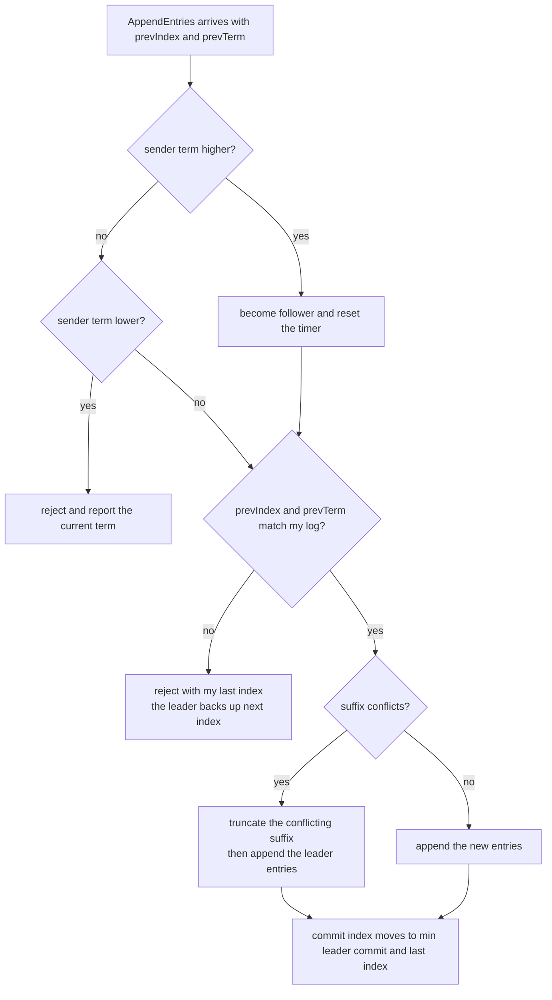
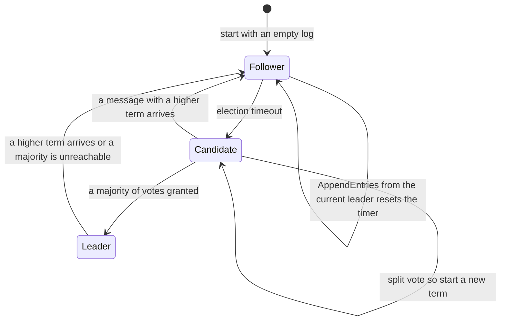
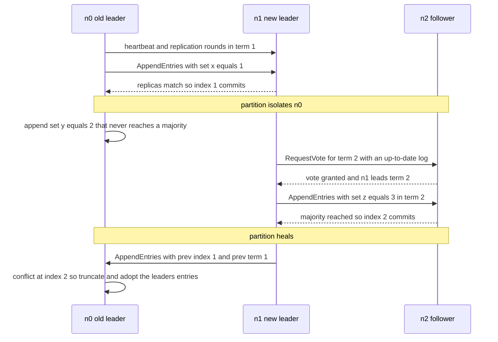

# 628 — Implement distributed consensus simulation with network partitions (Raft test harness).

> **Tier:** Expert · **CTCI chapter:** Ch 9 — System Design and Scalability
> **Task spec:** [628-implement-distributed-consensus-simulation-with-network-partitio.md](../../../tasks/expert/628-implement-distributed-consensus-simulation-with-network-partitio.md)
> **Solutions:** [Python](../../../solutions/python/expert/628-implement-distributed-consensus-simulation-with-network-partitio/solution.py) ·
> [Java](../../../solutions/java/expert/628-implement-distributed-consensus-simulation-with-network-partitio/Solution.java) ·
> [JavaScript](../../../solutions/javascript/expert/628-implement-distributed-consensus-simulation-with-network-partitio/solution.js) ·
> [C#](../../../solutions/csharp/expert/628-implement-distributed-consensus-simulation-with-network-partitio/Solution.cs)

## 1. Problem restatement

Build a **Raft test harness**: leaders elected by a majority of votes, log entries replicated by
`AppendEntries` with the previous-index/previous-term consistency check, and an entry committed only once it
is stored on a majority. Network partitions are explicit, so a minority leader, a re-election and the
subsequent log repair are all reproducible.

- **Input:** a set of node ids, client commands, a driver that ticks the cluster and drains the message
  queue, and scenarios that install partitions, drop messages and crash nodes.
- **Output:** the committed history, the leader of each term, and the counters (steps, messages, dropped
  messages) — plus the safety verdicts asserted after **every tick and every message**.
- **Safety invariants:** Election Safety (at most one leader per term, and a node never votes twice in a
  term), Log Matching (two logs that agree at an index agree on every earlier entry), State Machine Safety
  (an entry applied at an index is never replaced), and Leader Completeness (the current leader holds every
  committed entry).

**Modelling contract.** This is a discrete-event simulation, not a network: `step()` is one tick, every node
then runs its election/heartbeat logic, and the whole message queue is delivered with per-node FIFO and a
fixed node order, so runs are reproducible. The randomised parts of Raft are replaced by **deterministic
stand-ins that the solutions state explicitly**: election timeouts of `3 + node_index` ticks, so the
lowest-numbered live node always wins a fresh election, and heartbeats once per tick. A partition is a list
of groups that can talk among themselves; a loss rate drops every n-th message to exercise retries. Commands
are opaque strings, the replicated state is an ordered list, and snapshots, client deduplication and
membership changes are out of scope — reconfiguration has its own task.

Concrete expected results (all asserted):

- Election and re-election, replication and majority commit; a single-node cluster is its own majority and
  elects itself immediately.
- Partition tests assert the two halves: the **minority** side cannot commit even though the old leader still
  believes it leads, the **majority** side elects a new leader in a higher term and commits, and the minority
  leader's uncommitted entry is **overwritten** when the partition heals and the logs catch up.
- The invariant checker runs across every step of every scenario; the harness's summary line for the final
  scenario reports `leaders_seen={1: 0} steps=9 messages=32 committed=2 dropped=4`.
- A follower truncates only on a genuine conflict, and an entry from an earlier term is never committed by
  counting replicas alone.

## 2. Intuition

A single leader is easy to have and hard to *agree* on. If any node could declare itself leader, two leaders
in one term could accept conflicting commands at the same index; if a leader were chosen by whoever is
fastest, it could be missing entries that a majority already committed. Raft fixes the first with
**majorities** (two majorities of the same cluster always intersect, so two leaders in one term would need a
node to vote twice) and the second with an **up-to-date check**: a voter grants its vote only to a candidate
whose log is at least as up to date (compare `(last_term, last_index)`).

Replication is the same idea applied to entries. Each `AppendEntries` carries the index and term of the entry
*before* the ones being sent. A follower rejects the message when its own log does not match that prefix —
and its rejection carries its last index so the leader can back up and retry from an earlier point. When the
prefix does match but a suffix conflicts, the follower **truncates** the conflicting suffix and takes the
leader's entries. That single rule is what repairs a log written by a leader that has since been deposed.



The commit rule carries one more subtlety, shown in Raft's Figure 8: a follower's commit index only moves
when a leader tells it to, and a leader commits an index only if that entry belongs to the leader's **own
term** and is stored on a majority. An entry from an earlier term can be present on a majority and still be
replaced, precisely because a later leader may not have it. That is why a fresh leader appends a no-op entry
of its own term: committing that one commits everything before it indirectly.

## 3. Algorithm

1. Every node starts as a follower with term 0, an empty log, a commit index of 0 and an election timer
   `3 + node_index`.
2. `tick()`: a leader broadcasts `AppendEntries` (one heartbeat round per tick); a follower increments its
   timer and starts an election at the timeout.
3. `_start_election()`: become a candidate, increment the term, vote for itself, reset the timer, and send
   `RequestVote` with `(last_index, last_term)` to every other node; a cluster of one is already a majority,
   so it becomes leader immediately.
4. `_on_request_vote()`: grant the vote only if the candidate's term is not stale, the candidate's log is at
   least as up to date, and this node has not voted for somebody else in this term; reset the timer on a
   granted vote.
5. `_on_vote_response()`: count votes only while still a candidate in the same term; a majority makes the node
   leader, which initializes `next_index`/`match_index` for every follower, appends a no-op entry of its own
   term if its log is non-empty, and broadcasts.
6. `_broadcast_append()`: per follower, send `prev_index = next_index − 1`, the matching `prev_term`, the
   entries from `prev_index` onwards, and the leader's commit index.
7. `_on_append()`: reject a stale term; otherwise become a follower, reset the timer, and reject the message
   when the prefix does not match (reporting the last index); on a match, truncate any conflicting suffix,
   append the remaining entries, and advance the commit index to `min(leader_commit, last_index)`.
8. `_on_append_response()`: on success record `match_index` and set `next_index = match_index + 1`; on failure
   back `next_index` up to `match_index + 1`. Then `_advance_commit()` scans downward for the highest index
   that is both in the leader's term and replicated on a majority.
9. `append_entry(command)`: only a leader accepts a client command; it appends it to its own log, updates its
   own `match_index`, broadcasts and tries to advance the commit index.
10. The harness checks the invariants after every tick and every delivered message; `history` records each
    committed index once and is never rewritten.

```text
procedure node.tick()
    if state = LEADER then broadcast_append() and return
    ticks ← ticks + 1
    if ticks >= election_timeout then start_election()

procedure node.start_election()
    state ← CANDIDATE, term ← term + 1, voted_for ← self, votes ← 1, ticks ← 0
    for each other node do
        send RequestVote with term, last_index, last_term
    if votes >= majority() then become_leader()

procedure node.on_request_vote(term, candidate, last_index, last_term)
    up_to_date ← (last_term, last_index) >= (self.last_term(), self.last_index())
    granted ← term >= self.term and up_to_date
              and (voted_for is none or voted_for = candidate)
    if granted then voted_for ← candidate, ticks ← 0
    send VoteResponse with granted

procedure node.on_append(term, leader, prev_index, prev_term, entries, leader_commit)
    if term < self.term then send AppendResponse with success = false, return
    become_follower(term), self.leader ← leader, ticks ← 0
    if prev_index > last_index() or (prev_index > 0 and entry(prev_index).term != prev_term) then
        send AppendResponse with success = false and my last index      // the leader backs up
        return
    index ← prev_index + 1
    for each entry in entries do
        if index <= last_index() then
            if entry(index).term != entry.term then                     // conflict
                log ← log[0 .. index - 2]
                log.append(entry)
        else
            log.append(entry)
        index ← index + 1
    if leader_commit > commit_index then
        commit_index ← minimum of leader_commit and last_index()
    send AppendResponse with success = true and my last index

procedure leader.advance_commit()
    for index ← last_index() down to commit_index + 1 do
        if entry(index).term != self.term then continue                  // only my own term
        replicated ← count of nodes whose match_index >= index including myself
        if replicated >= majority() then
            commit_index ← index
            return true
    return false
```



## 4. Worked example

Three nodes `n0`, `n1`, `n2` with timeouts of 3, 4 and 5 ticks. The cluster starts quiet, so `n0` times out
first, wins the election and leads term 1.

| Step | Event | `n0` | `n1` | `n2` | Committed |
| --- | --- | --- | --- | --- | --- |
| Ticks 3 | `n0` times out, term 1, requests votes | candidate | follower | follower | — |
| +1 | both followers grant (their logs are empty, so `n0` is up to date) | leader | follower | follower | — |
| +1 | client command `set x=1` appended at index 1 | log `[(1, "set x=1")]` | — | — | — |
| +2 | `AppendEntries` replicated it to `n1` | match `n1 = 1` | log `[(1, "set x=1")]` | — | index 1 in term 1: majority ✓ |
| Partition | `{n0}` is cut off from `{n1, n2}` | leader (believes it leads) | follower | follower | — |
| +1 | client command `set y=2` at index 2 | log grows to 2 entries | — | — | **not committed**: only 1 of 3 has it |
| +4 | `n1` times out (it no longer hears heartbeats), term 2, requests votes | leader of term 1 | candidate | follower | — |
| +1 | `n2` grants: `n1`'s log is as up to date and `n2` has not voted in term 2 | leader (stale) | leader of term 2 | follower | — |
| +1 | `n1` commits `set z=3` at index 2 in **term 2** | — | 2 entries, majority = itself + `n2` | log matches | index 2 in term 2 ✓ |
| Heal | `n0` receives `AppendEntries` with `prev_index 1`, `prev_term 1` | prefix matches | leader | follower | — |
| +1 | the entry at index 2 has term 2 in the message and term 1 locally | truncates, then takes `(2, "set z=3")` | — | — | the uncommitted `set y=2` is discarded |
| +1 | all three logs equal | `[(1, "set x=1"), (2, "set z=3")]` | same | same | caught up |

The last two rows are the repair Raft is designed for: the minority leader's uncommitted entry is not
"rolled back" by any special case — it simply conflicts with the new leader's entry at the same index, so the
ordinary truncation rule removes it. Note also that the new leader could not have committed the old term-1
entry by counting replicas; it committed its *own* term-2 entry, which carries the earlier one with it.



The harness sweeps several scenarios and asserts the invariants after every step; the summary line printed for
its final scenario is `leaders_seen={1: 0} steps=9 messages=32 committed=2 dropped=4` — one leader in term 1,
nine ticks, 32 messages of which 4 were dropped by the partition, and two committed commands. The single-node
scenario is the smallest one and matters for a different reason: with a cluster of one the majority is
itself, so its election completes in the same call that starts it, and no message is sent at all.

## 5. Complexity

With `n` nodes, `L` the log length, `b` the batch size of an `AppendEntries` and `e` entries appended by the
client.

| Quantity | Best | Average | Worst | Why the bound holds |
| --- | --- | --- | --- | --- |
| `tick` (one node) | O(1) follower | O(1) | O(n) leader | a follower only bumps a counter; a leader sends one message per follower |
| Election | O(n) messages | O(n) | O(n) per round, rounds until a majority responds | one `RequestVote` and one response per peer |
| Replication round | O(n) messages | O(n · b) entries | O(n · b) | one message per follower carrying the entries that follower is missing |
| `AppendEntries` handling | O(1) | O(b) | O(L) | the prefix check is constant time; a conflicting suffix is truncated once |
| Commit decision | O(1) | O(log L · n) | O(L · n) | the scan walks down from the leader's last index and counts matches per candidate index |
| Log repair after healing | O(1) | O(d) messages for a divergence of `d` indices | O(d) | the leader backs up one index per rejection until the prefixes match |
| State machine apply | O(1) | O(e) | O(e) | committed entries are applied in order into the ordered command list |
| Space | O(n) | O(n · L) | O(n · L) | one log per node; snapshots would bound it, and are explicitly out of scope here |
| Availability under partition | majority side keeps committing | — | minority side cannot commit at all | a majority is required, so the minority stalls until it heals — the CP choice |

Compare the alternatives the harness's own framing implies: a single-leader design without majorities can
accept writes in a minority partition and silently lose them when the partition heals. Paxos-style consensus
has the same majority requirement but a different message pattern. 2PC makes a single coordinator's decision
authoritative, which is why it blocks when that coordinator disappears
→ [627 — transactional key-value store with two-phase commit simulation](../../../tasks/expert/627-implement-transactional-key-value-store-with-two-phase-commit-si.md);
Raft replaces that coordinator with a majority-elected, term-ordered log. The cost of Raft's guarantees is
visible in the numbers: 32 messages and 4 dropped ones for a nine-tick scenario, every one of them checked
against the invariants after delivery.

## 6. Pitfalls and edge cases

- **Commit only entries of the leader's own term.** An earlier-term entry present on a majority can still be
  replaced — Raft's Figure 8. Counting replicas alone would commit an entry that a later leader overwrites,
  which is why a new leader appends a no-op entry of its own term.
- **Truncate only on a genuine term conflict.** Overwriting a longer follower log on a shorter prefix, or
  truncating when the terms agree, corrupts committed entries.
- **The prefix check is on `(prev_index, prev_term)`, not on the index alone.** Two nodes can disagree about
  the term at an index, and the term is what distinguishes a matching prefix from a coincidentally equal one.
- **A rejection must report the follower's last index**, otherwise the leader has nothing to back its
  `next_index` up to and the repair cannot converge.
- **A higher term demotes immediately**, whichever message carries it — a candidate that meets a higher term
  becomes a follower and a stale leader steps down as soon as it hears about it.
- **Never vote twice in one term.** The `voted_for` field is per term, and the election-safety invariant
  depends on it: two leaders in one term would need one node to vote twice.
- **The up-to-date check is lexicographic on `(last_term, last_index)`.** Comparing indices alone lets a node
  with a shorter but newer log lose to a longer stale one, which breaks leader completeness.
- **Follower commit indexes only move when a leader says so.** A follower that has an entry on a majority of
  its own knowledge still must not commit it locally; only the leader's `leader_commit` advances it.
- **The deterministic timeouts are a deliberate stand-in.** `3 + node_index` makes the lowest-numbered live
  node the natural winner, so election tests are reproducible — and the trade-off is documented, since real
  Raft randomizes the timeout to avoid persistent split votes.
- **Dropped messages are not faults.** A partition or a loss rate merely forces retries; the verdicts must not
  change because messages vanished, only the number of ticks.
- **Snapshots, client deduplication and membership are out of scope.** An unbounded log, a client whose
  command was applied but whose acknowledgement was lost, and a configuration change are all separate
  problems; the next task covers reconfiguration with joint consensus.
- **Unicode is irrelevant**: commands are opaque strings placed in an ordered list, and uncommitted entries
  carry `None` (the leader's no-op) which the command accessor skips.

## 7. Variants and follow-ups

- Changing the cluster membership *while it is running*, which is the joint-consensus protocol the next task
  covers → [629 — dynamic reconfiguration in Raft (joint consensus)](../../../tasks/expert/629-implement-dynamic-reconfiguration-in-raft-joint-consensus.md).
- The single-coordinator alternative that commits without a majority and blocks when it dies
  → [627 — transactional key-value store with two-phase commit simulation](../../../tasks/expert/627-implement-transactional-key-value-store-with-two-phase-commit-si.md).
- Finding out whether a node is alive *without* a consensus round, which is what the failure detector here
  cannot do → [631 — gossip protocol for membership and failure detection](../../../tasks/expert/631-implement-gossip-protocol-for-membership-and-failure-detection.md).
- Reading a committed state consistently across shards once a log is agreed
  → [617 — consistent snapshot across shards simulation](../../../tasks/expert/617-implement-consistent-snapshot-across-shards-simulation.md).
- Repairing the replicas that fell behind during the partition without shipping whole logs
  → [632 — anti-entropy Merkle tree reconciliation demo](../../../tasks/expert/632-implement-anti-entropy-merkle-tree-reconciliation-demo.md).
- Ordering writes by causality rather than by a leader, for the workloads that do not need a total order
  → [630 — causal consistency protocol simulation](../../../tasks/expert/630-implement-causal-consistency-protocol-simulation-vector-clocks.md).

## 8. Check yourself

<details><summary>Show answer</summary>
**Why can two leaders not be elected in the same term?** Because winning requires a majority of votes and a
node grants at most one vote per term. Two majorities of the same cluster intersect, so some node would have
to vote twice — which the `voted_for` field prevents, and which the election-safety invariant checks after
every message.
</details>

<details><summary>Show answer</summary>
**The old leader in the minority partition kept appending entries. Why did none of them commit?** Committing
requires replication on a majority, and only the old leader had those entries. Its logs were still
well-formed — it simply could not reach a majority, so the entries stayed uncommitted and were discarded at
the next conflict.
</details>

<details><summary>Show answer</summary>
**How is the minority leader's uncommitted entry removed when the partition heals?** By the ordinary
truncation rule: the new leader's `AppendEntries` carries an entry at the same index with a different term,
so the follower truncates its conflicting suffix and adopts the leader's entries. No special recovery code is
needed.
</details>

<details><summary>Show answer</summary>
**Why does a fresh leader append an entry of its own term even with nothing to write?** Because
earlier-term entries cannot be committed by counting replicas — a later leader might not have them. Appending
a no-op of the current term gives the leader something it *can* commit, and committing it commits everything
before it indirectly.
</details>

<details><summary>Show answer</summary>
**A follower is missing entries 5 to 9 and its log ends at index 4. What happens next?** The leader's
`AppendEntries` with `prev_index = 9` is rejected, and the rejection reports the follower's last index 4, so
the leader backs `next_index` up and retries from an earlier point — the repair converges one rejection batch
at a time rather than shipping the whole log.
</details>
